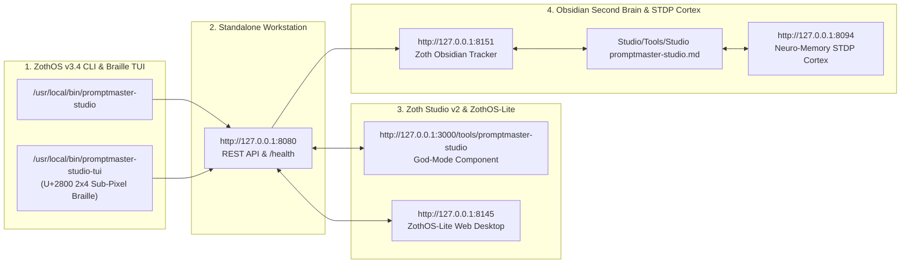

# PromptMaster Studio (`promptmaster-studio`)

> **100% Free & Open-Access Prompt Engineering, Static AST Linter, Multi-Model Dialect Optimizer (Claude XML, OpenAI Strict JSON, Gemini, DSPy, Ollama), Adversarial Red-Team Scanner, Chain-of-Verification (CoVe) & MCP Server.**
> Engineered by **1nc0gn30 (@1nc0gn30)** • **NullAI Platform**

---

## 1. Executive Summary & Architectural Overview

**PromptMaster Studio** (`promptmaster-studio`) is a zero-dependency Python 3.12+ and browser-native prompt engineering suite designed for both deterministic CLI automation and interactive multi-pane browser optimization:

1. **Static AST Linter (`linter.py`)**: Evaluates raw system and user prompts across Clarity, Security, Structure, and Positive-to-Negative Constraint Ratio, detecting injection vectors (`ignore previous instructions`), missing output format specifications, and ambiguous quantifiers.
2. **Multi-Target Meta-Optimizer (`meta_optimizer.py`)**: Compiles unstructured prompts into provider-native schemas (`anthropic_xml`, `openai_chat`, `google_gemini`, `generic_markdown`) with optional Chain-of-Thought (`<thinking_process>`) scaffolding and Mustache (`{{ variable }}`) interpolation.
3. **Adversarial Red-Team & Chain-of-Verification (`v3_enhancements.py`)**: Executes 10-vector adversarial jailbreak/injection audits (`redteam`), 4-stage Chain-of-Verification (`cove`) hallucination-prevention pipelines, and Society-of-Mind (`debate`) ensembles.
4. **Prompt Diff & Version History (`prompt_diff.py`, `version_history.py`)**: Computes token deltas, structural XML tag diffs, and Git-style branched prompt version history.

---

## 2. Step-by-Step Visual Verification Gallery (12 Real Screenshots)

### Step 01 — Developer Perspective: Repository Architecture & Binary Verification
Inspecting `~/NullAITech/promptmaster-studio/src/promptmaster_studio/` (`cli.py`, `ui_server.py`, `mcp_server.py`, `models.py`, `engine/`) and verifying global ZothOS binary parity (`which -a promptmaster-studio` and `promptmaster-studio doctor`).

---

### Step 02 — Developer Perspective: Automated Pytest Verification Suite (`248 passed`)
Running the full 248-test automated verification suite (`pytest tests/ -v`) covering adversarial jailbreak detection, CLI subcommands, CoVe/debate, curriculum DB, few-shot ranker, static linter, MCP JSON-RPC server, meta-optimizer, prompt diff/history, template engine, tokenizer estimator, and UI server.

---

### Step 03 — Developer Perspective: Live HTTP REST API & Linter/Optimizer Contracts (`:8123`)
Querying the live HTTP backend on `http://127.0.0.1:8123` (`GET /api/models`, `POST /api/lint`, and `POST /api/optimize` with `target: "anthropic_xml"`).

---

### Step 04 — End-User ZothOS CLI: 22-Subcommand Matrix & Static AST Linter
Executing `promptmaster-studio --help` to inspect all 22 subcommands (`optimize`, `lint`, `render`, `tokens`, `templates`, `curriculum`, `serve`, `mcp`, `doctor`, `redteam`, `cove`, `debate`, `diff`, `history`, `context`, `migrate`, `batch`, `score`, `export`) and running `promptmaster-studio lint ... --json`.

---

### Step 05 — End-User ZothOS CLI: Multi-Model XML Optimizer & Adversarial Red-Team Scanner
Running `promptmaster-studio optimize ... -t anthropic_xml --cot -p "Principal SOC Architect" --json` and `promptmaster-studio redteam ... --json` (testing 10 adversarial vectors and synthesizing a hardened `<security_policy>` prompt).

---

### Step 06 — End-User ZothOS CLI: Chain-of-Verification (CoVe) & Multi-Dimensional Scoring
Running `promptmaster-studio cove ... --domain security --json` to generate a 4-stage hallucination-prevention verification pipeline, followed by `promptmaster-studio score ... --json`.

---

### Step 07 — End-User Standalone Web Workstation (`:8123`): Optimize Studio & Live Linter
Loading `http://127.0.0.1:8123`, selecting a built-in architecture template with Mustache variables (`{{ codebase_module }}`, `{{ code_snippet }}`), compiling to **Claude XML**, and inspecting the live **97 / 100** Quality & Safety score and multi-model Token Cost Estimator (`119 Tokens`, `$0.000298` GPT-4o, `$0.000357` Claude 3.5 Sonnet, `$0.000012` Gemini 2.0 Flash).

---

### Step 08 — End-User Standalone Web Workstation (`:8123`): Interactive Prompt Diff Engine
Switching to the **⚖️ Prompt Diff** tab on `:8123` to compare a raw baseline prompt (`18 Left Tokens`, `85.0/100` Quality) against a structured XML-tagged security prompt (`65 Right Tokens`, `+47 Token Delta`, `95.0/100` Quality, `role, task, output_format` tags).

---

### Step 09 — End-User Standalone Web Workstation (`:8123`): Version History & Curriculum Drawer
Committing a version snapshot (`v1.0-sarif`) in the **▣ Version History** tab and opening the interactive **▣ Prompt Engineering Curriculum** drawer with one-click example loaders across Beginner, Intermediate, and Advanced mastery modules.

---

### Step 10 — Zoth Studio v2 God-Mode (`:3000/tools/promptmaster-studio`): Claude XML Dialect Compiler
Using the integrated God-Mode workstation inside Zoth Studio v2 (`http://127.0.0.1:3000/tools/promptmaster-studio`) showing real-time static AST diagnostics (`AST Score: 96/100`, `~62 BPE Tokens`) and the **Claude XML** `<system_instructions>` dialect compiler.

---

### Step 11 — Zoth Studio v2 God-Mode (`:3000/tools/promptmaster-studio`): DSPy Signature Compiler
Switching to the **DSPy Signature** tab on `:3000/tools/promptmaster-studio` to synthesize a typed `class SovereignAuditSignature(dspy.Signature)` module with `dspy.InputField` and `dspy.OutputField` contracts.

---

### Step 12 — Mobile 390×844 Viewport Responsive Verification (`overflowPx: 0`)
Verifying mobile layout responsiveness at `390×844` (`deviceScaleFactor: 2`) on `http://127.0.0.1:8123` with zero horizontal scroll overflow (`overflowPx === 0`) and 100% open-access controls.

---

## 3. Support & Attribution

- **100% Free & Open-Access**: Zero paywalls, zero blur locks, and zero license keys required.
- **☕ Buy Us a Coffee (Stripe)**: [https://buy.stripe.com/3cIfZg27PdKo2D64Ocfw40X](https://buy.stripe.com/3cIfZg27PdKo2D64Ocfw40X)
- **◎ Solana Tip Address**: `GG2eQbVh8ut1BK6j1A2tz7pSySdLpD38BgyEhGcxdXoK`

---

## Sovereign 5-Layer Architecture & Second Brain Topology

### ZothOS v3.4 TUI & Obsidian Second Brain Sync
- **Unicode `U+2800` Braille TUI**: `promptmaster-studio-tui --status` / `promptmaster-studio-tui --json`
- **Zoth Obsidian Tracker (`:8151`)**: `zoth-obsidian-tracker --verify`
- **Connected Canon Notes**: [[00 Home]] · [[Zoth OS]] · [[Zoth Studio]] · [[ZothOS-Lite Web Desktop]] · [[Zoth Memory]] · [[Public Surfaces]]
