# 🤖 Regex Droid Studio (`regex-droid-builder`) — Complete Developer & User Walkthrough

> **100% Free & Open-Access Sovereign Utility**: Zero paywalls, zero blur locks, zero telemetry. Support via [☕ Buy Us a Coffee (Stripe)](https://buy.stripe.com/3cIfZg27PdKo2D64Ocfw40X) or Solana (`GG2eQbVh8ut1BK6j1A2tz7pSySdLpD38BgyEhGcxdXoK`).

---

## 🛠️ Part 1: Developer Perspective (Architecture, 90-Test Suite & REST API Contracts)

### Step 1: Repository Architecture & System Diagnostics (`regex-droid-builder doctor`)
Developers inspecting `~/NullAITech/regex-droid-builder` can verify the modular zero-dependency Python package (`src/regex_droid_builder/` containing `ast_engine.py`, `automaton_engine.py`, `redos_detector.py`, `formal_verifier.py`, `dialect_transpiler.py`, `codegen.py`, `mcp_server.py`, and `ui_server.py`), the 12 test modules in `tests/`, and run `regex-droid-builder doctor`.

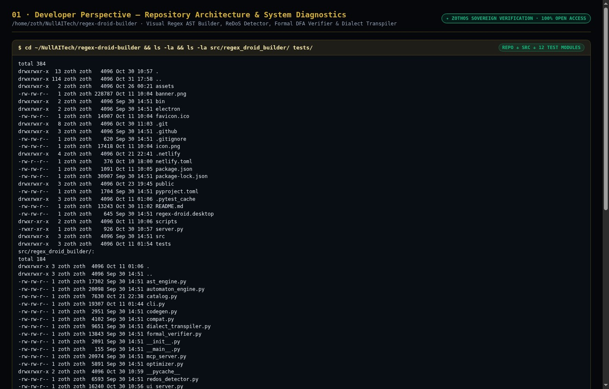

### Step 2: Automated Pytest Verification Suite (`90 passed in 1.36s`)
Running `pytest -v` executes all 90 unit and integration tests covering the recursive-descent AST parser, Thompson NFA and powerset DFA construction, automaton gas metering, Hopcroft/Moore canonical DFA minimization, formal language equivalence ($L(A) == L(B)$), cross-flavor dialect transpilation, FastMCP JSON-RPC tools, and HTTP server endpoints.

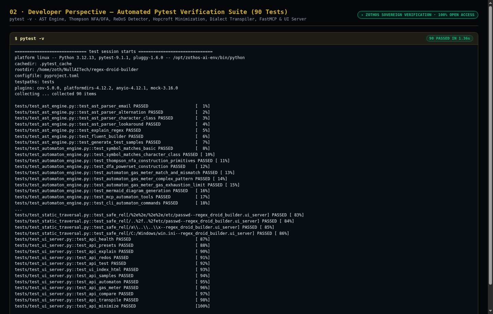

### Step 3: Live HTTP REST API & Formal Verification Contracts (`:8101`)
Developers and local agents can query `GET /api/health`, `POST /api/redos`, and `POST /api/compare` on port `8101` to audit patterns for exponential ReDoS backtracking and formally prove DFA equivalence between two regular expressions.

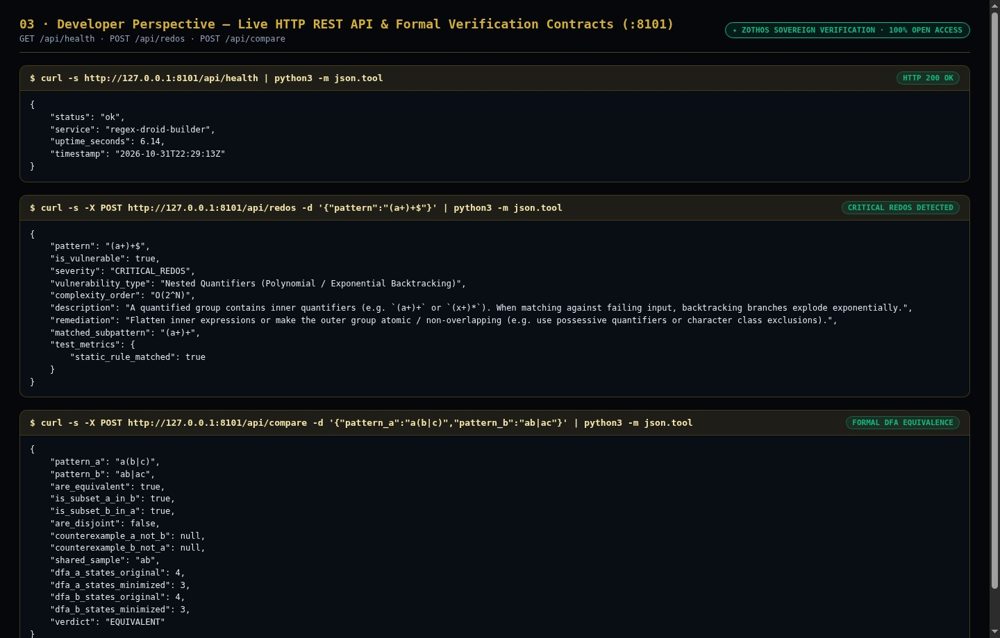

---

## 💻 Part 2: End-User CLI Perspective (14 ZothOS Subcommands)

### Step 4: CLI Help Matrix, Plain-English AST Decomposition & ReDoS Security Audit
Users can run `regex-droid-builder --help`, decompose complex patterns into step-by-step plain-English AST explanations via `regex-droid-builder explain`, and detect catastrophic $O(2^N)$ exponential backtracking traps via `regex-droid-builder audit '(a+)+$'`.

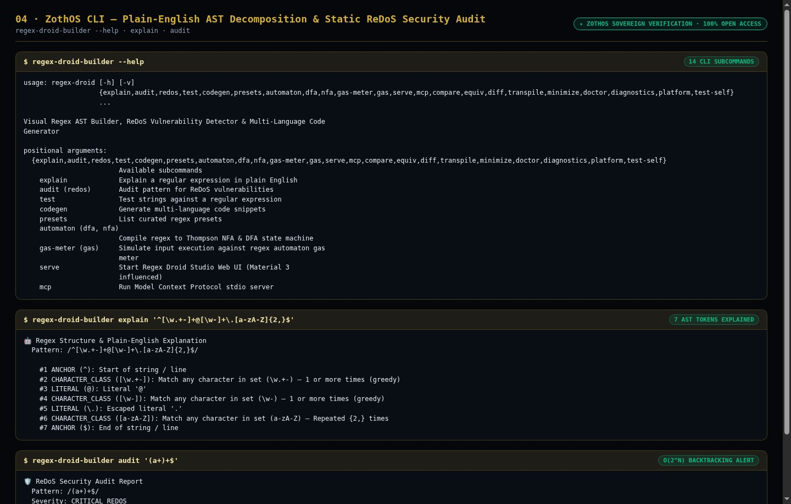

### Step 5: Hopcroft DFA State Minimization, Formal Equivalence & Automaton Gas Meter
Users can minimize state machines with `regex-droid-builder minimize 'a(b|c)*d'` (pruning 5 DFA states down to the canonical 3-state minimal DFA), formally prove `a(b|c)` $\equiv$ `ab|ac` with `regex-droid-builder compare`, and trace step-by-step execution gas consumption with `regex-droid-builder gas-meter`.

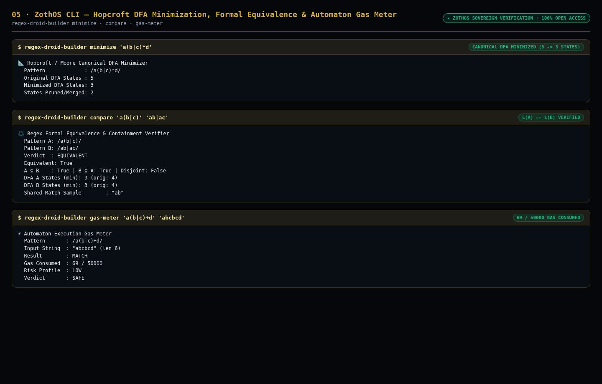

### Step 6: Cross-Flavor Dialect Transpiler & Multi-Language Code Synthesizer
Running `regex-droid-builder transpile '(?P<user>\w+)@(?P<host>\w+)' --from python --to javascript` converts Python named capture groups to ECMAScript syntax losslessly, while `regex-droid-builder codegen ... --lang rust` emits production-ready Rust `regex` crate bindings.

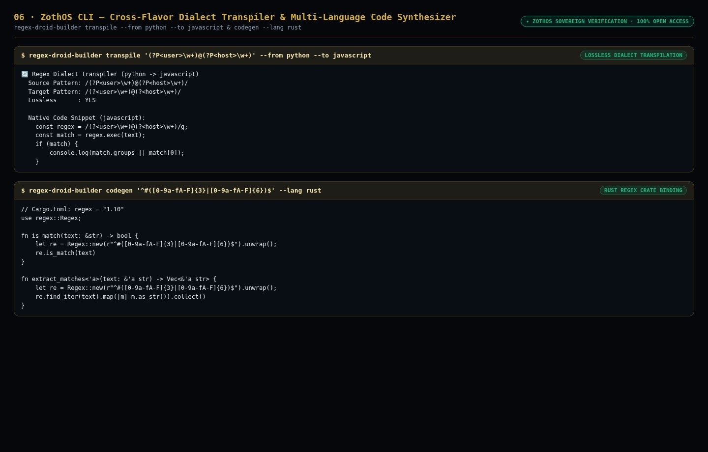

---

## 🖥️ Part 3: End-User GUI Perspective (Standalone Workstation & Zoth Studio v2 God-Mode)

### Step 7: Standalone Workstation (`:8101`) — Interactive SVG Railroad Track Diagram & Safe Verification
Opening `http://127.0.0.1:8101` launches the standalone Regex Droid Studio featuring the curated preset catalog, real-time ReDoS safety badge (`O(N) · Risk Score: 5/100`), and interactive SVG railroad track diagram.

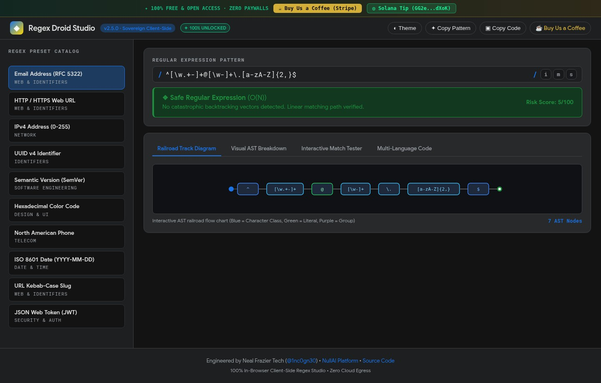

### Step 8: Standalone Workstation (`:8101`) — Visual AST Breakdown & Critical ReDoS Alert
Entering a pattern with nested quantifiers (`^(a+)+@[a-z0-9.-]+\.[a-z]{2,}$`) triggers the red `CRITICAL (O(2^N)) · Risk Score: 95/100` ReDoS alert banner with remediation guidance and displays the node-by-node Visual AST Breakdown.

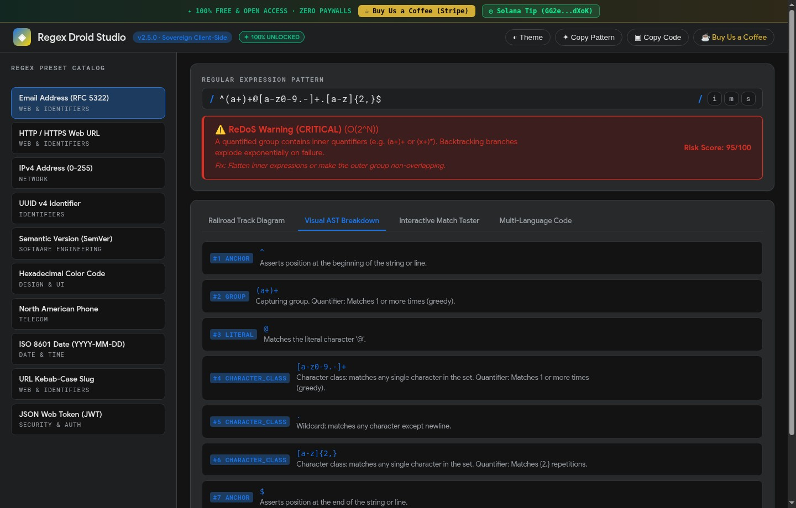

### Step 9: Standalone Workstation (`:8101`) — Multi-Language Code Generator (Rust, Python, JS, Go, PHP)
Selecting the **JSON Web Token (JWT)** preset and switching to the **Multi-Language Code** tab generates copy-ready implementations across Python, JavaScript, Rust, Go, and PHP with zero paywalls or blur locks.

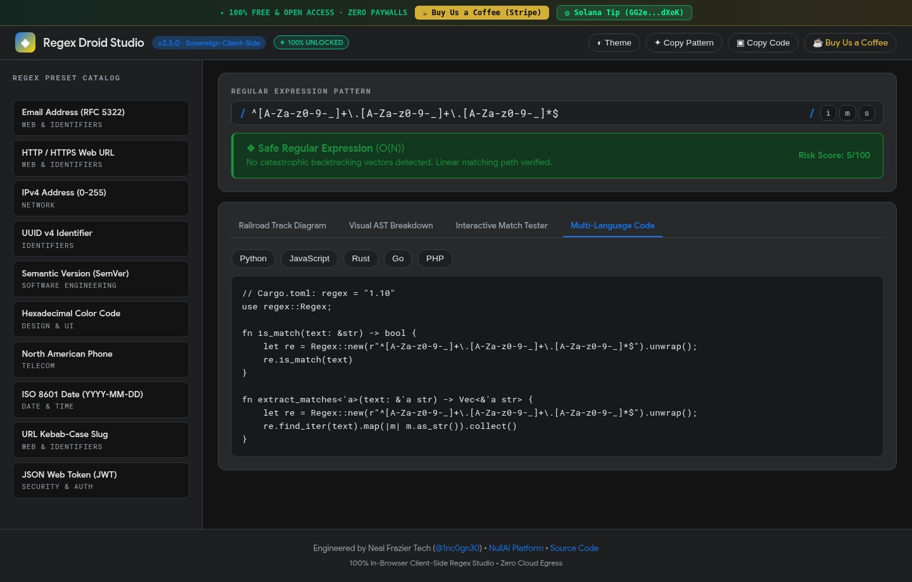

### Step 10: Zoth Studio v2 God-Mode (`:3000/tools/regex-droid-builder`) — Live Matcher & Testbed
Inside the Zoth Studio v2 enclave (`http://127.0.0.1:3000/tools/regex-droid-builder`), users can evaluate multi-line payloads in real time with sub-millisecond execution timing, match index badges, and ReDoS complexity verification.

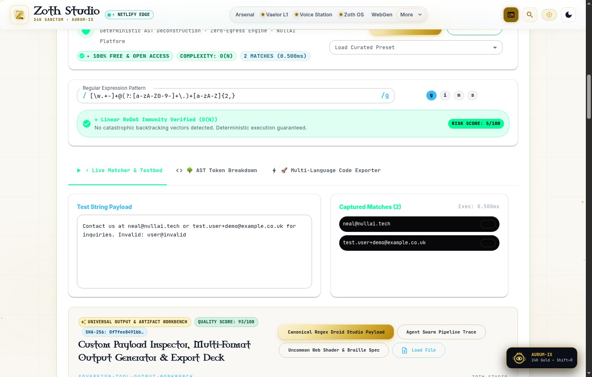

### Step 11: Zoth Studio v2 God-Mode (`:3000/tools/regex-droid-builder`) — AST Token Sequence Cards
Switching to the **AST Token Breakdown** tab decomposes the active regular expression into color-coded lexical token cards (`CHAR_SET`, `LITERAL`, `GROUP`, `ANCHOR`) with plain-English explanations.

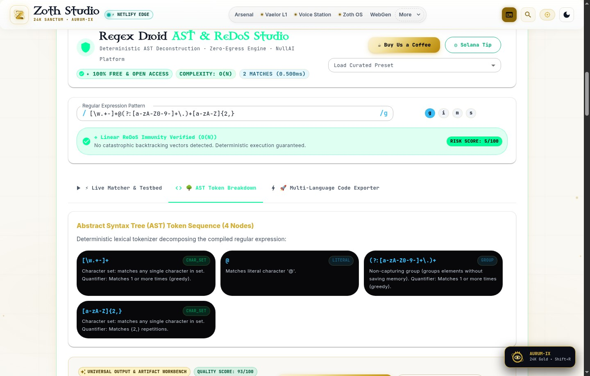

### Step 12: Mobile 390×844 Responsive Verification (`overflowPx === 0`)
Verified at mobile viewport (`390×844`) with zero horizontal scroll overflow (`overflowPx === 0`), stacked preset cards, and touch-friendly controls.

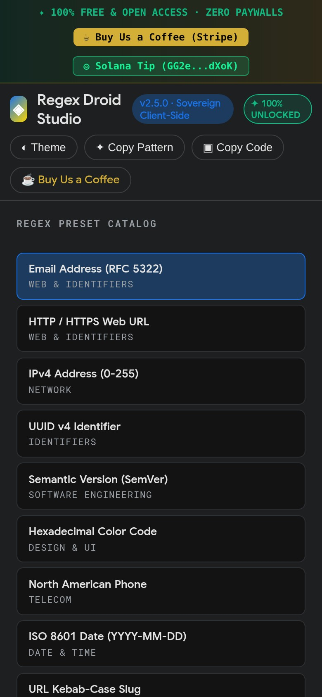

---

## Sovereign 5-Layer Architecture & Second Brain Topology

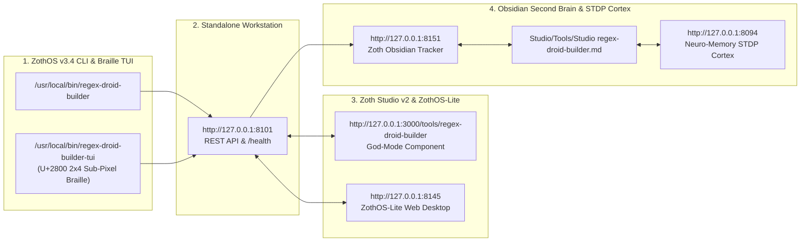

### ZothOS v3.4 TUI & Obsidian Second Brain Sync
- **Unicode `U+2800` Braille TUI**: `regex-droid-builder-tui --status` / `regex-droid-builder-tui --json`
- **Zoth Obsidian Tracker (`:8151`)**: `zoth-obsidian-tracker --verify`
- **Connected Canon Notes**: [[00 Home]] · [[Zoth OS]] · [[Zoth Studio]] · [[ZothOS-Lite Web Desktop]] · [[Zoth Memory]] · [[Public Surfaces]]
