# ⚡ Robots.txt & AEO Auditor (`robots-txt-auditor`) — Complete Developer & User Walkthrough

> **100% Free & Open-Access Sovereign Utility**: Zero paywalls, zero blur locks, zero telemetry. Support via [☕ Buy Us a Coffee (Stripe)](https://buy.stripe.com/3cIfZg27PdKo2D64Ocfw40X) or Solana (`GG2eQbVh8ut1BK6j1A2tz7pSySdLpD38BgyEhGcxdXoK`).

---

## 🛠️ Part 1: Developer Perspective (Architecture, Pytest Suite & REST API Contracts)

### Step 1: Repository Architecture & Daemon Telemetry (`:8086`)
Developers inspecting `~/NullAITech/robots-txt-auditor` can verify the RFC 9309 Python server (`server.py`), the ZothOS CLI (`bin/robots-txt-auditor`), the standalone workstation (`public/index.html`), and the `pytest` suite (`tests/test_robots_txt_auditor.py`).

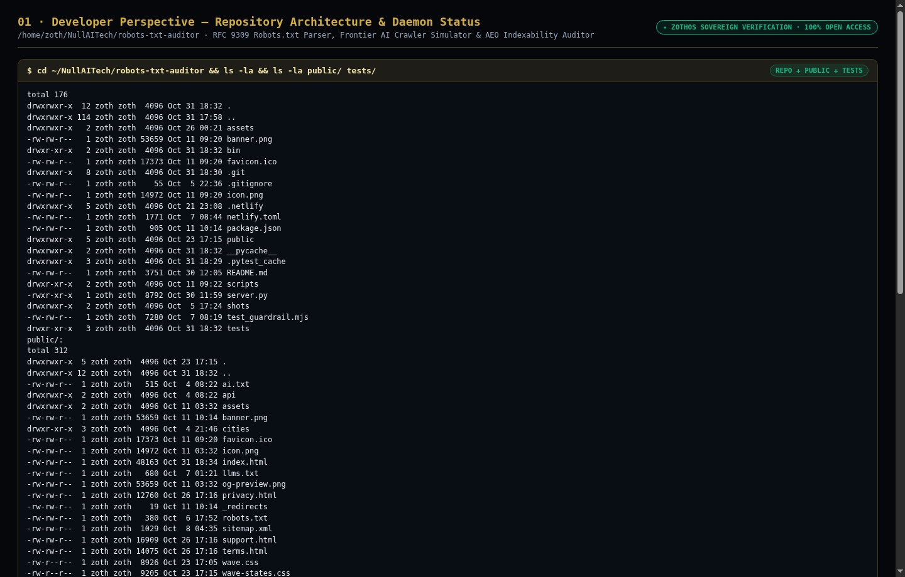

### Step 2: Automated Pytest Verification Suite (`8 passed in 1.78s`)
Running `pytest -v` executes 8 automated unit and integration tests covering RFC 9309 rule parsing, Frontier AI bot evaluations (`Googlebot`, `GPTBot`, `ClaudeBot`, `PerplexityBot`, `Applebot`), `Crawl-delay` parsing, CLI preset audits, and HTTP REST API endpoints.

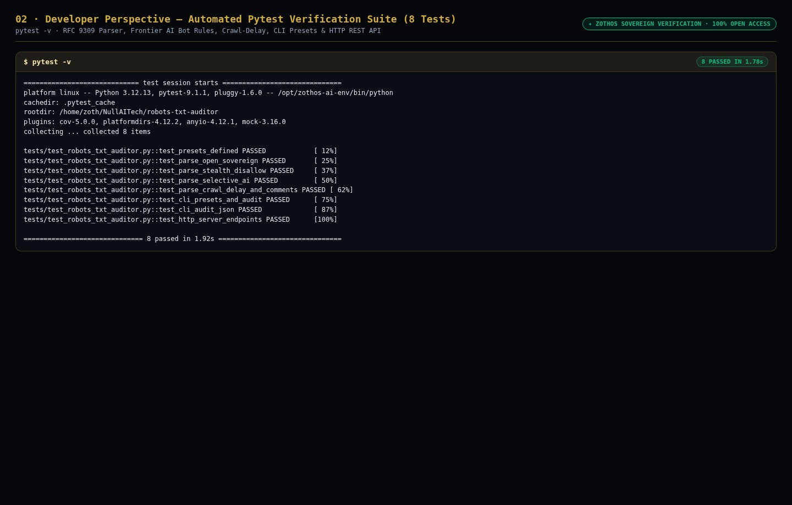

### Step 3: Live HTTP REST API & RFC 9309 Audit Contracts (`:8086`)
Developers and autonomous agents can query `GET /health`, `GET /api/presets`, and `POST /api/audit` on port `8086` to programmatically evaluate `robots.txt` policies and compute AEO indexability scores (`100/100 A+`).

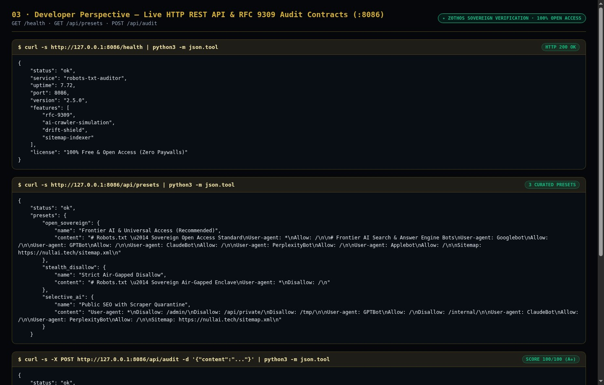

---

## 💻 Part 2: End-User CLI Perspective (ZothOS Global Binary & Frontier AI Audits)

### Step 4: Global ZothOS Binary Help Matrix, Presets & Status
Users can run `robots-txt-auditor --help`, `robots-txt-auditor --presets`, and `robots-txt-auditor --status` from any terminal directory to inspect available RFC 9309 presets and daemon telemetry.

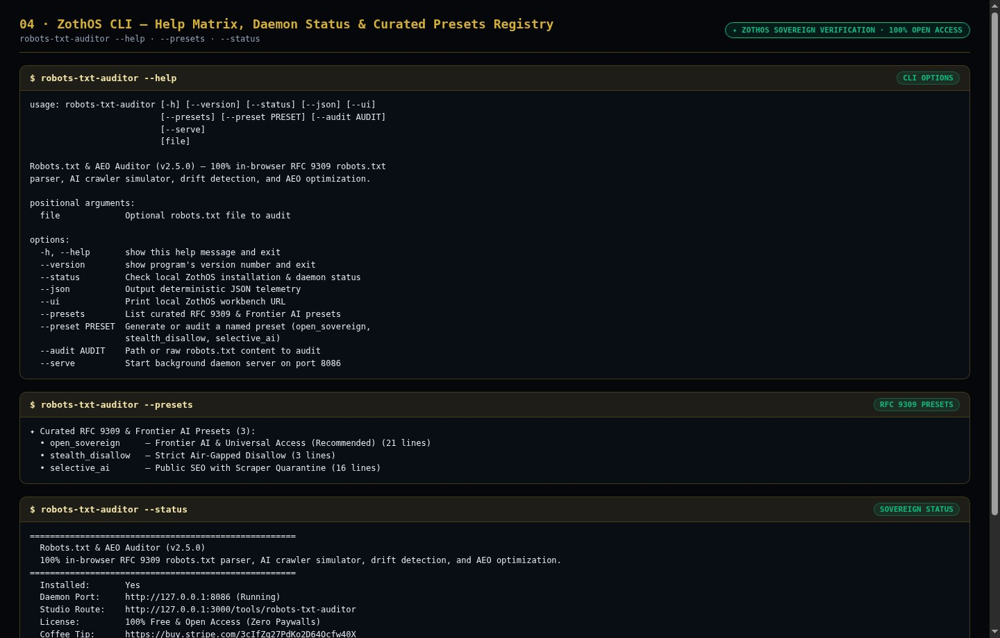

### Step 5: Frontier AI Crawler Audit — Universal Access (`A+`) vs Air-Gapped Disallow (`F`)
Running `robots-txt-auditor --preset open_sovereign` verifies `100/100 (A+)` with all 5 Frontier AI bots allowed (`Googlebot`, `GPTBot`, `ClaudeBot`, `PerplexityBot`, `Applebot`), whereas `robots-txt-auditor --preset stealth_disallow` reports `10/100 (F)` with all bots blocked by `Disallow: /`.

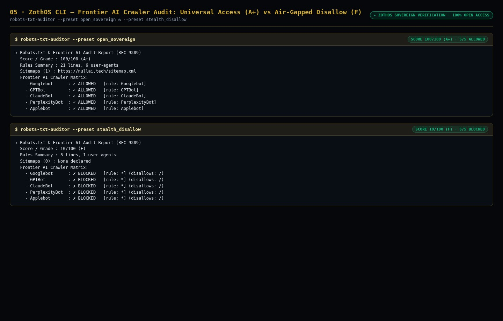

### Step 6: Selective AI Quarantine Audit & Deterministic JSON AST Output
Running `robots-txt-auditor --preset selective_ai` and `robots-txt-auditor --audit selective_ai --json` audits directory-scoped quarantine rules (`/admin/`, `/api/private/`, `/internal/`) and emits machine-readable JSON telemetry.

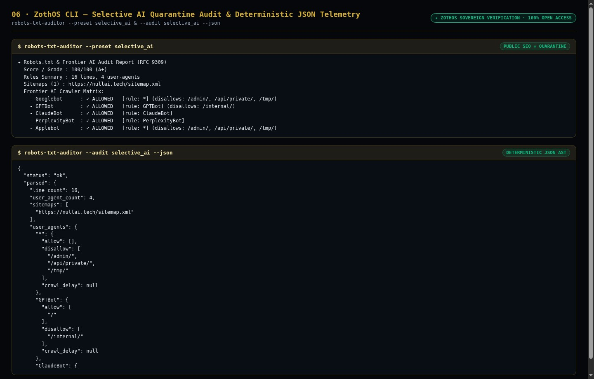

---

## 🖥️ Part 3: End-User GUI Perspective (Standalone Workstation & Zoth Studio v2 God-Mode)

### Step 7: Standalone Workstation (`:8086`) — AI Welcoming Preset (`7/7 Bots Allowed · Score 100/100`)
Opening `http://127.0.0.1:8086` launches the standalone **AI Crawler & Robots.txt Studio** with line-numbered RFC 9309 editing, real-time path simulation (`/blog/autonomous-agents`), and the 7-bot compatibility matrix.

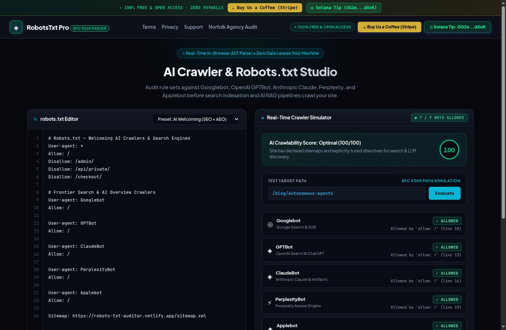

### Step 8: Standalone Workstation (`:8086`) — Strict Anti-Scraping Preset (Blocking AI Training Scrapers)
Selecting **Preset: Strict Anti-Scraping** updates the editor and immediately shows `GPTBot`, `ClaudeBot`, and `CCBot` marked as `✗ BLOCKED` with exact line-number citations while keeping `Googlebot` and `Bingbot` `✓ ALLOWED`.

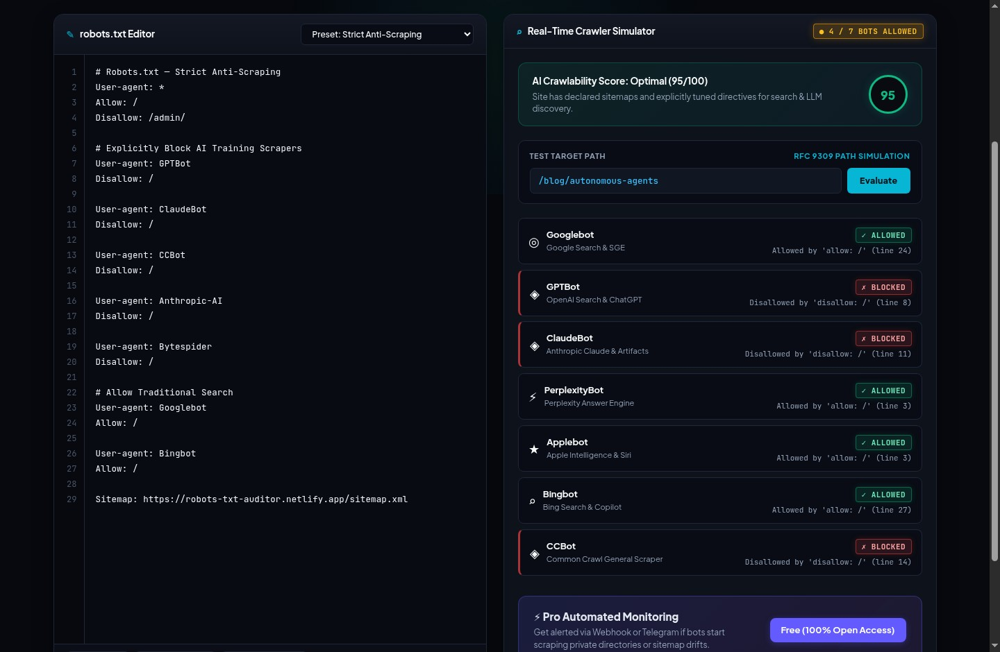

### Step 9: Standalone Workstation (`:8086`) — Modern SaaS Private Route Simulation (`/dashboard/billing`)
Selecting **Preset: Modern SaaS & Private API** and testing `/dashboard/billing` verifies that `GPTBot`, `ClaudeBot`, `PerplexityBot`, `Applebot`, `Bingbot`, and `CCBot` are blocked by `Disallow: /dashboard/` with Drift Shield verification active.

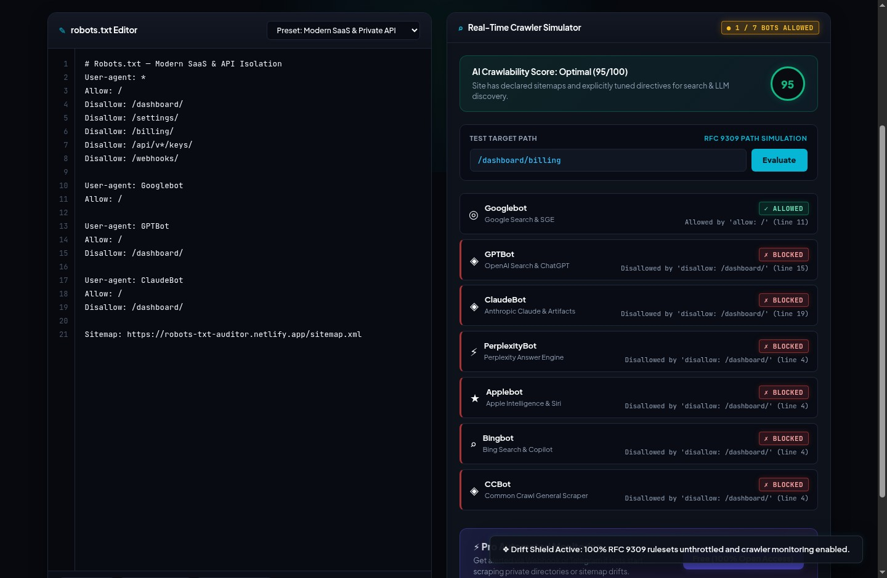

### Step 10: Zoth Studio v2 God-Mode (`:3000/tools/robots-txt-auditor`) — Optimal AEO & SGE Workspace
Inside the Zoth Studio v2 enclave (`http://127.0.0.1:3000/tools/robots-txt-auditor`), users can insert directives with 1-click chips (`+ Allow: /`, `+ GPTBot Allow`, `+ Sitemap`), inspect the `100` AEO score gauge, and download `robots.txt`.

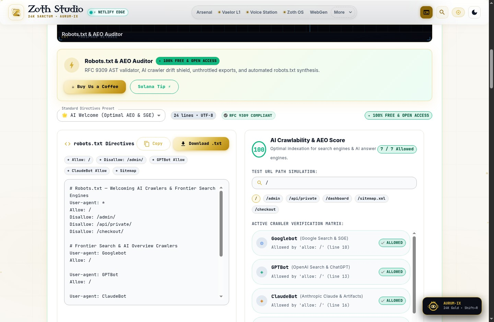

### Step 11: Zoth Studio v2 God-Mode (`:3000/tools/robots-txt-auditor`) — SaaS & API Isolation Simulation (`/dashboard`)
Switching to **SaaS & API Isolation (/dashboard)** and clicking the `/dashboard` quick-test chip demonstrates real-time RFC 9309 longest-match precedence across all 7 crawlers.

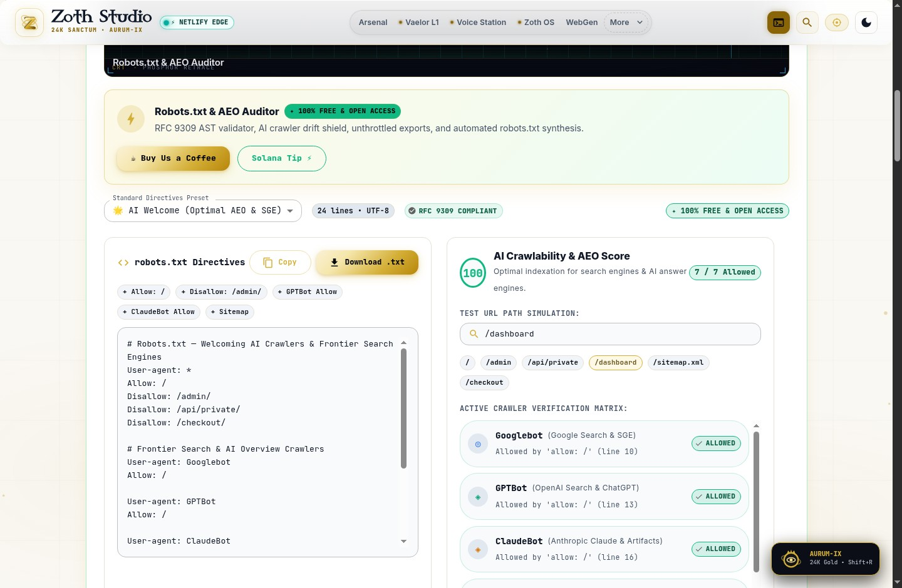

### Step 12: Mobile 390×844 Responsive Verification (`overflowPx === 0`)
Verified at mobile viewport (`390×844`) with zero horizontal scroll overflow (`overflowPx === 0`), clean mobile header, and full editor/simulator access.

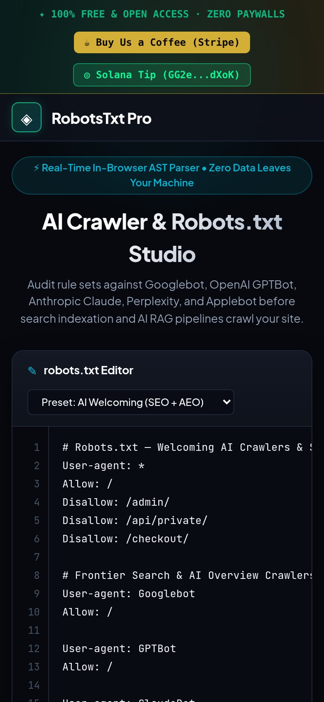

---

## Sovereign 5-Layer Architecture & Second Brain Topology

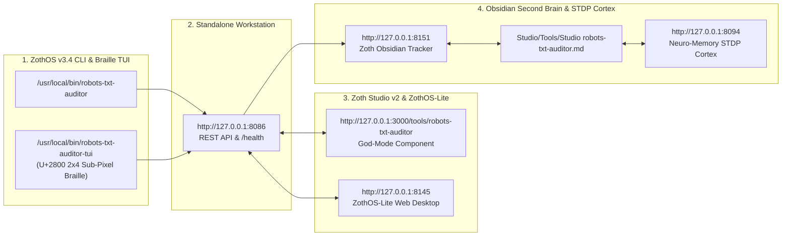

### ZothOS v3.4 TUI & Obsidian Second Brain Sync
- **Unicode `U+2800` Braille TUI**: `robots-txt-auditor-tui --status` / `robots-txt-auditor-tui --json`
- **Zoth Obsidian Tracker (`:8151`)**: `zoth-obsidian-tracker --verify`
- **Connected Canon Notes**: [[00 Home]] · [[Zoth OS]] · [[Zoth Studio]] · [[ZothOS-Lite Web Desktop]] · [[Zoth Memory]] · [[Public Surfaces]]
