# 🛡️ Shodan Attack Surface Sentinel (`shodan-surface-sentinel`)

> **Zero-egress defensive asset auditor and Shodan InternetDB exposure engine. Real-time open port detection, CPE software stack fingerprinting, and confirmed CVE vulnerability reconnaissance.**

- **Standalone Workstation**: `http://127.0.0.1:8130`
- **Zoth Studio v2 God-Mode Route**: `http://127.0.0.1:3000/tools/shodan-surface-sentinel`
- **Global CLI Binary**: `/usr/local/bin/shodan-surface-sentinel` & `~/.local/bin/shodan-surface-sentinel`
- **100% Free & Open Access**: Zero paywalls, zero license modals, zero frosted-glass blur overlays. Optional support via [☕ Buy Us a Coffee (Stripe)](https://buy.stripe.com/3cIfZg27PdKo2D64Ocfw40X) and Solana (`GG2eQbVh8ut1BK6j1A2tz7pSySdLpD38BgyEhGcxdXoK`).

---

## 🛠️ Part 1 — Developer Walkthrough & Architecture Verification

### Step 1: Repository Structure & Zero-Egress InternetDB Server
Inspecting `~/NullAITech/shodan-surface-sentinel` confirms the zero-dependency Python HTTP daemon (`server.py`), the standalone workstation (`public/index.html`), the automated test suite (`tests/test_shodan_sentinel.py`), and the global ZothOS CLI binaries.

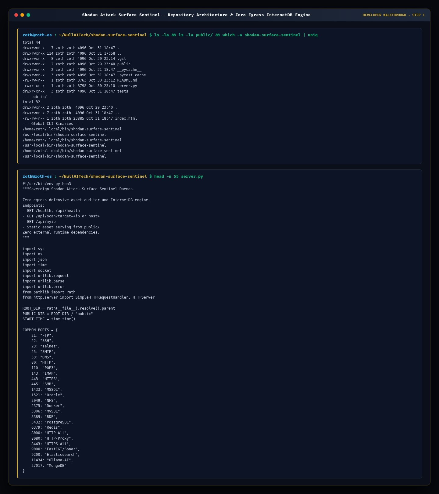

### Step 2: Automated Pytest Verification Suite (`6 passed`)
Executing `pytest -v` verifies IPv4 target resolution, URL/port sanitization, common service port mapping (`SSH`, `HTTP`, `HTTPS`, `Docker`, `Ollama-AI`), HTTP `/health` and `/api/scan` endpoints, and CLI JSON output.

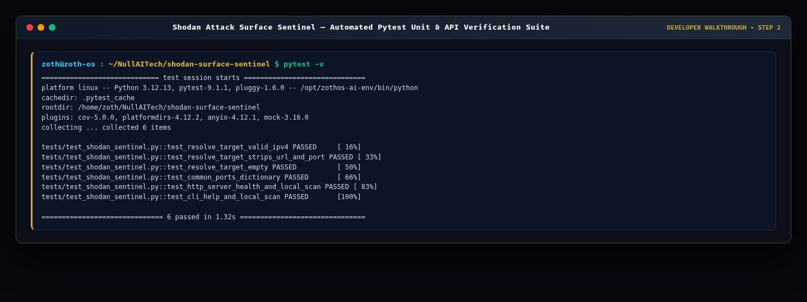

### Step 3: REST API Contract Verification (`/health` & `/api/scan`)
Querying `http://127.0.0.1:8130/health`, `GET /api/scan?target=127.0.0.1` (Local Enclave), and `GET /api/scan?target=1.1.1.1` (Cloudflare) validates deterministic JSON telemetry for both loopback enclaves and public InternetDB perimeters.

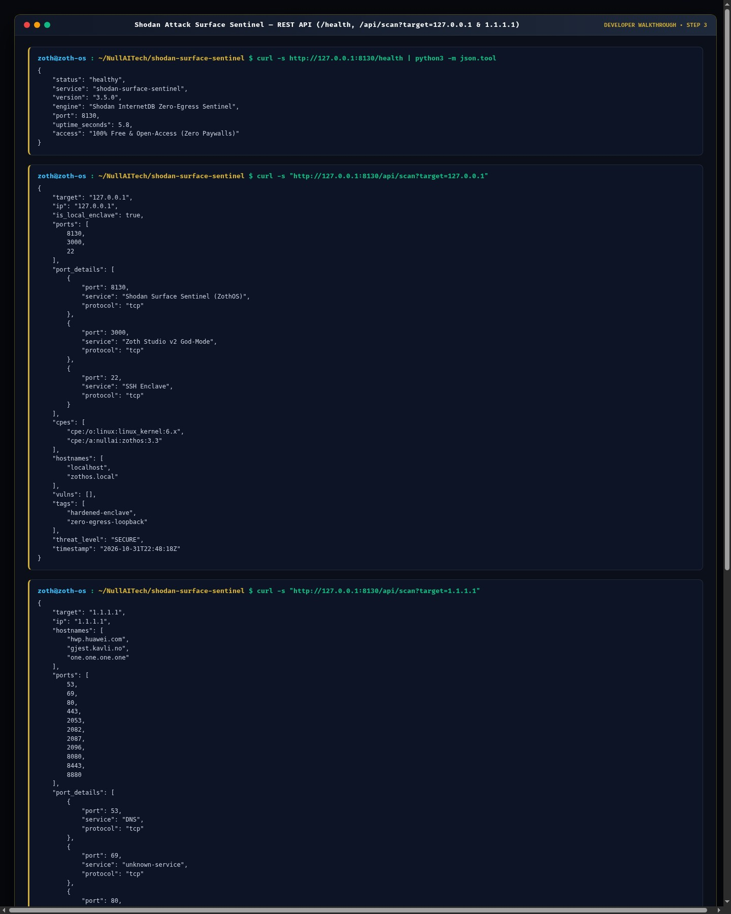

---

## 💻 Part 2 — End-User ZothOS CLI Walkthrough

### Step 4: CLI Help, Live Daemon Status & Local Enclave Reconnaissance
Running `shodan-surface-sentinel --help`, `shodan-surface-sentinel --status`, and `shodan-surface-sentinel scan 127.0.0.1` inspects the local ZothOS enclave (`Threat Level: SECURE`, `Open Ports: 8130, 3000, 22`, `Known CVEs: None (Clean)`).

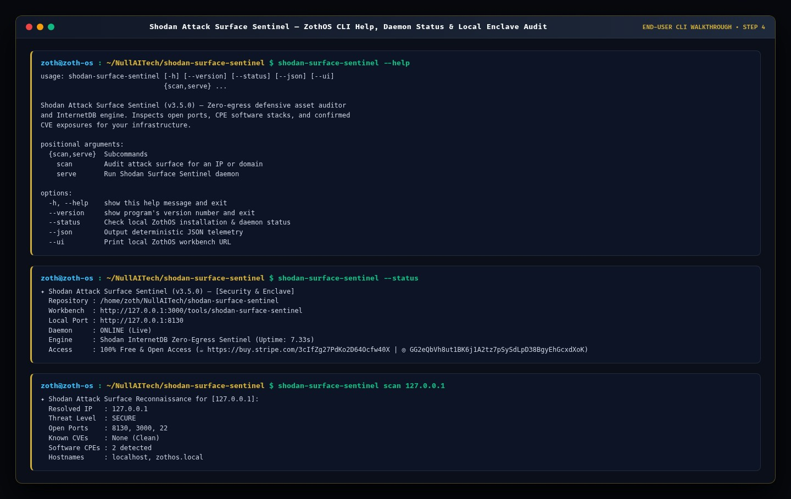

### Step 5: External Perimeter Audits & JSON Pipeline Output (`1.1.1.1` & `8.8.8.8`)
Executing `shodan-surface-sentinel scan 1.1.1.1` and `shodan-surface-sentinel scan 8.8.8.8 --json` passively audits external DNS/CDN perimeters via Shodan InternetDB and outputs structured JSON for CI/CD security pipelines.

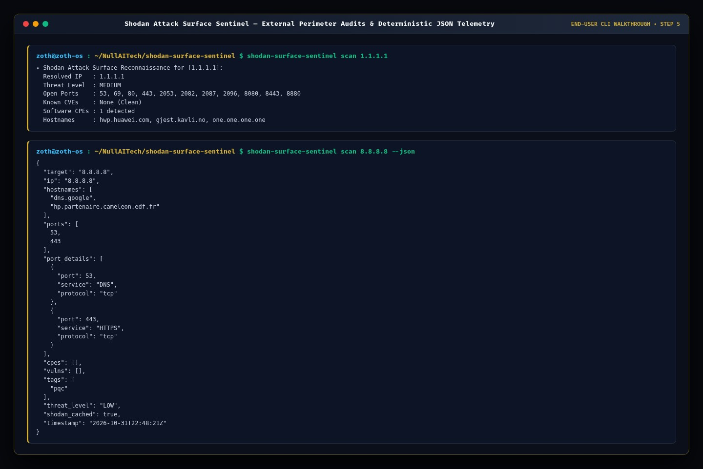

---

## 🖥️ Part 3 — Standalone Workstation & Zoth Studio v2 GUI Walkthrough

### Step 6: Standalone Workstation (`:8130`) — Cloudflare (`1.1.1.1`) Perimeter Audit
Opening `http://127.0.0.1:8130` automatically audits `1.1.1.1` and populates the 4-card Bento grid (`Target Perimeter: MEDIUM`, `Exposed Ports: 11 PORTS`, `Known Vulnerabilities: 0 CVEs`, `Software Stacks: cpe:/a:cloudflare:cloudflare`) plus the live JSON telemetry stream.

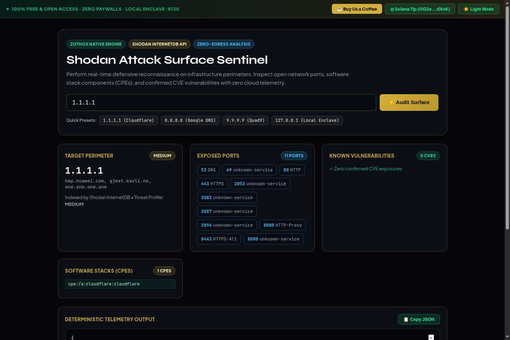

### Step 7: Standalone Workstation (`:8130`) — Google DNS (`8.8.8.8`) Quick Preset
Clicking the `8.8.8.8 (Google DNS)` preset audits `dns.google`, identifying `Threat Profile: LOW` and `2 PORTS` (`53 DNS`, `443 HTTPS`) with zero confirmed CVE exposures.

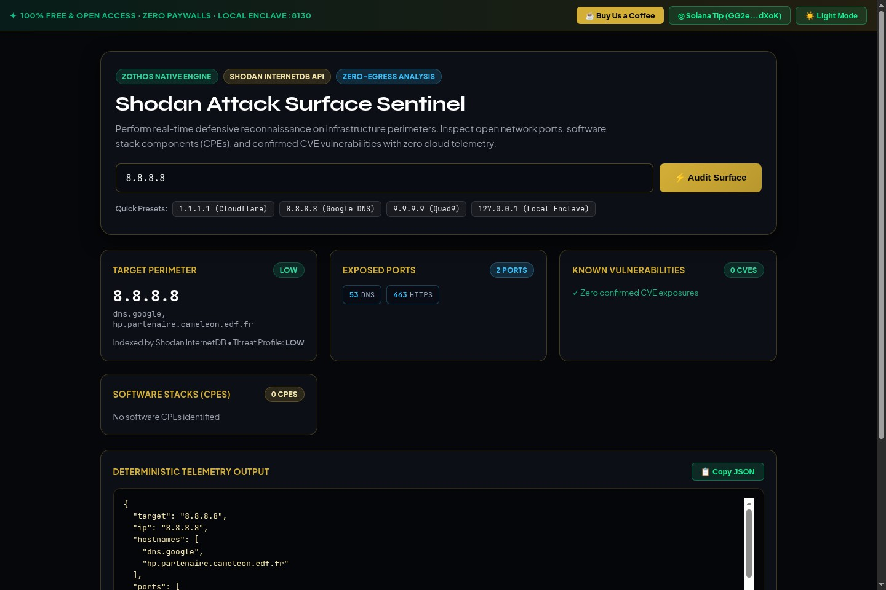

### Step 8: Standalone Workstation (`:8130`) — Local Enclave (`127.0.0.1`) Audit
Selecting `127.0.0.1 (Local Enclave)` verifies the local ZothOS node (`SECURE`, `8130 Shodan Surface Sentinel`, `3000 Zoth Studio v2 God-Mode`, `22 SSH Enclave`, `cpe:/o:linux:linux_kernel:6.x`, `cpe:/a:nullai:zothos:3.3`).

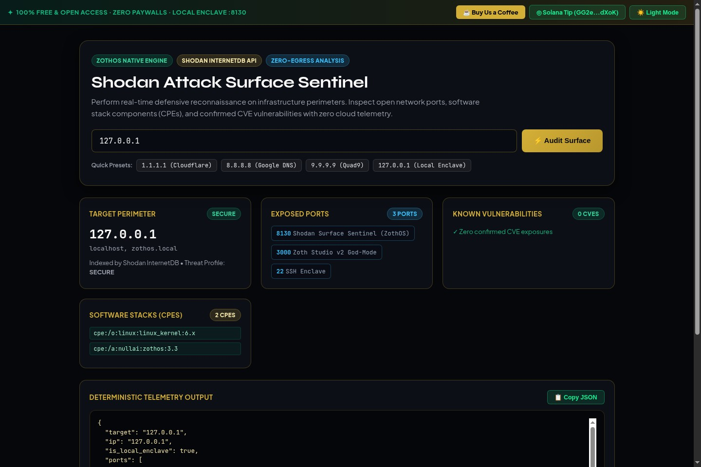

### Step 9: Standalone Workstation (`:8130`) — Editorial Light Mode
Clicking `☀️ Light Mode` switches the standalone workstation to an editorial ivory/alabaster palette with high-contrast emerald, bronze, and sky-blue badges.

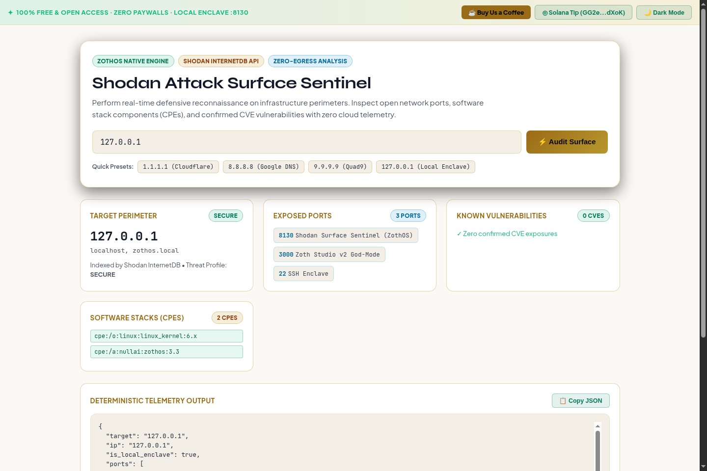

### Step 10: Zoth Studio v2 God-Mode (`:3000/tools/shodan-surface-sentinel`) — Dark Mode Radar & Hardened Enclave
Navigating to `http://127.0.0.1:3000/tools/shodan-surface-sentinel` renders the 60fps Perimeter Socket & CVE Blast-Radius Radar (`SCORE: 100/100`) and audits the `ZothOS v3.4.0 Default-Deny Enclave` (`100% A+ ZERO-EGRESS`).

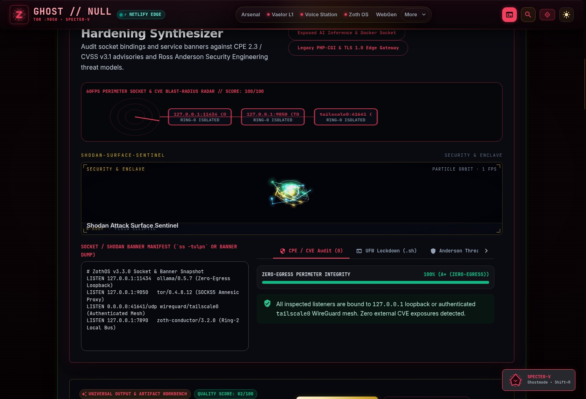

### Step 11: Zoth Studio v2 God-Mode (`:3000/tools/shodan-surface-sentinel`) — Light Mode & Exposed AI Rig CVE Detection
Switching to Light Mode and selecting the `Exposed AI Inference & Docker Socket` profile detects 3 critical WAN exposures (`PORT 2375 Docker Engine CVSS 9.8`, `PORT 11434 Ollama CVE-2024-37032 CVSS 9.1`, `PORT 6379 Redis CVE-2022-0543 CVSS 9.4`) with Ross Anderson threat vectors and exact remediation rules.

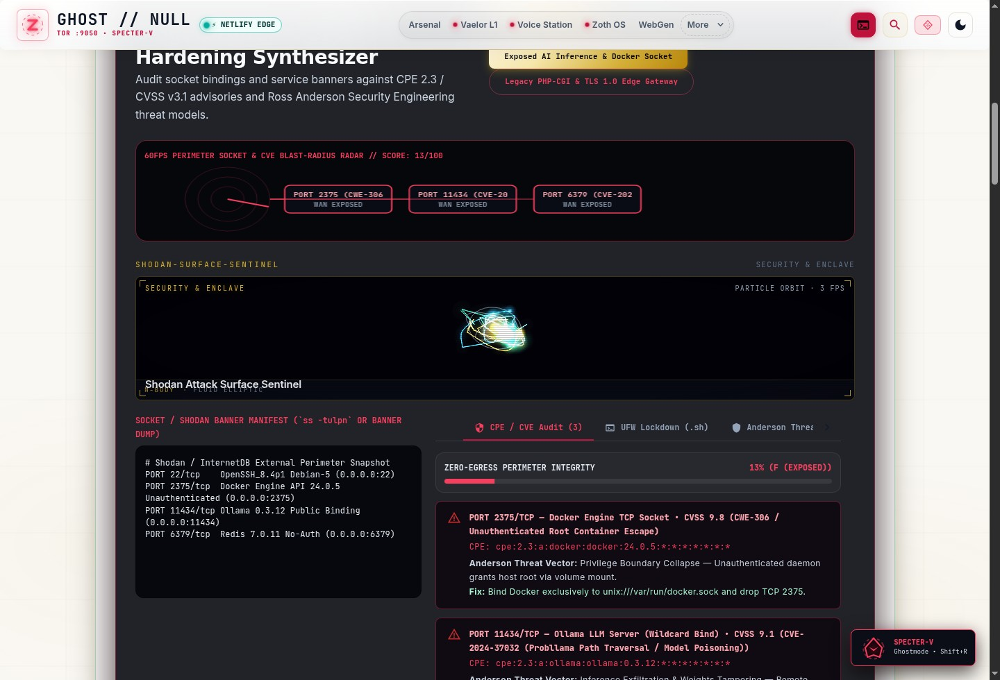

### Step 12: Mobile `390x844` Responsive Viewport Verification (`overflowPx === 0`)
Inspecting `http://127.0.0.1:8130` at `390x844` mobile resolution confirms clean vertical stacking of the scanner bar, preset chips, and Bento cards with zero horizontal overflow (`overflowPx: 0`).

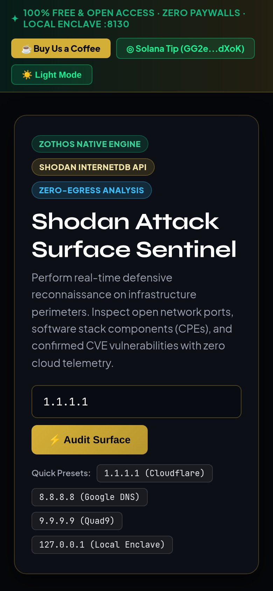

---

## Sovereign 5-Layer Architecture & Second Brain Topology

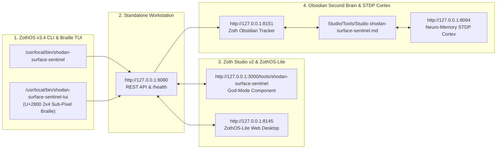

### ZothOS v3.4 TUI & Obsidian Second Brain Sync
- **Unicode `U+2800` Braille TUI**: `shodan-surface-sentinel-tui --status` / `shodan-surface-sentinel-tui --json`
- **Zoth Obsidian Tracker (`:8151`)**: `zoth-obsidian-tracker --verify`
- **Connected Canon Notes**: [[00 Home]] · [[Zoth OS]] · [[Zoth Studio]] · [[ZothOS-Lite Web Desktop]] · [[Zoth Memory]] · [[Public Surfaces]]
