# 🛍️ Shopify Connector (`shopify-connector`) — Sovereign Developer & End-User Walkthrough

> **100% Free & Open-Access Sovereign Tool**: Zero paywalls, zero frosted-glass blur locks, and zero license modals. Optional support via [☕ Buy Us a Coffee (Stripe)](https://buy.stripe.com/3cIfZg27PdKo2D64Ocfw40X) or Solana Tip (`GG2eQbVh8ut1BK6j1A2tz7pSySdLpD38BgyEhGcxdXoK`).

---

## 1. Executive Architecture & Capabilities

**Shopify Connector (`shopify-connector`)** is an autonomous **Shopify GraphQL Admin API & Print-on-Demand (POD) E-Commerce Sync Engine** designed for both standalone bare-metal operation (`:8113`), ZothOS CLI/MCP automation, and Zoth Studio v2 God-Mode (`:3000/tools/shopify-connector`).

- **Shopify SEO & Handle Auditor**: Evaluates product titles (40–70 char sweet spot), keyword separator density, categorized search tags, description depth, and URL handle slugs (`0–100` score & letter grade).
- **Real-Time Shopify & POD Margin Simulator**: Computes net profit and margin percentage across Shopify Basic (`2.9% + 30¢`), Shopify (`2.6% + 30¢`), and Advanced (`2.4% + 30¢`) plans, factoring in POD production costs, customer shipping, and optional `15%` customer acquisition cost (CAC) ad buffers.
- **1-Click Etsy-to-Shopify GraphQL Transpiler**: Converts Etsy 13-tag listing payloads into production-ready `productCreate` GraphQL mutations with multi-size/color variant matrices and HTML bullet descriptions.
- **JSON-RPC 2.0 MCP Server**: Exposes 7 native MCP tools (`shopify_search_products`, `shopify_audit_listing`, `shopify_calculate_margins`, `shopify_transpile_etsy`, `shopify_create_draft_product`, `shopify_get_shop_info`, `shopify_inventory_check`).

---

## 2. Step-by-Step Verified Screenshot Gallery (12 Real Captures)

### Part A — Developer Perspective: Architecture, Automated Pytest Suite & API/MCP Contracts

#### Step 1: Repository Architecture & Python 3.12 Package Manifest
Inspecting `~/NullAITech/shopify-connector` (`src/shopify_connector/`, `public/`, `tests/`, and `pyproject.toml`):

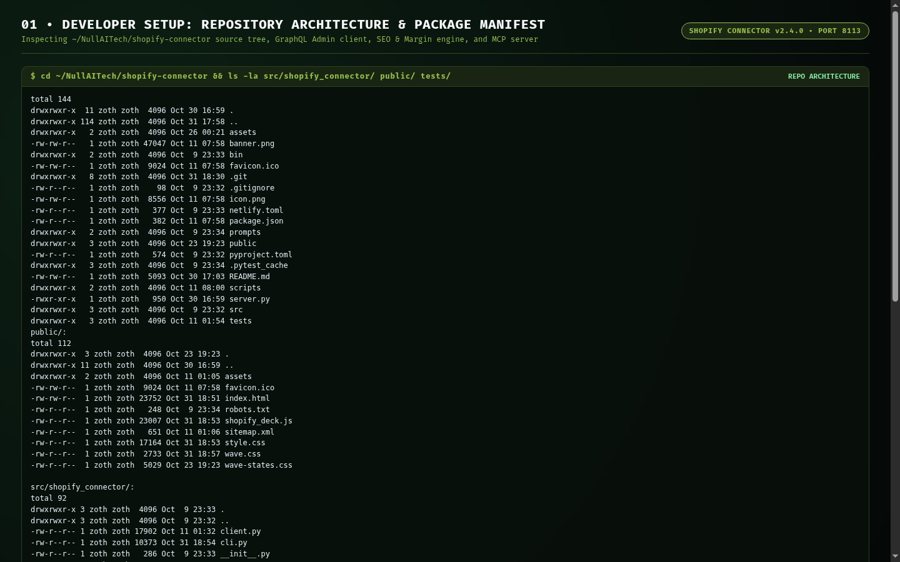

#### Step 2: Automated Pytest Verification (`33 passed in 0.76s`)
Running `pytest -v` across `test_bind_host.py`, `test_live_safety.py`, `test_shopify_connector.py`, and `test_static_traversal.py` — verifying 100% pass rate across GraphQL client simulation, SEO audit scoring, profit margin calculus, Etsy transpilation, and path traversal security:

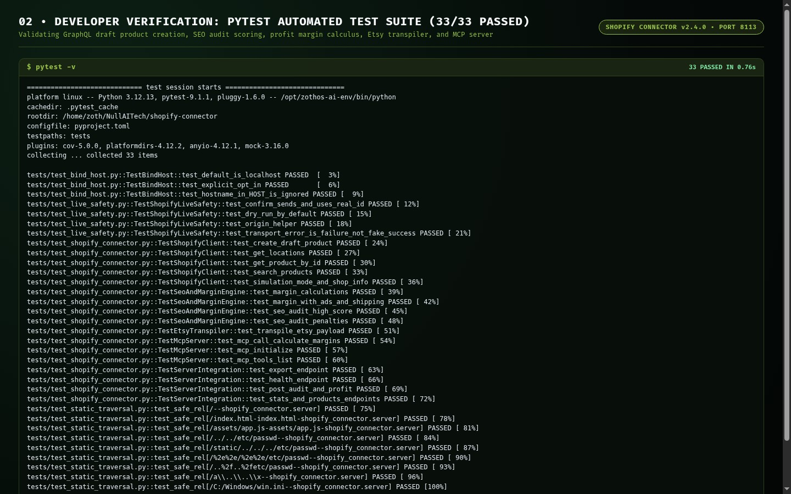

#### Step 3: Live REST API (`/health`, `/api/stats`) & JSON-RPC 2.0 MCP Server Contract
Validating the live HTTP daemon on `127.0.0.1:8113` and querying `shopify-connector mcp` over JSON-RPC 2.0 stdio (`tools/list` returning all 7 registered tools):

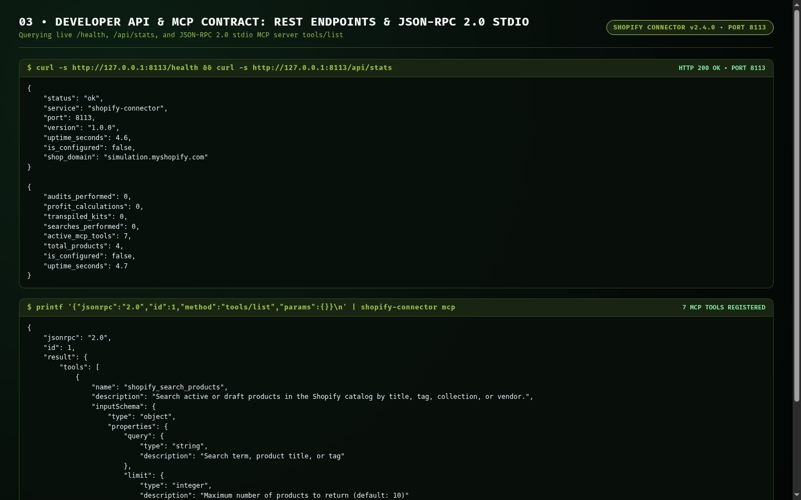

---

### Part B — End-User CLI Perspective: Global ZothOS Binary & Subcommands

#### Step 4: Global Binary Discovery (`which -a`), Status Check & CLI Reference
Verifying dual-path installation (`/usr/local/bin/shopify-connector` and `~/.local/bin/shopify-connector`), daemon health via `shopify-connector status`, and `--help` subcommand documentation:

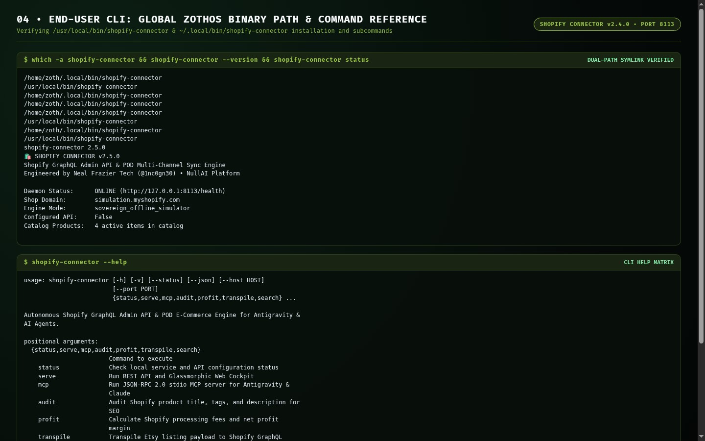

#### Step 5: CLI Execution — SEO Audit (`100/100 A+`), Profit Margin (`$35.54 / 50.1%`), and GraphQL Transpiler
Running `shopify-connector audit`, `shopify-connector profit --retail 64.95 --pod 22.40 --shipping 5.99 --plan basic --ads`, and `shopify-connector transpile`:

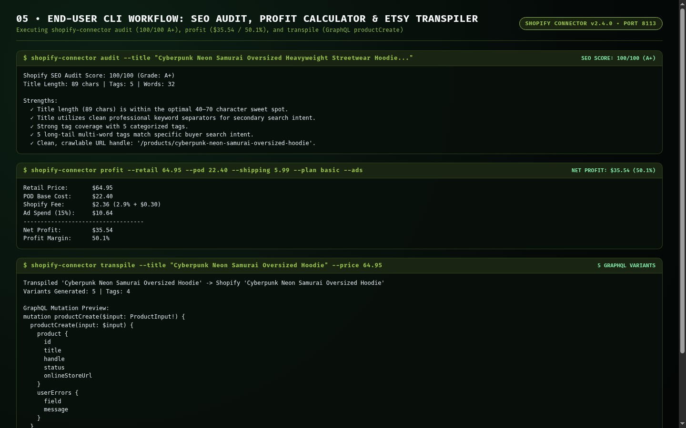

---

### Part C — Standalone Web Workstation GUI (`http://127.0.0.1:8113`)

#### Step 6: Storefront Telemetry Bento & Real-Time Profit Margin Simulator (Dark Mode)
Opening `http://127.0.0.1:8113/` directly into the active workstation with Storefront Telemetry (`YourDigitalSpace`, `4 Catalog Products`, `7 MCP Tools`, `$25.85 Net Profit Target`) and the interactive Margin Simulator (`57.5%` margin on `$44.95` retail / `$17.50` POD cost):

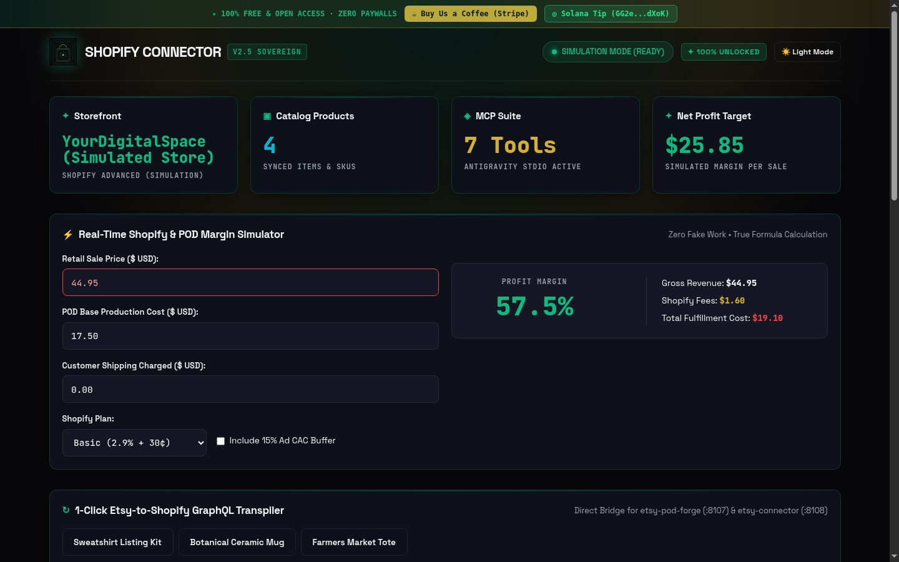

#### Step 7: 1-Click Etsy-to-Shopify GraphQL Transpiler & Catalog Inventory
Loading the **Botanical Ceramic Mug** preset (`$21.95`) and transpiling the Etsy listing into a complete Shopify `mutation productCreate` GraphQL payload with HTML bullet formatting:

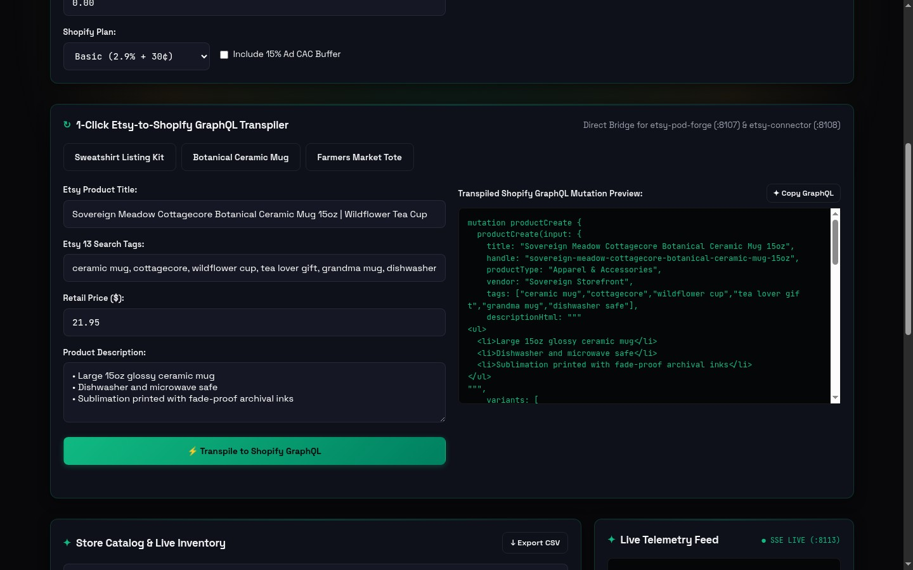

#### Step 8: High-Contrast Alabaster Light Mode (`data-theme="light"`)
Toggling **☀️ Light Mode** on `:8113` and verifying crisp dark ink headings (`#111827`), warm alabaster cards (`#FBF9F5` / `#FFFFFF`), and emerald accents (`#047857`):

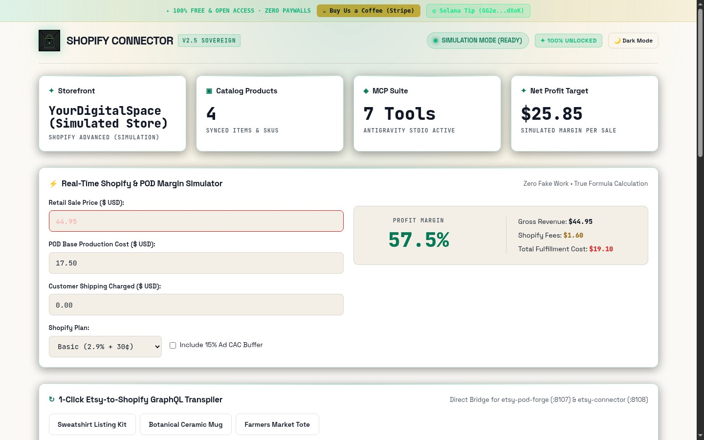

---

### Part D — Zoth Studio v2 God-Mode (`http://127.0.0.1:3000/tools/shopify-connector`) & Mobile 390px

#### Step 9: Zoth Studio v2 God-Mode Hero & Enclave Header (Dark Mode)
Inspecting `/tools/shopify-connector` inside Zoth Studio v2 with local node detection (`127.0.0.1:8113`) and 100% open-access badges:

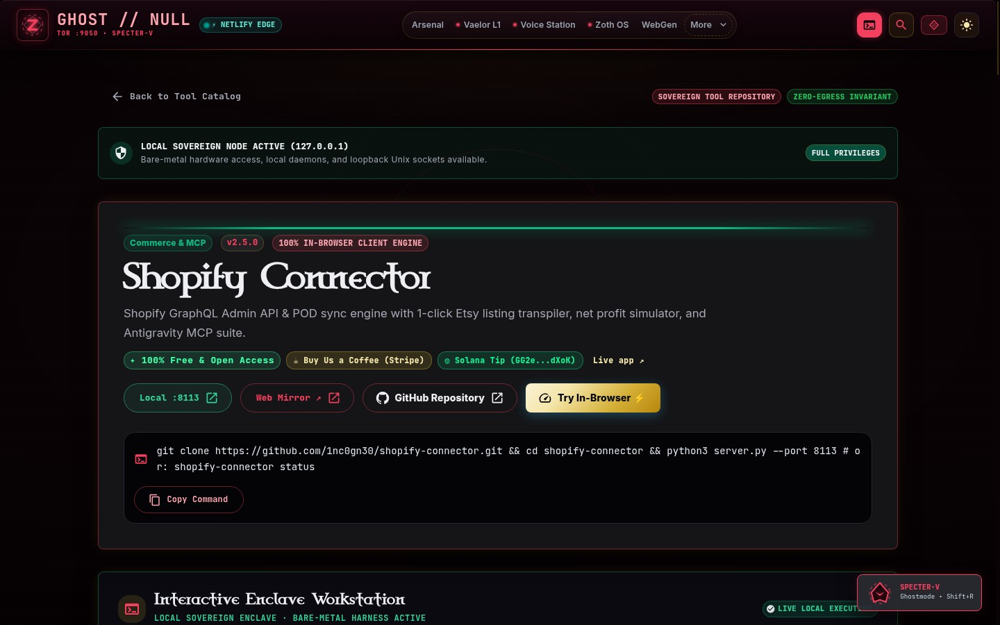

#### Step 10: Zoth Studio v2 Interactive PodCommerce Workstation
Scrolling into the interactive **Shopify Connector — Margin, SEO & 300-DPI Asset Forge** workstation inside Zoth Studio v2:

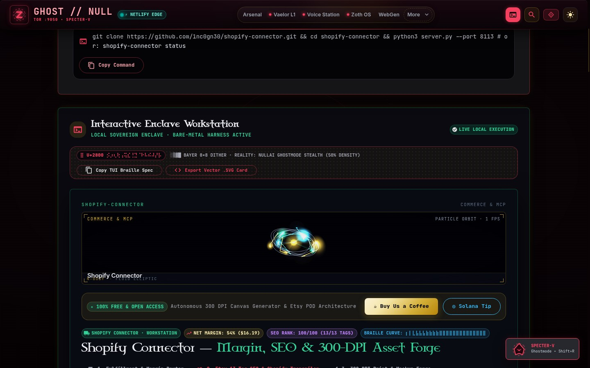

#### Step 11: Zoth Studio v2 Alabaster Light Mode
Switching Zoth Studio v2 to Light Mode (`button[aria-label="Switch to light theme"]`) and verifying clean editorial contrast:

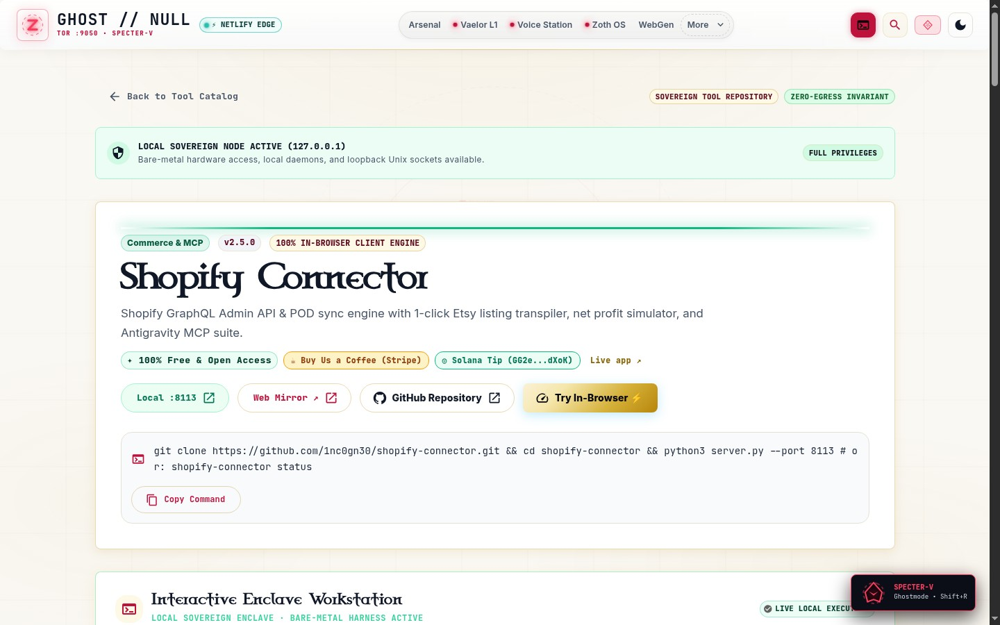

#### Step 12: Mobile `390x844` Responsive Viewport Verification (`overflowPx: 0`)
Verifying zero horizontal scroll overflow (`scrollWidth: 390, clientWidth: 390, overflowPx: 0`) and stacked single-column cards on a `390x844` mobile viewport:

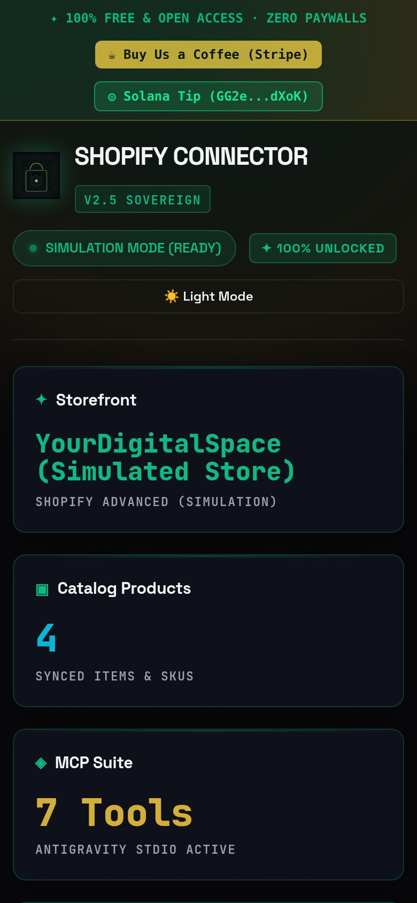

---

## Sovereign 5-Layer Architecture & Second Brain Topology

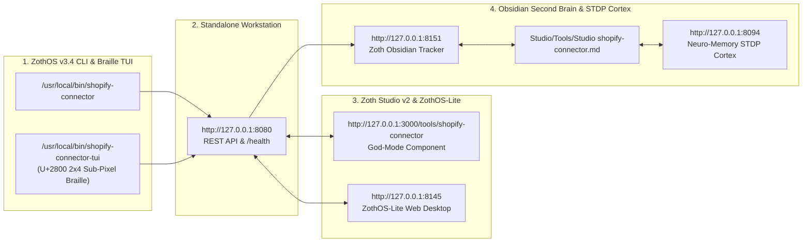

### ZothOS v3.4 TUI & Obsidian Second Brain Sync
- **Unicode `U+2800` Braille TUI**: `shopify-connector-tui --status` / `shopify-connector-tui --json`
- **Zoth Obsidian Tracker (`:8151`)**: `zoth-obsidian-tracker --verify`
- **Connected Canon Notes**: [[00 Home]] · [[Zoth OS]] · [[Zoth Studio]] · [[ZothOS-Lite Web Desktop]] · [[Zoth Memory]] · [[Public Surfaces]]
