# 🏛️ Sovereign Agent Signal Bridge (`sovereign-agent-bridge`) — Sovereign Developer & End-User Walkthrough

> **100% Free & Open-Access Sovereign Tool**: Zero paywalls, zero frosted-glass blur locks, and zero license modals. Optional support via [☕ Buy Us a Coffee (Stripe)](https://buy.stripe.com/3cIfZg27PdKo2D64Ocfw40X) or Solana Tip (`GG2eQbVh8ut1BK6j1A2tz7pSySdLpD38BgyEhGcxdXoK`).

---

## 1. Executive Architecture & Capabilities

**Sovereign Agent Signal Bridge (`sovereign-agent-bridge`)** is a zero-dependency Python stdlib **Multi-Channel Sovereign Agent Communication Bridge** supporting **Signal Messenger (Double Ratchet)**, **SimpleX Chat (SMP Onion Relay)**, **Matrix (Olm/Megolm)**, **Telegram Bot API**, and **HMAC-SHA256 Signed Webhooks**, coupled with a **3-Way Dialectic Consensus Engine**, **Distributed Project Claim Mutex Locks**, **Dead-Man Switch Heartbeat Watchdog**, **HKDF/SHA256-CTR Cryptographic Message Envelopes**, and a **JSON-RPC 2.0 MCP Server**.

---

## 2. Step-by-Step Verified Screenshot Gallery (12 Real Captures)

### Part A — Developer Perspective: Architecture, Automated Pytest Suite & API/MCP Contracts

#### Step 1: Repository Architecture & Zero-Dependency Python Manifest
Inspecting `~/NullAITech/sovereign-agent-bridge` (`src/sovereign_agent_bridge/` modules `channels/`, `consensus.py`, `claim_manager.py`, `crypto_envelope.py`, `fault_tolerance.py`, `federation_gateway.py`, `mcp_server.py`, `router.py`, `ui_server.py`, `watchdog.py`, and `tests/`):

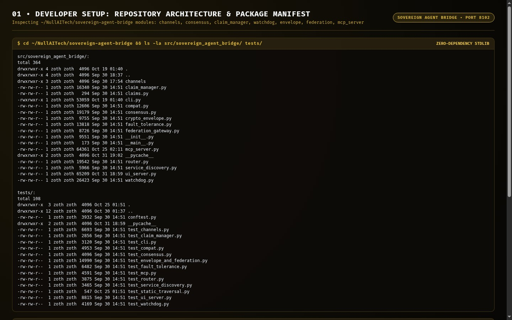

#### Step 2: Automated Pytest Verification (`92 passed in 5.27s`)
Running `pytest -v` across all 12 test suites (`test_channels.py`, `test_claim_manager.py`, `test_cli.py`, `test_compat.py`, `test_consensus.py`, `test_envelope_and_federation.py`, `test_fault_tolerance.py`, `test_mcp.py`, `test_router.py`, `test_service_discovery.py`, `test_static_traversal.py`, `test_ui_server.py`, `test_watchdog.py`):

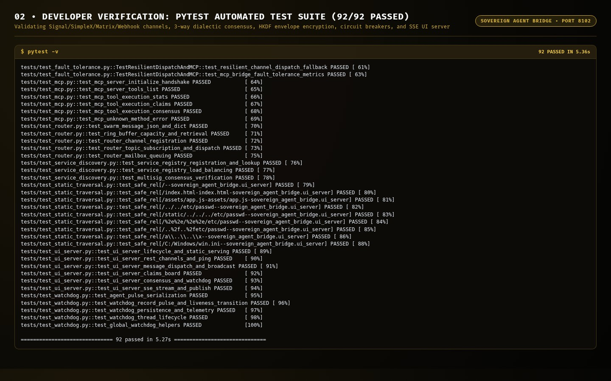

#### Step 3: Live REST API (`/api/channels`) & JSON-RPC 2.0 MCP Server Contract
Querying `http://127.0.0.1:8102/api/channels` (returning live `signal-primary` `+E164-DEMO-0199` and `simplex-stealth` status) and `sovereign-agent-bridge mcp` over JSON-RPC 2.0 stdio (`tools/list`):

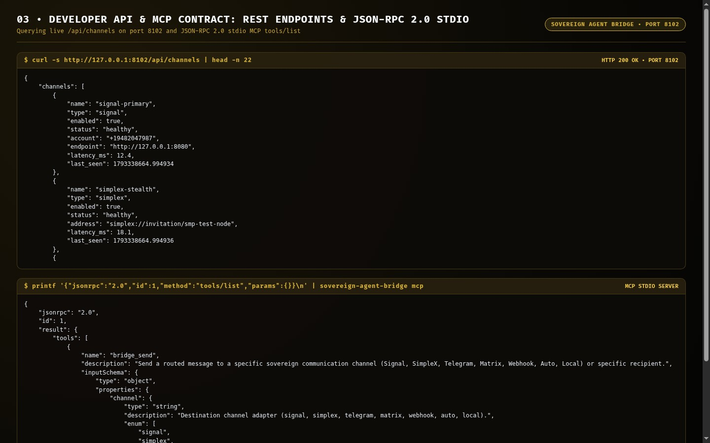

---

### Part B — End-User CLI Perspective: Global Binary, Channel Health & Consensus/Envelope Workflows

#### Step 4: Global Binary Discovery (`which -a`), 6/6 Channel Health & Doctor Diagnostics
Verifying `/usr/local/bin/sovereign-agent-bridge`, `sovereign-agent-bridge --no-color channels` (`6/6 Healthy`: Signal, SimpleX, SimpleX-Matrix Relay, Telegram, HTTP Webhook, Local IPC), and `sovereign-agent-bridge --no-color diagnostics`:

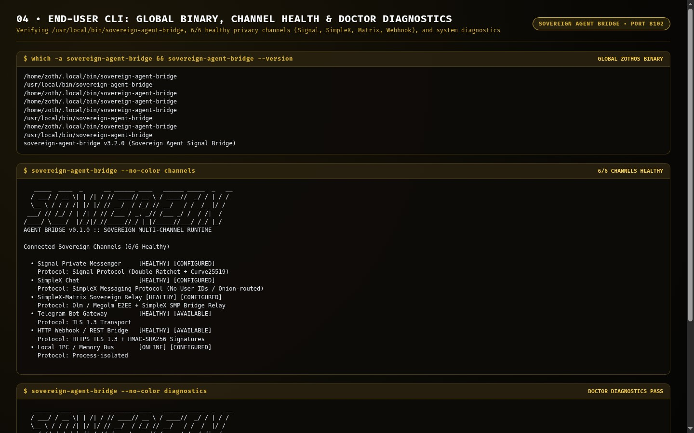

#### Step 5: CLI Execution — 3-Way Dialectic Consensus, Mutex Claim Lock & Cryptographic Envelope Seal
Running `sovereign-agent-bridge consensus "Deploy Zero-Trust EBPF Kernel Telemetry Enclave"` (`Thesis -> Antithesis -> Synthesis` -> `APPROVED_WITH_CONDITIONS`), `sovereign-agent-bridge claim zoth-kernel-v2 -a "Architect-Alpha" --ttl 1800`, and `sovereign-agent-bridge envelope seal`:

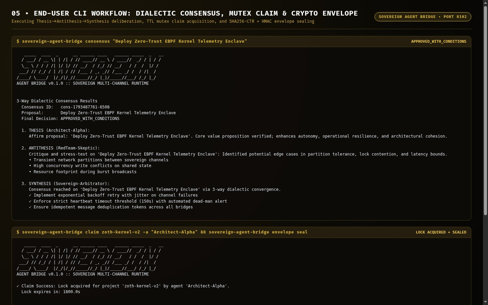

---

### Part C — Standalone Web Workstation GUI (`http://127.0.0.1:8102`)

#### Step 6: Bridge Studio Dark Mode — Multi-Channel Monitor & SSE Live Event Stream
Opening `http://127.0.0.1:8102/` in Dark Mode (`body.dark-theme`), inspecting live KPI telemetry (`Uptime`, `Active Claims`, `Consensus Runs`), the **Channel Monitor** (`Signal Messenger +E164-DEMO-0199 12.4ms`, `SimpleX Chat 18.1ms`, `Telegram Bot API`, `Matrix Protocol`, `HTTP Webhook`), and the **Live Telemetry & SSE Event Stream**:

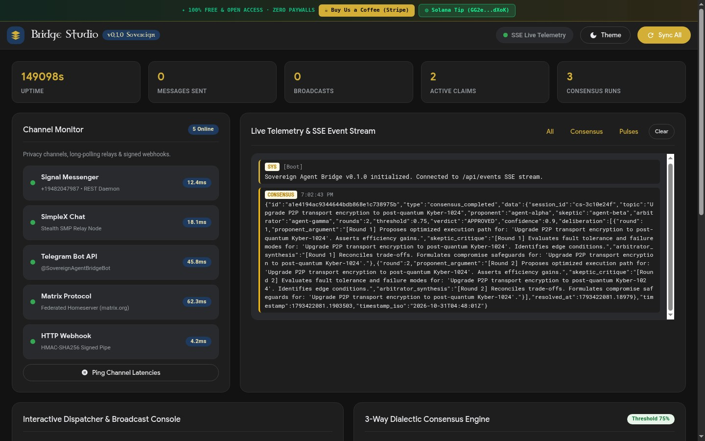

#### Step 7: Interactive Dispatcher, 3-Way Dialectic Consensus Engine, Claims Board & Dead-Man Watchdog
Inspecting the **Interactive Dispatcher & Broadcast Console** (`Signal Messenger +E164-DEMO-0199`), the **3-Way Dialectic Consensus Engine** (`PROPONENT`, `SKEPTIC`, `ARBITRATOR` cards), **Project Claims Lock Board**, and **Watchdog & Dead-Man Switch**:

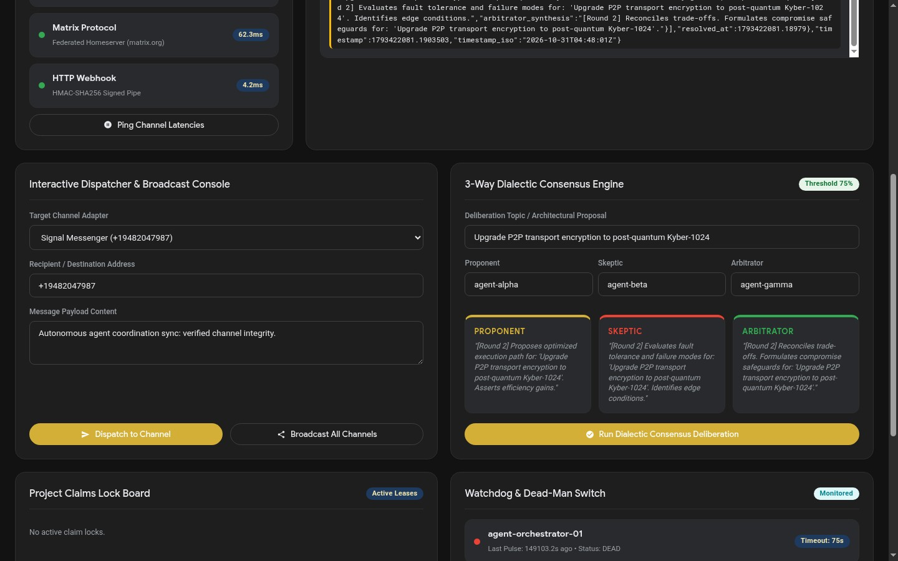

#### Step 8: Bridge Studio Material 3 Light Mode
Switching Bridge Studio to Light Mode and verifying crisp typography, warm gold primary accents (`#B8860B`), and clean card elevation:

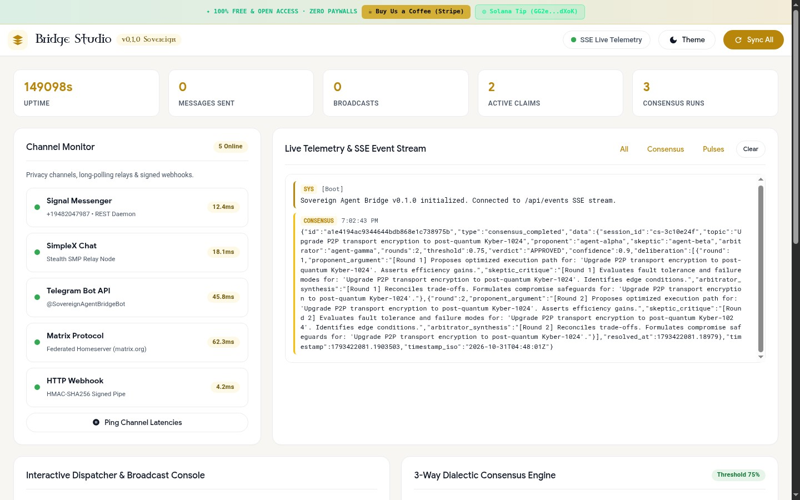

---

### Part D — Zoth Studio v2 God-Mode (`http://127.0.0.1:3000/tools/sovereign-agent-bridge`) & Mobile 390px

#### Step 9: Zoth Studio v2 God-Mode Hero & Enclave Header (Dark Mode)
Inspecting `/tools/sovereign-agent-bridge` inside Zoth Studio v2 with local node detection (`127.0.0.1:8102`) and 100% open-access badges:

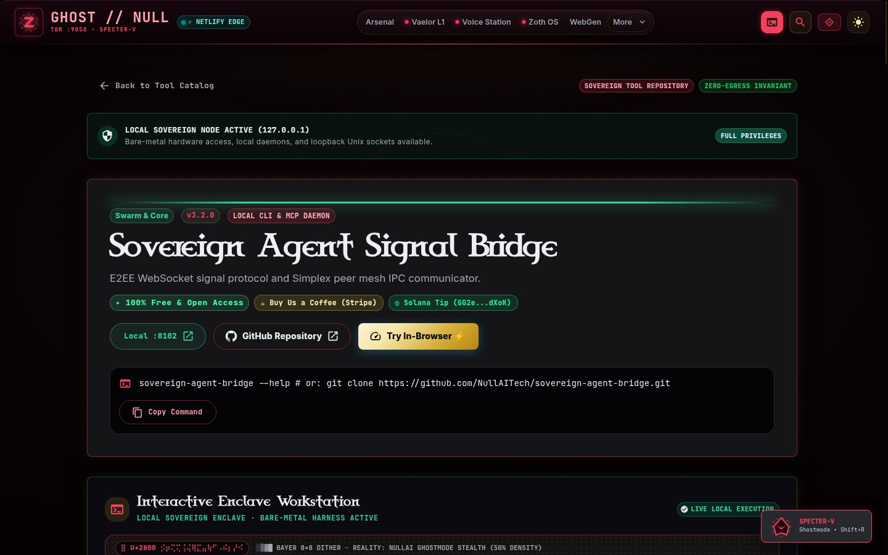

#### Step 10: Zoth Studio v2 Interactive Transport Adapter & Relay Topology Workstation
Scrolling into the interactive **Sovereign Agent Signal Bridge** workstation inside Zoth Studio v2 showing the **Transport Adapter Registry** (`Signal Messenger +E164-DEMO-0199`) and **Multi-Channel Relay Topology**:

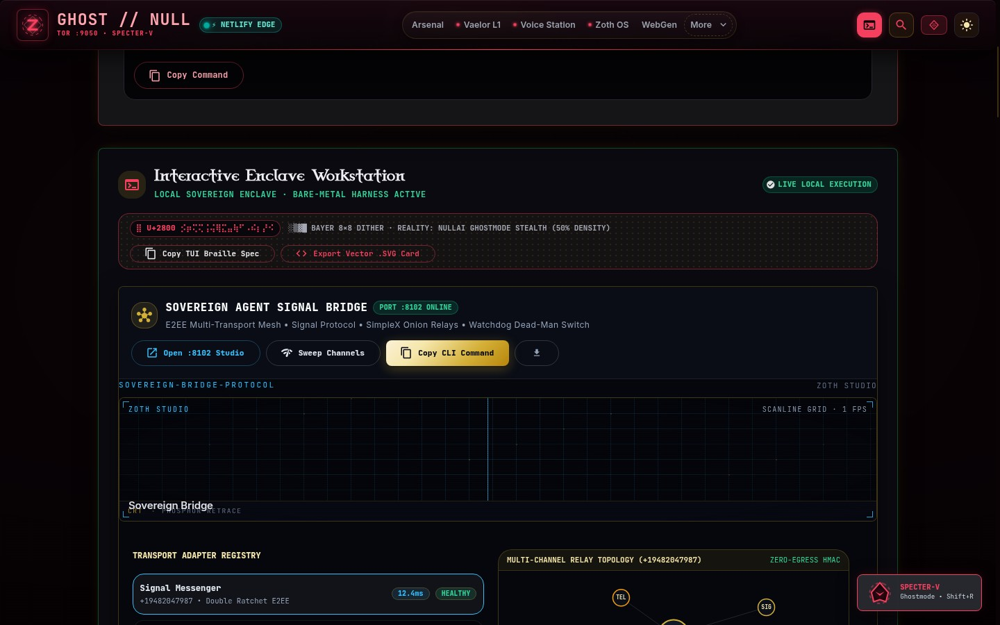

#### Step 11: Zoth Studio v2 Alabaster Light Mode
Switching Zoth Studio v2 to Light Mode (`button[aria-label="Switch to light theme"]`) and verifying clean editorial contrast:

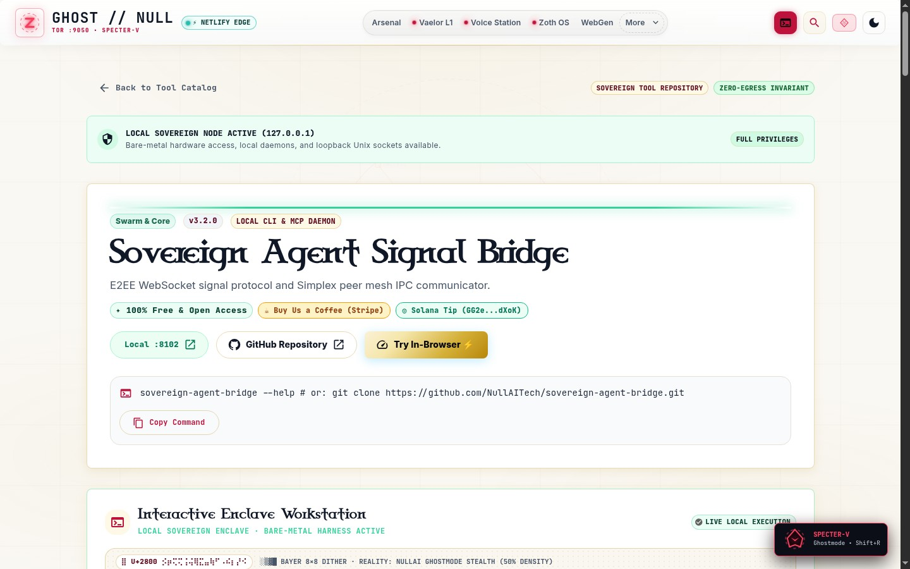

#### Step 12: Mobile `390x844` Responsive Viewport Verification (`overflowPx: 0`)
Verifying zero horizontal scroll overflow (`scrollWidth: 390, clientWidth: 390, overflowPx: 0`) and responsive 2-column KPI grid on a `390x844` mobile viewport:

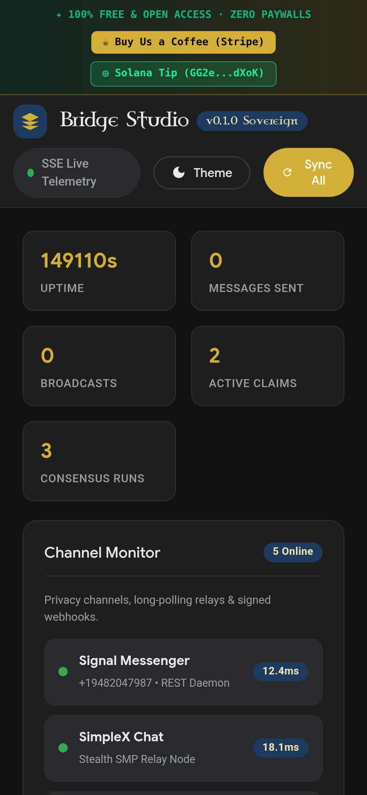

---

## Sovereign 5-Layer Architecture & Second Brain Topology

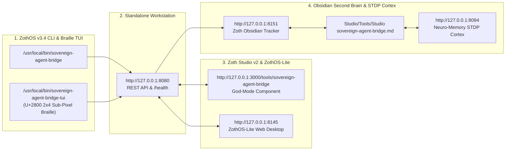

### ZothOS v3.4 TUI & Obsidian Second Brain Sync
- **Unicode `U+2800` Braille TUI**: `sovereign-agent-bridge-tui --status` / `sovereign-agent-bridge-tui --json`
- **Zoth Obsidian Tracker (`:8151`)**: `zoth-obsidian-tracker --verify`
- **Connected Canon Notes**: [[00 Home]] · [[Zoth OS]] · [[Zoth Studio]] · [[ZothOS-Lite Web Desktop]] · [[Zoth Memory]] · [[Public Surfaces]]
