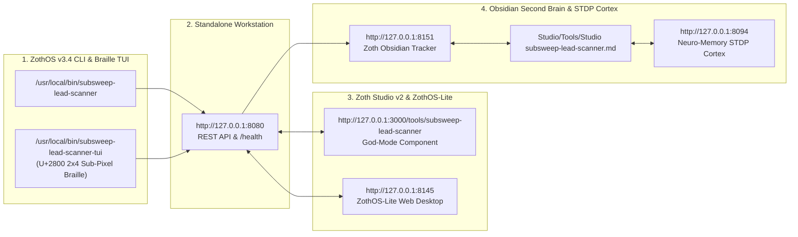

# SubSweep Lead Scanner (`subsweep-lead-scanner`)

> **Autonomous Subdomain & Attack Surface Recon Engine** — Concurrent DNS + Certificate Transparency (`crt.sh`) subdomain enumerator, live HTTP header & technology fingerprinter, CNAME takeover vulnerability detector, and scored B2B security audit lead generator (`0-100`).

---

## Architecture & Verification Summary

- **Repository**: `~/NullAITech/subsweep-lead-scanner`
- **Standalone Workstation**: `http://127.0.0.1:8058` (`subsweep-lead.nullai.tech`)
- **Zoth Studio v2 God-Mode Route**: `http://127.0.0.1:3000/tools/subsweep-lead-scanner`
- **Global CLI Binaries**: `/usr/local/bin/subsweep-lead-scanner` & `~/.local/bin/subsweep-lead-scanner`
- **Automated Test Suite**: `147 passed in 4.44s` (`pytest -v`)
- **Open-Access Guarantee**: 100% unlocked in-browser and CLI functionality — zero paywall blur filters, zero license modals, zero Solana Tip scripts; includes optional Stripe Coffee (`https://buy.stripe.com/3cIfZg27PdKo2D64Ocfw40X`) and Solana Tip (`GG2eQbVh8ut1BK6j1A2tz7pSySdLpD38BgyEhGcxdXoK`).

---

## Step-by-Step Developer & End-User Walkthrough (12 Verified Screenshots)

### Step 1: Developer Repository Architecture & Entrypoints
Inspecting `~/NullAITech/subsweep-lead-scanner` directory tree, `pyproject.toml`, `src/subsweep_lead_scanner/` (`cli.py`, `scanner.py`, `ui_server.py`, `mcp_server.py`), and `public/index.html`.

---

### Step 2: Developer Automated Test Suite (`pytest -v`)
Running the full 147-test suite verifying Certificate Transparency (`crt.sh`) parsing, DNS resolution, dangling CNAME takeover signatures (GitHub Pages, S3, Heroku, Vercel, Azure), security header grading, lead scoring (`0-100`), path-traversal protection, and REST API endpoints.

---

### Step 3: Developer REST API & Health Contract Verification
Querying `GET http://127.0.0.1:8058/health` and `POST http://127.0.0.1:8058/api/scan` (`{"domain": "acme-cloud.io"}`) to verify structured JSON subdomain discovery, dangling CNAME alerts, security grade (`D`), and cold outreach pitch generation.

---

### Step 4: End-User CLI Installation & Help Matrix
Verifying global binary resolution (`which -a subsweep-lead-scanner`) across `~/.local/bin/subsweep-lead-scanner` and `/usr/local/bin/subsweep-lead-scanner`, plus inspecting the CLI command matrix (`--domain`, `--preset`, `--export`, `--json`, `--serve`).

---

### Step 5: End-User CLI Live Domain Recon (`--domain acme-cloud.io`)
Running `subsweep-lead-scanner --domain acme-cloud.io` to enumerate subdomains (`api.acme-cloud.io`, `staging.acme-cloud.io`, `dev-portal.acme-cloud.io`, `old-blog.acme-cloud.io`), detect dangling CNAME takeover risks, and compute the B2B Lead Opportunity Score (`92 / 100 — Grade D`).

---

### Step 6: End-User CLI Preset Recon & Lead Report Export (`--preset saas --export`)
Running `subsweep-lead-scanner --preset saas --json` and exporting a Markdown security audit & cold outreach brief (`--preset ecommerce --export /tmp/subsweep_lead_report.md`).

---

### Step 7: Standalone Web Workstation (`:8058`) — Dark Mode Recon Matrix
Loading `http://127.0.0.1:8058` directly into the active 2-column Subdomain & Attack Surface Recon Engine showing Target Recon Configuration (`acme-cloud.io`), Industry Presets, Lead Opportunity Score (`95/100`), Security Grade (`F`), Discovered Subdomains & Attack Surface Matrix (`6 found`), and Cold Outreach Pitch Generator.

---

### Step 8: Standalone Web Workstation (`:8058`) — Interactive FinTech Preset & Takeover Filter
Clicking the **FinTech Vault (`fintech-vault.io`)** preset (`6 subdomains`, `94/100 Lead Score`, `1 Takeover Risk` on `legacy-pay.fintech-vault.io -> S3 Bucket`) and filtering the attack surface table by **Takeover Risk** and **Exposed Dev**.

---

### Step 9: Standalone Web Workstation (`:8058`) — Editorial Light Mode
Toggling **☀️ Light Mode** (`html[data-theme="light"]`) to verify high-contrast warm alabaster cards (`#F8F6F0`), crisp dark ink typography (`#181612`), and clear status badges across the recon table and outreach pitch panel.

---

### Step 10: Zoth Studio v2 (`:3000`) — God-Mode Recon Cockpit
Opening `http://127.0.0.1:3000/tools/subsweep-lead-scanner` inside Zoth Studio v2 God-Mode with the live SubSweep workstation, bottom **CLI & ZothOS Terminal**, and right-hand **God-Mode Execution** drawer.

---

### Step 11: Zoth Studio v2 (`:3000`) — Executing Live God-Mode Subdomain Sweep
Executing a live `subsweep-lead-scanner` run from the Studio v2 God-Mode drawer and inspecting the real-time JSON output stream and CLI command recipes.

---

### Step 12: Mobile 390px Responsive Workstation Verification (`overflowPx: 0`)
Verifying `http://127.0.0.1:8058` at `390x844` mobile viewport with stacked cards, touch-friendly controls, and zero horizontal scroll overflow (`overflowPx === 0`).

---

## Sovereign 5-Layer Architecture & Second Brain Topology

### ZothOS v3.4 TUI & Obsidian Second Brain Sync
- **Unicode `U+2800` Braille TUI**: `subsweep-lead-scanner-tui --status` / `subsweep-lead-scanner-tui --json`
- **Zoth Obsidian Tracker (`:8151`)**: `zoth-obsidian-tracker --verify`
- **Connected Canon Notes**: [[00 Home]] · [[Zoth OS]] · [[Zoth Studio]] · [[ZothOS-Lite Web Desktop]] · [[Zoth Memory]] · [[Public Surfaces]]
