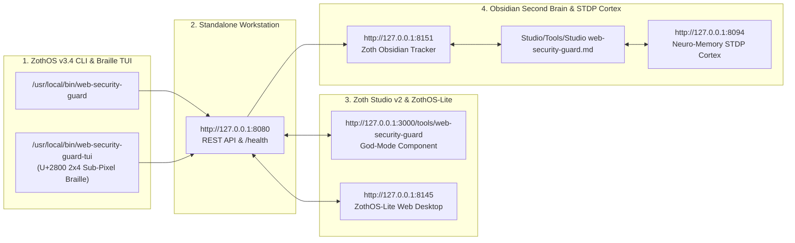

# Web Security Guard (`web-security-guard`)

> **Sovereign In-Browser Security Headers Auditor, TLS Certificate Inspector, CSP Level 3 Generator, SHA-384 SRI Hasher, WCAG 2.2 Contrast Engine & 12-Tool MCP Server**
> - **Standalone Workstation**: `http://127.0.0.1:8125`
> - **Zoth Studio v2 God-Mode**: `http://127.0.0.1:3000/tools/web-security-guard`
> - **Global ZothOS CLI**: `~/.local/bin/web-security-guard` (`/usr/local/bin/web-security-guard`)
> - **100% Open-Access Support**: [☕ Buy Us a Coffee (Stripe)](https://buy.stripe.com/3cIfZg27PdKo2D64Ocfw40X) · ◎ Solana Tip: `GG2eQbVh8ut1BK6j1A2tz7pSySdLpD38BgyEhGcxdXoK`

---

## Part I — Developer Architecture, Automated Test Suite & API / MCP Contracts

### Step 01 · Repository Architecture & Core SecOps Modules (`src/web_security_guard/`)
Developers inspecting `~/NullAITech/web-security-guard` can examine the 22 specialized modules in `src/web_security_guard/` (`auditor.py`, `csp.py`, `sri.py`, `wcag.py`, `ssl_inspector.py`, `isolation_guard.py`, `secret_scanner.py`, `supply_chain_auditor.py`, `patcher.py`, `mcp_server.py`, `ui_server.py`) and the production entrypoint (`server.py` on `:8125`).

![[Studio/Tools/Artifacts/web-security-guard/web-security-guard_01_dev_repo_architecture.jpg]]

### Step 02 · Automated Pytest Suite (`pytest -v` — 300 Passed)
Running `pytest -v` executes 300 unit and HTTP integration tests across `tests/`, verifying WCAG 2.2 luminance math, SHA-384 SRI hashing & HTML injection, CSP Level 3 policy generation, TLS certificate inspection, secret leakage detection, supply-chain auditing, and live REST endpoints (`/api/audit`, `/api/csp/generate`, `/api/sri/hash`, `/api/wcag/contrast`, `/api/remediate`).

![[Studio/Tools/Artifacts/web-security-guard/web-security-guard_02_dev_pytest_suite.jpg]]

### Step 03 · REST API & 12-Tool Model Context Protocol (MCP) Contract (`:8125`)
Developers integrating with `:8125` can query `GET /api/health`, generate multi-framework CSP Level 3 snippets via `POST /api/csp/generate` (returning Next.js middleware, Nginx, Vercel, and Netlify configs), or expose the 12 native MCP tools (`sec_audit_site`, `sec_generate_csp`, `sec_generate_sri`, `sec_inject_sri`, `sec_check_contrast`, `sec_generate_remediation`, `sec_inspect_ssl`, etc.) via `web-security-guard mcp`.

![[Studio/Tools/Artifacts/web-security-guard/web-security-guard_03_dev_api_mcp_contracts.jpg]]

---

## Part II — End-User ZothOS CLI Installation & Terminal Workflows

### Step 04 · Global ZothOS CLI Installation & 15-Subcommand Contract
End-users invoke `web-security-guard --help` from any directory to access all 15 subcommands: `audit`, `csp`, `sri`, `contrast`, `fix`, `check`, `ssl`, `diff`, `patch`, `mcp`, `isolation`, `secrets`, `supply`, `serve`, and `platform`.

![[Studio/Tools/Artifacts/web-security-guard/web-security-guard_04_user_cli_help_install.jpg]]

### Step 05 · CLI Workflow A — Strict CSP Level 3 Policy & SHA-384 Subresource Integrity Hasher
Running `web-security-guard csp --preset strict --framework nextjs --nonce zoth-nonce-77` emits a production-ready `strict-dynamic` + cryptographic nonce `Content-Security-Policy` header, while `web-security-guard sri "console.log('sovereign-shield');" --algorithm sha384` computes the Base64/Hex SHA-384 digest and ready-to-paste `<script>` / `<link>` tags.

![[Studio/Tools/Artifacts/web-security-guard/web-security-guard_05_user_cli_workflow_a.jpg]]

### Step 06 · CLI Workflow B — WCAG 2.2 Contrast Analysis & 13-Point Self-Test Suite
Running `web-security-guard contrast "#D4AF37" "#08080B"` verifies Zoth Gold on Void (`9.51:1` contrast ratio — passing all WCAG 2.2 AA and AAA criteria), and `web-security-guard --test` executes the 13-point internal SecOps engine verification suite.

![[Studio/Tools/Artifacts/web-security-guard/web-security-guard_06_user_cli_workflow_b.jpg]]

---

## Part III — Standalone Web Workstation (`:8125`), Zoth Studio God-Mode (`:3000`) & Responsive Verification

### Step 07 · Standalone Web Workstation (`http://127.0.0.1:8125`) — Dark Mode Live Site Auditor
Opening `http://127.0.0.1:8125` launches the **Web Security Studio** workstation in Dark Mode, displaying the **Live Site Auditor** with an `A+ (94/100)` security score ring, vector breakdowns (`Security Headers`, `Transport & Origin Isolation`), and the 100% Free & Open-Access support bar.

![[Studio/Tools/Artifacts/web-security-guard/web-security-guard_07_gui_standalone_dark_home.jpg]]

### Step 08 · Standalone Web Workstation — CSP Level 3 Policy Builder & Multi-Platform Exporter
Switching to **★ CSP Level 3 Builder** lets users toggle `'strict-dynamic'`, `upgrade-insecure-requests`, and `block-all-mixed-content`, regenerate cryptographic nonces, and export ready-to-deploy Next.js 14/15 App Router Edge Middleware, Nginx, Vercel, Netlify, and Cloudflare Workers snippets.

![[Studio/Tools/Artifacts/web-security-guard/web-security-guard_08_gui_standalone_interactive_a.jpg]]

### Step 09 · Standalone Web Workstation — WCAG 2.2 Contrast Engine & Editorial Light Mode
Switching to **✦ WCAG 2.2 Contrast** and toggling **☀️ Light Mode** transitions the workstation to warm alabaster (`#F8F6F0`) while evaluating real-time relative luminance ratios (`4.51:1`), AA/AAA compliance badges, and Protanopia / Deuteranopia / Tritanopia / Achromatopsia color vision deficiency simulations.

![[Studio/Tools/Artifacts/web-security-guard/web-security-guard_09_gui_standalone_interactive_b.jpg]]

### Step 10 · Zoth Studio v2 God-Mode Workbench (`http://127.0.0.1:3000/tools/web-security-guard`) — Overview
Navigating to `http://127.0.0.1:3000/tools/web-security-guard` inside Zoth Studio v2 displays the sovereign tool overview, local `:8125` launch controls, and open-access Stripe/Solana support links.

![[Studio/Tools/Artifacts/web-security-guard/web-security-guard_10_gui_studio_godmode_overview.jpg]]

### Step 11 · Zoth Studio v2 God-Mode Workbench — Interactive Enclave Workstation & Policy Auditor
Scrolling to the **Interactive Enclave Workstation** reveals the U+2800 Braille / Bayer 8x8 dither canvas and the live **Web Security Guard & Policy Auditor** (`GRADE A+`, `SCORE 98/100`, `0 ATTACK RISKS`) auditing `https://nullai.tech`.

![[Studio/Tools/Artifacts/web-security-guard/web-security-guard_11_gui_studio_godmode_interactive.jpg]]

### Step 12 · Mobile `390x844` Responsive Verification (`overflowPx === 0`)
Verified at `390x844` mobile viewport (`scrollWidth: 390, clientWidth: 390, overflowPx: 0`) with wrapped header actions, scrollable navigation tabs, and zero horizontal overflow.

![[Studio/Tools/Artifacts/web-security-guard/web-security-guard_12_gui_mobile_390px.jpg]]

---

## Sovereign 5-Layer Architecture & Second Brain Topology

### ZothOS v3.4 TUI & Obsidian Second Brain Sync
- **Unicode `U+2800` Braille TUI**: `web-security-guard-tui --status` / `web-security-guard-tui --json`
- **Zoth Obsidian Tracker (`:8151`)**: `zoth-obsidian-tracker --verify`
- **Connected Canon Notes**: [[00 Home]] · [[Zoth OS]] · [[Zoth Studio]] · [[ZothOS-Lite Web Desktop]] · [[Zoth Memory]] · [[Public Surfaces]]
