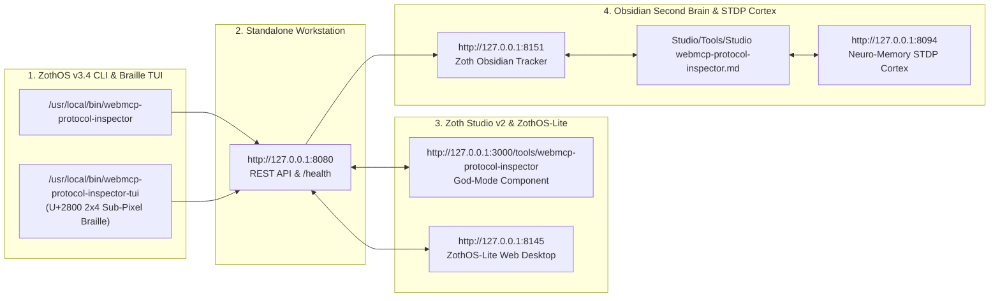

# WebMCP Protocol Suite (`webmcp-protocol-inspector`)

> **Sovereign In-Browser Model Context Protocol (MCP) JSON-RPC 2.0 Inspector, Tool Schema Dispatcher, Token Meter & Schema Security Firewall**
> - **Standalone Workstation**: `http://127.0.0.1:8142`
> - **Zoth Studio v2 God-Mode**: `http://127.0.0.1:3000/tools/webmcp-protocol-inspector`
> - **Global ZothOS CLI**: `~/.local/bin/webmcp-protocol-inspector` (`/usr/local/bin/webmcp-protocol-inspector`)
> - **100% Open-Access Support**: [☕ Buy Us a Coffee (Stripe)](https://buy.stripe.com/3cIfZg27PdKo2D64Ocfw40X) · ◎ Solana Tip: `GG2eQbVh8ut1BK6j1A2tz7pSySdLpD38BgyEhGcxdXoK`

---

## Part I — Developer Architecture, Automated Test Suite & API Contracts

### Step 01 · Repository Architecture & Schema Security Scoring Engine (`server.py`)
Developers inspecting `~/NullAITech/webmcp-protocol-inspector` can review the zero-dependency JSON-RPC 2.0 server (`server.py`), the standalone workstation (`public/index.html`), and the `audit_schema()` scoring engine that evaluates tool name hygiene, grounding description completeness, property documentation coverage, and prompt token footprints.

![[Studio/Tools/Artifacts/webmcp-protocol-inspector/webmcp-protocol-inspector_01_dev_repo_architecture.jpg]]

### Step 02 · Automated Pytest Suite (`pytest -v`)
Running `pytest -v` executes `tests/test_webmcp.py`, verifying `A+` (100/100) grading across all built-in MCP tool presets (`solana_tip_transfer`, `stripe_buy_coffee`, `system_diagnostics`), missing-field and undocumented-property warnings, and live HTTP endpoints (`/health`, `/api/presets`, `/api/inspect`, `/api/rpc/simulate`).

![[Studio/Tools/Artifacts/webmcp-protocol-inspector/webmcp-protocol-inspector_02_dev_pytest_suite.jpg]]

### Step 03 · REST & JSON-RPC 2.0 API Contract Verification (`:8142`)
Developers integrating with the local daemon on port `:8142` can query `/health`, submit MCP tool schemas to `POST /api/inspect` for real-time security grading and token estimation, and simulate `tools/call/*` wire frames via `POST /api/rpc/simulate`.

![[Studio/Tools/Artifacts/webmcp-protocol-inspector/webmcp-protocol-inspector_03_dev_api_mcp_contracts.jpg]]

---

## Part II — End-User ZothOS CLI Installation & Terminal Workflows

### Step 04 · Global ZothOS CLI Installation, Help Contract & Daemon Status
End-users invoke `webmcp-protocol-inspector` from anywhere in ZothOS to inspect available flags (`--presets`, `--inspect`, `--simulate`, `--params`, `--status`, `--json`) and check live daemon telemetry on `:8142`.

![[Studio/Tools/Artifacts/webmcp-protocol-inspector/webmcp-protocol-inspector_04_user_cli_help_install.jpg]]

### Step 05 · CLI Workflow A — Preset Catalog & Schema Safety Audit
Running `webmcp-protocol-inspector --presets` lists all built-in sovereign MCP tool schemas alongside their safety grade and token estimate, while `webmcp-protocol-inspector --inspect solana_tip_transfer` audits a specific tool definition.

![[Studio/Tools/Artifacts/webmcp-protocol-inspector/webmcp-protocol-inspector_05_user_cli_workflow_a.jpg]]

### Step 06 · CLI Workflow B — JSON-RPC 2.0 Bus Simulation & Machine-Readable JSON Audit
Running `webmcp-protocol-inspector --simulate tools/call/system_diagnostics --params '{"subsystem":"daemons","verbose":true}'` dispatches a structured JSON-RPC 2.0 frame, and `--inspect stripe_buy_coffee --json` emits deterministic JSON telemetry for CI/CD pipelines.

![[Studio/Tools/Artifacts/webmcp-protocol-inspector/webmcp-protocol-inspector_06_user_cli_workflow_b.jpg]]

---

## Part III — Standalone Web Workstation (`:8142`), Zoth Studio God-Mode (`:3000`) & Responsive Verification

### Step 07 · Standalone Web Workstation (`http://127.0.0.1:8142`) — Dark Mode Home
Opening `http://127.0.0.1:8142` launches directly into the dual-pane WebMCP Protocol Suite workstation with live token estimation (`~150`), real-time schema grading (`GRADE: A+ (100/100)`), and the 100% Free & Open-Access support bar.

![[Studio/Tools/Artifacts/webmcp-protocol-inspector/webmcp-protocol-inspector_07_gui_standalone_dark_home.jpg]]

### Step 08 · Standalone Web Workstation — Live JSON-RPC 2.0 Frame Dispatch (`solana_tip_transfer`)
Clicking **Dispatch JSON-RPC Frame ⚡** sends the `tools/call/solana_tip_transfer` payload to `/api/rpc/simulate` on `:8142` and renders the complete JSON-RPC 2.0 response envelope in the Wire Result Envelope panel.

![[Studio/Tools/Artifacts/webmcp-protocol-inspector/webmcp-protocol-inspector_08_gui_standalone_interactive_a.jpg]]

### Step 09 · Standalone Web Workstation — System Diagnostics Preset & Editorial Light Mode
Switching to the **System Diagnostics** preset (`system_diagnostics`), dispatching the `{"subsystem": "daemons", "verbose": true}` frame, and toggling **☀️ Light Mode** transitions the workstation to high-contrast warm alabaster (`#F8F6F0`) with deep ink typography (`#181612`).

![[Studio/Tools/Artifacts/webmcp-protocol-inspector/webmcp-protocol-inspector_09_gui_standalone_interactive_b.jpg]]

### Step 10 · Zoth Studio v2 God-Mode Workbench (`http://127.0.0.1:3000/tools/webmcp-protocol-inspector`) — Overview
Inside Zoth Studio v2 (`:3000`), the WebMCP Protocol Suite page presents local sovereign node status, quick-launch commands, and 100% open-access Stripe/Solana support rails.

![[Studio/Tools/Artifacts/webmcp-protocol-inspector/webmcp-protocol-inspector_10_gui_studio_godmode_overview.jpg]]

### Step 11 · Zoth Studio v2 God-Mode Workbench — Interactive Enclave Workstation & Transport Bus
Scrolling to the **Interactive Enclave Workstation** reveals the live JSON-RPC 2.0 Transport Bus (`BROWSER / AGENT` → `RING 2 GATE SCORE 100/100` → `MCP TOOL ENCLAVE`), interactive Ring-level preset buttons, and the U+2800 Braille / Bayer 8x8 dither canvas.

![[Studio/Tools/Artifacts/webmcp-protocol-inspector/webmcp-protocol-inspector_11_gui_studio_godmode_interactive.jpg]]

### Step 12 · Mobile `390x844` Responsive Verification (`overflowPx === 0`)
Verified at `390x844` mobile viewport (`scrollWidth: 390, clientWidth: 390, overflowPx: 0`) with stacked responsive panels, touch-friendly preset pills, and zero horizontal overflow.

![[Studio/Tools/Artifacts/webmcp-protocol-inspector/webmcp-protocol-inspector_12_gui_mobile_390px.jpg]]

---

## Sovereign 5-Layer Architecture & Second Brain Topology

### ZothOS v3.4 TUI & Obsidian Second Brain Sync
- **Unicode `U+2800` Braille TUI**: `webmcp-protocol-inspector-tui --status` / `webmcp-protocol-inspector-tui --json`
- **Zoth Obsidian Tracker (`:8151`)**: `zoth-obsidian-tracker --verify`
- **Connected Canon Notes**: [[00 Home]] · [[Zoth OS]] · [[Zoth Studio]] · [[ZothOS-Lite Web Desktop]] · [[Zoth Memory]] · [[Public Surfaces]]
