# Zela Glasses Guide (`zela-glasses-guide`)

> **Sovereign Wearable AI Mission Coach for Ray-Ban Meta Smart Glasses over Tailscale** — Full-duplex WebSocket `/v1/guide/stream` relay, local Moondream vision captioning in RAM with degenerate bounding-box sanitization, persistent AGY `stream-json` coaching with `[^ spoken ^]` `MarkerParser` early comma splitting, and 24kHz Kokoro v1.0 ONNX neural TTS with instant barge-in.
> **100% Free & Open-Access** • **Zero Paywalls** • [☕ Buy Us a Coffee (Stripe)](https://buy.stripe.com/3cIfZg27PdKo2D64Ocfw40X) • Solana Tip: `GG2eQbVh8ut1BK6j1A2tz7pSySdLpD38BgyEhGcxdXoK`

---

## Architecture & Operational Overview

1. **Developer Architecture (`~/NullAITech/zela-glasses-guide`)**:
   - `server.py`: Wearable mission preset engine (`SCENES` across Repair, Hardware, Daily, Security, DevOps, and Mobility), `SAMPLE_CONFIG_YAML` exporter for `~/.config/zoth-relay/mobile/config.yaml`, and `/health`, `/api/status`, `/api/presets`, `/api/config` endpoints on port `8144`.
   - `public/index.html` & `public/possibilities.html`: Interactive Ray-Ban Meta Optical HUD Viewfinder simulator, `MarkerParser` clause splitter (`zoth_relay/markers.py`), Moondream `sanitize_caption()` regex/token-ratio filter (`zoth_relay/guide.py`), and 12-Minute Soak Benchmark table (`zgbench/after.json`).
   - `tests/test_zela_glasses_guide.py`: Automated `pytest` suite verifying all 6 wearable presets, YAML configuration invariants, and HTTP JSON endpoints.
2. **End-User ZothOS CLI (`zela-glasses-guide`)**:
   - Installed at `~/.local/bin/zela-glasses-guide` and `/usr/local/bin/zela-glasses-guide`.
   - Supports `--help`, `--status`, `--presets`, `--config`, `--json`, and `--serve PORT`.
3. **Interactive GUI Workstations**:
   - **Standalone Workstation (`http://127.0.0.1:8144`)**: Features the 4-tab wearable mission coach workbench (`01 · Smart Glasses POV Simulator`, `02 · MarkerParser & Caption Sanitizer`, `03 · v0.4 vs v0.5 Soak Benchmarks`, `04 · Live Relay Bridge & Config Export`) with Dark & Light mode support.
   - **Zoth Studio v2 God-Mode (`http://127.0.0.1:3000/tools/zela-glasses-guide`)**: Integrated with the 60fps WebGPU Hand & Facial Kinematics stage (`Zela AR Waveguide HUD & Optical Reticle` mode) and temple-tap gesture bindings.

---

## Part I — Developer Perspective (Architecture, Automated Pytest Suite & API Contracts)

### Step 1: Repository Structure & Wearable Mission Presets (`server.py`)
Inspecting `~/NullAITech/zela-glasses-guide` directory layout, `public/` HUD simulator assets, and the `SCENES` wearable coaching preset catalog in `server.py`:

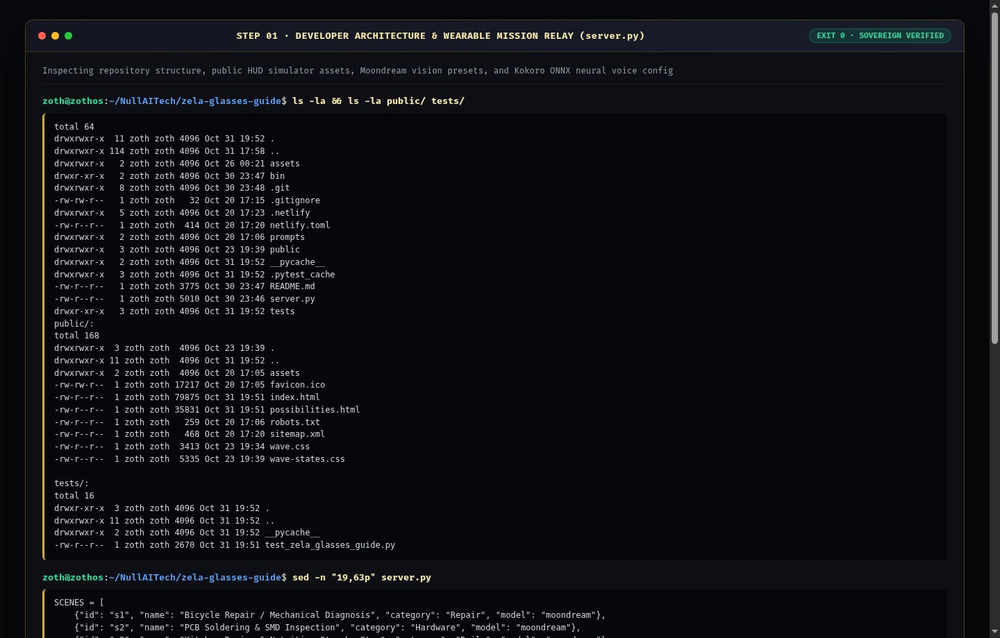

### Step 2: Running the Automated `pytest -v` Verification Suite
Executing `pytest -v` in `~/NullAITech/zela-glasses-guide` to verify wearable scene presets, YAML relay configuration, and `/health`, `/api/status`, `/api/presets`, `/api/config` endpoints (`2 passed in 0.54s`):

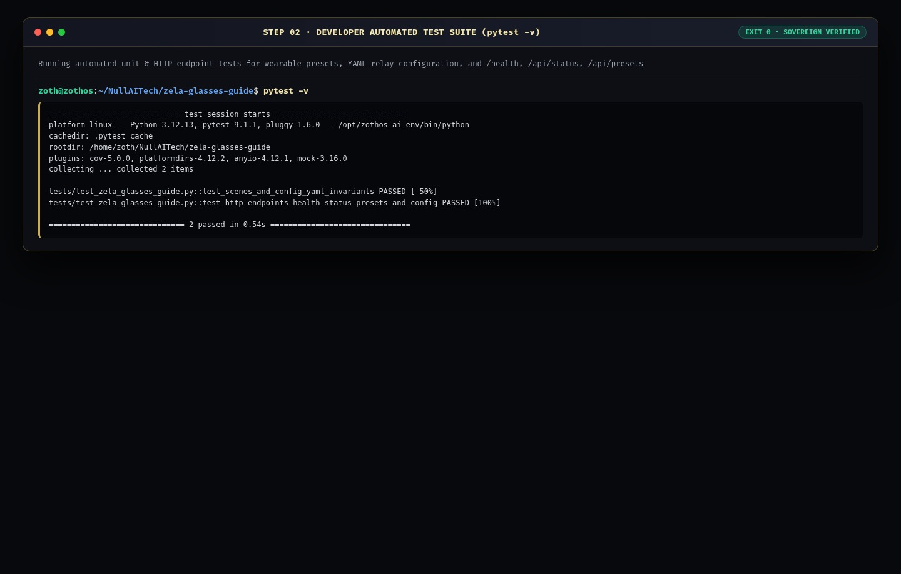

### Step 3: Verifying Live REST API & Wearable Telemetry Contracts (`:8144`)
Querying `GET /health` and `GET /api/status` on `http://127.0.0.1:8144` to verify Tailscale WireGuard endpoint configuration (`100.106.132.5:8766`), Moondream vision engine, and Kokoro v1.0 ONNX TTS status:

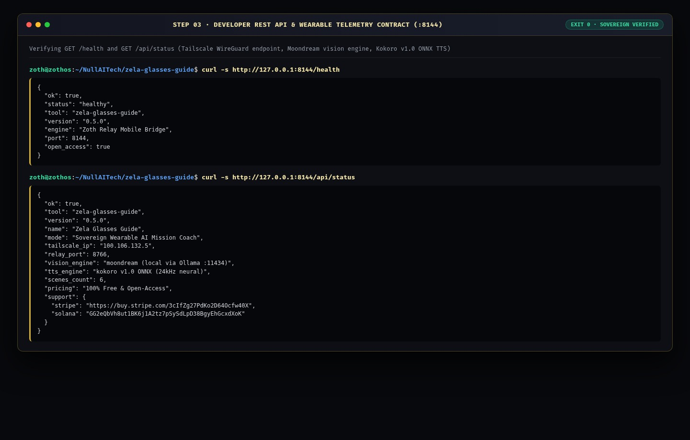

---

## Part II — End-User CLI Perspective (Installation, Mission Presets & Relay YAML)

### Step 4: Global ZothOS Binary Discovery & CLI Help Contract
Running `which -a zela-glasses-guide`, `zela-glasses-guide --help`, and `zela-glasses-guide --status` to confirm global CLI installation and active daemon status:

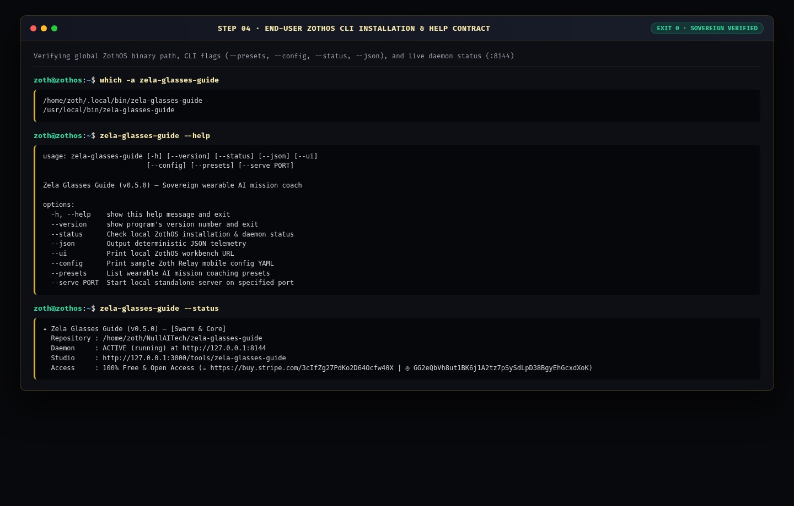

### Step 5: CLI Workflow A — Listing Wearable Mission Presets & Exporting Relay Config YAML
Running `zela-glasses-guide --presets` to inspect all 6 Moondream coaching presets and `zela-glasses-guide --config` to export `~/.config/zoth-relay/mobile/config.yaml`:

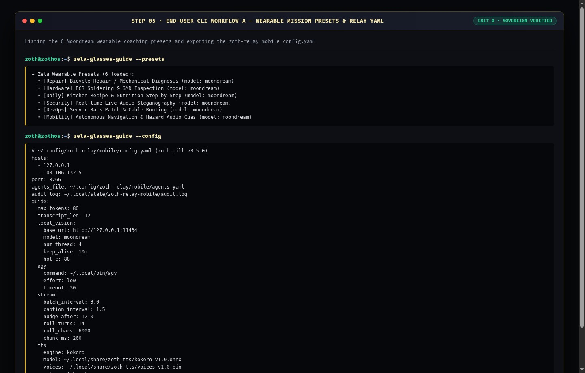

### Step 6: CLI Workflow B — Machine-Readable JSON Telemetry & Preset Catalog
Executing `zela-glasses-guide --json` and `zela-glasses-guide --presets --json` for automated agent pipeline consumption:

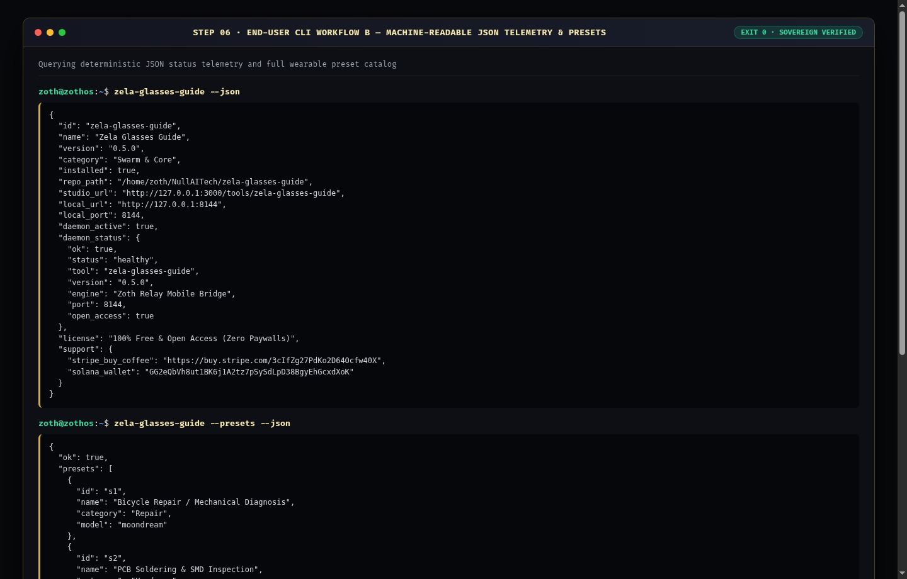

---

## Part III — End-User GUI Perspective (Standalone Workstation, Studio God-Mode & Mobile)

### Step 7: Standalone Web Workstation (`:8144`) — Ray-Ban Meta Optical HUD Viewfinder
Loading `http://127.0.0.1:8144` into the **Smart Glasses POV Simulator** tab (`01 · Smart Glasses POV Simulator`), showcasing the live Ray-Ban Meta Optical HUD Viewfinder, Moondream scene captioning, silent context tracker, and WebSocket `/v1/guide/stream` coaching turns:

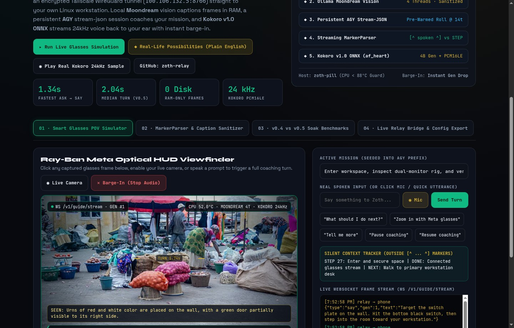

### Step 8: Standalone Interactive Workflow A — Streaming `MarkerParser` & Moondream `sanitize_caption()` Filter
Switching to `02 · MarkerParser & Caption Sanitizer`, parsing streaming AGY `[^ spoken ^]` clauses on early commas (`min_chunk_words >= 4`) while filtering degenerate bounding-box coordinate arrays from Moondream vision output:

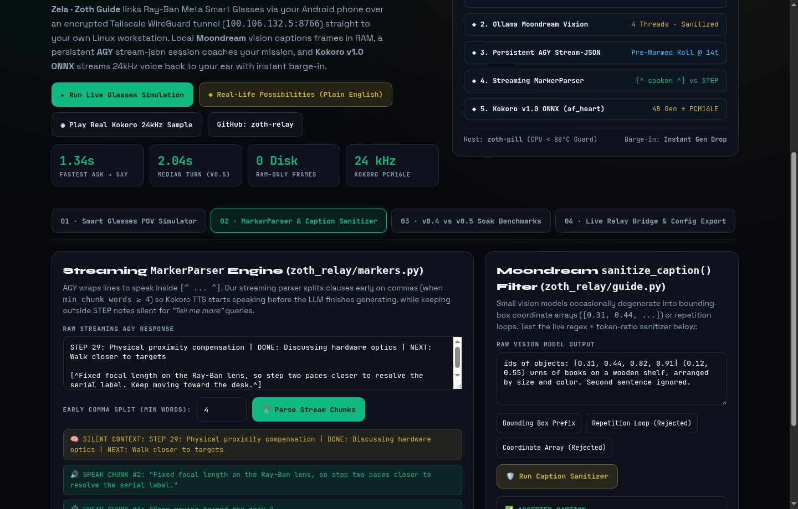

### Step 9: Standalone Interactive Workflow B — Editorial Light Mode & 12-Minute Soak Benchmarks
Toggling Editorial Light Mode (`toggleTheme()`) and inspecting `03 · v0.4 vs v0.5 Soak Benchmarks`, displaying the real 12-minute soak benchmark table (`zgbench/after.json`) with 8 zero-stall session rolls and `1.34s` fastest Ask-to-Say latency:

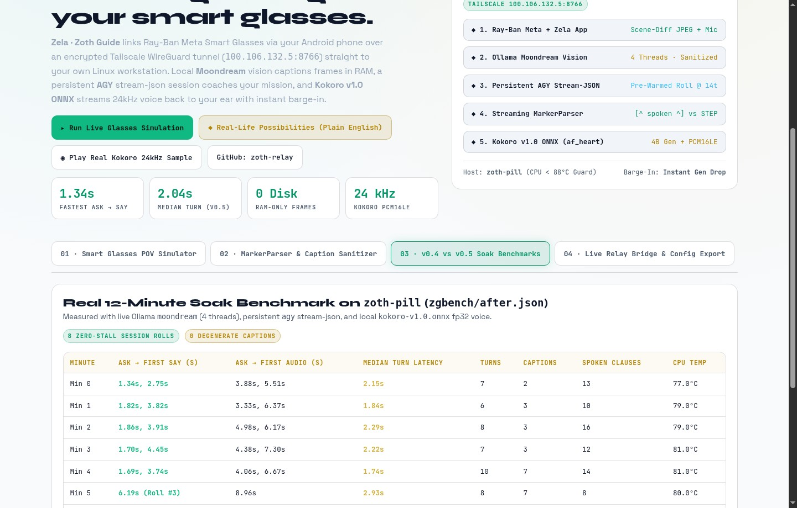

### Step 10: Zoth Studio v2 God-Mode (`:3000/tools/zela-glasses-guide`) — Overview & Local Enclave Bridge
Opening `http://127.0.0.1:3000/tools/zela-glasses-guide` in Zoth Studio v2, verifying the Local Sovereign Node (`:8144`) status banner, Open-Access Stripe/Solana support badges, and CLI launch bar:

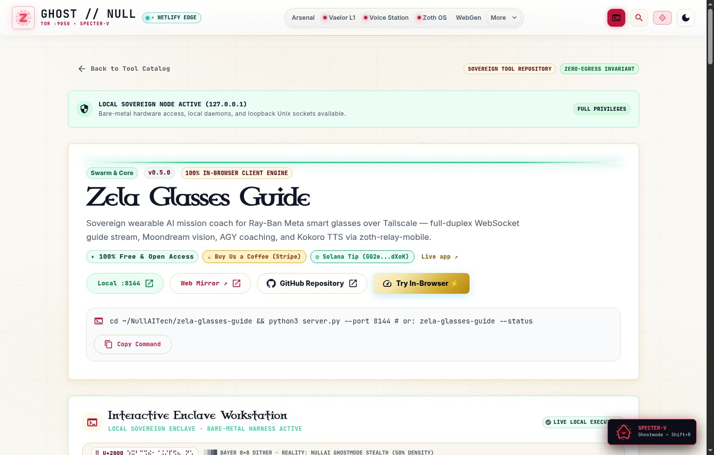

### Step 11: Zoth Studio v2 God-Mode — Interactive Zela AR Waveguide HUD & Optical Reticle Stage
Activating the **Zela AR Waveguide HUD & Optical Reticle** mode inside the Interactive Enclave Workstation (`:3000/tools/zela-glasses-guide`) to test 60fps kinematics and `TEMPLE_TAP_DOUBLE` (`zela-hud --toggle-teleprompter-overlay`) gesture bindings:

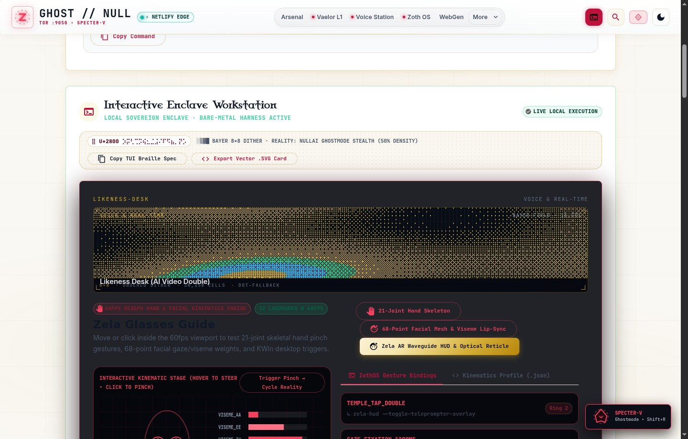

### Step 12: Mobile 390×844 Responsive Viewport Verification (`overflowPx: 0`)
Verifying mobile layout responsiveness at `390×844` on `http://127.0.0.1:8144` with zero horizontal scroll overflow (`scrollWidth: 390, clientWidth: 390, overflowPx: 0`):

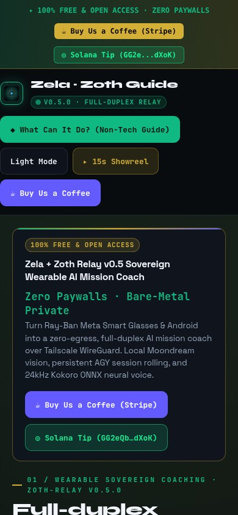

---

## Sovereign 5-Layer Architecture & Second Brain Topology

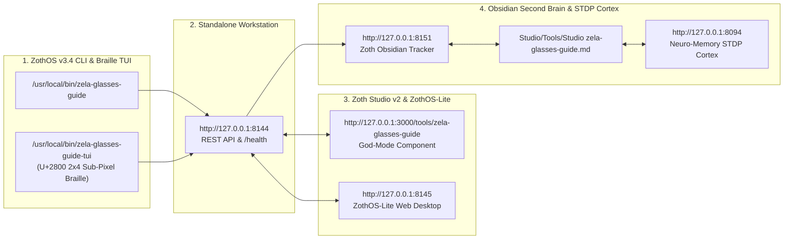

### ZothOS v3.4 TUI & Obsidian Second Brain Sync
- **Unicode `U+2800` Braille TUI**: `zela-glasses-guide-tui --status` / `zela-glasses-guide-tui --json`
- **Zoth Obsidian Tracker (`:8151`)**: `zoth-obsidian-tracker --verify`
- **Connected Canon Notes**: [[00 Home]] · [[Zoth OS]] · [[Zoth Studio]] · [[ZothOS-Lite Web Desktop]] · [[Zoth Memory]] · [[Public Surfaces]]
