# Zoth ASCII Magic Studio (`zoth-ascii-magic`)

> **Avant-Garde Image, Video & 3D SDF to 24-Bit TrueColor ASCII, Sub-Pixel Unicode Braille & Bayer Dither Synthesizer** — Features 60fps procedural 3D SDF shaders (`cyberBust`, `liquidChrome`, `torus4d`, `merkaba`, `datamosh`, `radar`, `sigil`), 10 glyph quantizers (including 2×4 Unicode Braille `U+2800`, Atkinson, Floyd-Steinberg, Bayer 4×4/8×8 ordered dithering), Sobel directional edge contours (`/\|-`), interactive 2D point relighting, and scalable SVG/ANSI/HTML exports.
> **100% Free & Open-Access** • **Zero Paywalls** • [☕ Buy Us a Coffee (Stripe)](https://buy.stripe.com/3cIfZg27PdKo2D64Ocfw40X) • Solana Tip: `GG2eQbVh8ut1BK6j1A2tz7pSySdLpD38BgyEhGcxdXoK`

---

## Architecture & Operational Overview

1. **Developer Architecture (`~/NullAITech/zoth-ascii-magic`)**:
   - `bin/zoth-ascii-magic`: Core Python synthesis engine implementing `BAYER_4X4`, `BAYER_8X8`, `RAMPS`, `PALETTES`, `eval_sdf()`, Sobel horizontal/vertical gradient contour mapping (`gx`, `gy`), and `generate_svg()`.
   - `server.py`: Multi-threaded HTTP daemon on port `8132` serving `public/index.html` and REST endpoints `GET /health`, `GET /api/status`, and `GET /api/render`.
   - `tests/test_zoth_ascii_magic.py`: Automated `pytest` suite verifying Braille/Bayer8/SVG synthesis and HTTP render contracts.
2. **End-User ZothOS CLI (`zoth-ascii-magic`)**:
   - Installed at `~/.local/bin/zoth-ascii-magic` and `/usr/local/bin/zoth-ascii-magic`.
   - Supports `--preset`, `--mode`, `--tube`, `--cols`, `--no-edge`, `--no-color`, `--html`, `--svg`, `--json`, and `--status`.
3. **Interactive GUI Workstations**:
   - **Standalone Workstation (`http://127.0.0.1:8132`)**: 60fps interactive canvas with real-time 2D point-light dragging, 8 geometry presets, 6 CRT phosphor tube palettes, 10 dither/glyph quantizers, WebM video recording, and Dark/Light themes.
   - **Zoth Studio v2 God-Mode (`http://127.0.0.1:3000/tools/zoth-ascii-magic`)**: Integrated sovereign enclave workstation with live Braille/Bayer preview and one-click SVG/ANSI/HTML exports.

---

## Part I — Developer Perspective (Architecture, Automated Pytest Suite & API Contracts)

### Step 1: Repository Structure & Bayer/Braille Quantizer Matrices (`bin/zoth-ascii-magic`)
Inspecting `~/NullAITech/zoth-ascii-magic` directory structure and the `BAYER_4X4`, `BAYER_8X8`, `RAMPS`, and `PALETTES` definitions in `bin/zoth-ascii-magic`:

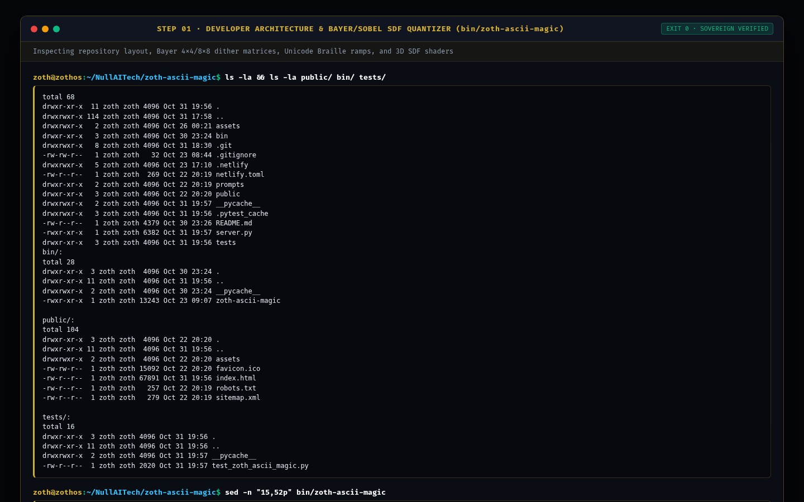

### Step 2: Running the Automated `pytest -v` Verification Suite
Executing `pytest -v` in `~/NullAITech/zoth-ascii-magic` to validate 3D SDF evaluation, Braille/Bayer8/SVG synthesis, and `/health` + `/api/render` HTTP endpoints (`2 passed in 0.54s`):

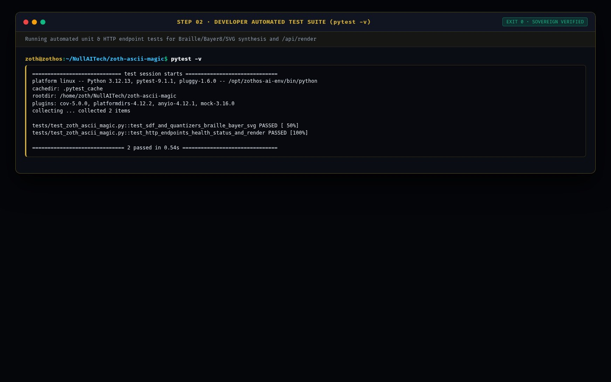

### Step 3: Verifying Live REST API & Procedural SDF Render Contract (`:8132`)
Querying `GET /health` and `GET /api/render?preset=torus4d&mode=braille&cols=42&no_color=1` on `http://127.0.0.1:8132`:

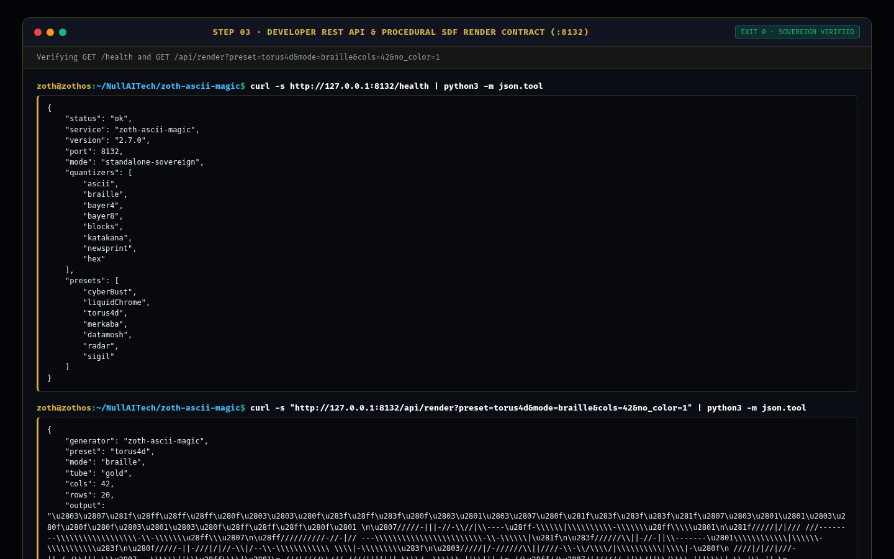

---

## Part II — End-User CLI Perspective (Installation, Braille Contours & SVG Vector Export)

### Step 4: Global ZothOS Binary Discovery & CLI Help Contract
Running `which -a zoth-ascii-magic`, `zoth-ascii-magic --help`, and `zoth-ascii-magic --status` to confirm global CLI installation and active `:8132` daemon status:

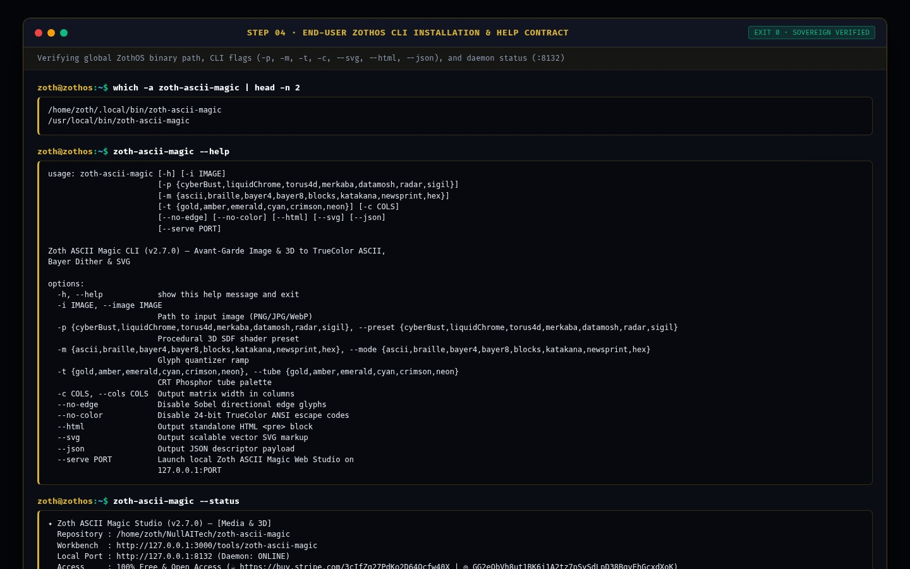

### Step 5: CLI Workflow A — Sub-Pixel Unicode Braille & Sobel Directional Edge Synthesis
Rendering the 3D `cyberBust` SDF preset at 52 columns using the `braille` quantizer and directional Sobel edge contours (`/\|-`):

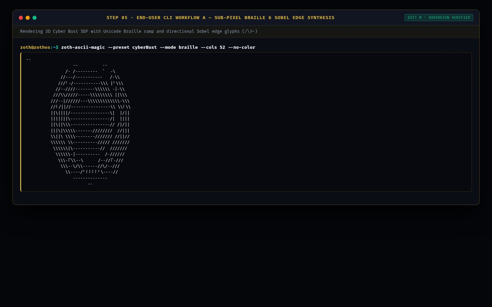

### Step 6: CLI Workflow B — Bayer 8×8 Dither JSON Telemetry & Scalable SVG Vector Export
Synthesizing the `merkaba` SDF preset with `bayer8` ordered dithering (`--json`) and exporting scalable `<svg>` vector markup from the `liquidChrome` preset:

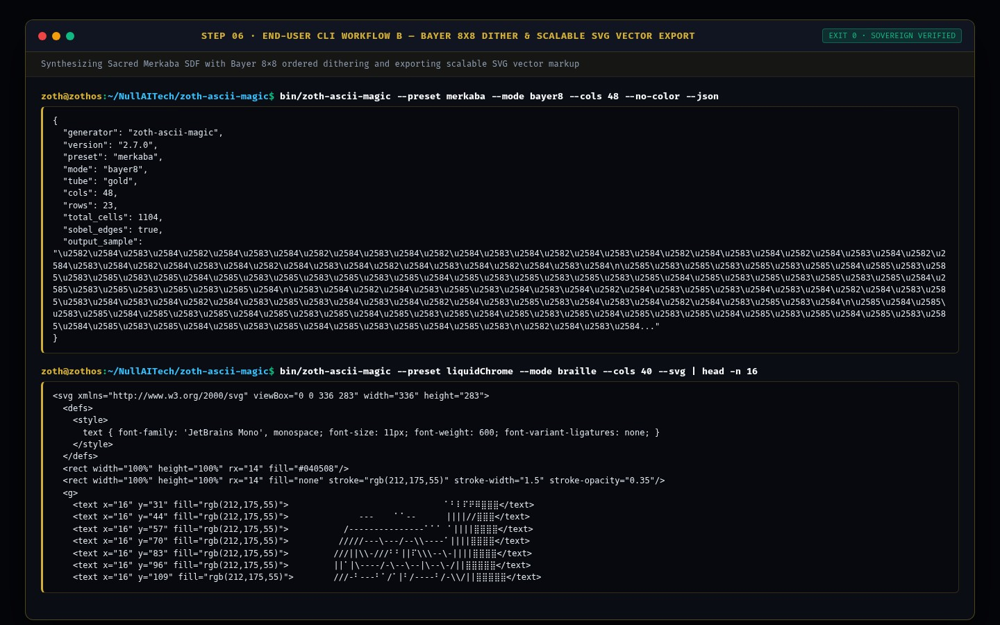

---

## Part III — End-User GUI Perspective (Standalone Workstation, Studio God-Mode & Mobile)

### Step 7: Standalone Web Workstation (`:8132`) — Cyber Bust 3D & 2D Point Relighting Stage
Loading `http://127.0.0.1:8132` in Dark Mode, showcasing the 60fps **Cyber Bust 3D** stage with interactive 2D point-light reticle (`-0.35, -0.35`), Sovereign Gold phosphor palette, and 10 glyph quantizer controls:

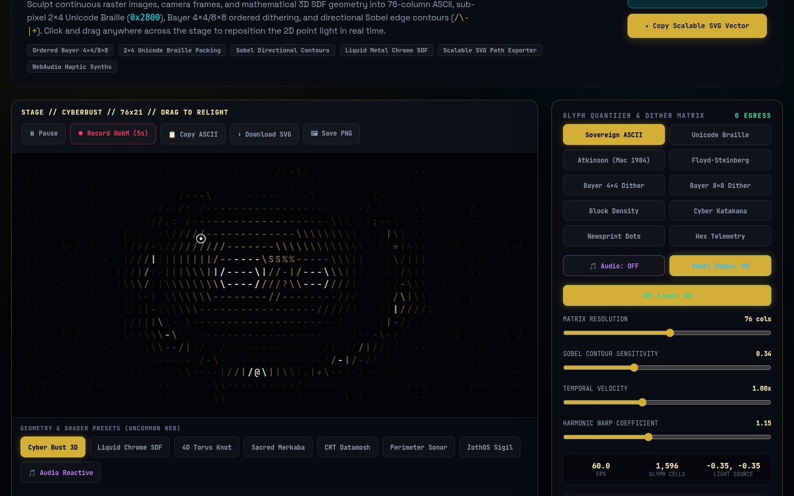

### Step 8: Standalone Interactive Workflow A — Liquid Chrome SDF + Unicode Braille + Cyber Cyan Tube
Switching to the **Liquid Chrome SDF** preset with **Unicode Braille** quantization, **Cyber Cyan** phosphor spectrum, and repositioning the 2D light source (`0.28, -0.22`):

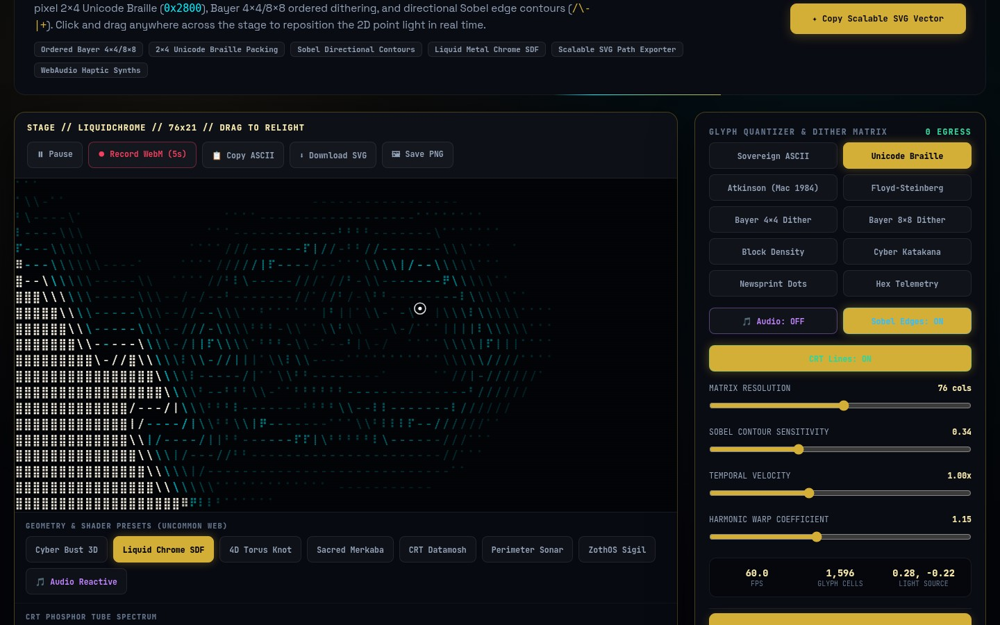

### Step 9: Standalone Interactive Workflow B — Editorial Light Mode + Sacred Merkaba + Bayer 8×8 Dither
Toggling Editorial Light Mode (`☀️ Light Mode`), selecting the **Sacred Merkaba** geometry preset with **Bayer 8×8 Dither** and **Sovereign Gold** phosphor, and inspecting the SVG/ANSI/HTML export controls:

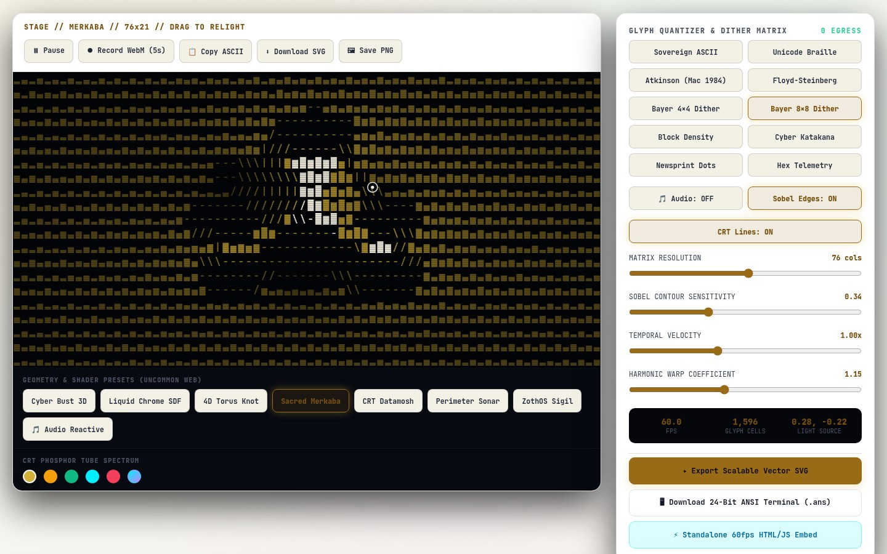

### Step 10: Zoth Studio v2 God-Mode (`:3000/tools/zoth-ascii-magic`) — Overview & Local Enclave Bridge
Opening `http://127.0.0.1:3000/tools/zoth-ascii-magic` in Zoth Studio v2, verifying the Local Sovereign Node (`:8132`) status banner, Open-Access Stripe/Solana support badges, and CLI launch bar:

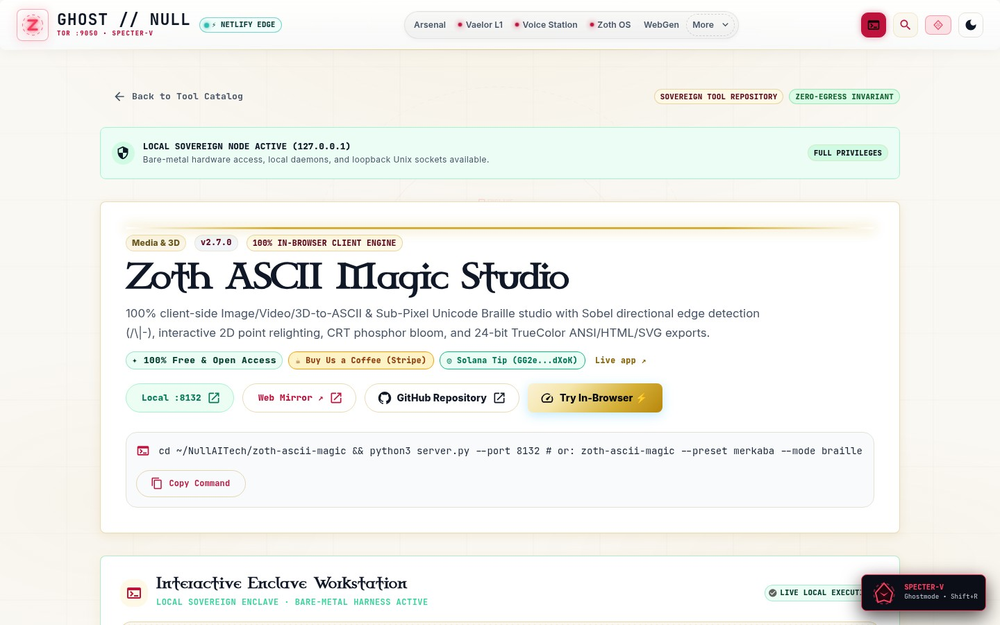

### Step 11: Zoth Studio v2 God-Mode — Interactive ASCII Magic & Braille Synth Enclave
Interacting with the embedded **Zoth ASCII Magic & Braille Synth** inside Zoth Studio v2 (`:3000/tools/zoth-ascii-magic`), testing 24-bit ANSI, SVG, and HTML/JS export actions:

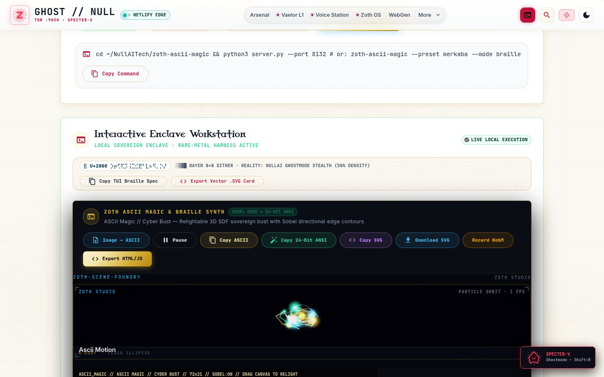

### Step 12: Mobile 390×844 Responsive Viewport Verification (`overflowPx: 0`)
Verifying mobile layout responsiveness at `390×844` on `http://127.0.0.1:8132` with zero horizontal scroll overflow (`scrollWidth: 390, clientWidth: 390, overflowPx: 0`):

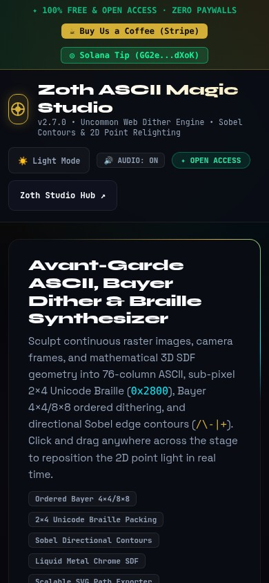

---

## Sovereign 5-Layer Architecture & Second Brain Topology

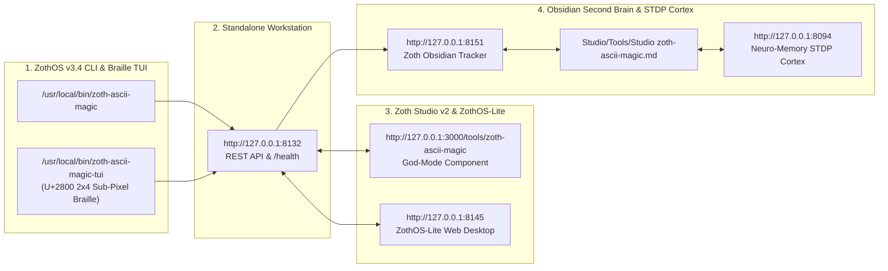

### ZothOS v3.4 TUI & Obsidian Second Brain Sync
- **Unicode `U+2800` Braille TUI**: `zoth-ascii-magic-tui --status` / `zoth-ascii-magic-tui --json`
- **Zoth Obsidian Tracker (`:8151`)**: `zoth-obsidian-tracker --verify`
- **Connected Canon Notes**: [[00 Home]] · [[Zoth OS]] · [[Zoth Studio]] · [[ZothOS-Lite Web Desktop]] · [[Zoth Memory]] · [[Public Surfaces]]
