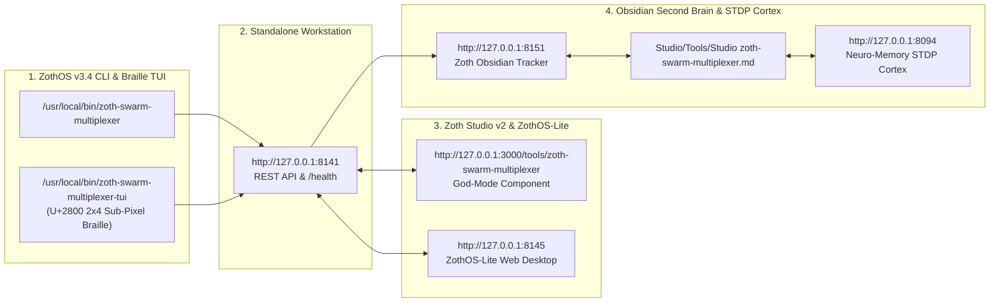

# 21-Agent Swarm Multiplexer (`zoth-swarm-multiplexer`) — Complete Developer & End-User Walkthrough

> **100% Free & Open-Access Sovereign Tool** — Zero paywalls, zero blur locks, zero feature gates. Built by **1nc0gn30 • NullAI (`@1nc0gn30`) • NullAI Platform**. Support via [Stripe Buy Us a Coffee](https://buy.stripe.com/3cIfZg27PdKo2D64Ocfw40X) or Solana (`GG2eQbVh8ut1BK6j1A2tz7pSySdLpD38BgyEhGcxdXoK`).

---

## Part 1: Developer Architecture & Verification Walkthrough

### Step 1: Repository Structure, Swarm Daemon & MCP Stdio Server
Developers inspecting `~/NullAITech/zoth-swarm-multiplexer` can review `swarm_daemon.py` (21-Agent `SwarmMultiplexerEngine` + SSE stream), `swarm_cli.py`, `mcp_server.py` (JSON-RPC 2.0 MCP stdio server), and `index.html`.

### Step 2: Automated Pytest Verification Suite (`pytest -v`)
Running `pytest -v` in `~/NullAITech/zoth-swarm-multiplexer` executes all 12 unit and MCP protocol tests (`test_engine_initialization`, `test_agent_schema_integrity`, `test_execute_single_agent`, `test_broadcast_all_agents`, `test_switch_harness_and_model`, `test_mcp_tools_list`, `12 passed in 0.04s`).

### Step 3: REST `/execute` & JSON-RPC 2.0 MCP Contracts
Sending `POST http://127.0.0.1:8141/execute` for `AZOTH` and piping `tools/list` into `python3 mcp_server.py` verifies both the HTTP REST API and the MCP stdio tool definitions (`swarm_list_agents`, `swarm_execute`, `swarm_broadcast`, `swarm_switch_harness`).

---

## Part 2: End-User ZothOS CLI & TUI Walkthrough

### Step 4: Global Binary Resolution & CLI Help (`zoth-swarm-multiplexer --help`)
Users can verify `/usr/local/bin/zoth-swarm-multiplexer` and `~/.local/bin/zoth-swarm-multiplexer` via `which -a zoth-swarm-multiplexer` and inspect subcommands (`status`, `exec`, `broadcast`, `switch`, `daemon`).

### Step 5: 21-Agent Swarm Pantheon Status Matrix (`zoth-swarm-multiplexer status`)
Running `zoth-swarm-multiplexer status` renders the full 21-Agent Swarm Pantheon Status Matrix across all 5 Cadres (`Architects`, `Code`, `Security`, `Creative`, `Swarm`), displaying each agent's AI Harness, Model, STDP Memory %, Status, and Working Directory.

### Step 6: Single-Agent Execution & Security Cadre Broadcast (`exec` & `broadcast`)
Running `zoth-swarm-multiplexer exec --agent AZOTH "verify zero-egress"` and `zoth-swarm-multiplexer broadcast --cadre Security "audit owasp enclave"` dispatches directives to `AZOTH` and across the 4 Security Cadre nodes (`LYCAN`, `ONYX`, `SCORPIUS`, `PIXEL-SHIBA`).

---

## Part 3: Standalone Web Workstation & Zoth Studio v2 God-Mode GUI

### Step 7: Standalone Web Workstation (`http://127.0.0.1:8141`) — 21-Terminal Multiplexer Grid
Opening `http://127.0.0.1:8141` launches the 21-Agent Sovereign Terminal Engine in Dark Mode, displaying concurrent agent terminals (`Azoth`, `Nexus`, `Vigil`, `Mercury`, `Ghostbyte`, `Athena`, etc.) with hot-swappable AI Harness and Model Target selectors.

### Step 8: Standalone Web Workstation — Security Cadre Filter & Swarm Broadcast
Filtering to **Security (4)** (`Lycan`, `Onyx`, `Scorpius`, `Pixel-Shiba`) and broadcasting `verify zero-egress` executes the directive concurrently across all Security Cadre terminals via the local `:8141` daemon.

### Step 9: Standalone Web Workstation — Editorial Light Mode & STDP Synaptic Sync
Toggling **Light Mode** (`☀ Light / Dark`), filtering to **Architects (6)**, and clicking **🧠 Sync STDP Synapses** reinforces Long-Term Potentiation (`+0.08`) across the Pantheon terminals.

### Step 10: Zoth Studio v2 God-Mode Route (`http://127.0.0.1:3000/tools/zoth-swarm-multiplexer`)
Navigating to `/tools/zoth-swarm-multiplexer` inside Zoth Studio v2 provides the unified God-Mode header, local `:8141` enclave badge, and CLI quick-copy bar.

### Step 11: Zoth Studio v2 God-Mode — Interactive 21-Agent Swarm & Byzantine Hub
Scrolling into the Interactive Enclave Workstation inside Zoth Studio v2 showcases the live Bayer 8×8 dither field and Byzantine fault-tolerance (`N = 3f + 1`) swarm controls.

### Step 12: Mobile Responsive Viewport (`390x844` — Zero Horizontal Overflow)
Verified on a `390x844` mobile viewport with `scrollWidth === 390` (`overflowPx === 0`), single-column terminal cards, wrapped cadre filter tabs, and touch-friendly controls.

---

## Sovereign 5-Layer Architecture & Second Brain Topology

### ZothOS v3.4 TUI & Obsidian Second Brain Sync
- **Unicode `U+2800` Braille TUI**: `zoth-swarm-multiplexer-tui --status` / `zoth-swarm-multiplexer-tui --json`
- **Zoth Obsidian Tracker (`:8151`)**: `zoth-obsidian-tracker --verify`
- **Connected Canon Notes**: [[00 Home]] · [[Zoth OS]] · [[Zoth Studio]] · [[ZothOS-Lite Web Desktop]] · [[Zoth Memory]] · [[Public Surfaces]]
