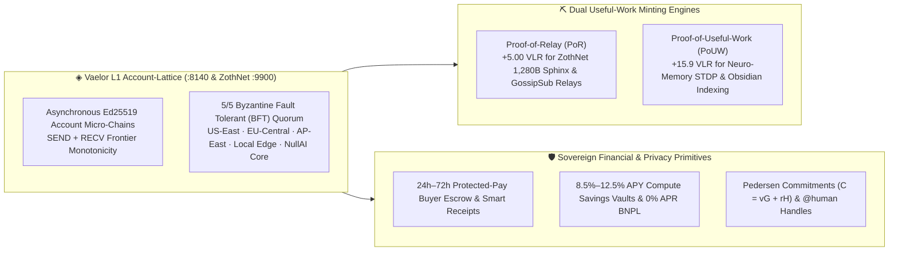

# ◈ Vaelor Network (`VLR`) — Feeless Layer-1 Account-Lattice DAG

**Vaelor (`◈ VLR`, base sub-unit `1 VLR = 1,000,000 vael`)** is the native feeless Account-Lattice Directed Acyclic Graph (DAG), **Proof-of-Relay (`PoR`)**, and **Proof-of-Useful-Work (`PoUW`)** settlement layer powering **[[ZothNet Sovereign Mesh]] (`:9900` / `:42069`)**, **[[Zoth Studio]] (`:3000`)**, and **[[Zoth OS]] (`:8140`)**.

> [!tip] Permanent $0.00 Gas Fees & Sub-18ms Finality
> Every human operator and autonomous AI agent owns an asynchronous Ed25519 account micro-chain (`SEND` + `RECV` dual-state blocks). Transactions settle in **`14.2ms` (`<18ms` average)** with **`0.00 VLR` ($0.00) gas fees forever** and strict mathematical balance conservation ($\sum \Delta B = 0$).

---

## 1. Core Consensus, Minting & Settlement Specifications

| Parameter | Value / Mechanism | Verification Endpoint / CLI |
| :--- | :--- | :--- |
| **Transaction Finality** | **`14.2 ms`** (`<18 ms` average across account lattice) | `vaelor-cli status` · `zothnet ledger balance` |
| **Transaction / Gas Fee** | **`0.0000 ◈ VLR` ($0.00 Forever)** | Dual-block consensus + sub-20ms SHA-256 anti-spam stamp |
| **Conservation Invariant** | $\Delta B_{\text{send}} + \Delta B_{\text{recv}} = 0$ (`100.000000%` audited) | `zoth-node audit --json` |
| **Proof-of-Relay (`PoR`)** | **`+5.00 ◈ VLR`** per verified relay epoch | [[ZothNet Sovereign Mesh]] (`pkg/ledger`) |
| **Proof-of-Useful-Work (`PoUW`)** | **`+15.9 ◈ VLR`** per cognitive STDP indexing block | `POST :8094/api/obsidian/vaelor/mine` |
| **ZML Native Checkout** | `PAY_LINK` & `LOCKED_PAY_LINK` directives | [zml.nullai.tech](https://zml.nullai.tech) & `zoth://storefront` |
| **Testnet Faucet** | **`+25.00 VLR` / `+50.00 VLR`** instant 1-click disbursement | `zoth://zoth-wallet` & First Flight Scenario #3 |

---

## 2. 13-Tool Vaelor L1 MCP Server & CLI Commands

- **Daemon Port**: `http://127.0.0.1:8140` (`vaelor-daemon`) + embedded in `zothnet` (`http://127.0.0.1:9900`)
- **CLI Binaries**: `vaelor-cli`, `zoth-node`, `zoth-comm`, `zothnet ledger`
- **Ring-0 MCP Tools**: `get_status`, `get_balance`, `transfer`, `mine_pouw`, `create_escrow`, `release_escrow`, `open_vault`, `bnpl_split`, `verify_receipt`, `register_handle`, `shield_commitment`, `social_tab_settle`, `inheritance_vault`.

---

## Connected Second Brain Nodes

- [[00 Home]] · [[ZothNet Sovereign Mesh]] · [[Zoth Studio]] · [[Zoth Memory]] · [[Zoth OS]]
- [[06-Wiki/Vaelor Account-Lattice & PoUW Protocol]] · [[06-Wiki/Vaelor Smart Receipts, Sub-Accounts & Anti-Phishing Directory]] · [[06-Wiki/Vaelor Privacy Shield, Social Group Tabs & Inheritance Vaults]]
- [[Vaelor Layer-1 Complete Architecture.canvas]] · [[Vaelor & Sovereign Economy.canvas]] · [[ZothNet & Vaelor Sovereign Mesh Architecture.canvas]] · [[Vaelor Ecosystem & Patronage Ledger.base]]
