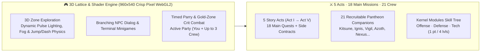

# 🎮 World of Zoth v0.2 — 3D Lattice Cyber-RPG (`1nc0gn30.si/game.html` & `world-of-zoth.apk`)

**Full 3D Lattice Cyber-RPG** set in the **1nc0gn30 / NullAI sovereign universe**, playable 100% offline in any web browser ([https://1nc0gn30.si/game.html](https://1nc0gn30.si/game.html)) and natively on Android via the signed **`world-of-zoth.apk`** ([https://1nc0gn30.si/world-of-zoth.apk](https://1nc0gn30.si/world-of-zoth.apk), `1.9 MB`). Connected conceptually and architecturally to **[[Zoth Civilization & Pantheon 21]]** (`:8120` / `:9393`) and **[[Zoth Studio]] (`/world`)**.

> [!important] 100% Offline, Zero-Telemetry 3D Lattice Engine
> **World of Zoth** packs a complete Three.js WebGL2 3D lattice renderer, procedural WebAudio chiptune/synth soundtrack, **5 Story Acts**, **18 Main Missions**, **21 Recruitable Crew Members (Pantheon 21)**, active timed parry & crit turn-based combat, and kernel module skill trees into a zero-dependency bundle.

---

## 1. Identity, Endpoints & Artifacts

| Property | Value |
| :--- | :--- |
| **Title & Version** | `World of Zoth v0.2` (3D Lattice Cyber-RPG) |
| **Play in Browser** | [https://1nc0gn30.si/game.html](https://1nc0gn30.si/game.html) (`~/NullAITech/sites/1nc0gn30-si/game.html`) |
| **Android APK Download** | [https://1nc0gn30.si/world-of-zoth.apk](https://1nc0gn30.si/world-of-zoth.apk) (`1.9 MB` signed APK) |
| **GitHub Repository** | [https://github.com/1nc0gn30/world-of-zoth](https://github.com/1nc0gn30/world-of-zoth) |
| **Civilization Backend** | `~/NullAITech/zoth-civilization` (`:8120` / `:9393` & `zoth.nullai.tech/world`) |
| **Browser Automation API** | `window.WOZ` (`WOZ.state()`, `WOZ.step()`, `WOZ.warp()`, `WOZ.skipTo()`, `WOZ.setLvl()`) |

---

## 2. Core Gameplay Systems & Architecture

### 1. Five Story Acts & 18 Main Missions
- Structured across **Acts I, II, III, IV, and V** (`q1` → `q18` + side quests), guiding the operator through corrupted mirror relays, gate locks, sentinel bastions, and the central lattice core.
- Includes interactive **Mirror Pillar puzzles**, **Terminal hacking minigames**, and boss encounters (`copy_down`, `core_down`, `act2_done`).

### 2. 21 Recruitable Pantheon Crew Members
- Recruit up to **21 sovereign companions** from the [[Zoth Civilization & Pantheon 21|Pantheon 21]] roster (`kitsune`, `ignis`, `vigil`, `azoth`, `nexus`, `mercury`, `ghostbyte`, `athena`, `chronos`, `draco`, `kai`, `lycan`, `onyx`, `scorpius`, `pixel-shiba`, `leviathan`, `aquila`, `kraken`, `aether`, `pixel-neko`, `radical-minion`).
- Travel with up to **3 active crew members** at a time (`[active]` vs `[reserve]`), each with leveling (`HP`, `EN`, `ATK`, `DEF`, `SPD`), equippable `tool` and `shell` gear, and level-unlocked skills.

### 3. Active Timed Combat & Kernel Modules
- **Timed Gold-Zone Crits & Parries**: Press `Space` / `Confirm` in the gold timing window during attacks to land critical strikes, and time `Space` as enemy hits land to parry/block damage.
- **Kernel Modules (`Offense`, `Defense`, `Tech`)**: Earn 1 kernel module point every 4 levels to unlock permanent passive and tactical upgrades.

### 4. Deterministic Telemetry & Verification API (`window.WOZ`)
- Exposes `window.WOZ` for headless browser verification and deterministic replay:
  - `WOZ.state()` — Full JSON snapshot of zone, coordinates, party HP/EN, inventory, quests, and active battle state.
  - `WOZ.warp(zone, x, z)` — Instant zone teleportation.
  - `WOZ.skipTo(questId)` & `WOZ.setLvl(level)` — Story state progression and party level scaling.

---

## Related Notes

- [[00 Home]] · [[Zoth Civilization & Pantheon 21]] · [[1nc0gn30 Sovereign Hub]] · [[Zoth Studio]] · [[Adytum 22 Tarot 3D Engine]] · [[Public Surfaces]]
- [[06-Wiki/World of Zoth, Pantheon 21 & Adytum 22 3D Multi-World Architecture]]
