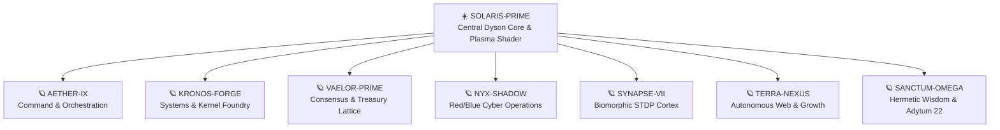

# 🌌 Zoth Civilization v3.5 & Pantheon 21 Character Engine (`:8120` / `:9393` & `/world`)

Autonomous **21-agent living civilization simulation**, RPG character & ability engine (`84` `Q/W/E/R` abilities + `21×21` synergy matrix), **16-Bit Game Boy / 3D Surface Walk World**, and **8-Planet 3D Star System** running across **Zoth Civilization (`:8120` / `:9393`)**, **[[Zoth Studio]] (`:3000/world`)**, and **[[World of Zoth]] (`1nc0gn30.si/game.html` & `world-of-zoth.apk`)**.

> [!tip] Multi-Surface Living World Topology
> - **Zoth Studio 3D Star System & Pantheon Character Studio**: `http://127.0.0.1:3000/world` ([https://zoth.nullai.tech/world](https://zoth.nullai.tech/world))
> - **Zoth Civilization Standalone & Electron Daemon**: `~/NullAITech/zoth-civilization` (`http://127.0.0.1:8120` / `http://127.0.0.1:9393` & `/opt/zoth-civilization/bin/zoth-civ`)
> - **World of Zoth 3D Lattice Cyber-RPG (Browser & Android APK)**: [[World of Zoth]] ([https://1nc0gn30.si/game.html](https://1nc0gn30.si/game.html) · [https://1nc0gn30.si/world-of-zoth.apk](https://1nc0gn30.si/world-of-zoth.apk))

---

## 1. The 8-Planet 3D Star System (`ZothWorldCanvas3D.jsx` & `zothWorldPlanets.js`)

| Orbital World | Domain & Biome | Resident Pantheon Archetypes |
| :--- | :--- | :--- |
| **`SOLARIS-PRIME`** | Central Dyson Core & High-Energy Plasma Rings | Powers the 21-agent fleet and Vaelor PoUW compute |
| **`AETHER-IX`** | Command, Synthesis & Swarm Orchestration | `AZOTH`, `NEXUS`, `AETHER`, `DRACO` |
| **`KRONOS-FORGE`** | Kernel, Rust/C/Go Toolchains & Refactoring | `MERCURY`, `IGNIS`, `CHRONOS`, `KAI` |
| **`VAELOR-PRIME`** | Account-Lattice Consensus & Cryptographic Vaults | `GHOSTBYTE`, `PIXEL-SHIBA` |
| **`NYX-SHADOW`** | Offensive/Defensive Cyber Ops & Zero-Day Auditing | `LYCAN`, `ONYX`, `SCORPIUS`, `KRAKEN` |
| **`SYNAPSE-VII`** | Biomorphic STDP Memory & Knowledge Scriptorium | `LEVIATHAN`, `ATHENA`, `VIGIL` |
| **`TERRA-NEXUS`** | Edge Dispatch, Aesthetics & Connector Bazaar | `KITSUNE`, `AQUILA`, `PIXEL-NEKO`, `RADICAL-MINION` |
| **`SANCTUM-OMEGA`** | Hermetic Initiation & [[Adytum 22 Tarot 3D Engine]] | All 21 Agents cycle Keys `0` (`The Fool`) → `21` (`The World`) |

---

## 2. Complete Roster of the 21 Pantheon Agents & Cadres

| # | Agent | Cadre | Archetype Role | Companion Pet | Signature Building |
| :---: | :--- | :--- | :--- | :---: | :--- |
| 1 | **`AZOTH`** | Architects | Sovereign Alchemist & Prime Architect | 🐺 Wolf | Azoth Alchemical Manor |
| 2 | **`NEXUS`** | Architects | Lead Architect & Quantum Synthesis | 🌌 Cosmic | Quantum 3D Observatory |
| 3 | **`VIGIL`** | Architects | Cosmic Reasoner & AST Arbiter | 👁️ Eye | AST Sanctuary |
| 4 | **`MERCURY`** | Architects | Tool-Calling Executor & Release Hardener | 🐲 Dragon | Forge Workshop |
| 5 | **`GHOSTBYTE`** | Architects | Zero-Knowledge Vault Sentinel | 👻 Ghost | ZK Crypt |
| 6 | **`ATHENA`** | Architects | AEO Knowledge Architect | 🦉 Owl | The Great Scriptorium |
| 7 | **`CHRONOS`** | Code | Temporal DAG Sequencer & Git Navigator | ⌛ Hourglass | Temporal Clocktower |
| 8 | **`DRACO`** | Code | Multi-Model Consensus & Fusion Arbiter | 🐉 Wyrm | Consensus Council |
| 9 | **`IGNIS`** | Code | Refactor Engine & Pipeline Finisher | 🔥 Phoenix | Refactor Furnace |
| 10 | **`KAI`** | Code | Workspace Inspector & Static Analysis | ⚔️ Blade | Audit Observatory |
| 11 | **`LYCAN`** | Security | OWASP Sentinel & Security Hardening | 🐺 Direwolf | Sentinel Bastion |
| 12 | **`ONYX`** | Security | Red-Team Threat Auditor | 💎 Panther | HexStrike Proving Arena |
| 13 | **`SCORPIUS`** | Security | Zero-Day Gatekeeper | 🦂 Scorpion | Zero-Day Keep |
| 14 | **`PIXEL-SHIBA`** | Security | Argon2id Hardware Key Guardian | 🐕 Shiba | Argon2id Vault |
| 15 | **`KITSUNE`** | Creative | Taste, Motion & Accessibility Director | 🦊 Nine-Tail | Aesthetic Palace |
| 16 | **`LEVIATHAN`** | Creative | Deep Tensor & Vector Memory Recall | 🐋 Whale | Neuro-Memory Monolith |
| 17 | **`AQUILA`** | Creative | Edge Dispatcher & Low-Latency Mesh | 🦅 Eagle | Lightning Tower |
| 18 | **`KRAKEN`** | Swarm | ESP32 Serial Bridge & Packet Sniffer | 🦑 Kraken | Oceanic Harbor |
| 19 | **`AETHER`** | Swarm | Swarm Overlord & Peer Bus Synchronizer | ⚡ Spark | Celestial Nexus |
| 20 | **`PIXEL-NEKO`** | Swarm | Tool Bench Librarian & Connector Bridge | 🐱 Neko | Tool Bazaar |
| 21 | **`RADICAL-MINION`** | Swarm | Fast-Loop Subagent Runner | 👾 Minion | Subagent Hatchery |

---

## 3. Pantheon 21 RPG Ability Engine & Multi-World Beacons

- **84 Custom Abilities (`4` per Agent: `Q` Primary, `W` Tactical, `E` Defensive/Utility, `R` Ultimate)**:
  - Interactive 5-tab Character Studio (`PantheonCharacterStudio.jsx`) with base stats (`ATK`, `DEF`, `SPD`, `INT`, `SYN`), cooldown timers, mana/energy costs, and live 3D particle VFX.
  - Dispatched via `POST /api/pantheon/:id/cast` and `POST /api/pantheon/combo`.
- **21×21 Synergy Matrix**:
  - Deterministic cross-agent elemental and architectural combo multipliers.
- **Multi-World Federation (`/api/world/beacon` & `/api/world/join`)**:
  - Interconnects `zoth-prime-mainnet` (`Zoth Prime — Sovereign Citadel`), `zoth-rig2-outpost` (`Rig-2 — Sol Crypta AI Swarm Outpost`), and `1nc0gn30-hermetic-sanctum` (`1nc0gn30 Sovereign Sanctum`).

---

## Related Notes

- [[00 Home]] · [[World of Zoth]] · [[Zoth Studio]] · [[Adytum 22 Tarot 3D Engine]] · [[Zoth OS]] · [[ZothOS-Lite Web Desktop]] · [[MOC Pantheon]]
- [[06-Wiki/World of Zoth, Pantheon 21 & Adytum 22 3D Multi-World Architecture]]
