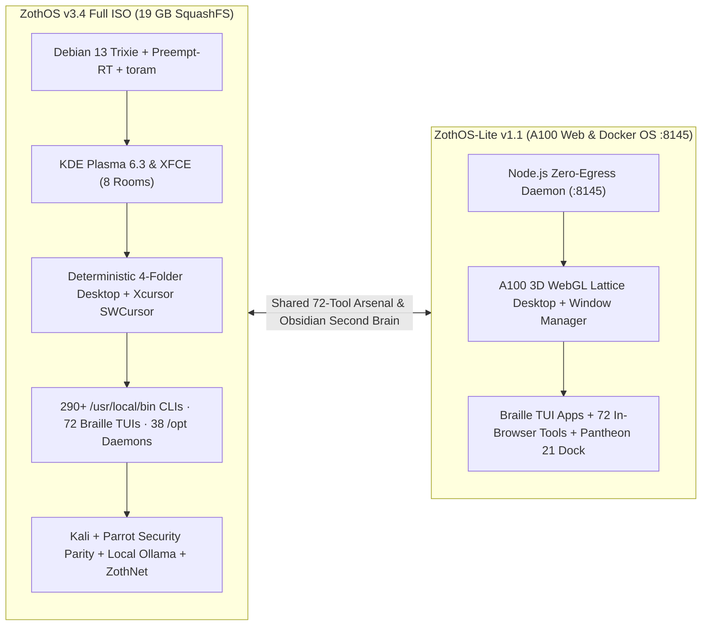

# 🛡️ Zoth OS (v3.4.0) — Sovereign Linux Workstation & Live ISO

**Debian 13 (Trixie) + KDE Plasma 6.3 Wayland / X11 + XFCE Fallback** sovereign developer, AI, and offensive/defensive security operating system featuring an Obsidian & Sovereign Gold aesthetic, 8 virtual desktop rooms (`Forge` → `Sanctum`), dual Kali + Parrot security parity, **Zoth Cursorz** multi-agent virtual pointers (`:9990`), **[[ZothNet Sovereign Mesh]]** (`:9900` / `:42069`), and the **72-Tool Sovereign AI Arsenal**. Paired with [[ZothOS-Lite Web Desktop|ZothOS-Lite v1.1]] (`:8145`) and [[Zoth Studio|Zoth Studio v2]] (`:3000`).

> [!important] v3.4 Live ISO & Desktop Hardening Invariants (Nov 2026)
> ZothOS v3.4 enforces **Debian Live / SquashFS Determinism**, **KDE Plasma 6 & XFCE Desktop Folder Determinism** (zero loose desktop icon regressions), **Xcursor Binary Integrity** (`16×16` to `48×48` ARGB bitmaps with verified hotspots), **`SWCursor` / `KWIN_FORCE_SW_CURSOR=1`** universal cursor visibility under all GPU/VM drivers, and **Amnesic `toram` Boot Hygiene**. See [[06-Wiki/ZothOS v3.4 & ZothOS-Lite A100 Desktop Hardening Architecture]] for full engineering specs.

---

## 1. Identity, Repositories & Endpoints

| Property | Value |
| :--- | :--- |
| **Full ISO Version** | `v3.4.0` (`VERSION` = `3.4.0` in `NullAITech/zoth-os`) |
| **Lite Web OS Version** | `v1.1.0` (`NullAITech/zothos-lite` on port `:8145`) |
| **Primary GitHub Repo** | `~/NullAITech/zoth-os` → [https://github.com/NullAITech/zoth-os](https://github.com/NullAITech/zoth-os) (`main`) |
| **Mirror GitHub Repo** | [https://github.com/1nc0gn30/zoth-os](https://github.com/1nc0gn30/zoth-os) (`main`) |
| **Official Website** | `~/NullAITech/zoth-os-website` → [https://zothos.nullai.tech](https://zothos.nullai.tech) |
| **Chroot Skeleton Path** | `~/NullAITech/zoth-os/config/includes.chroot/` (synced with [[Repo vs Live OS]]) |
| **Architect** | Neal Frazier (`@1nc0gn30`) • [NullAI Platform](https://nullai.tech) • [nealfrazier.tech](https://nealfrazier.tech) |

---

## 2. Two Editions: Full Bare-Metal Live ISO vs. ZothOS-Lite A100

---

## 3. Live ISO & Desktop Hardening Architecture

### A. Deterministic `~/Desktop` Folder Architecture (Zero Loose Icon Regressions)
1. **Clean Chroot Sync in `pack-iso.sh`**:
   - Wipes `chroot/etc/skel/Desktop` and `chroot/home/*/Desktop` prior to copying `config/includes.chroot/etc/skel/Desktop` so stale `.desktop` launchers from prior builds never leak onto the live desktop.
2. **Pre-Render Categorization (`zoth-plasma-setup`)**:
   - Automatically organizes desktop launchers into **4 canonical category folders** before Plasma or XFCE renders:
     - `01-AI-Agents-and-Dev` (Zoth Studio, Hermes, WebGen, Bolt, Neuro-Memory, Zoth Cursorz)
     - `02-Security-and-Privacy` (HexStrike AI, Anderson Sentinel, Ghidra, Caido, YARA-X, ZothNet)
     - `03-ZothOS-Daemons` (Control Center, Cockpit, Tool Nexus, Vaelor, Obsidian Tracker)
     - `04-Media-and-Utilities` (PixelCast, AudioCipher, Datamosh, ASCII Magic, Scene Foundry)
3. **Conflict-Free Autostart**:
   - Strictly separates KDE Plasma 6 (`zoth-plasma-setup`) from XFCE (`xfconf-query` / `xfdesktop`) and never calls `plasmashell --replace` post-login.

### B. Xcursor Binary Integrity & Universal Cursor Visibility (`SWCursor`)
1. **Verified Multi-Size ARGB Xcursor Binaries**:
   - Custom cursor themes in `/usr/share/icons/Zoth-Gold-Cursors/cursors/` contain validated `16×16`, `24×24`, `32×32`, and `48×48` ARGB frames with in-bounds hotspots (`xhot < width`, `yhot < height`) across all standard X11/Wayland/GTK/Qt symlinks (`default`, `left_ptr`, `text`, `xterm`, `pointer`, `hand2`, `grab`, `grabbing`, `wait`, `crosshair`).
2. **Hardware Cursor Plane Fallback**:
   - Exports `KWIN_FORCE_SW_CURSOR=1`, `XCURSOR_THEME=Zoth-Gold-Cursors`, and `XCURSOR_SIZE=24` in `/etc/environment` and `/etc/profile.d/zoth-cursor.sh`.
   - Configures `/etc/X11/xorg.conf.d/20-zoth-cursor.conf` with `Option "SWCursor" "true"` for modesetting, VirtIO, QXL, and VMware GPU drivers.
3. **Zoth Cursorz Multi-Agent Virtual Cursor Engine (`:9990`)**:
   - `zoth-cursorz` spawns up to 16 concurrent virtual agent pointers with 3D dithered Unicode `U+2800` Braille hologram trails, pixel companions, OpenCV landmark drift alignment, and native Linux (`ydotool` / `xdotool`) + Android (`AccessibilityService`) input injection.

### C. Amnesic `toram` Boot Hygiene & Loopback Enclave
- **Amnesic `toram` Mode (`zoth-ghost-amnesic`)**: Loads the SquashFS image entirely into system RAM, unmounts physical storage media, randomizes MAC/hostname identifiers, routes external traffic through Tor, and wipes volatile state on shutdown.
- **Firewall (`UFW`)**: Default-deny incoming; allows loopback (`lo`), `tailscale0`, WireGuard/ZothNet UDP (`41641`, `42069`).
- **Loopback Enclave**: Local AI (`Ollama :11434`), Neuro-Memory (`:8094`), Vaelor (`:8140`), ZothOS-Lite (`:8145`), Obsidian Tracker (`:8151`), Zoth Civilization (`:8120` / `:9393`), ZothNet Web UI (`:9900`), and Zoth Cursorz (`:9990`) bind strictly to local interfaces.

---

## 4. Eight Named Virtual Desktops (`Ctrl+F1`…`F8`)

Laptop `eDP-1` (`0,0`) + extended monitor `DP-3` (`1920,0`). Run `zoth-workspaces apply` to restore the 2×4 desktop grid:

1. **Room 1 — Forge (`Ctrl+F1`)**: Kernel, C/Rust/Go/Python build toolchains & Braille terminals
2. **Room 2 — Studio (`Ctrl+F2`)**: [[Zoth Studio]] (`:3000`) & 72-tool sovereign cockpit
3. **Room 3 — WebGen (`Ctrl+F3`)**: [[Zoth WebGen]] (`:5173`) full-stack AI app foundry
4. **Room 4 — Memory (`Ctrl+F4`)**: [[Zoth Memory]] (`:8094`) & Obsidian Second Brain Vault (`:8151`)
5. **Room 5 — Agents (`Ctrl+F5`)**: Hermes Agent, [[Zoth Civilization & Pantheon 21]], Zoth Cursorz (`:9990`) & Swarm Multiplexer
6. **Room 6 — Comms (`Ctrl+F6`)**: [[ZothNet Sovereign Mesh]] (`:9900` / `:42069`), Signal, Element & SimpleX
7. **Room 7 — Ops (`Ctrl+F7`)**: HexStrike AI, Anderson Sentinel, Burp, Caido & GhidraMCP
8. **Room 8 — Sanctum (`Ctrl+F8`)**: [[Adytum 22 Tarot 3D Engine]], [[World of Zoth]] & Ghost Mode

---

## 5. Essential ZothOS v3.4 CLI & Braille TUI Commands

| Command | Role & Verification |
| :--- | :--- |
| `zoth-cockpit` | Terminal & Electron Swarm Command Deck (`/opt/zoth-cockpit`) |
| `zoth-studio` | Launch [[Zoth Studio]] (`~/NullAITech/zoth-studio-v2` / `:3000`) |
| `zothnet` | [[ZothNet Sovereign Mesh]] daemon, `zothnet monitor` 60fps Braille radar TUI, ZML compiler & Vaelor ledger CLI |
| `zoth-cursorz` | Multi-agent virtual cursor engine (`:9990`), 3D Braille trails, workflow trainer & Android APK builder |
| `zoth-control-center` | Hardware, thermal & systemd daemon supervisor |
| `zoth-tool-nexus` | Sovereign Kali + Parrot + 72-Tool Arsenal orchestrator |
| `zoth-obsidian-tracker` | Launch Obsidian Verification & Second Brain Web App (`:8151`) |
| `zoth-neuro-memory` | Query & manage [[Zoth Memory]] STDP daemon (`:8094`) |
| `zoth-second-brain` | Bidirectional Obsidian Vault + STDP memory sync CLI |
| `<tool>` / `<tool>-tui` | Every one of the 72 tools supports `<tool> --json`, `<tool>-tui --status` (Unicode `U+2800` Braille TUI), and `<tool> desktop` |
| `zoth-mode` | Switch Reality Modes (`Forge`, `Ghost`, `Overclock`, `Sanctum`) |
| `zoth-ghost` | Amnesic Tor routing & MAC/hostname anonymizer |
| `zoth-doctor` | Full system health, port & daemon diagnostic verifier |
| `zoth-workspaces` | Multi-monitor + 8 virtual desktop layout configurator |

---

## Related Notes

- [[00 Home]] · [[ZothOS-Lite Web Desktop]] · [[Zoth Studio]] · [[ZothNet Sovereign Mesh]] · [[World of Zoth]] · [[Repo vs Live OS]] · [[Zoth Trust & Supply Chain]] · [[Public Surfaces]]
- [[06-Wiki/ZothOS v3.4 & ZothOS-Lite A100 Desktop Hardening Architecture]] · [[06-Wiki/ZothOS Sovereign Linux & Kernel Architecture]]
- [[Maps/OS.canvas|OS Canvas]] · [[Maps/Rooms.canvas|Rooms Canvas]] · [[Maps/CLIs.base|CLI Base]]
