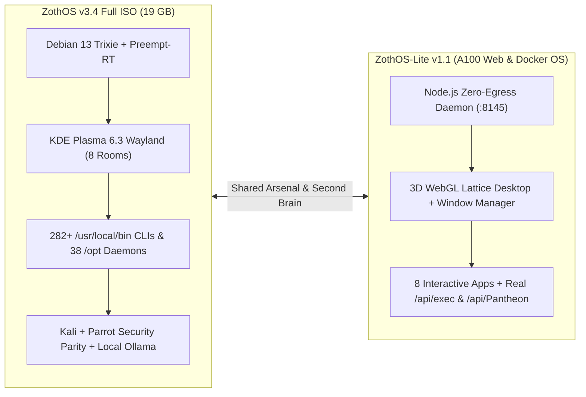

# 🛡️ Zoth OS (v3.4.0) & ZothOS-Lite (v1.1.0)

**Debian 13 (Trixie) + KDE Plasma 6.3 Wayland** sovereign developer and security operating system featuring an Obsidian & Gold aesthetic, 8 virtual desktop rooms (`Forge` → `Sanctum`), dual Kali + Parrot security parity, and the **72-Tool Sovereign AI Arsenal**. Paired with [[ZothOS-Lite Web Desktop|ZothOS-Lite v1.1]] (`:8145`) and [[Zoth Studio|Zoth Studio v2]] (`:3000`).

---

## 1. Identity & Repositories

| Property | Value |
| :--- | :--- |
| **Full ISO Version** | `v3.4.0` (`VERSION` = `3.4.0` in `NullAITech/zoth-os`) |
| **Lite Web OS Version** | `v1.1.0` (`NullAITech/zothos-lite` on port `:8145`) |
| **Primary GitHub Repo** | `~/NullAITech/zoth-os` → `https://github.com/NullAITech/zoth-os.git` (`main`) |
| **Mirror GitHub Repo** | `https://github.com/1nc0gn30/zoth-os.git` (`main`) |
| **Website Repo** | `~/NullAITech/zoth-os-website` → [https://zothos.nullai.tech](https://zothos.nullai.tech) |
| **Architect** | `1nc0gn30` `<1nc0gn30@users.noreply.github.com>` • [NullAI Platform](https://nullai.tech) |

---

## 2. Two Editions: Full Bare-Metal ISO vs. ZothOS-Lite

---

## 3. Security, Privacy & Supply-Chain Invariants

- **Firewall (`UFW`)**: `ENABLED=yes`, default-deny incoming, allows `lo`, `tailscale0`, UDP `41641`, TCP `7890`.
- **Loopback Enclave**: Local AI (`Ollama :11434`), Neuro-Memory (`:8094`), Vaelor (`:8140`), ZothOS-Lite (`:8145`), and Obsidian Tracker (`:8151`) bind strictly to local interfaces.
- **MCP Catalog**: Present in `/opt/zoth-mcp` and **all off by default** (`0` unsolicited external connections).
- **Supply-Chain Provenance ([[Zoth Trust & Supply Chain]])**:
  - Keyless Sigstore `cosign` OIDC signatures (`release-sign.yml`)
  - Automated 70+ engine VirusTotal release binary scanning (`virustotal-release.yml` + `docs/TRUST.md`)
  - SPDX & CycloneDX SBOM generation (`sbom.yml`)
  - CodeQL, Semgrep, and OpenSSF Scorecard v2.5.0 continuous auditing

---

## 4. Eight Named Virtual Desktops (`Ctrl+F1`…`F8`)

Laptop `eDP-1` (`0,0`) + extended monitor `DP-3` (`1920,0`). Run `zoth-workspaces apply` to restore the 2×4 desktop grid:

1. **Room 1 — Forge (`Ctrl+F1`)**: Kernel, C/Rust/Python build toolchains & terminals
2. **Room 2 — Studio (`Ctrl+F2`)**: [[Zoth Studio]] (`:3000`) & 72-tool sovereign cockpit
3. **Room 3 — WebGen (`Ctrl+F3`)**: [[Zoth WebGen]] (`:5173`) full-stack AI app foundry
4. **Room 4 — Memory (`Ctrl+F4`)**: [[Zoth Memory]] (`:8094`) & Obsidian Second Brain Vault
5. **Room 5 — Agents (`Ctrl+F5`)**: Hermes Agent, Pantheon 21 & Swarm Multiplexer
6. **Room 6 — Comms (`Ctrl+F6`)**: ZothNet encrypted mesh, Signal, Element & SimpleX
7. **Room 7 — Ops (`Ctrl+F7`)**: HexStrike AI, Anderson Sentinel, Burp, Caido & Ghidra
8. **Room 8 — Sanctum (`Ctrl+F8`)**: [[Adytum 22 Tarot 3D Engine]], [[Zoth Civilization & Pantheon 21]] & Ghost Mode

---

## 5. Essential ZothOS CLI Commands

| Command | Role |
| :--- | :--- |
| `zoth-cockpit` | Terminal & Electron Swarm Command Deck (`/opt/zoth-cockpit`) |
| `zoth-studio` | Launch [[Zoth Studio]] (`~/NullAITech/zoth-studio-v2` / `:3000`) |
| `zoth-control-center` | Hardware, thermal & systemd daemon supervisor |
| `zoth-tool-nexus` | Sovereign Kali + Parrot + 72-Tool Arsenal orchestrator |
| `zoth-obsidian-tracker` | Launch Obsidian Verification & Second Brain Web App (`:8151`) |
| `zoth-neuro-memory` | Query & manage [[Zoth Memory]] STDP daemon (`:8094`) |
| `zoth-second-brain` | Bidirectional Obsidian Vault + STDP memory sync CLI |
| `zoth-mode` | Switch Reality Modes (`Forge`, `Ghost`, `Overclock`, `Sanctum`) |
| `zoth-ghost` | Amnesic Tor routing & MAC/hostname anonymizer |
| `zoth-doctor` | Full system health, port & daemon diagnostic verifier |
| `zoth-workspaces` | Multi-monitor + 8 virtual desktop layout configurator |

---

## Related Notes

- [[00 Home]] · [[ZothOS-Lite Web Desktop]] · [[Zoth Studio]] · [[Repo vs Live OS]] · [[Zoth Trust & Supply Chain]] · [[Public Surfaces]]
- [[Maps/OS.canvas|OS Canvas]] · [[Maps/Rooms.canvas|Rooms Canvas]] · [[Maps/CLIs.base|CLI Base]]
