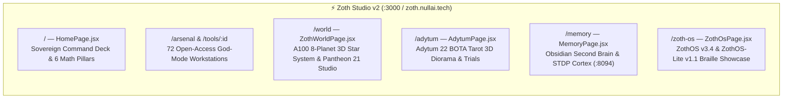

# ⚡ Zoth Studio v2 — Sovereign AI Workstation & 3D Multi-World (`:3000` & `zoth.nullai.tech`)

**Vite + React 19 + MUI 5 + Three.js / WebGL** sovereign AI engineering platform running locally on `http://127.0.0.1:3000` and publicly at [https://zoth.nullai.tech](https://zoth.nullai.tech).

> [!important] 100% Free & Open-Access Architecture (Zero Paywalls)
> All **72 Sovereign Tools** in `src/data/toolsData.js` are **100% free, unlocked, and open-access ($0.00)** with zero blur locks, zero license modals, and zero paywalls. Optional patronage is supported via a clean **"☕ Buy Us a Coffee"** link (`https://buy.stripe.com/3cIfZg27PdKo2D64Ocfw40X`) and Solana tip address (`GG2eQbVh8ut1BK6j1A2tz7pSySdLpD38BgyEhGcxdXoK`).

---

## 1. Identity, Repositories & Endpoints

| Property | Value |
| :--- | :--- |
| **Primary Repository** | `~/NullAITech/zoth-studio-v2` → [https://github.com/NullAITech/zoth-studio-v2](https://github.com/NullAITech/zoth-studio-v2) |
| **Public Production URL** | [https://zoth.nullai.tech](https://zoth.nullai.tech) |
| **Local Workstation URL** | `http://127.0.0.1:3000` (bypass route intros anytime with `?intro=0`) |
| **System Bundle Mirror** | `/opt/zoth-studio/dist/` (synced into [[Zoth OS]] chroot) |
| **CLI Launcher** | `zoth-studio` / `npx @nullaitech/zoth` |
| **Catalog Source of Truth** | `src/data/toolsData.js` + `public/api/tools.json` (72 verified tools: 53 in-browser + 19 CLI/daemon workstations) |

---

## 2. Flagship Routes & 3D Experiences

| Route | Component / Engine | What It Delivers |
| :--- | :--- | :--- |
| `/` | `HomePage.jsx` | Sovereign command deck, 72-tool telemetry, 6 mathematical pillars & live daemon fleet |
| `/world` | `ZothWorldPage.jsx` (`ZothWorldCanvas3D.jsx`, `PantheonCharacterStudio.jsx`) | **A100 Multi-World 8-Planet 3D Star System & Dyson Core** (`SOLARIS-PRIME`, `AETHER-IX`, `KRONOS-FORGE`, `VAELOR-PRIME`, `NYX-SHADOW`, `SYNAPSE-VII`, `TERRA-NEXUS`, `SANCTUM-OMEGA`) + **[[Zoth Civilization & Pantheon 21|Pantheon 21 Character Studio]]** (5-tab RPG inspector, 84 `Q/W/E/R` abilities, 21×21 synergy matrix) |
| `/adytum` | `AdytumPage.jsx` (`AdytumTarotEngine3D.jsx`) | **[[Adytum 22 Tarot 3D Engine]]** (Key `0` The Fool → Key `XXI` The World, procedural WebGL shrines, interactive 3-Card Tarot Spread Oracle, and playable Trials of Wisdom) |
| `/memory` | `MemoryPage.jsx` (`obsidianWikiData.js`) | **Obsidian Second Brain & Biomorphic 3D Netrunner Cortex** (`:8094` STDP engrams, Karpathy LLM Wiki reader, JSON Canvas 1.0 & Bases auditor) |
| `/zoth-os` | `ZothOsPage.jsx` | **[[Zoth OS|ZothOS v3.4]] & [[ZothOS-Lite Web Desktop|ZothOS-Lite v1.1]] Showcase** with interactive Unicode `U+2800` Braille & Bayer 8×8 Dither 3D Pyramid/Merkaba logo |
| `/arsenal` | `ArsenalPage.jsx` | Filterable catalog of all 72 sovereign developer, security, AI, and creative tools |
| `/tools/:id` | `src/components/tools/*` | Dedicated multi-pane **God-Mode** interactive workstation for each of the 72 tools |
| `/webgen` | `WebGenPage.jsx` | [[Zoth WebGen]] full-stack AI app foundry showcase (`:5173`) |

---

## 3. 5-Layer Per-Tool Sovereign Parity Standard

Every tool in `src/data/toolsData.js` satisfies the 5-Layer Sovereign Verification Standard:
1. **Layer A — Standalone Web Workstation (`http://127.0.0.1:<localPort>`)**: Opens directly into a working multi-pane workstation with real client-side AST/crypto/canvas execution and `/health` + `/api/*` endpoints.
2. **Layer B — Zoth Studio v2 God-Mode Route (`http://127.0.0.1:3000/tools/<id>`)**: Dedicated React component in `src/components/tools/` synced to `/opt/zoth-studio/dist/`.
3. **Layer C — ZothOS CLI & Braille TUI (`/usr/local/bin/<tool>` & `<tool>-tui`)**: Verified across `/usr/local/bin/`, `~/.local/bin/`, and `config/includes.chroot/usr/local/bin/` with `--help`, `--json`, and `--status`.
4. **Layer D — Documentation Parity**: Complete `README.md` and in-app architectural documentation.
5. **Layer E — Triple-Viewport Visual Verification**: Zero console errors (`errors.length === 0`) and zero horizontal overflow (`overflowPx === 0`) at `375px`, `768px`, and `1440px`.

---

## 4. Design System & Intro Choreography

- **Typography**: `Celtic Garamond` / `Cinzel` display headers, `Inter` / `Space Grotesk` UI body, `JetBrains Mono` telemetry and Braille canvases.
- **Color Palette**: Sovereign Gold (`#D4AF37` dark / `#B8860B` editorial ivory light), Obsidian Void (`#08080B`), Cyan Telemetry (`#38BDF8`), Emerald Verified (`#10B981`).
- **Route Intros**: 60fps Unicode `U+2800` 2×4 Sub-Pixel Braille + Ordered Bayer 8×8 Dither + Glyph Scramble (`IntroDirector.jsx` / `routeIntros.js`) with Aperture Seam handoff, skippable anytime via `?intro=0`.

---

## Related Notes

- [[00 Home]] · [[Zoth OS]] · [[ZothOS-Lite Web Desktop]] · [[ZothNet Sovereign Mesh]] · [[Zoth Civilization & Pantheon 21]] · [[World of Zoth]] · [[Adytum 22 Tarot 3D Engine]] · [[Zoth Memory]] · [[Public Surfaces]]
- [[06-Wiki/Zoth Studio v2 & 72 Sovereign Micro-SaaS Tools]] · [[06-Wiki/World of Zoth, Pantheon 21 & Adytum 22 3D Multi-World Architecture]]
- [[Maps/Studio.canvas|Studio Canvas]] · [[Maps/Studio Tools.base|Studio Tools Base]] · [[Zoth 72 Sovereign Tools.base]] · [[Zoth 72 Sovereign Tools Tracker.base]]
