# 🧅 ZothNet v1.2.2 — Sovereign Darknet Overlay Mesh, Vaelor L1 DAG & ZML

**Autonomous, Zero-DNS, Cryptographically Sovereign Peer-to-Peer Overlay Mesh** featuring **1,280-byte constant-size Sphinx Mixnet onion packets**, **ChaCha20-Poly1305 + X25519 + Ed25519** cryptography, the **[[Vaelor Network|Vaelor L1 Feeless Account-Lattice DAG]]** (`0.00 VLR` gas fees forever, `+5.00 VLR` Proof-of-Relay rewards), **ZML (`Zoth Markup Language`)**, and native binaries across Linux, Windows, macOS, and **Android 17 API 37 PIE (`zothnet-arm64.apk`)** verified on **Google Pixel 10 Pro**.

> [!important] Live Production Endpoints & Repositories
> - **Primary Web Portal & 3D Mixnet Globe**: [https://zothnet.nullai.tech](https://zothnet.nullai.tech) ([https://zothnet-mesh.netlify.app](https://zothnet-mesh.netlify.app))
> - **ZML Live Studio & Specification**: [https://zml.nullai.tech](https://zml.nullai.tech) · [https://zothnet.nullai.tech/zml/](https://zothnet.nullai.tech/zml/)
> - **GitHub Repository**: [https://github.com/1nc0gn30/zothnet](https://github.com/1nc0gn30/zothnet) (`~/NullAITech/zothnet`, `~/NullAITech/zothnet-android`, `~/NullAITech/zothnet-website`, `~/NullAITech/zml-website`)
> - **Local Workstation Ports**: `http://127.0.0.1:9900` (Embedded Web Dashboard & ZothApp Host) · `UDP :42069` (P2P Wire Frame & LAN Beacon Transport)
> - **Protocol Spec**: Formal `RFC-ZOTH-0102` specification & 11-Tool Model Context Protocol (MCP) server

---

## 1. Four-Layer Cryptographic & Mesh Architecture

```mermaid
flowchart TD
    subgraph L1["📱 Layer 1: Client, Workstation & Mobile Runtime"]
        CLI["ZothOS CLI & 60fps Braille Radar TUI<br/><code>zothnet run / monitor / status / id</code>"]
        WEB["Embedded Alabaster & Gold Web Workstation<br/><code>http://127.0.0.1:9900</code> · First Flight Tour"]
        APK["Android 17 API 37 PIE Native APK<br/><code>libzothnet.so</code> + ForegroundService + WakeLock"]
        ZML_IDE["ZML Reactive Engine & 11 ZothApps<br/><code>1.4ms</code> AST Compiler · <code>zoth://storefront...</code>"]
    end

    subgraph L2["⚙️ Layer 2: Sovereign Protocol Services"]
        VAELOR["◈ Vaelor L1 Feeless DAG<br/><code>0.00 VLR</code> Gas · <code>+5.00 VLR</code> PoR · <code>&lt;18ms</code> Finality"]
        ZNS["🏷️ ZNS Sovereign Name Service<br/><code>.zoth</code> Ed25519 Domain Registrar + Homoglyph Guard"]
        CAS["💾 CAS Swarm Storage<br/>1,200B Chunks · Merkle SHA-256 CIDs · Parallel c=6"]
        AUTH["🔑 Ambient Device Auth<br/>Ed25519 Zero-Password Hardware Passport"]
    end

    subgraph L3["🧅 Layer 3: Sphinx Onion Transport & Broadcast Mesh"]
        SPHINX["3-Hop Sphinx Mixnet Onion Routing<br/>Origin ➔ Guard ➔ Mix Relay ➔ Exit ➔ Recipient"]
        FRAME["Rigid 1,280-Byte Constant Wire Framing<br/>ChaCha20-Poly1305 + X25519 + Anti-Replay Filter"]
        GOSSIP["GossipSub Broadcast Mesh (D=6)<br/>#all, #general, 🚨 #emergency, 🤝 #trade, 🌲 #off-grid, 🛠️ #dev"]
        ZASF["ZASF Store-and-Forward Mailbox<br/>500-Frame Ring Buffer · 24h Ephemeral TTL"]
    end

    subgraph L4["📡 Layer 4: Physical Radio & NAT Traversal"]
        LAN["UDP :42069 Broadcast Beacons<br/>Sub-100ms LAN, Wi-Fi Direct & Hotspot Discovery"]
        DHT["Kademlia 256-Bucket XOR DHT (k=20)<br/>Parallel α=3 Iterative Routing"]
        STUN["RFC 5389 STUN + UPnP / NAT-PMP<br/>Reflexive WAN Hole Punching"]
    end

    L1 --> L2 --> L3 --> L4
```

---

## 2. Sphinx 1,280-Byte Constant-Size Mixnet & Vaelor L1 PoR

| Subsystem | Technical Specification | Security & Economic Invariant |
| :--- | :--- | :--- |
| **Wire MTU Framing** | **Rigid `1,280 Bytes` Constant** (`64B` header + payload + ChaCha20-Poly1305 random padding) | Matches IPv6 minimum MTU; **zero packet-length or DPI side-channel leakage** |
| **3-Hop Onion Peeling** | `Origin ➔ Guard Node ➔ Mix Relay ➔ Exit Node ➔ Recipient` | Ephemeral `X25519` ECDH per hop + `ChaCha20-Poly1305` AEAD + `Ed25519` identity signatures |
| **Vaelor L1 Feeless DAG** | Asynchronous dual-state Account-Lattice (`SEND` + `RECV` frontier blocks) | **`0.00 VLR` ($0.00) gas fees forever**, `14.2ms` (`<18ms`) finality, $\sum \Delta B = 0$ conservation |
| **Proof-of-Relay (`PoR`)** | **`+5.00 VLR` Automatic Relay Reward** | Relays earn `+5.00 VLR` for routing verified multi-hop Sphinx and GossipSub frames |
| **Rate Limiting & Defense** | Token-bucket per-peer rate limiter + anti-replay bloom filter + Unicode homoglyph guard | Prevents Sybil floods, replay attacks, and `.zoth` domain spoofing |

---

## 3. Broadcast Mesh Channels & Quick Signal Actions

The **Broadcast Mesh & Onion Terminal** (`http://127.0.0.1:9900`) provides zero-account GossipSub ($D=6$) community communication across **6 dedicated channels**:
- 🌐 **`#all` (All Mesh)**: Unified real-time feed across all subscribed mesh topics.
- 📢 **`#general` (Public Mesh)**: Open community square and node presence announcements.
- 🚨 **`#emergency` (SOS / Storm)**: High-priority grid-down, severe weather, and neighborhood hazard alerts.
- 🤝 **`#trade` (Yard Sale / Barter)**: Peer-to-peer local commerce and feeless `◈ VLR` payment requests.
- 🌲 **`#off-grid` (0-Bar Radio)**: Direct device-to-device Wi-Fi hotspot and ad-hoc radio relays.
- 🛠️ **`#dev` (Engineering)**: ZML app releases, CAS CIDs, and protocol telemetry.

### Quick Signal Toolbar & Ephemeral Burn Timers
Operators can inject structured payloads with a single click:
1. **`🚨 SOS Alert`** (`insertBroadcastSOS()`) — Emergency coordinates and hazard status.
2. **`◈ Request VLR`** (`insertBroadcastPayment()`) — Inline feeless Vaelor L1 payment link.
3. **`📍 Drop Pin`** (`insertBroadcastPin()`) — Offline mesh location marker.
4. **`🤝 Barter`** (`insertBroadcastBarter()`) — Local yard-sale / swap offer card.
5. **`📎 CAS File`** (`insertBroadcastCAS()`) — Content-addressed 1,280B chunked file attachment.
- **Configurable TTL**: `24h Ephemeral`, `1h Fast Burn`, `7 Days`, or `Permanent DAG`.

---

## 4. Five "Regular Joe" First Flight Interactive Scenarios

Accessible via the **🚀 First Flight Tour** button in the top bar of `http://127.0.0.1:9900` and `zothnet.nullai.tech`:

| Scenario | Title & Real-World Problem | Interactive Simulation & "Regular Joe Rule" |
| :--- | :--- | :--- |
| **1 of 5** | 🌪️ **Hurricane & Grid Outage: When Cell Towers Die** | Simulates `0 Bars (No SIM)` cellular blackout and hops a message (`"Generator running at 142 Maple St..."`) across `Neighbor 1 (60 yds)` → `Neighbor 2 (140 yds)` → `Mom's Phone (300 yds)` via UDP `:42069`. |
| **2 of 5** | 🏟️ **Stadium 5G Congestion: The 75,000-Fan Lifeline** | Interactive slider (`1,000` to `85,000` fans) comparing a `99.4% JAMMED` 5G tower against ZothNet's `100% ROUTE SURPLUS` (`8ms` wave-hop across 128 peer relays). |
| **3 of 5** | 🤝 **Yard Sale & Farmers Market: Cash in Hand ($0.00 Fees)** | Interactive checkout for a *Vintage 10-Speed Road Bicycle (`35.00 VLR`)* with a **`💧 Claim +25.00 VLR Faucet`** button and **`⚡ Tap to Pay 35.00 VLR`** instant offline settlement (`$0.00` fee vs. Square/Venmo `-$1.52`). |
| **4 of 5** | ☕ **Public Wi-Fi Snooper Shield: The Coffee Shop Cloak** | Live packet-weight gauge where typing any sensitive text dynamically adjusts `ChaCha20-Poly1305` junk padding so wire size remains locked at **`1,280 Bytes`**. |
| **5 of 5** | 🚨 **Neighborhood SOS & Beacon: Instant Local Broadcast** | 1-click presets (*🐕 Lost Golden Retriever*, *⚠️ Fallen Tree on Oak Ave*, *🍲 Free Generator Power & Warm Soup*) broadcasting over local GossipSub with zero accounts or phone numbers. |

---

## 5. ZML (Zoth Markup Language) & 11 Built-In ZothApps

**ZML** ([https://zml.nullai.tech](https://zml.nullai.tech) · [https://zothnet.nullai.tech/zml/](https://zothnet.nullai.tech/zml/)) compiles 5–15 lines of declarative directives (`HEADER`, `AMBIENT_DEVICE_AUTH`, `DITHER_BANNER`, `BRAILLE_RADAR`, `GRID`, `ITEM`, `PAY_LINK`, `CART_BAR`, `RECEIPT_BOX`, `COFFEE_BUTTON`) into CSP-hardened, zero-cloud HTML5 apps in **1.4ms**.

### The 11 Built-In Sovereign ZothApps (`zoth://<slug>`)
1. `zoth://welcome` — **ZothNet Sovereign Portal** (Onboarding & ZothSDK bridge)
2. `zoth://ghost-notes` — **Ghost Notes Vault** (1-Bit amnesic RAM scratchpad)
3. `zoth://mesh-board` — **Mesh Bulletin Board** (Multi-channel Ed25519 signed forum)
4. `zoth://storefront` — **Sovereign Storefront** (Feeless Vaelor L1 DAG bazaar)
5. `zoth://zoth-drive` — **ZothDrive Vault** (1,280B chunked CAS file vault with SHA-256 CIDs)
6. `zoth://zoth-radio` — **ZothRadio Darknet Synth** (WebAudio `-14 LUFS` procedural synth)
7. `zoth://zoth-chat` — **ZothChat E2EE Messenger** (3-hop Sphinx onion chat with burn timers)
8. `zoth://zoth-wallet` — **ZothWallet & DAG Explorer** (Interactive SVG Account-Lattice visualizer & faucet)
9. `zoth://names` — **ZNS Sovereign Name Service** (`.zoth` decentralized domain registrar)
10. `zoth://zoth-vault` — **ZothVault Sovereign Vault** (AES-256-GCM credentials & notebook vault)
11. `zoth://zoth-pub` — **ZothPub Sovereign Press** (Signed censorship-resistant Markdown publishing)

---

## 6. Multi-Platform Binaries, Android 17 API 37 PIE APK & 24/7 Relay Guide

| Target Platform | Artifact | Size | SHA-256 Digest |
| :--- | :--- | :--- | :--- |
| **Linux (x86_64)** | [`zothnet-linux-amd64`](https://zothnet.nullai.tech/downloads/zothnet-linux-amd64) | 8.1 MB | `d51519302d2e6219f7f4daa96a09c605824c5a29fe59ba06d6f2cd98d8288825` |
| **Linux (ARM64 / RPi)** | [`zothnet-linux-arm64`](https://zothnet.nullai.tech/downloads/zothnet-linux-arm64) | 7.6 MB | `b16a5691274ddf4799f7c0bf6657616d9eec6dd701816f55e5976dc9226bd2ae` |
| **Windows (x64)** | [`zothnet-windows-amd64.exe`](https://zothnet.nullai.tech/downloads/zothnet-windows-amd64.exe) | 8.3 MB | `364bec8beceee49e21cc50d1a4cf405874ec41e71fcab64d9e09a73417ec7814` |
| **macOS (Apple Silicon)** | [`zothnet-darwin-arm64`](https://zothnet.nullai.tech/downloads/zothnet-darwin-arm64) | 7.7 MB | `be797cf5e5d1df6757b2ce980815e61f9e387c781a812c34299936886c7cbd84` |
| **macOS (Intel x86_64)** | [`zothnet-darwin-amd64`](https://zothnet.nullai.tech/downloads/zothnet-darwin-amd64) | 8.3 MB | `a9e961934a8881391540bc955ca816d7c1d5acd4a7e1960c4a9c54a57927ea5d` |
| **Android (ARM64 Signed APK)** | [`zothnet-arm64.apk`](https://zothnet.nullai.tech/downloads/zothnet-arm64.apk) | 9.0 MB | `4600915e5837a6cf504401dbc158d02f5fd0d02d33e9de7097c9ed264332e69c` |

### Android 17 (API 37) PIE Hardening & Google Pixel 10 Pro Verification
- **PIE Native Binary (`-buildmode=pie`)**: Cross-compiled `CGO_ENABLED=0 GOOS=android GOARCH=arm64 go build -buildmode=pie` packaged as `lib/arm64-v8a/libzothnet.so` for strict SELinux W^X and Android 15/16/17 (API 37) compliance, verified live on **Google Pixel 10 Pro**.
- **24/7 Background Persistence (`ZothNetService.java`)**: Ongoing `ForegroundService` (`zothnet_mesh_channel`) + `PowerManager.PARTIAL_WAKE_LOCK` (`ZothNet::MeshKeepAlive`) + `WifiManager.MulticastLock` (`ZothNetMulticast`).

### Running 24/7 Dedicated Relay Nodes (Linux VPS, Moto G 2025, Moto G Stylus)
1. **Spare Android Hardware Relay (Moto G 2025 / Moto G Stylus)**:
   - Install `zothnet-arm64.apk` via `adb install -r zothnet-arm64.apk` or direct download.
   - Set Android **Battery Usage → Unrestricted** for ZothNet so `PARTIAL_WAKE_LOCK` and `MulticastLock` stay active 24/7 with screen off, turning a `$100` Moto G 2025 or Moto G Stylus into an always-on home/neighborhood Sphinx relay and ZASF store-and-forward anchor earning `+5.00 VLR` PoR rewards.
2. **Cloud / Bare-Metal Linux VPS Relay**:
   - Run `curl -fsSL https://zothnet.nullai.tech/install.sh | bash` and start `zothnet run --alias "VPS-Relay-Anchor" --port 42069` (with UDP `42069` open) to provide public STUN reflexive discovery and intercontinental Sphinx mixnet routing.

---

## Related Notes

- [[00 Home]] · [[Vaelor Network]] · [[Zoth OS]] · [[Zoth Studio]] · [[Public Surfaces]] · [[05-Telemetry/ZothNet Encrypted Comms]]
- [[06-Wiki/ZothNet v1.2.2 Sovereign Mesh, Vaelor L1 DAG & ZML Architecture]]
- [[ZothNet & Vaelor Sovereign Mesh Architecture.canvas]]
