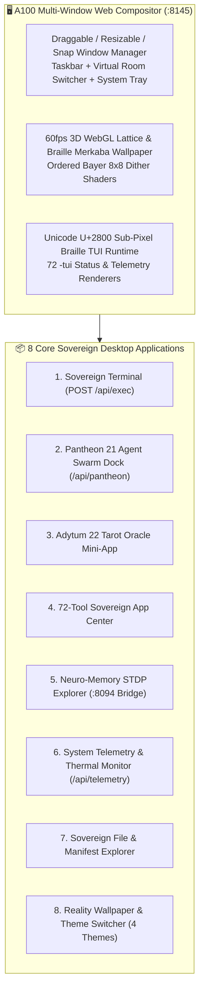

# 💻 ZothOS-Lite v1.1 — A100 3D Web & Docker Desktop (`:8145` & `zothos.nullai.tech`)

Lightweight (`<800 MB RAM` / `958 MB` container footprint) browser-native and Docker-ready edition of **[[Zoth OS|ZothOS v3.4]]** running locally on `http://127.0.0.1:8145` and publicly at [https://zothos.nullai.tech](https://zothos.nullai.tech) (`https://zothos-lite.nullai.tech`). Engineered with the **A100 Web Desktop Architect** upgrades: a 60fps 3D WebGL Lattice Desktop background, hardware-accelerated multi-window compositor, Unicode `U+2800` Braille TUI applications, in-browser 72-tool launchpad, Pantheon 21 Agent Swarm Dock, and real backend API execution.

> [!tip] Instant Zero-Install Sovereign Workstation
> ZothOS-Lite requires zero ISO flashing or partitioning—operators can boot the full KDE/XFCE-inspired sovereign window manager directly in any browser or spin it up via `PORT=8145 node server.js` / Docker in under 2 seconds.

---

## 1. Identity, Endpoints & Repositories

| Property | Value |
| :--- | :--- |
| **Version** | `v1.1.0` (A100 Web Desktop Architect Edition) |
| **Local Repository** | `~/NullAITech/zothos-lite` → [https://github.com/NullAITech/zothos-lite](https://github.com/NullAITech/zothos-lite) |
| **Website Repository** | `~/NullAITech/zoth-os-website` → [https://zothos.nullai.tech](https://zothos.nullai.tech) |
| **Local Loopback Daemon** | `http://127.0.0.1:8145` (`PORT=8145 node server.js`) |
| **Public Web Desktop** | [https://zothos.nullai.tech](https://zothos.nullai.tech) (`#lite` interactive preview & standalone mode) |
| **Architect** | 1nc0gn30 (`@1nc0gn30`) • [NullAI Platform](https://nullai.tech) |

---

## 2. A100 Web Desktop Architect Upgrades

### Key Architectural Highlights
1. **Desktop-Class Window Manager**:
   - Full z-index focus stacking, window minimize/maximize/restore, viewport edge-snapping, keyboard shortcuts, and mobile/tablet responsive touch adaptation (`overflowPx === 0` across `375px`, `768px`, and `1440px`).
2. **Unicode `U+2800` 2×4 Sub-Pixel Braille TUI Apps**:
   - Renders real-time Braille radar waveforms, CPU/RAM sparklines, and `<tool>-tui --status` outputs directly inside terminal and telemetry windows at 60fps.
3. **In-Browser 72-Tool Execution**:
   - Launches any of the 72 open-access tools from [[Zoth Studio]] (`src/data/toolsData.js`) inside dedicated desktop windows or links directly to their God-Mode routes.
4. **Dual-Theme & Reality Shader Engine**:
   - Instant switching between `Sovereign Gold` (`#08080B` + `#D4AF37`), `Netrunner Cyan` (`#38BDF8`), `Ghost Emerald` (`#10B981`), and `Ivory Alchemist` (`#FAF8F3` editorial light mode).

---

## 3. Built-In Desktop Applications & API Routes

| App / Window | Backend Endpoint | Core Utility |
| :--- | :--- | :--- |
| **1. Sovereign Terminal (`bash` / `zoth-cli`)** | `POST /api/exec` | Executes whitelisted ZothOS, Linux, and Braille TUI diagnostic commands with real stdout/stderr streaming. |
| **2. Pantheon 21 Agent Swarm Dock** | `GET /api/pantheon` | Inspect all 21 sovereign agents, dispatch tasks, and trigger `Q/W/E/R` RPG abilities. |
| **3. Adytum 22 Tarot Oracle** | Client + `/api/tarot` | Draw 1-card or 3-card BOTA Major Arcana spreads with live alchemical and architectural interpretations. |
| **4. 72-Tool Sovereign App Center** | `GET /api/tools` | Search, filter by category, and open any of the 72 zero-paywall tools in [[Zoth Studio]]. |
| **5. Neuro-Memory Explorer** | `:8094` REST Bridge | Query 41,690+ STDP synaptic engrams and browse the [[00 Home|Obsidian Second Brain]]. |
| **6. System Telemetry & Thermal Monitor** | `GET /api/telemetry` | Live CPU load, memory allocation, uptime, loopback daemon status, and Braille waveforms. |
| **7. Sovereign File Explorer** | `GET /api/fs` | Inspect chroot directories, CLI wrappers, and security manifests. |
| **8. Reality Wallpaper & Theme Switcher** | Client WebGL + CSS | Toggle 3D WebGL geometry modes (`Merkaba`, `Lattice`, `Braille Sphere`) and color palettes. |

---

## Related Notes

- [[00 Home]] · [[Zoth OS]] · [[Zoth Studio]] · [[ZothNet Sovereign Mesh]] · [[Zoth Civilization & Pantheon 21]] · [[Adytum 22 Tarot 3D Engine]] · [[Public Surfaces]]
- [[06-Wiki/ZothOS v3.4 & ZothOS-Lite A100 Desktop Hardening Architecture]]
