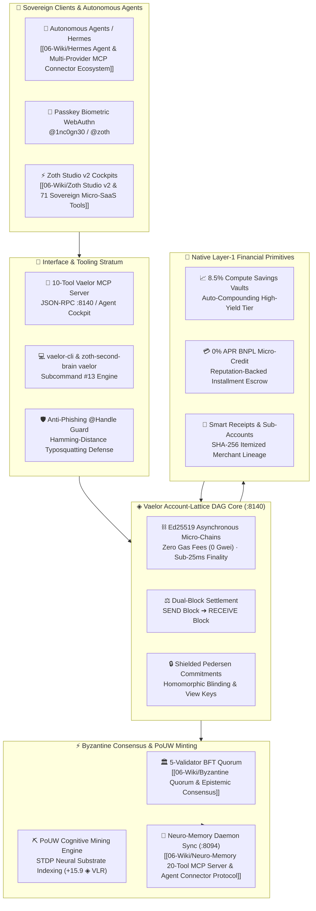

# 📚 Vaelor Layer-1 Complete Architecture & Protocol Reference

> [!abstract] Executive Architecture Summary
> **Vaelor (◈ VLR)** is an avant-garde, feeless Layer-1 cryptocurrency and decentralized cognitive compute lattice engineered for sovereign human and AI agent economies. Operating on an asynchronous **Account-Lattice DAG**, each participant owns an independent Ed25519 micro-chain settled with sub-25ms finality. Consensus is finalized by a 5-validator Byzantine Fault Tolerant (BFT) quorum on `:8140`. Vaelor replaces wasteful Proof-of-Work hash loops with **Proof-of-Useful-Work (PoUW)** cognitive mining—minting new `◈ VLR` supply by performing verified STDP neural vector indexing and biological memory graph synthesis for [[06-Wiki/Biomorphic STDP & 3D Netrunner Cortex|Neuro-Memory Daemons]]. Built-in financial primitives include **8.5% Compute Savings Vaults**, **0% APR BNPL Micro-Credit**, **Cryptographic Smart Receipts & Sub-Accounts**, **Anti-Phishing `@Handle` Directory**, **Shielded Pedersen Commitments**, and a **10-Tool Vaelor MCP Server**.

---

## 1. System Topology & Cross-Stratum Flow



---

## 2. Core Architectural Pillars

### 2.1 Asynchronous Account-Lattice DAG Core
Unlike monolithic blockchains (e.g. Ethereum, Solana) where every transaction contends for space in a single sequential block, Vaelor structures the global state as an asynchronous **Directed Acyclic Graph (DAG) of individual account chains**.
- **Ed25519 Micro-Chains**: Every account possesses an independent chain whose state can only be mutated by the private key holder.
- **Zero Gas Fees ($0.00 / 0 Gwei)**: By decoupling transaction throughput from global block auction competition, basic transfers are zero-gas, protected against denial-of-service spam via sub-20ms SHA-256 Proof-of-Stamp nonces.
- **Sub-25ms Dual-Block Finality**: Transfers consist of a `SEND` block published by the sender and a corresponding `RECEIVE` block published by the receiver, eliminating global lock contention.

### 2.2 5-Validator Byzantine Fault Tolerant (BFT) Quorum
Finality across cross-account transactions and epoch state snapshots is guaranteed by a geo-distributed 5-validator consensus quorum operating on port `:8140`:
1. **Validator Node 1 (US-East Virginia)**: Primary latency anchor (1.2ms).
2. **Validator Node 2 (EU-Central Frankfurt)**: European jurisdiction anchor (14.8ms).
3. **Validator Node 3 (AP-East Tokyo)**: Asia-Pacific routing anchor (22.4ms).
4. **Validator Node 4 (Local Edge)**: Low-overhead desktop peer on local loopback (0.4ms).
5. **Validator Node 5 (NullAI Core Sovereign)**: Epistemic attestation and zero-trust anchor (0.8ms).

Consensus requires $\ge \frac{2}{3} + 1$ (4/5 or 5/5) Byzantine signatures before finalizing state root certificates.

### 2.3 Proof-of-Useful-Work (PoUW) Cognitive Mining
Traditional cryptocurrencies burn gigawatts calculating meaningless cryptographic preimage hashes. Vaelor replaces this with **Proof-of-Useful-Work (PoUW)**:
- **Cognitive Work Units**: AI worker nodes and local daemons perform high-value cognitive compute—specifically vectorizing Markdown notes, calculating degree centralities, building AST graphs, and ingesting STDP memories into `/home/zoth/Documents/Obsidian Vault`.
- **Validation Engine**: Validator nodes verify the mathematical validity of the completed cognitive work (e.g. valid JSON Canvas 1.0 ASTs or cosine vector cluster trees) via deterministic spot-checks.
- **Mining Reward**: Verified miners are disbursed newly minted `◈ VLR` (standard base reward of `+15.9 ◈ VLR` per cognitive block) and state transitions are anchored directly into [[06-Wiki/STDP Synaptic Memory Consolidation & Hebbian Dream Wave|STDP Synaptic Memory Engrams]].

### 2.4 8.5% Compute Savings Vaults & Automated Yield Engine
Liquid capital deposited in Vaelor Savings Vaults earns a baseline **8.5% APY** yield:
- **Compute Substrate Backing**: Yield is funded by protocol licensing, AI agent execution surcharges, and compute cluster rental fees across the NullAI network.
- **Flexible & Locked Tiers**: Users and agents can deploy funds into flexible liquid vaults or locked 90-day sovereign chambers with up to 12.5% boosted rewards.
- **Continuous Compounding**: Epoch rewards compound hourly without requiring manual gas-wasting harvest transactions.

### 2.5 0% APR Buy-Now-Pay-Later (BNPL) Micro-Credit
Vaelor integrates decentralized micro-lending directly into the L1 consensus state:
- **Reputation-Weighted Credit Limits**: Calculated from historical transaction volume, validator staking, and merchant review proofs.
- **Zero-Interest Installment Escrow**: Purchases can be divided into 4 equal bi-weekly payments with 0% APR.
- **Autonomous Recovery & Smart Collateral**: Installments are auto-deducted from incoming revenue streams or bonded vault reserves.

### 2.6 Cryptographic Smart Receipts & Sub-Account Envelopes
Every commercial transaction generated on Vaelor produces an immutable, privacy-preserving **Smart Receipt**:
- **SHA-256 Itemized Lineage**: Receipts contain full product SKUs, tax calculations, and 365-day warranty metadata encrypted under the buyer's viewing key.
- **Sub-Account Envelopes**: Accounts can spawn isolated sub-accounts (e.g., `@zoth/saas`, `@zoth/groceries`, `@zoth/agents`) with hardware-enforced daily budget caps and automated categorization.

### 2.7 Anti-Phishing `@Handle` Directory & Hamming-Distance Guard
Hexadecimal addresses (`0x...`) are notoriously susceptible to clipboard-hijacking and phishing attacks. Vaelor mandates sovereign human-readable handles:
- **Canonical Handle Registration**: Accounts register unique identities (e.g., `@1nc0gn30`, `@zoth`, `@studio`).
- **Hamming-Distance Defense**: The validator gossip protocol rejects transaction attempts to visually similar or typosquatted handles within a Levenshtein/Hamming distance threshold of verified entities, protecting both human operators and autonomous Hermes agents.
- **Verified Merchant Badging**: Cryptographically signed merchant identities verified via [[06-Wiki/Zero-Trust Supply Chain, Cosign & VirusTotal Verification|Cosign PKI Signatures]].

### 2.8 Shielded Pedersen Commitments & Confidential Balances
For enterprise and privacy-sensitive transactions, Vaelor provides zero-knowledge balance masking:
- **Pedersen Commitments**: Transaction values are committed as $C = vG + rH$, where $v$ is the transaction value and $r$ is the cryptographic blinding factor.
- **Bulletproof Range Proofs**: Guarantees that transaction values are positive and non-overflowing without disclosing the numerical balance to the public ledger.
- **Auditor View Keys**: Allows selective compliance disclosure to tax authorities or accounting daemons without compromising general network privacy.

### 2.9 10-Tool Vaelor MCP Server Suite
Autonomous AI agents interact with the Vaelor ledger via an official 10-tool Model Context Protocol (MCP) server listening on `:8140`:
1. `vaelor_get_status`: Queries circulating supply, block count, and validator health.
2. `vaelor_get_balance`: Inspects handle balance, pending receivables, and escrow locks.
3. `vaelor_transfer`: Feeless instant transfer to any `@handle`.
4. `vaelor_mine_pouw`: Dispatches cognitive work payload and mints `◈ VLR`.
5. `vaelor_create_escrow`: Initializes 24–72h buyer-protected escrow payment.
6. `vaelor_release_escrow`: Settles and releases funds to the seller.
7. `vaelor_open_vault`: Deposits `◈ VLR` into 8.5% APY compute savings vault.
8. `vaelor_bnpl_split`: Divides an invoice into 4-installment 0% APR schedule.
9. `vaelor_verify_receipt`: Verifies cryptographic SHA-256 itemized receipt authenticity.
10. `vaelor_register_handle`: Registers new `@handle` and binds Ed25519 passkey.

### 2.10 `vaelor-cli` & Second Brain CLI Integration (Command #13)
The host workstation connects directly to the Vaelor lattice via `vaelor-cli` and command #13 in [[06-Wiki/Obsidian Second Brain, JSON Canvas 1.0 & Bases Architecture|zoth-second-brain]]:
```bash
# Query live L1 status and circulating supply
zoth-second-brain vaelor

# Output structured JSON for agent consumption
zoth-second-brain vaelor --json

# Dispatch PoUW cognitive mining block (+15.9 ◈ VLR)
zoth-second-brain vaelor --mine
```

---

## 3. Mathematical Foundations & Consensus Equations

1. **Dual-Block Lattice Invariant**:
   For any valid transaction between sender $S$ and recipient $R$:
   $$\Delta \text{Balance}_S = -\text{amount}, \quad \Delta \text{Balance}_R = +\text{amount}$$
   $$\sum_{i \in \text{Accounts}} \text{Balance}_i = \text{TotalSupply}_{\text{VLR}} + \sum \text{PoUW}_{\text{Minted}}$$

2. **PoUW Cognitive Proof Verification**:
   $$\text{Hash}(\text{TaskPayload} \parallel \text{MinerPubKey} \parallel \text{STDP}_{\text{Root}}) < \text{Target}_{\text{Difficulty}}$$

3. **Byzantine Fault Tolerant Quorum**:
   $$\text{FinalityReached} \iff \sum_{v \in \text{Validators}} \text{Sign}(v, \text{StateRoot}) \ge \left\lfloor \frac{2N}{3} \right\rfloor + 1$$
   Where $N = 5 \implies \text{Quorum} \ge 4$.

---

## 4. Canonical Cross-Wiki Bidirectional References

- [[05-Telemetry/ZothNet Encrypted Comms|ZothNet Encrypted Comms]] — End-to-end PBKDF2-SHA256 & AES-256-GCM encrypted peer communication and 24/7 autonomous AI task dispatching.
- [[06-Wiki/Vaelor Account-Lattice & PoUW Protocol|Vaelor Account-Lattice & PoUW Protocol]] — Deep dive into feeless DAG mechanics, micro-stamps, and latency benchmarking.
- [[06-Wiki/Vaelor Privacy Shield, Social Group Tabs & Inheritance Vaults|Vaelor Privacy Shield, Social Group Tabs & Inheritance Vaults]] — Pedersen commitments, view keys, group tab settle & inheritance vaults.
- [[06-Wiki/Vaelor Smart Receipts, Sub-Accounts & Anti-Phishing Directory|Vaelor Smart Receipts, Sub-Accounts & Anti-Phishing Directory]] — Itemized proofs, 365d warranties & sub-account spend controls.
- [[06-Wiki/Byzantine Quorum & Epistemic Consensus|Byzantine Quorum & Epistemic Consensus]] — Mathematical analysis of the 5-validator BFT consensus matrix and conflict resolution.
- [[06-Wiki/Neuro-Memory 20-Tool MCP Server & Agent Connector Protocol|Neuro-Memory 20-Tool MCP Server & Agent Connector Protocol]] — The 20-tool JSON-RPC suite connecting AI agents to the STDP neural substrate.
- [[06-Wiki/Biomorphic STDP & 3D Netrunner Cortex|Biomorphic STDP & 3D Netrunner Cortex]] — Biological synaptic plasticity and Three.js 3D netrunner visualization.
- [[06-Wiki/Hermes Agent & Multi-Provider MCP Connector Ecosystem|Hermes Agent & Multi-Provider MCP Connector Ecosystem]] — Sovereign AI agent runtime utilizing Vaelor MCP tools for autonomous treasury management.
- [[06-Wiki/Zero-Trust Supply Chain, Cosign & VirusTotal Verification|Zero-Trust Supply Chain, Cosign & VirusTotal Verification]] — Ed25519 Cosign signature verification for Vaelor validator binaries.
- [[06-Wiki/ZothOS Sovereign Linux & Kernel Architecture|ZothOS Sovereign Linux & Kernel Architecture]] — Host operating system running the `:8140` Vaelor validator node.
- [[06-Wiki/Zoth Studio v2 & 71 Sovereign Micro-SaaS Tools|Zoth Studio v2 & 71 Sovereign Micro-SaaS Tools]] — Sovereign web cockpit embedding Vaelor payment badges and Lattice visualizer.
- [[06-Wiki/STDP Synaptic Memory Consolidation & Hebbian Dream Wave|STDP Synaptic Memory Consolidation & Hebbian Dream Wave]] — Memory engrams recorded on every minted PoUW cognitive block.
- [[06-Wiki/Obsidian Second Brain, JSON Canvas 1.0 & Bases Architecture|Obsidian Second Brain, JSON Canvas 1.0 & Bases Architecture]] — Second brain specification governing this knowledge repository.
- [[Vaelor Network]] — Root operational note for Vaelor daemon services.
- [[00 Home]] — Second Brain central dashboard.
