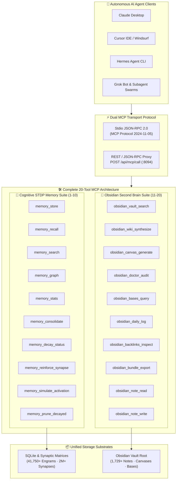

# 🧠 Neuro-Memory 20-Tool MCP Server & Agent Connector Protocol

> [!abstract] Executive Summary
> The **Neuro-Memory 20-Tool MCP Server** (`neuro_memory_daemon.mcp_server`) is the open standard cognitive and knowledge bridge linking autonomous AI agents (Claude Desktop, Cursor IDE, Grok Bot, Hermes Agent) to the biomorphic **Spike-Timing-Dependent Plasticity (STDP)** memory substrate and the **1,729+ note Obsidian Second Brain Vault**. Implementing the **Model Context Protocol (MCP)** specification over dual transport layers (`stdio` JSON-RPC 2.0 and RESTful HTTP `:8094`), the server delivers a cohesive 20-tool suite spanning associative engram recall, memory consolidation, fixed-root confined note read/write, spatial JSON Canvas generation, database querying, doctor health audits, and portable cryptographic bundle attestation.

## Conceptual Architecture



## Complete 20-Tool MCP Functional Catalog

### Part I: Cognitive & Biological STDP Memory Tools (1–10)
| # | Tool Name | Description | Key Arguments |
|---|-----------|-------------|---------------|
| 1 | `memory_store` | Ingests a cognitive memory engram into the biomorphic substrate with importance weighting and tags. | `text`, `tags`, `importance`, `category` |
| 2 | `memory_recall` | Performs associative cue recall leveraging CA3 pattern completion and spreading activation. | `query`, `top_k`, `min_salience` |
| 3 | `memory_search` | Substrate full-text search across all stored episodic, semantic, and insight memories. | `query`, `limit` |
| 4 | `memory_graph` | Extracts local synaptic adjacency subgraphs centered on target engram clusters. | `center_id`, `depth`, `min_weight` |
| 5 | `memory_stats` | Returns real-time biomorphic telemetry (total engrams, active synapses, Shannon entropy). | `none` |
| 6 | `memory_consolidate` | Triggers sleep replay consolidation, reinforcing recurring paths and shedding noise. | `cycles`, `decay_rate` |
| 7 | `memory_decay_status` | Inspects Ebbinghaus exponential decay curves and retention scores across working memory. | `memory_ids` |
| 8 | `memory_reinforce_synapse`| Explicitly reinforces Hebbian synaptic conductance between two memory nodes ($\Delta w$). | `source_id`, `target_id`, `delta` |
| 9 | `memory_simulate_activation`| Simulates continuous-time spreading activation wave through synaptic connections. | `seed_ids`, `decay`, `steps` |
| 10| `memory_prune_decayed` | Prunes sub-threshold forgotten engrams while preserving immutable system anchors. | `threshold` |

### Part II: Obsidian Second Brain & Knowledge Graph Tools (11–20)
| # | Tool Name | Description | Key Arguments |
|---|-----------|-------------|---------------|
| 11| `obsidian_vault_search` | Unified search across 1,729+ Vault notes, JSON Canvases, and Obsidian Bases. | `query`, `limit` |
| 12| `obsidian_wiki_synthesize` | Autonomously compiles and synthesizes a canonical Karpathy LLM Wiki note in `06-Wiki/`. | `topic` |
| 13| `obsidian_canvas_generate` | Procedurally generates a JSON Canvas 1.0 spatial graph with note cards and color badges. | `topic` |
| 14| `obsidian_doctor_audit` | Runs comprehensive AST and health audit on 100% of `.canvas`, `.base`, and `.md` files. | `none` |
| 15| `obsidian_bases_query` | Executes structured SQL/YAML queries against Obsidian Bases (`.base`) dynamic tables. | `base`, `limit` |
| 16| `obsidian_daily_log` | Appends timestamped engineering logs into today's Daily Sovereign Note in `07-Daily/`. | `entry`, `date` |
| 17| `obsidian_backlinks_inspect` | Scans notes for incoming citations, outgoing wikilinks, and latent unlinked mentions. | `note` (default: "00 Home") |
| 18| `obsidian_bundle_export` | Exports cryptographic SHA-256 portable knowledge bundle attestation with top hubs. | `refresh` (default: true) |
| 19| `obsidian_note_read` | Safely reads vault note with fixed-root confinement, parsing frontmatter and wikilinks. | `path` (default: "00 Home.md") |
| 20| `obsidian_note_write` | Safely writes Obsidian Flavored Markdown with fixed-root confinement and STDP sync. | `relPath`, `content` |

---

## Security Invariants: Strict Fixed-Root Confinement

All filesystem operations in the Obsidian tool suite enforce strict confinement within `/home/zoth/Documents/Obsidian Vault`:
- **Realpath Canonicalization:** Input paths are unquoted, normalized, and resolved via `os.path.realpath`.
- **Root Traversal Rejection:** Any path containing `..` or leading outside the canonical vault directory triggers an immediate HTTP 400 error (`Path traversal forbidden: requested path is outside vault root`).
- **Secret Shielding:** Symlinks pointing outside the vault boundary are dereferenced and rejected. Credential stores, SSH keys, and system secrets remain completely unreachable by tool invocations.

```python
# Fixed-root confinement security invariant:
vault_root = os.path.realpath(str(vault_dir))
candidate = os.path.realpath(os.path.abspath(os.path.join(vault_root, normalized)))
if os.path.commonpath([vault_root, candidate]) != vault_root:
    raise SecurityError("Path traversal forbidden: requested path is outside vault root")
```

---

## Multi-Provider Agent Integration

External agent systems integrate with the Neuro-Memory daemon via standardized configuration blocks:

### 1. Claude Desktop Configuration (`claude_desktop_config.json`)
```json
{
  "mcpServers": {
    "neuro-memory": {
      "command": "/opt/zothos-ai-env/bin/python3",
      "args": ["-m", "neuro_memory_daemon.mcp_server"],
      "env": {
        "PYTHONPATH": "/home/zoth/NullAITech/neuro-memory-daemon/src",
        "NEURO_MEMORY_DB": "/home/zoth/.local/share/neuro_memory/memories.db"
      }
    }
  }
}
```

### 2. Cursor IDE & Windsurf Configuration (`mcp.json`)
```json
{
  "mcpServers": {
    "zoth-obsidian-second-brain": {
      "command": "/opt/zothos-ai-env/bin/python3",
      "args": ["-m", "neuro_memory_daemon.mcp_server"],
      "env": {
        "PYTHONPATH": "/home/zoth/NullAITech/neuro-memory-daemon/src"
      }
    }
  }
}
```

---

## See Also

- [[00 Home]] — Sovereign Second Brain Central Hub
- [[Zoth Memory]] — Biomorphic Cognitive Memory Substrate
- [[06-Wiki/Biomorphic STDP & 3D Netrunner Cortex|Biomorphic STDP & 3D Netrunner Cortex]]
- [[06-Wiki/Obsidian Second Brain, JSON Canvas 1.0 & Bases Architecture|Obsidian Second Brain, JSON Canvas 1.0 & Bases Architecture]]
- [[06-Wiki/Hermes Agent & Multi-Provider MCP Connector Ecosystem|Hermes Agent & Multi-Provider MCP Connector Ecosystem]]
- [[06-Wiki/Vaelor Privacy Shield, Social Group Tabs & Inheritance Vaults|Vaelor Privacy Shield, Social Group Tabs & Inheritance Vaults]]
- [[Zoth OS]] — Preempt-RT Sovereign Operating System
