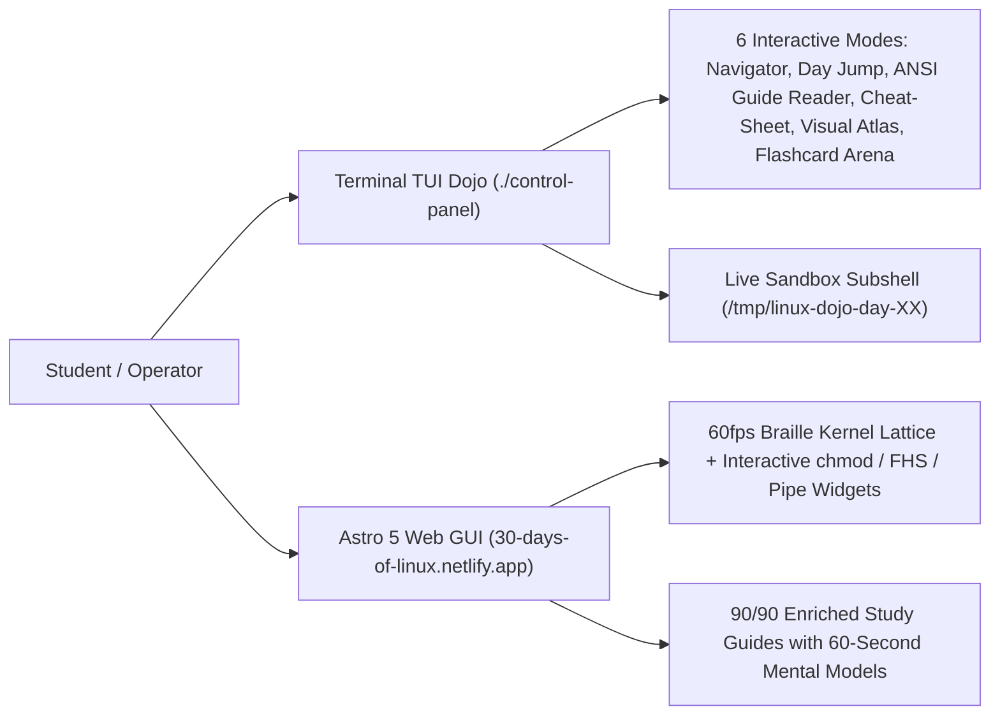

# 🐧 30 Days of Linux Fundamentals — ZothOS × 1nc0gn30 Dojo (v3.4)

Interactive, zero-fluff Linux systems engineering curriculum structured into **4 Weekly Phases**, **30 Daily Modules**, and **90 Bite-Sized Digestible Meals** (`Breakfast` = Theory & Syscalls, `Lunch` = Flags & Real-World Patterns, `Dinner` = Boss Lab & Verification Quiz).

- **GitHub Repository**: [https://github.com/1nc0gn30/30-days-of-Linux-Fundamentals](https://github.com/1nc0gn30/30-days-of-Linux-Fundamentals)
- **Local Path**: `/home/zoth/NullAITech/30-days-of-Linux-Fundamentals`
- **Live Web Dojo (Astro 5 GUI)**: [https://30-days-of-linux.netlify.app](https://30-days-of-linux.netlify.app)
- **Native C Terminal Dojo (TUI)**: `./control-panel` (compiled from `control.c`)

---

## 1. Dual-Interface Student Learning Architecture



---

## 2. Interactive Visual Widgets (Web GUI & TUI)

1. **60fps ASCII-Braille Kernel Lattice Visualizer**:
   - Toggle between **Kernel Ring-0 → Ring-3 Syscall Flow**, **Filesystem Hierarchy Standard (`/`)**, and **POSIX `stdin | stdout | stderr` Streams**.
2. **Interactive `chmod` Octal & Symbolic Permission Matrix**:
   - Toggle `r`/`w`/`x` bits for Owner, Group, and Others (`chmod 755`, `chmod 600`, `chmod 644`) with live octal sum and binary mask preview.
3. **Interactive Linux Filesystem (`/`) Directory Explorer**:
   - Clickable inspection of `/bin`, `/etc`, `/proc`, `/dev`, `/var`, `/home`, `/tmp`, and `/usr` with kernel inode notes and study commands.
4. **Interactive POSIX Pipeline (`|`) Dataflow Simulator**:
   - Step-by-step live transformation across `cat auth.log` → `grep "Failed"` → `awk '{print $11}'` → `sort | uniq -c`.

---

## 3. Native C TUI CLI Flags (`./control-panel`)

```bash
# Launch interactive 6-mode student TUI menu
./control-panel

# Print non-interactive curriculum progress status
./control-panel --status

# Print the Master Linux Commands & Keyboard Cheat-Sheet
./control-panel --cheatsheet

# Print the Visual ASCII Linux Architecture Atlas (FHS, chmod, Pipes, Signals)
./control-panel --atlas

# Jump directly into any day's lessons & sandbox (1..30)
./control-panel --day 15
```

---

## Related Notes

- [[00 Home]] · [[Zoth OS]] · [[Public Surfaces]] · [[1nc0gn30 Sovereign Hub]]
