# Agent Mock Twin (`agent-mock-twin`)

> **100% Free & Open Access Sovereign Tool** — Zero paywalls, zero blur locks, zero license keys.
> - **Standalone Workstation**: `http://127.0.0.1:8097`
> - **Zoth Studio v2 God-Mode**: `http://127.0.0.1:3000/tools/agent-mock-twin`
> - **ZothOS Global CLI**: `agent-mock-twin` (`/usr/local/bin/agent-mock-twin` & `~/.local/bin/agent-mock-twin`)
> - **Support Rails**: [Buy Us a Coffee (Stripe)](https://buy.stripe.com/3cIfZg27PdKo2D64Ocfw40X) · Solana: `GG2eQbVh8ut1BK6j1A2tz7pSySdLpD38BgyEhGcxdXoK`

---

## Architecture & EngineeringFixes Applied

1. **SQLite Live Cache Sync (`src/agent_mock_twin/storage.py`)**:
   - Updated `MockStorage.get_routes()` and `MockStorage.get_stats()` to refresh `self._load_cache()` from `agent_mock.db` on read so routes ingested via the CLI (`agent-mock-twin import <har|openapi>`) are immediately active in the live HTTP daemon on `:8097`.
2. **Flexible Blueprint Upload (`src/agent_mock_twin/mock_server.py`)**:
   - Enhanced `_handle_api_upload` to accept both raw HAR 1.2 / OpenAPI 3.0 JSON payloads and `{"content": "..."}` wrapped JSON payloads.
3. **Live Request Intercept Feed Chaos Status Badges (`public/mock_engine.js` & `public/index.html`)**:
   - Removed legacy `onclick="openProModal()"` attributes on `#btnExportDockerLive` and `#btnChaosTriggerLive`, and updated `renderReplayFeed()` to dynamically render HTTP status codes (`200` vs `503`) with crimson `CHAOS_FAULT` badges when upstream fault simulation is triggered.

---

## Complete 12-Step Developer & User Verification Gallery

### Part I — Developer Perspective: Package Architecture & Automated Pytest Suite

#### Step 01 — Package Architecture & Pytest Suite (`23/23 Passed`)
 Inspecting `src/agent_mock_twin` (`cli.py`, `matcher.py`, `mock_server.py`, `parser.py`, `storage.py`) and `tests/`, and executing `pytest -v` (`23 passed in 0.95s` across HAR 1.2 parsing, OpenAPI 3.0 parsing, 3-tier exact/fuzzy/fallback request matching, SQLite persistence, localhost bind security, origin guards, and path traversal defenses).

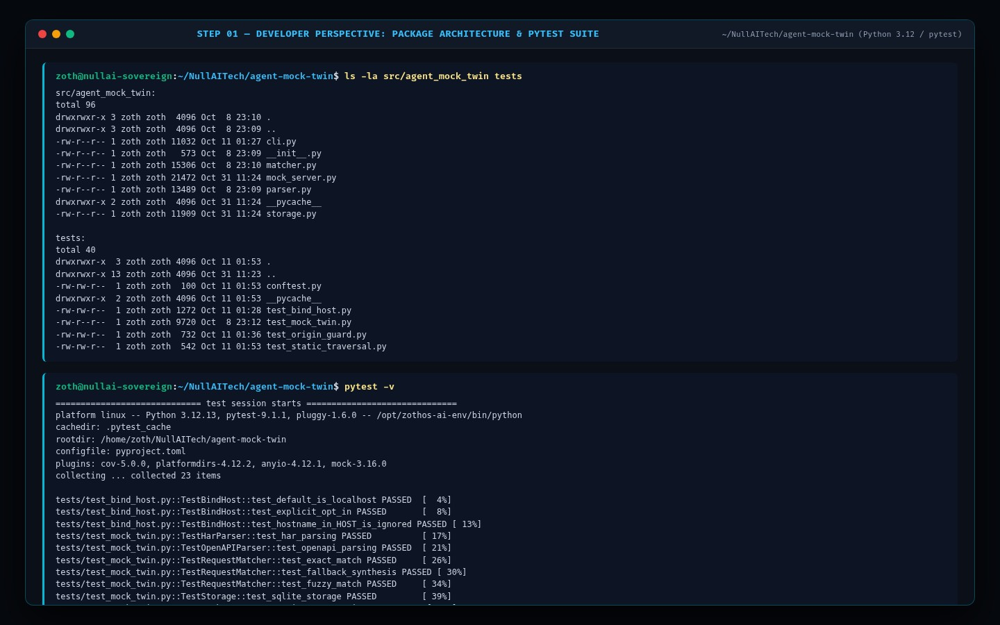

---

### Part II — ZothOS Native User Perspective: CLI / TUI Subcommands & Zero-Code Execution Wrapper

#### Step 02 — Global Binary Discovery, CLI Help & JSON Manifest
Verifying `which -a agent-mock-twin | uniq`, inspecting `agent-mock-twin --help`, and querying `agent-mock-twin --json` alongside `http://127.0.0.1:8097/health`.

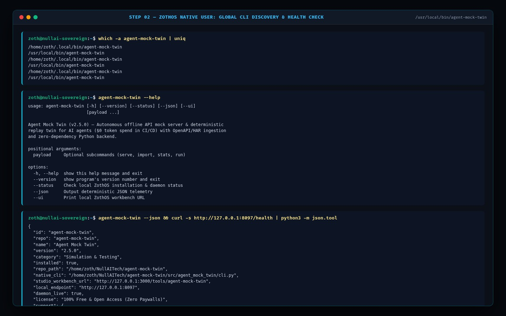

#### Step 03 — CLI HAR 1.2 & OpenAPI 3.0 Blueprint Ingestion (`agent-mock-twin import`)
Ingesting both an OpenAI Chat Completions HAR 1.2 archive (`/tmp/sample_openai.har`) and an Anthropic Claude 3.7 Sonnet OpenAPI 3.0 specification (`/tmp/sample_claude_openapi.json`) into the local SQLite mock registry.

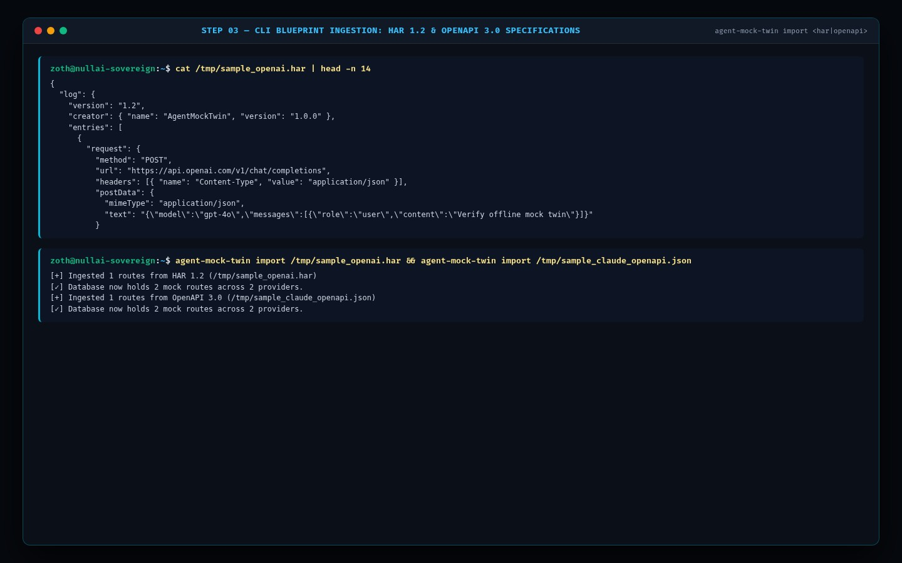

#### Step 04 — CLI Zero-Code Agent Execution Wrapper (`agent-mock-twin run`)
Executing `agent-mock-twin run --port 8098 -- python3 /tmp/test_mock_agent.py`, which automatically injects `OPENAI_BASE_URL` and `ANTHROPIC_BASE_URL`, intercepts the outbound `/v1/chat/completions` call in `0.21s`, and prints the Session Report (`API Token Cost: $0.00 (100% Mock Replay)`).

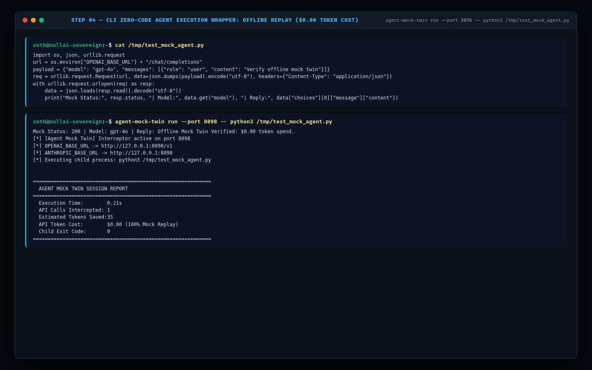

#### Step 05 — CLI Telemetry Summary & SQLite Mock Route Registry (`agent-mock-twin stats`)
Running `agent-mock-twin stats` (`325 Requests Intercepted`, `10,109 API Tokens Saved`, `Active Mock Routes: 2`) and inspecting `GET /api/routes` on `:8097`.

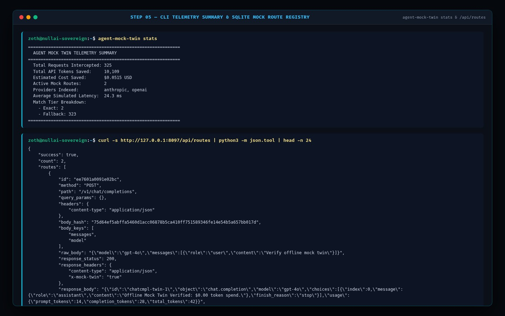

---

### Part III — Standalone Web Workstation Perspective (`http://127.0.0.1:8097`)

#### Step 06 — Prism Network Twin Topology Canvas & Real-Time Telemetry Bento Grid
Opening `http://127.0.0.1:8097` showing the interactive Dual-Ring Network Twin Topology canvas (`#heroCanvas`), 100% Free & Open Access header with Stripe & Solana tip rails, and real-time Telemetry Bento Grid (`2 Active Mock Endpoints`, `325 Requests Intercepted`, `10,109 Saved API Tokens`).

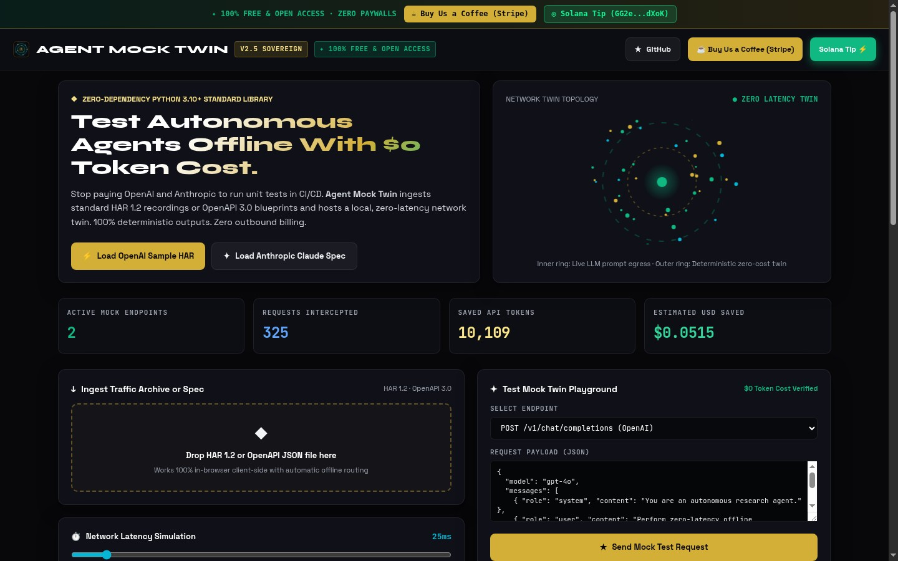

#### Step 07 — Ingested Mock Route Matrix & Interactive Test Mock Twin Playground
Loading the OpenAI HAR blueprint, inspecting the Ingested Mock Route Matrix (`POST /v1/chat/completions`, `POST /v1/messages`), and executing a live mock request in the **Test Mock Twin Playground** with SSE streaming into the **Live Request Intercept Feed**.

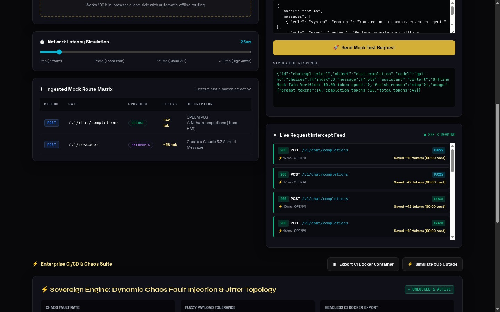

#### Step 08 — Anthropic Claude Blueprint & HTTP 503 Chaos Outage Simulation
Loading the Anthropic Claude specification and clicking **⚡ Simulate 503 Outage**, recording a `503 POST /v1/chat/completions` (`CHAOS_FAULT`, `Injected 503 Chaos Fault`) entry at the top of the Live Request Intercept Feed.

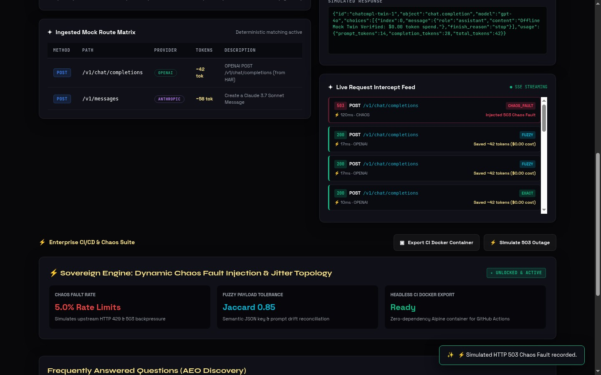

#### Step 09 — Headless CI Docker Container Export & Dynamic Chaos Jitter Topology
Clicking **▣ Export CI Docker Container** (`📦 CI Docker Container bundle exported successfully!`) and inspecting the Dynamic Chaos Fault Injection & Jitter Topology cards (`5.0% Rate Limits`, `Jaccard 0.85`, `Headless CI Docker Export: Ready`).

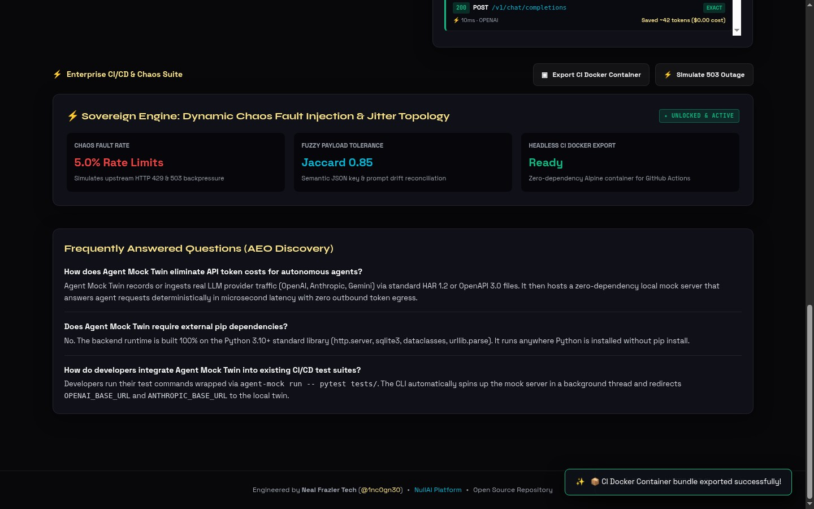

---

### Part IV — Zoth Studio v2 God-Mode Workstation (`http://127.0.0.1:3000/tools/agent-mock-twin`)

#### Step 10 — Studio God-Mode: Tier 1 Exact SHA-256 Hash Match Replay
Opening `/tools/agent-mock-twin` inside Zoth Studio v2 (`:3000`) and clicking **EXECUTE MOCK MATCH & REPLAY**, returning `200 OK (MOCK REPLAY)` in `2.70ms` (`Tier 1: Exact SHA-256 Hash`, `Token Cost: $0.00 (100% Mocked)`).

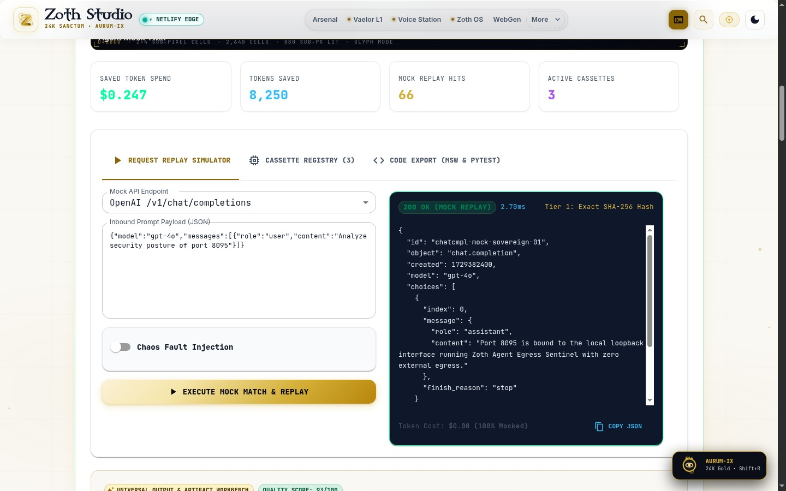

#### Step 11 — Studio God-Mode: Chaos Fault Injection (`429 Rate Limit Exceeded`)
Toggling **Chaos Fault Injection** (`FAULT SIMULATION ACTIVE` -> `429 Rate Limit Exceeded`, `25ms Latency Jitter`) and clicking **EXECUTE MOCK MATCH & REPLAY** to verify deterministic `TOO MANY REQUESTS` (`rate_limit_exceeded`) backoff testing.

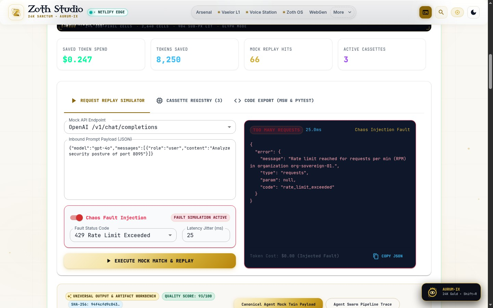

#### Step 12 — Studio God-Mode: Code Export (`Node.js MSW` & `Python pytest-mock / responses`)
Switching to the **CODE EXPORT (MSW & PYTEST)** tab to inspect and copy auto-generated `msw` (`http.post(...)`) and Python `pytest` / `responses` test fixtures (`overflowPx = 0`).

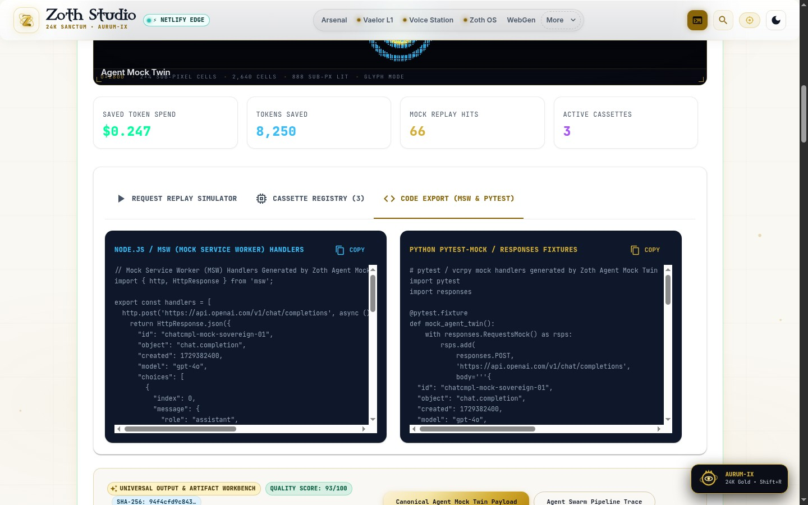
