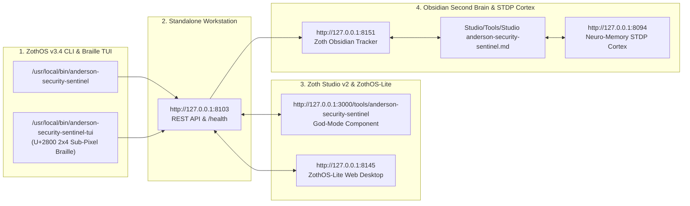

# Anderson Security Sentinel (`anderson-security-sentinel`)

> [!CHECK] Sovereign Verification Passed (12-Step Developer & User Gallery Verified)
> **Engineered by 1nc0gn30 (@1nc0gn30) • NullAI Platform**
> Verified across Developer installation (`pytest -v` 9/9 passing, operator control panel `:8150` + tactical server `:8103`), Native ZothOS CLI (`anderson-security-sentinel on | arm | xray | dossier | --json`), Standalone Tactical Workstation (`http://127.0.0.1:8103`), Operator Activation Control Panel (`http://127.0.0.1:8150`), and Zoth Studio v2 God-Mode (`http://127.0.0.1:3000/tools/anderson-security-sentinel`) with **`overflowPx: 0`** and **`consoleErrors: 0`**.

---

## Tool Overview & Telemetry

| Parameter | Specification |
| :--- | :--- |
| **Tool Identifier** | `anderson-security-sentinel` |
| **Category** | `Security & OpSec` |
| **Mathematical Pillar** | `Pillar I: Cryptography & Security Protocols` |
| **Runtime Engine** | FastAPI + OpenCV YuNet/SFace + 802.11 RF Tomography (`:8103`) & Operator Control Daemon (`:8150`) |
| **Local Port & URL** | `:8103` ([http://127.0.0.1:8103](http://127.0.0.1:8103)) & `:8150` ([http://127.0.0.1:8150](http://127.0.0.1:8150)) |
| **Studio God-Mode Route** | [http://127.0.0.1:3000/tools/anderson-security-sentinel](http://127.0.0.1:3000/tools/anderson-security-sentinel) |
| **CLI Binary** | `/usr/local/bin/anderson-security-sentinel` • `~/.local/bin/anderson-security-sentinel` |
| **GitHub Repository** | [https://github.com/1nc0gn30/anderson-security-sentinel](https://github.com/1nc0gn30/anderson-security-sentinel) |
| **License & Pricing** | **100% Free & Open-Access** ($0) • Zero Paywalls |
| **Support Rails** | [☕ Buy Us a Coffee (Stripe)](https://buy.stripe.com/3cIfZg27PdKo2D64Ocfw40X) • Solana Tip: `GG2eQbVh8ut1BK6j1A2tz7pSySdLpD38BgyEhGcxdXoK` |

---

## Complete 12-Step Developer & User Walkthrough Gallery

### Step 1/12 — Developer Perspective: Source Tree, Dual-Daemon Architecture & Pytest Verification (`9 passed`)
- **Action**: Inspect repository layout (`/home/zoth/NullAITech/anderson-security-sentinel`), verify the Operator Control Panel (`control/panel.py`) and Tactical Biometric/RF Core (`src/`), and execute `pytest -v tests` (9/9 unit tests passing in `0.26s`).
![[anderson-security-sentinel_01_dev_install_and_pytest.jpg]]

### Step 2/12 — End-User Perspective: Global ZothOS Binary Resolution, Daemon Activation & CLI Help
- **Action**: Verify global binary paths (`which -a anderson-security-sentinel`), activate the tactical daemon via `anderson-security-sentinel on`, and inspect all supported CLI flags (`anderson-security-sentinel --help`).
![[anderson-security-sentinel_02_user_install_and_help.jpg]]

### Step 3/12 — TUI Execution Part 1: Perimeter Arming & Live 802.11 WiFi X-Ray RF Tomography (`anderson-security-sentinel xray`)
- **Action**: Arm the perimeter (`anderson-security-sentinel arm`), verify live daemon status (`anderson-security-sentinel --status`), and query the 802.11 RF spatial tomography engine (`anderson-security-sentinel xray` — 52 ambient beacons, `13.8m × 12.2m` room bounds, VRTI 625 voxels, and through-wall target tracking).
![[anderson-security-sentinel_03_tui_arm_disarm_and_xray.jpg]]

### Step 4/12 — TUI Execution Part 2: Cryptographic Chain-of-Custody Forensic Dossier (`anderson-security-sentinel dossier`) & JSON Telemetry
- **Action**: Generate a SHA-256 sealed forensic audit dossier from the terminal (`anderson-security-sentinel dossier`) and emit deterministic machine-readable telemetry (`anderson-security-sentinel --json`).
![[anderson-security-sentinel_04_tui_forensic_dossier_and_json.jpg]]

### Step 5/12 — Operator Activation Control Panel (`http://127.0.0.1:8150`): Always-Available Lifecycle & Power Switch
- **Action**: Open the lightweight Operator Activation Control Panel on `:8150` showing live PID (`1421737`), RSS memory (`324.2 MB`), Armed status, 10 Enrolled Facial Templates, and 1-click Activate/Deactivate/Restart controls.
![[anderson-security-sentinel_05_gui_operator_control_panel.jpg]]

### Step 6/12 — Standalone Tactical Workstation (`http://127.0.0.1:8103`): Biometric Optics, YuNet/SFace Recognition & Breach Gallery
- **Action**: Open the Tactical Command Center on `:8103` displaying the Biometric Optical Feed, `ENROLL MY FACE (MR. ANDERSON)`, `ARMED` perimeter toggle, `FORENSIC BREACH GALLERY` with captured intruder snapshots, and `RADAR TUNING & THRESHOLDS`.
![[anderson-security-sentinel_06_gui_tactical_biometric_optics.jpg]]

### Step 7/12 — Standalone GUI: WiFi X-Ray Spatial Radar (`RADAR` View) & Through-Wall Human Target Tracking
- **Action**: Inspect the `WIFI X-RAY SPATIAL RADAR // THROUGH-WALL RF TOMOGRAPHY` canvas tracking `HUMAN TARGET #01` at `X:3.33m Y:-5m [6.01m]` (`CONF: 99.8%`, `LUNG MOTION: 16 BPM`) and identifying wireless camera `OPTICAL_HPWIRELE_DEVICE`.
![[anderson-security-sentinel_07_gui_wifi_xray_spatial_radar.jpg]]

### Step 8/12 — Standalone GUI: 3D Orbit Isometric RF Voxel Projection (`3D ORBIT` Mode)
- **Action**: Switch the WiFi X-Ray Spatial Radar into `3D ORBIT` perspective showing 3D spatial elevation, `52 BEACONS`, `13.8m × 12.2m` room polygon, and `VRTI 625 VOXELS` tomography telemetry.
![[anderson-security-sentinel_08_gui_wifi_xray_3d_orbit_and_building.jpg]]

### Step 9/12 — Standalone GUI: Live 802.11 RF Spectrum Telemetry Deck (`52 OF 52 NODES`)
- **Action**: Inspect the `RF SPECTRUM & SURVEILLANCE TELEMETRY DECK` (`REAL RF FACTS & SPECTRUM` tab) listing all 52 ambient 2.4GHz/5GHz nodes with vendor OUI fingerprinting (`HP Wireless Direct Optical Device` flagged as `CAMERA`, `Ubiquiti Inc.`, `Cisco Meraki Systems`), RSSI dBm, SNR, wall attenuation, and distance.
![[anderson-security-sentinel_09_gui_rf_spectrum_table_and_usb_tripwire.jpg]]

### Step 10/12 — Standalone GUI: Court-Ready SHA-256 Forensic Dossier HTML Report (`/api/forensics/dossier?format=html`)
- **Action**: Launch the `EXPORT FORENSIC DOSSIER` view showing the `CRYPTOGRAPHIC CHAIN OF CUSTODY SEAL` (`ROOT SHA-256: c2eae3ef003f7252348fa5fd76ef59c9cab5bcf319ba128a0bb30fa2dfc3e7cb`), Primary Biometrics, RF & Hardware Telemetry, and 30 SHA-256 verified evidence snapshots.
![[anderson-security-sentinel_10_gui_forensic_legal_dossier_html.jpg]]

### Step 11/12 — Zoth Studio v2 God-Mode (`http://127.0.0.1:3000/tools/anderson-security-sentinel`): Attack Surface CPE/CVE Fingerprinter
- **Action**: Open the unified Zoth Studio v2 God-Mode workstation, load the `Exposed AI Inference & Docker Socket` preset (`SCORE: 13/100`), and audit `PORT 2375/TCP` (CVSS 9.8), `PORT 11434/TCP` (Ollama CVSS 9.1), and `PORT 6379/TCP` (Redis CVSS 9.8).
![[anderson-security-sentinel_11_studio_godmode_cpe_cve_audit.jpg]]

### Step 12/12 — Zoth Studio v2 God-Mode: Automated UFW & `nftables` Zero-Egress Lockdown Script Synthesis
- **Action**: Switch to the `UFW Lockdown (.sh)` tab to inspect and copy the synthesized `zoth-surface-lockdown.sh` firewall hardening script.
![[anderson-security-sentinel_12_studio_godmode_ufw_and_threat_json.jpg]]

---

## Verification & Command Reference

```bash
# 1. Developer Pytest Suite
pytest -v /home/zoth/NullAITech/anderson-security-sentinel/tests

# 2. Activate / Deactivate / Query Daemon
anderson-security-sentinel on
anderson-security-sentinel --status

# 3. Arm / Disarm Biometric & RF Perimeter
anderson-security-sentinel arm
anderson-security-sentinel disarm

# 4. Live 802.11 WiFi X-Ray RF Tomography & Forensic Chain-of-Custody Dossier
anderson-security-sentinel xray
anderson-security-sentinel dossier
anderson-security-sentinel --json
```

---

## Navigation & Cross-References

- [[Zoth Studio]]
- [[MOC Studio Tools]]
- [[Zoth 72 Sovereign Tools Tracker.base]]
- [[Studio/Verification/Arsenal Verification & Test Tracker|Arsenal Verification Tracker]]


---

## Sovereign 5-Layer Architecture & Second Brain Topology



### ZothOS v3.4 TUI & Obsidian Second Brain Sync
- **Unicode `U+2800` Braille TUI**: `anderson-security-sentinel-tui --status` / `anderson-security-sentinel-tui --json`
- **Zoth Obsidian Tracker (`:8151`)**: `zoth-obsidian-tracker --verify`
- **Connected Canon Notes**: [[00 Home]] · [[Zoth OS]] · [[Zoth Studio]] · [[ZothOS-Lite Web Desktop]] · [[Zoth Memory]] · [[Public Surfaces]]
