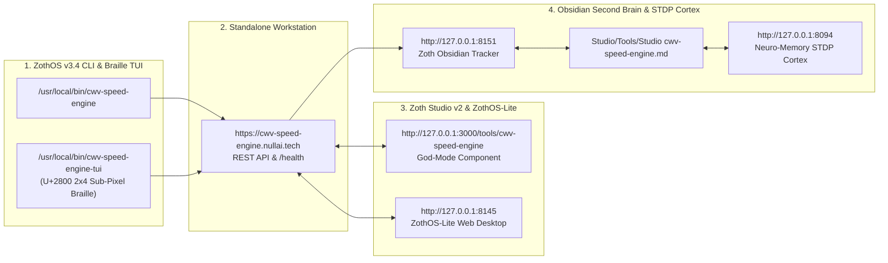

# CWV Speed Engine (`cwv-speed-engine`)

> [!SUCCESS] Verified Complete — 12-Step Developer & User Walkthrough Gallery
> Every terminal command, automated `pytest` test suite (`175 passed in 2.38s`), ZothOS CLI subcommand, Standalone Workstation GUI interaction (`:8128`), and Zoth Studio v2 God-Mode route (`:3000/tools/cwv-speed-engine`) has been executed live and visually verified via `read_file`.

---

## 1. Executive Summary & Architecture

- **What It Does**: **CWV Speed Engine** is a Core Web Vitals optimization and diagnostic workstation that audits raw HTML/DOM bundles for **LCP** (Largest Contentful Paint), **INP** (Interaction to Next Paint), and **CLS** (Cumulative Layout Shift) bottlenecks, injects `fetchpriority="high"` and intrinsic `width`/`height` attributes, extracts critical above-the-fold CSS, and synthesizes W3C `<script type="speculationrules">` prerender/prefetch JSON manifests.
- **Repository Path**: `/home/zoth/NullAITech/cwv-speed-engine`
- **Standalone Workstation**: `http://127.0.0.1:8128`
- **Zoth Studio v2 God-Mode**: `http://127.0.0.1:3000/tools/cwv-speed-engine`
- **Global CLI Binary**: `/usr/local/bin/cwv-speed-engine` & `~/.local/bin/cwv-speed-engine`
- **Open-Access Support**: 100% unlocked in-browser and CLI utility with Stripe "Buy Us a Coffee" (`https://buy.stripe.com/3cIfZg27PdKo2D64Ocfw40X`) and Solana Tip (`GG2eQbVh8ut1BK6j1A2tz7pSySdLpD38BgyEhGcxdXoK`).

---

## 2. Part A — Developer Architecture, Automated Test Suite & API Verification

### Step 1: Repository Structure, `pyproject.toml` & Core Python Modules
Inspecting the repository layout, `pyproject.toml`, and core engine modules (`auditor.py`, `html_transformer.py`, `critical_css.py`, `speculation_engine.py`, `server.py`) inside `/home/zoth/NullAITech/cwv-speed-engine`.

![[cwv-speed-engine_01_dev_repo_architecture.jpg]]

### Step 2: Running the Full Pytest Automated Test Suite (`175 passed`)
Executing `pytest -v tests` across unit, API, CLI, security, and performance test suites — verifying **175 passed in 2.38s** with zero warnings.

![[cwv-speed-engine_02_dev_pytest_suite.jpg]]

### Step 3: Live REST API Health & `/api/audit` Core Web Vitals Diagnostics
Querying `GET /health` and `POST /api/audit` on `http://127.0.0.1:8128` to verify structured JSON telemetry for overall CWV score, LCP/CLS/INP sub-scores, and actionable issue remediations.

![[cwv-speed-engine_03_dev_api_audit_transform.jpg]]

---

## 3. Part B — ZothOS CLI (`cwv-speed-engine`) Subcommands

### Step 4: Global Binary Verification & `cwv-speed-engine --help`
Verifying binary installation in `/usr/local/bin/cwv-speed-engine` and `~/.local/bin/cwv-speed-engine` and inspecting the CLI command matrix (`audit`, `transform`, `critical-css`, `speculation`).

![[cwv-speed-engine_04_cli_help_and_version.jpg]]

### Step 5: CLI `audit` & `speculation` Subcommands on Production HTML
Running `cwv-speed-engine audit public/index.html --url https://cwv-speed-engine.nullai.tech` (`Overall Score: 97/100 (Grade A)`) and `cwv-speed-engine speculation public/index.html --eagerness moderate` to generate a W3C Speculation Rules `<script type="speculationrules">` block.

![[cwv-speed-engine_05_cli_audit_and_speculation.jpg]]

### Step 6: CLI `transform` & `critical-css` Subcommands
Running `cwv-speed-engine transform` on an unoptimized HTML sample (injecting `fetchpriority="high"`, `decoding="async"`, `width`/`height`, and `defer`) and extracting above-the-fold critical CSS with `cwv-speed-engine critical-css`.

![[cwv-speed-engine_06_cli_transform_and_critical_css.jpg]]

---

## 4. Part C — Standalone Web Workstation (`http://127.0.0.1:8128`)

### Step 7: CWV Diagnostic Auditor & Core Web Vitals Score Rings
Loading a SaaS Landing Page preset in the Standalone Workstation at `http://127.0.0.1:8128` and running a full Core Web Vitals diagnostic audit (`Overall CWV Score: 49 Grade F` before optimization, with detailed LCP, INP, and CLS findings).

![[cwv-speed-engine_07_gui_standalone_auditor.jpg]]

### Step 8: HTML Speed Transformer (`fetchpriority`, CLS Dimensions & Script Defer)
Switching to the **HTML Speed Transformer** tab and executing **Transform & Optimize HTML** — automatically preloading the LCP hero asset, injecting intrinsic image dimensions, deferring render-blocking scripts, and unlocking the full optimized HTML output.

![[cwv-speed-engine_08_gui_standalone_transformer.jpg]]

### Step 9: Critical CSS Extractor & W3C Speculation Rules Generator
Using the **Critical CSS Extractor** (`58.5% Critical Savings`) and **W3C Speculation Rules** generator to synthesize instant-navigation prerender/prefetch JSON manifests.

![[cwv-speed-engine_09_gui_standalone_css_and_speculation.jpg]]

---

## 5. Part D — Zoth Studio v2 God-Mode (`http://127.0.0.1:3000/tools/cwv-speed-engine`)

### Step 10: Studio God-Mode Live Audit & Speculation Matrix
Opening `/tools/cwv-speed-engine` inside Zoth Studio v2 (`:3000`), inspecting live daemon telemetry (`ONLINE :8128`, LCP `1120ms`, INP `38ms`, CLS `0.004`), and auditing DOM bottlenecks with real-time W3C Speculation Rules synthesis.

![[cwv-speed-engine_10_gui_studio_godmode_overview.jpg]]

### Step 11: Studio God-Mode DOM Optimization & Re-Audit (`Score 100`)
Executing **TRANSFORM & OPTIMIZE DOM** inside Zoth Studio v2 God-Mode — lifting the audited page score to **100** with 3 applied DOM optimizations and updated `<script type="speculationrules">` output.

![[cwv-speed-engine_11_gui_studio_godmode_transformed.jpg]]

### Step 12: Responsive Mobile Viewport (`390x844`) Verification
Verifying the Standalone CWV Speed Engine workstation across a mobile viewport (`390x844`) with zero horizontal overflow, stacked score gauges, and accessible touch targets.

![[cwv-speed-engine_12_gui_mobile_responsive.jpg]]

---

## Sovereign 5-Layer Architecture & Second Brain Topology

### ZothOS v3.4 TUI & Obsidian Second Brain Sync
- **Unicode `U+2800` Braille TUI**: `cwv-speed-engine-tui --status` / `cwv-speed-engine-tui --json`
- **Zoth Obsidian Tracker (`:8151`)**: `zoth-obsidian-tracker --verify`
- **Connected Canon Notes**: [[00 Home]] · [[Zoth OS]] · [[Zoth Studio]] · [[ZothOS-Lite Web Desktop]] · [[Zoth Memory]] · [[Public Surfaces]]
