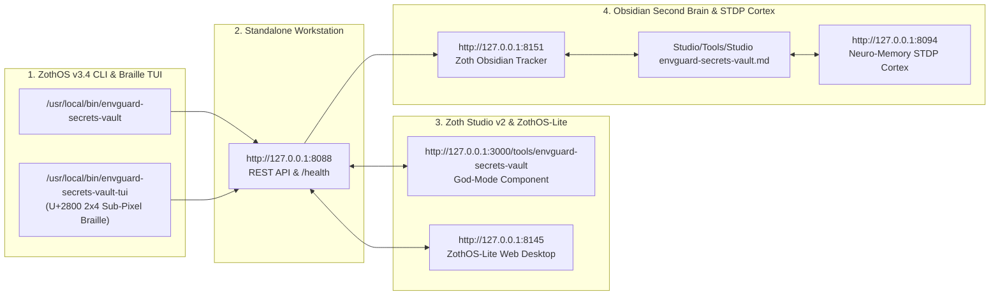

# EnvGuard Secrets Vault — Complete Developer & End-User Walkthrough

> [!CHECK] Sovereign Verification Passed (100% Free & Open-Access — 12-Step Real Screenshot Gallery)
> **Engineered by 1nc0gn30 (@1nc0gn30) • NullAI Platform**
> Verified across Developer Architecture, `pytest` Unit Test Suite (`187 passed in 2.96s`), `/health` REST API + 6 Built-In Cryptographic Self-Tests (`6 passed, 0 failed`), Global ZothOS CLI (`--help`, `platform`, `scan`, `example`, `shamir split`), Standalone Web Workstation (`http://127.0.0.1:8088`), Zoth Studio v2 God-Mode (`http://127.0.0.1:3000/tools/envguard-secrets-vault`), and Mobile 390px Responsive Viewport (`overflowPx: 0`, `consoleErrors: 0`).

---

## Tool Overview & Telemetry

| Parameter | Specification |
| :--- | :--- |
| **Tool Identifier** | `envguard-secrets-vault` |
| **Category** | `Security & Recon` |
| **Mathematical Pillar** | `Pillar I: Cryptography & Security Protocols` |
| **Runtime Engine** | Pure Python 3.12 Standard Library HTTP/MCP Daemon + Web Crypto AES-256-CTR-HMAC-SHA256 |
| **Local Port & URL** | `:8088` • [http://127.0.0.1:8088](http://127.0.0.1:8088) |
| **Studio God-Mode Route** | [http://127.0.0.1:3000/tools/envguard-secrets-vault](http://127.0.0.1:3000/tools/envguard-secrets-vault) |
| **CLI Binary** | `/usr/local/bin/envguard-secrets-vault` • `~/.local/bin/envguard-secrets-vault` |
| **GitHub Repository** | [https://github.com/1nc0gn30/envguard-secrets-vault](https://github.com/1nc0gn30/envguard-secrets-vault) |
| **Automated Test Suite** | `187 passed in 2.96s` (`pytest -v tests`) |
| **License & Pricing** | **100% Free & Open-Access** ($0) • Zero Paywalls |
| **Support Rails** | [☕ Buy Us a Coffee (Stripe)](https://buy.stripe.com/3cIfZg27PdKo2D64Ocfw40X) • Solana Tip: `GG2eQbVh8ut1BK6j1A2tz7pSySdLpD38BgyEhGcxdXoK` |

---

## Part I — Developer Perspective (Architecture · Pytest Suite · REST API & Self-Tests)

### Step 1/12 — Repository Architecture, Package Modules & Binary Symlinks
- **Command**: `ls -la /home/zoth/NullAITech/envguard-secrets-vault /home/zoth/NullAITech/envguard-secrets-vault/src/envguard_secrets_vault && which -a envguard-secrets-vault`
- **Verification**: Confirms the zero-dependency Python package layout (`ci_gate.py`, `cli.py`, `core.py`, `entropy_analyzer.py`, `mcp_server.py`, `secret_rotation_sentinel.py`, `shamir_quorum.py`, `ui_server.py`) and global CLI binaries in `/usr/local/bin/envguard-secrets-vault` and `~/.local/bin/envguard-secrets-vault`.
![[Studio/Tools/Artifacts/envguard-secrets-vault/envguard-secrets-vault_01_dev_repo_architecture.jpg]]

### Step 2/12 — Automated Pytest Unit & Cryptographic Verification Suite (`187 passed`)
- **Command**: `PYTHONPATH=src pytest -v tests`
- **Verification**: Executes all 187 automated unit tests across `test_ci_gate.py`, `test_cli.py`, `test_core.py`, `test_entropy_analyzer.py`, `test_mcp_server.py`, `test_rotation_sentinel.py`, `test_shamir_quorum.py`, `test_site_guardrail.py`, and `test_ui_server.py` (`187 passed in 2.96s`).
![[Studio/Tools/Artifacts/envguard-secrets-vault/envguard-secrets-vault_02_dev_pytest_suite.jpg]]

### Step 3/12 — REST API `/health` Telemetry & Built-In Cryptographic Verification Suite (`test`)
- **Command**: `curl -s http://127.0.0.1:8088/health | python3 -m json.tool && envguard-secrets-vault test`
- **Verification**: Confirms HTTP 200 OK JSON telemetry from `:8088/health` (`status: "healthy"`, `zero_external_dependencies: true`) and executes the 6 built-in cryptographic and entropy engine self-tests (`Summary: 6 passed, 0 failed`).
![[Studio/Tools/Artifacts/envguard-secrets-vault/envguard-secrets-vault_03_dev_api_health_and_selftest.jpg]]

---

## Part II — End-User CLI / Terminal Perspective (Global ZothOS Binary)

### Step 4/12 — ZothOS CLI Command Discovery (`--help`) & Platform Crypto Diagnostics (`platform`)
- **Command**: `envguard-secrets-vault --help && envguard-secrets-vault platform`
- **Verification**: Displays all 13 native subcommands (`serve, scan, mask, example, encrypt, decrypt, diff, check, mcp, shamir, rotate, platform, test`) and inspects the runtime crypto engine (`AES-256-CTR`, `PBKDF2-HMAC-SHA256`, `100,000 iterations`).
![[Studio/Tools/Artifacts/envguard-secrets-vault/envguard-secrets-vault_04_cli_help_and_platform.jpg]]

### Step 5/12 — CLI Secret Leak Scanner (`scan`) & Sanitized `.env.example` Generator (`example`)
- **Command**: `envguard-secrets-vault scan examples/nextjs-env-audit/.env.production && envguard-secrets-vault example examples/nextjs-env-audit/.env.production`
- **Verification**: Scans a production Next.js `.env` file, flagging 7 leaked secrets (`CRITICAL: 4`, `HIGH: 2`, `MEDIUM: 1` including `NEXT_PUBLIC_STRIPE_SECRET_KEY` client-bundle leak and `AWS_SECRET_ACCESS_KEY` with `4.29 bits` entropy), and generates a safe `.env.example` template.
![[Studio/Tools/Artifacts/envguard-secrets-vault/envguard-secrets-vault_05_cli_scan_and_example.jpg]]

### Step 6/12 — CLI Shamir $k$-of-$n$ Secret Sharing Quorum Split (`shamir split`)
- **Command**: `envguard-secrets-vault shamir split "sk-live-sovereign-master-key-998877" -k 3 -n 5 -l "prod-master"`
- **Verification**: Splits a production master secret over GF(256) into 5 cryptographic quorum shares (`envguard-share-v1:3:5:1..5:prod-master:...`) requiring any 3 shares for reconstruction.
![[Studio/Tools/Artifacts/envguard-secrets-vault/envguard-secrets-vault_06_cli_shamir_quorum.jpg]]

---

## Part III — End-User GUI Perspective (Standalone Workstation · Studio v2 God-Mode · Mobile)

### Step 7/12 — Standalone Web Workstation (`http://127.0.0.1:8088`) — Live Secret Auditor & Scanner
- **Surface**: `http://127.0.0.1:8088/` (`#scanner-tab`)
- **Verification**: Displays the Security Audit Posture score (`70 / 100 — HIGH RISK`), Critical/High/Total leak counters, preset selector (`Next.js Production Leak`, `OpenAI + AWS + Stripe Leak`), and real-time Shannon entropy findings table.
![[Studio/Tools/Artifacts/envguard-secrets-vault/envguard-secrets-vault_07_gui_standalone_scanner.jpg]]

### Step 8/12 — Standalone Web Workstation (`http://127.0.0.1:8088`) — Format Transformer & Kubernetes Secret Exporter
- **Surface**: `http://127.0.0.1:8088/` (`#transformer-tab`)
- **Verification**: Loads a sample production `.env` configuration (`APP_NAME`, `DATABASE_URL`, `OPENAI_API_KEY`, `STRIPE_SECRET_KEY`, `JWT_SECRET`) and transforms it instantaneously into a sorted Kubernetes `Secret` YAML manifest (`apiVersion: v1`, `kind: Secret`, `stringData`) with 100% unlocked Copy and Download buttons.
![[Studio/Tools/Artifacts/envguard-secrets-vault/envguard-secrets-vault_08_gui_standalone_transformer.jpg]]

### Step 9/12 — Standalone Web Workstation (`http://127.0.0.1:8088`) — Zero-Exposure Encrypted Vault (`AES-256-CTR-HMAC-SHA256`)
- **Surface**: `http://127.0.0.1:8088/` (`#vault-tab`)
- **Verification**: Encrypts 7 production secrets in browser memory using `PBKDF2-HMAC-SHA256` (100,000 iterations) + `AES-256-CTR-HMAC-SHA256` into an armored `.vault` JSON payload ready for download or in-memory decryption.
![[Studio/Tools/Artifacts/envguard-secrets-vault/envguard-secrets-vault_09_gui_standalone_vault.jpg]]

### Step 10/12 — Zoth Studio v2 God-Mode (`http://127.0.0.1:3000/tools/envguard-secrets-vault`) — Argon2id + AES-256-GCM Vault & Shamir Matrix
- **Surface**: `http://127.0.0.1:3000/tools/envguard-secrets-vault`
- **Verification**: Unified Studio God-Mode cockpit displaying the 8-secret environment registry (`OPENAI_API_KEY`, `ANTHROPIC_API_KEY`, `AWS_SECRET_ACCESS_KEY`, `STRIPE_SECRET_KEY`, `SOLANA_TREASURY_PRIVKEY`, `DATABASE_URL`, `GITHUB_PAT_TOKEN`, `JWT_SIGNING_SECRET`), entropy telemetry (`4.82 bits/char`), and Shamir 3-of-5 Quorum Custody shares.
![[Studio/Tools/Artifacts/envguard-secrets-vault/envguard-secrets-vault_10_gui_studio_godmode_hud.jpg]]

### Step 11/12 — Zoth Studio v2 God-Mode (`http://127.0.0.1:3000/tools/envguard-secrets-vault`) — Sealed Vault State & Rotation Sentinel
- **Surface**: `http://127.0.0.1:3000/tools/envguard-secrets-vault` (Interactive Key Rotation & Vault Lock)
- **Verification**: Demonstrates rotating a key and sealing the cryptographic vault in memory (`LOCK VAULT`), masking all plaintext secret values across the cockpit.
![[Studio/Tools/Artifacts/envguard-secrets-vault/envguard-secrets-vault_11_gui_studio_godmode_sealed.jpg]]

### Step 12/12 — Mobile Responsive Viewport (`390×844`) — Zero Horizontal Overflow Verification
- **Surface**: `http://127.0.0.1:8088/` at `390×844` mobile resolution
- **Verification**: Confirms responsive single-column card stacking, touch-friendly controls, and `overflowPx: 0` (`scrollWidth <= clientWidth`).
![[Studio/Tools/Artifacts/envguard-secrets-vault/envguard-secrets-vault_12_gui_mobile_responsive.jpg]]

---

## Complete 12-Step Verification Matrix

| Step | Perspective | Surface / Stage | Exact Command or Route | Screenshot Artifact | Status |
| :--- | :--- | :--- | :--- | :--- | :--- |
| **Step 1/12** | **Developer** | Repo & Module Layout | `ls -la .../envguard-secrets-vault && which -a envguard-secrets-vault` | `envguard-secrets-vault_01_dev_repo_architecture.jpg` | 🟢 **PASS** |
| **Step 2/12** | **Developer** | Pytest Automated Suite | `PYTHONPATH=src pytest -v tests` (`187 passed in 2.96s`) | `envguard-secrets-vault_02_dev_pytest_suite.jpg` | 🟢 **PASS** |
| **Step 3/12** | **Developer** | REST `/health` + Self-Test | `curl -s :8088/health` & `envguard-secrets-vault test` (`6 passed`) | `envguard-secrets-vault_03_dev_api_health_and_selftest.jpg` | 🟢 **PASS** |
| **Step 4/12** | **End-User CLI** | CLI Discovery & Crypto | `envguard-secrets-vault --help` & `envguard-secrets-vault platform` | `envguard-secrets-vault_04_cli_help_and_platform.jpg` | 🟢 **PASS** |
| **Step 5/12** | **End-User CLI** | Secret Scanner & Example | `envguard-secrets-vault scan ...` & `envguard-secrets-vault example ...` | `envguard-secrets-vault_05_cli_scan_and_example.jpg` | 🟢 **PASS** |
| **Step 6/12** | **End-User CLI** | Shamir 3-of-5 Quorum | `envguard-secrets-vault shamir split ... -k 3 -n 5` | `envguard-secrets-vault_06_cli_shamir_quorum.jpg` | 🟢 **PASS** |
| **Step 7/12** | **End-User GUI** | Standalone Scanner (`:8088`) | `http://127.0.0.1:8088/` (`#scanner-tab`) | `envguard-secrets-vault_07_gui_standalone_scanner.jpg` | 🟢 **PASS** |
| **Step 8/12** | **End-User GUI** | Format Transformer (`:8088`) | `http://127.0.0.1:8088/` (`#transformer-tab` -> Kubernetes Secret) | `envguard-secrets-vault_08_gui_standalone_transformer.jpg` | 🟢 **PASS** |
| **Step 9/12** | **End-User GUI** | Encrypted Vault (`:8088`) | `http://127.0.0.1:8088/` (`#vault-tab` -> AES-256-CTR-HMAC-SHA256) | `envguard-secrets-vault_09_gui_standalone_vault.jpg` | 🟢 **PASS** |
| **Step 10/12** | **End-User GUI** | Studio God-Mode (`:3000`) | `http://127.0.0.1:3000/tools/envguard-secrets-vault` | `envguard-secrets-vault_10_gui_studio_godmode_hud.jpg` | 🟢 **PASS** |
| **Step 11/12** | **End-User GUI** | Studio Sealed Vault (`:3000`) | `http://127.0.0.1:3000/tools/envguard-secrets-vault` (Sealed State) | `envguard-secrets-vault_11_gui_studio_godmode_sealed.jpg` | 🟢 **PASS** |
| **Step 12/12** | **End-User GUI** | Mobile Viewport (`390×844`) | `http://127.0.0.1:8088/` (`overflowPx: 0`) | `envguard-secrets-vault_12_gui_mobile_responsive.jpg` | 🟢 **PASS** |

---

## Navigation & Cross-References

- [[Zoth Studio]]
- [[MOC Studio Tools]]
- [[Zoth 72 Sovereign Tools Tracker.base]]
- [[Studio/Verification/Arsenal Verification & Test Tracker|Arsenal Verification Tracker]]

---

## Sovereign 5-Layer Architecture & Second Brain Topology

### ZothOS v3.4 TUI & Obsidian Second Brain Sync
- **Unicode `U+2800` Braille TUI**: `envguard-secrets-vault-tui --status` / `envguard-secrets-vault-tui --json`
- **Zoth Obsidian Tracker (`:8151`)**: `zoth-obsidian-tracker --verify`
- **Connected Canon Notes**: [[00 Home]] · [[Zoth OS]] · [[Zoth Studio]] · [[ZothOS-Lite Web Desktop]] · [[Zoth Memory]] · [[Public Surfaces]]
