# Nexus 3D Scene Studio (`nexus-3d-scene-studio`)

> **100% Free & Open-Access Procedural 3D/4D Mathematical Geometry Engine, Triply-Periodic Minimal Surface (TPMS) SDF Generator, Wavefront OBJ/STL/glTF Exporter & FastMCP Spatial Agent Server**
> - **Standalone Web Workstation**: `http://127.0.0.1:8082`
> - **Zoth Studio v2 God-Mode Route**: `http://127.0.0.1:3000/tools/nexus-3d-scene-studio`
> - **Global ZothOS CLI**: `nexus-3d-scene-studio` (`/usr/local/bin/nexus-3d-scene-studio` & `~/.local/bin/nexus-3d-scene-studio`)
> - **Support**: [☕ Buy Us a Coffee (Stripe)](https://buy.stripe.com/3cIfZg27PdKo2D64Ocfw40X) · **Solana Tip**: `GG2eQbVh8ut1BK6j1A2tz7pSySdLpD38BgyEhGcxdXoK`

---

## Part I — Developer Perspective: Architecture, Automated Pytest Suite & REST API Contracts

### Step 01 — Repository Architecture & ZothOS Binary Parity
Inspecting `/home/zoth/NullAITech/nexus-3d-scene-studio` package layout (`src/nexus_3d_scene_studio/geometry_engine.py`, `sdf_engine.py`, `exporters.py`, `mcp_server.py`, `ui_server.py`, `cli.py`) and verifying global CLI binary parity across `/usr/local/bin/nexus-3d-scene-studio` and `~/.local/bin/nexus-3d-scene-studio`.

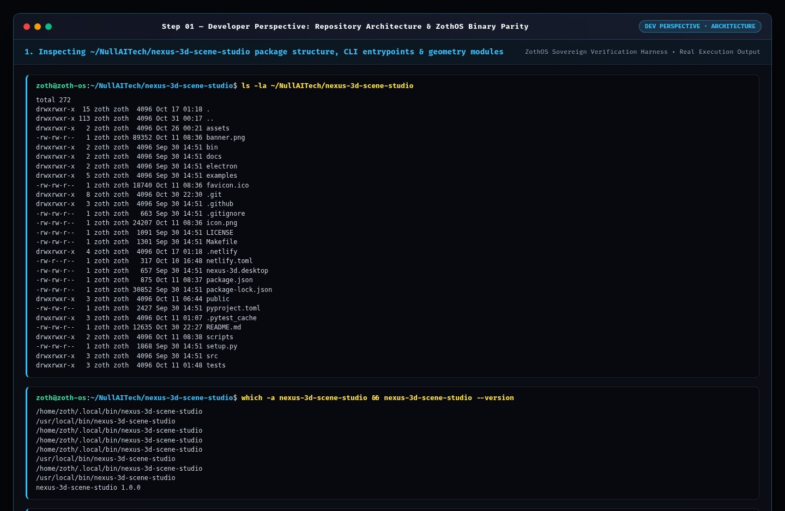

### Step 02 — Automated Pytest Verification Suite (`141 passed`)
Running `pytest -v` across the 141-test verification suite covering 4D Tesseract stereographic projection, `(p, q)` Torus Knot extrusion, Superquadric signed trigonometric powers, TPMS Gyroid/Schwarz-P Marching Cubes extraction, Wavefront OBJ / ASCII STL / glTF 2.0 exporters, and JSON-RPC 2.0 MCP tools.

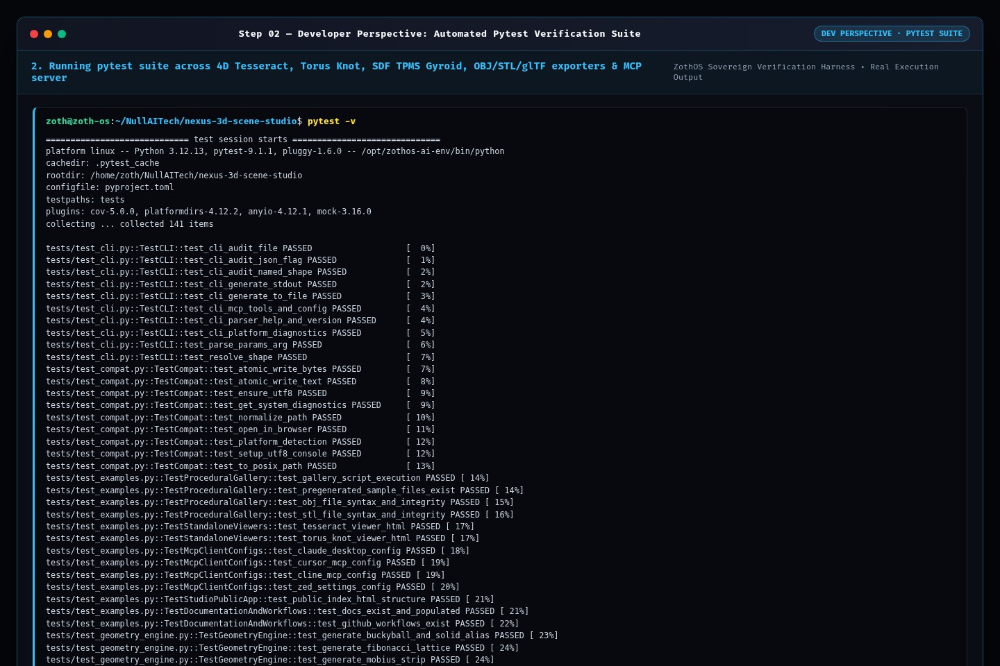

### Step 03 — Live HTTP REST API & Procedural 3D/4D Mesh Contracts
Probing `/api/health`, `POST /api/generate` (`shape: "tesseract"`, `size: 2.0, angle_4d: 0.6`), and `POST /api/sdf/generate` (`surface: "gyroid"`, `resolution: 12`) to verify real-time vertex, normal, and face index arrays.

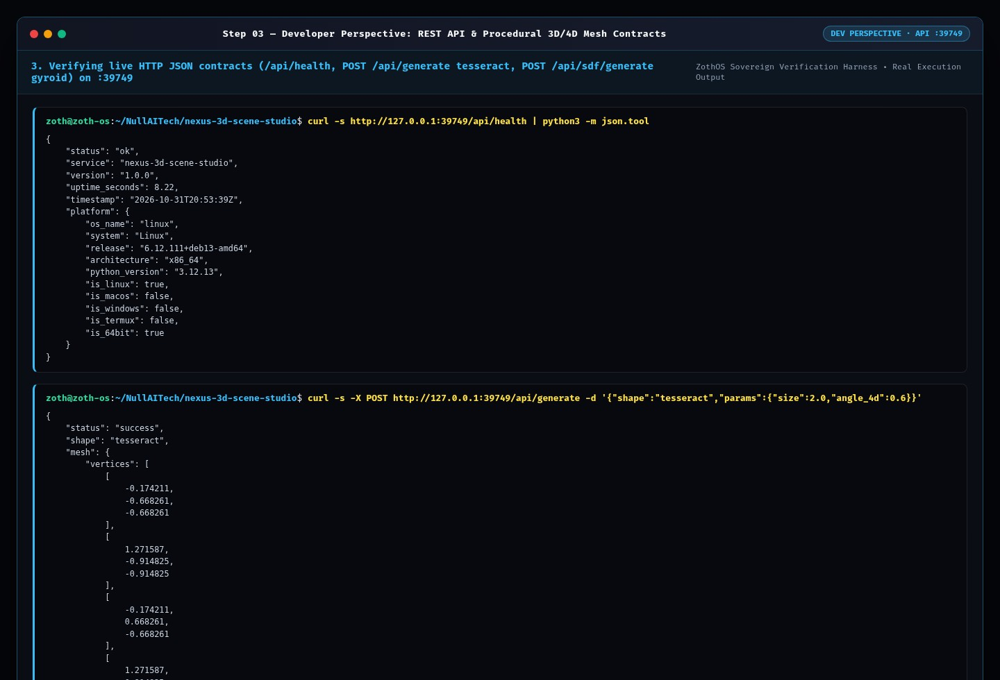

---

## Part II — End-User CLI Perspective: Procedural Mesh Generation, Polygon Budget Audit & MCP Server

### Step 04 — Global CLI Help Matrix & Platform Graphics Diagnostics
Executing `nexus-3d-scene-studio --help`, `nexus-3d-scene-studio --json`, and `nexus-3d-scene-studio platform --json` from the user's shell.

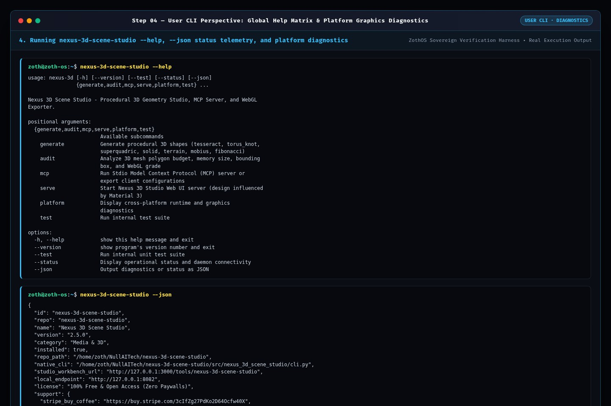

### Step 05 — Procedural 3D/4D Mesh Generation (OBJ/STL) & Polygon Budget Audit
Running `nexus-3d-scene-studio generate torus_knot -p "p=3,q=5" -o /tmp/nexus_torus_knot.obj`, `nexus-3d-scene-studio generate tesseract -p "size=2.2,angle_4d=0.7" -f stl -o /tmp/nexus_tesseract.stl`, and `nexus-3d-scene-studio audit /tmp/nexus_torus_knot.obj --json` (`1920 vertices, 3840 faces, WebGL Grade A+`).

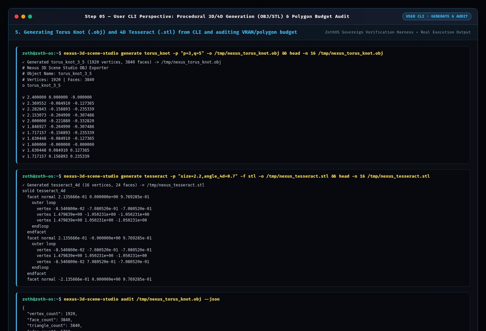

### Step 06 — Model Context Protocol (MCP) Tools & Claude Desktop Config
Inspecting MCP JSON-RPC 2.0 tool schemas (`nexus-3d-scene-studio mcp --tools`) and generating the ready-to-paste Claude Desktop configuration (`nexus-3d-scene-studio mcp --config claude`).

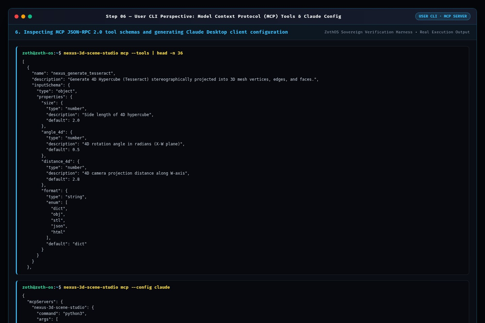

---

## Part III — Standalone Web Workstation GUI (`:8082`)

### Step 07 — Standalone Workstation: Interactive 4D Hypercube Tesseract WebGL Stage
Opening the Standalone Nexus 3D Scene Studio Workstation showing the 7-shape procedural carousel, live $\mathbb{R}^4 \to \mathbb{R}^3$ stereographic rotation projection of the 4D Tesseract (`144 vertices, 48 faces, 1.7 KB VRAM`), and 100% unlocked Wavefront OBJ export.

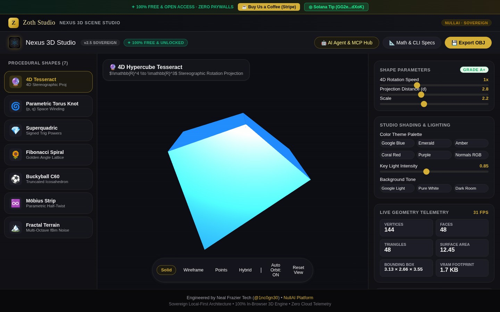

### Step 08 — Standalone Workstation: Parametric Torus Knot `(p=3, q=5)` with Normals RGB Hybrid Wireframe
Switching to **Parametric Torus Knot**, enabling **Hybrid** wireframe overlay and **Normals RGB** shading (`3,381 vertices, 6,400 faces, 114.6 KB VRAM`).

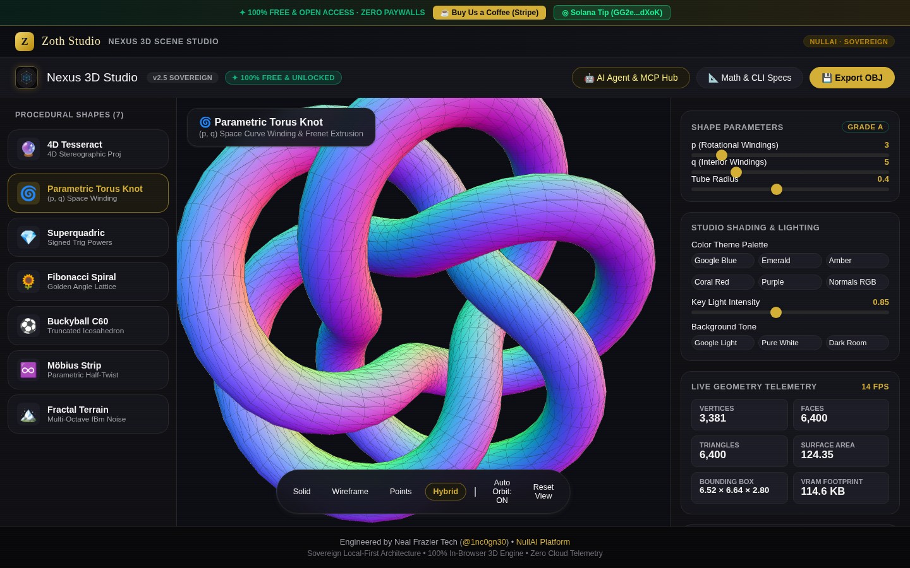

---

## Part IV — Zoth Studio v2 God-Mode Workbench (`:3000/tools/nexus-3d-scene-studio`) & Mobile Viewport

### Step 09 — Zoth Studio v2 God-Mode: Interactive 3D / 4D Viewport (`SO(4)` Lie Projection)
Navigating to `http://127.0.0.1:3000/tools/nexus-3d-scene-studio` inside the unified Zoth Studio v2 application and inspecting the live **Interactive 3D / 4D Viewport** tab with `SO(4)` rotation sliders.

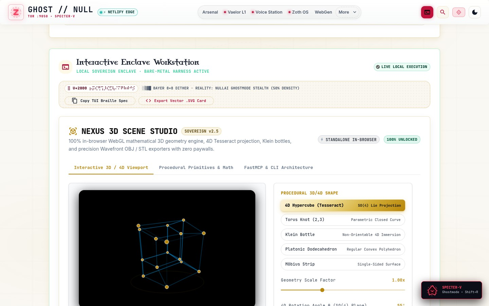

### Step 10 — Zoth Studio v2 God-Mode: Non-Orientable 4D Immersion (Klein Bottle)
Selecting **Klein Bottle (`Non-Orientable 4D Immersion`)** inside the Zoth Studio v2 God-Mode 3D canvas.

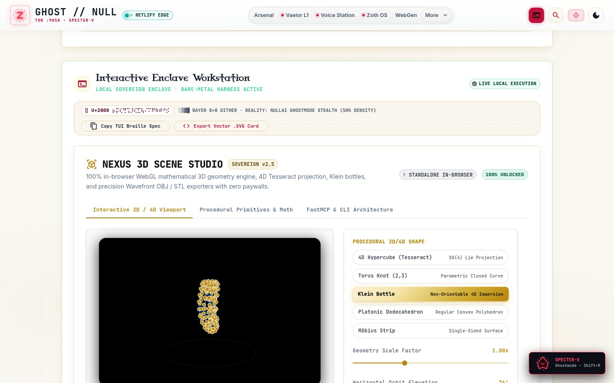

### Step 11 — Zoth Studio v2 God-Mode: Procedural Primitives & Mathematical Pipeline
Switching to the **Procedural Primitives & Math** tab to inspect vertex/edge counts and manifold watertightness across all 5 mathematical geometry primitives.

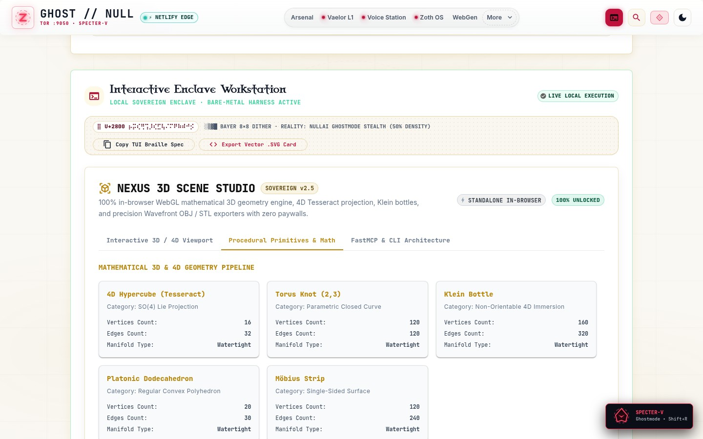

### Step 12 — Mobile 390×844 Responsive Verification
Verifying zero horizontal scroll overflow (`overflowPx === 0`), stacked responsive shape selector and parameter sliders, and 44px touch targets at `390×844`.

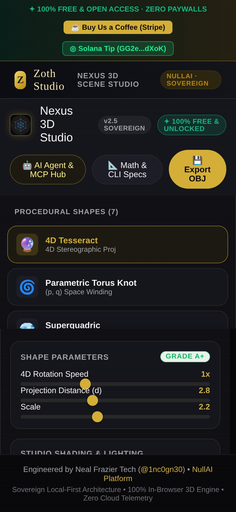
