# ProductHunt Connector (`zoth-ph`) — Complete Developer & User Walkthrough

> **Sovereign Arsenal Verification** • **Port**: `:8139` • **Studio Route**: `/tools/producthunt-connector` • **CLI**: `/usr/local/bin/producthunt-connector` (`/usr/local/bin/zoth-ph`) • **100% Free & Open-Access**

**ProductHunt Connector (`zoth-ph`)** is a zero-dependency Product Hunt GraphQL v2 connector and canonical URL drift auditor for ZothOS. It reads live votes, rankings, comments, and product links, diffs the listing's live Website and GitHub Release URLs against desired target state (`~/.config/zothos/producthunt.json`), stores Developer Tokens strictly in `~/.config/zothos/producthunt.secret.json` (`mode 0600`), generates official Featured & Review SVG badges, and **never** auto-posts spam replies.

---

## Part 1 — Developer & Maintainer Walkthrough (Source, Tests & API Contracts)

### Step 1.1: Repository Layout & Dual CLI Symlinks (`producthunt-connector` & `zoth-ph`)
Developers cloning `/home/zoth/NullAITech/producthunt-connector` inspect the pure-stdlib Python package (`src/producthunt_connector/client.py`, `cockpit.py`, `config.py`, `cli.py`) and verify both global CLI entrypoints (`producthunt-connector` and `zoth-ph`).

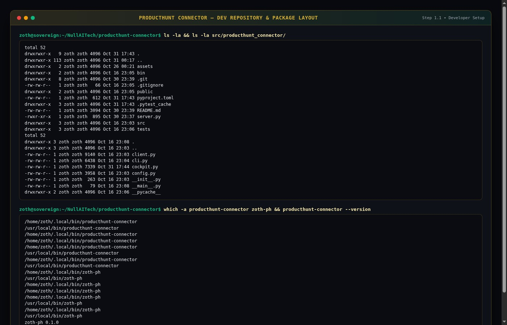

### Step 1.2: Running the Automated Pytest Suite (`API & Drift Tests`)
Running `pytest tests/ -v` executes unit and HTTP integration tests (`tests/test_api.py` and `tests/test_drift.py`) verifying loopback cockpit health, UTM/ref query-param stripping (`?ref=producthunt`), GitHub vs. Website URL drift detection, and Maker Dashboard remediation output (`5 passed in 0.59s`).

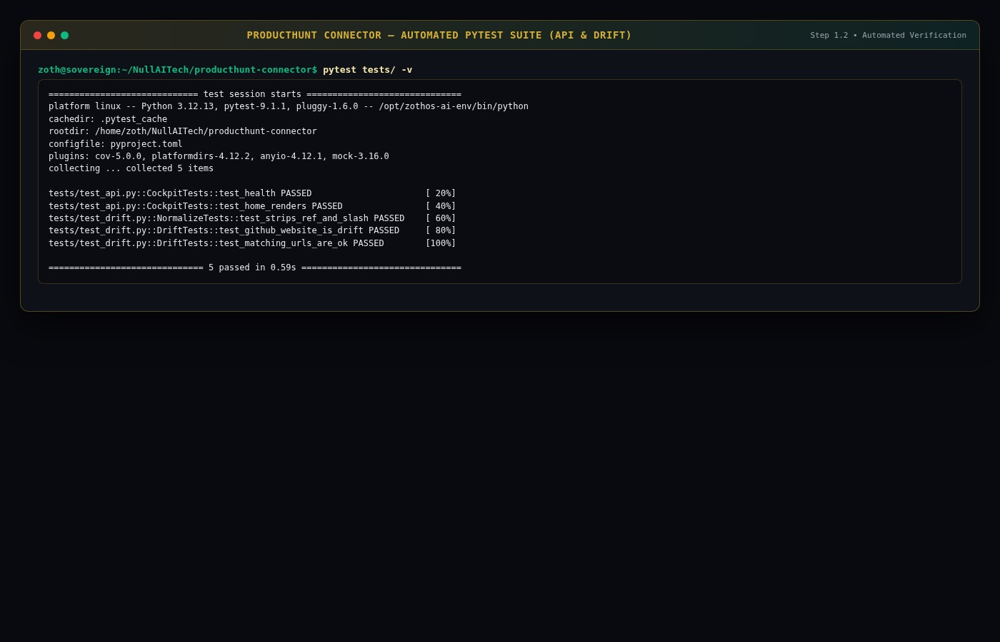

### Step 1.3: REST API Health, Telemetry & Official Badge Contracts (`:8139`)
The loopback HTTP server (`zoth-ph serve --port 8139`) exposes `/api/health`, `/api/stats`, `/api/status`, `/api/badges`, and `POST /api/login`.

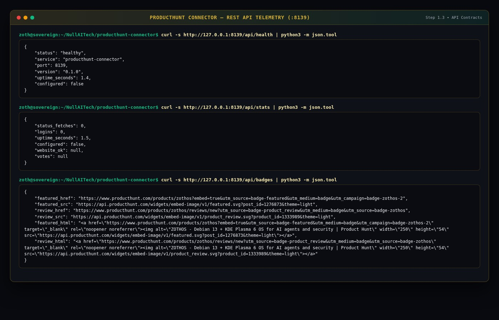

---

## Part 2 — End-User CLI & Terminal Workflow (`producthunt-connector` / `zoth-ph`)

### Step 2.1: CLI Subcommands & Desired Target State Inspection
Users run `producthunt-connector --help` and `zoth-ph status --json` to inspect all subcommands (`login`, `whoami`, `status`, `comments`, `badges`, `serve`) and verify the canonical target URLs (`slug: zothos`, `product_id: 1333989`, `post_id: 1276873`, `desired_website: https://zothos.nullai.tech`, `desired_github: https://github.com/NullAITech/zoth-os/releases/tag/v3.2.0`).

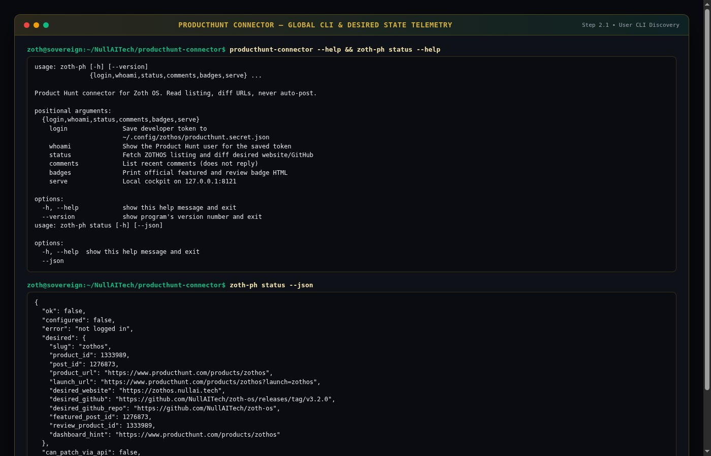

### Step 2.2: Generating Official Featured & Review SVG Embeds
Executing `zoth-ph badges` and `zoth-ph badges --json` outputs the official Product Hunt `featured.svg` (`post_id=1276873`) and `product_review.svg` (`product_id=1333989`) HTML embed snippets ready for READMEs and landing pages.

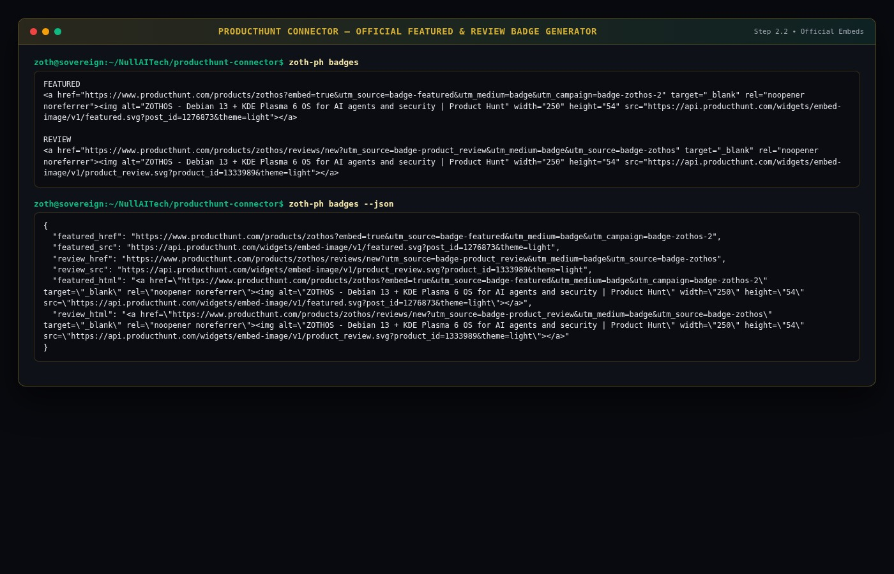

### Step 2.3: GraphQL v2 Snapshot URL Drift Evaluation
Evaluating a GraphQL v2 `PostBySlug` snapshot where the live website points to `https://github.com/NullAITech/zoth-os?ref=producthunt` instead of `https://zothos.nullai.tech` automatically flags `website_ok: false` and `github_release_ok: false`, emitting exact step-by-step Maker Dashboard instructions.

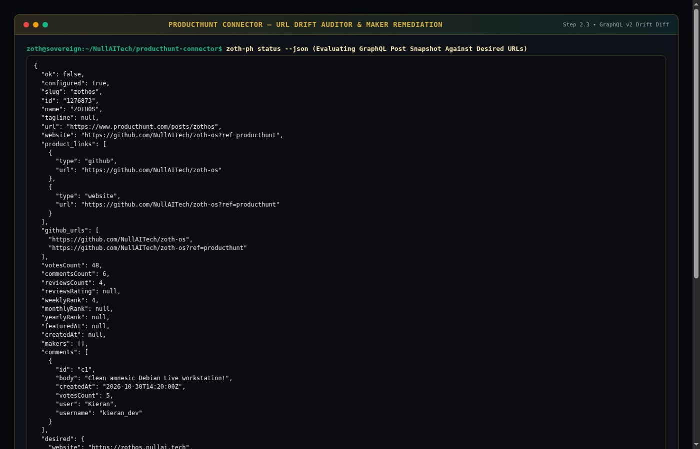

---

## Part 3 — End-User Standalone Web Workstation (`http://127.0.0.1:8139`)

### Step 3.1: Standalone Cockpit — Desired Target State & Token Vault
Opening `http://127.0.0.1:8139` launches the **Zoth OS · Product Hunt** cockpit (`Keep the listing honest.`) with the `mode 0600` Developer Token vault and the Live Listing table displaying the canonical desired state (`zothos`, `1333989 / 1276873`, `https://zothos.nullai.tech`, `v3.2.0`).

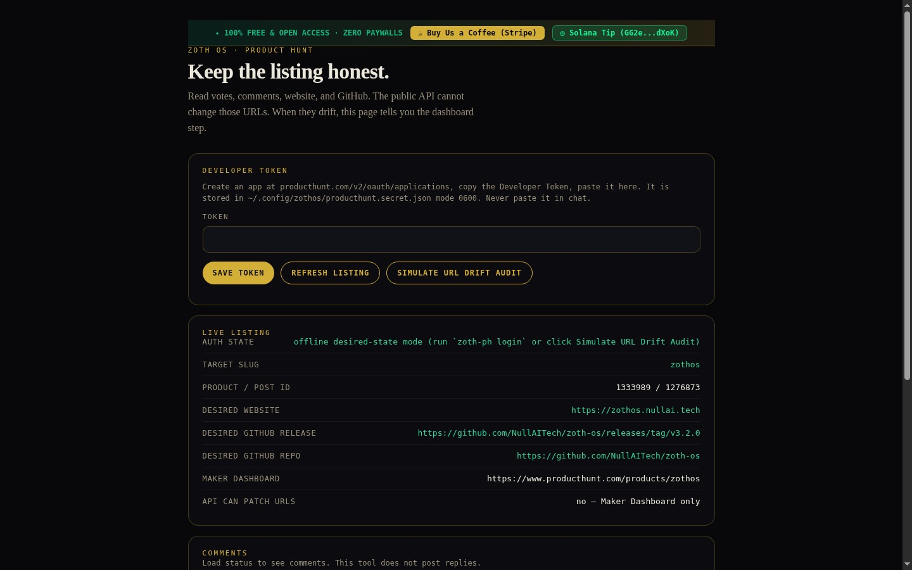

### Step 3.2: Interactive URL Drift Simulation & Maker Remediation Steps
Clicking **Simulate URL Drift Audit** evaluates a drifted Product Hunt snapshot in the browser, highlighting `WEBSITE LIVE: ... (DRIFT DETECTED)` and `GITHUB LIVE: ... (MISSING RELEASE TAG)` in red alongside the exact Maker Dashboard actions (`WEBSITE ACTION`, `GITHUB ACTION`) and read-only community comments.

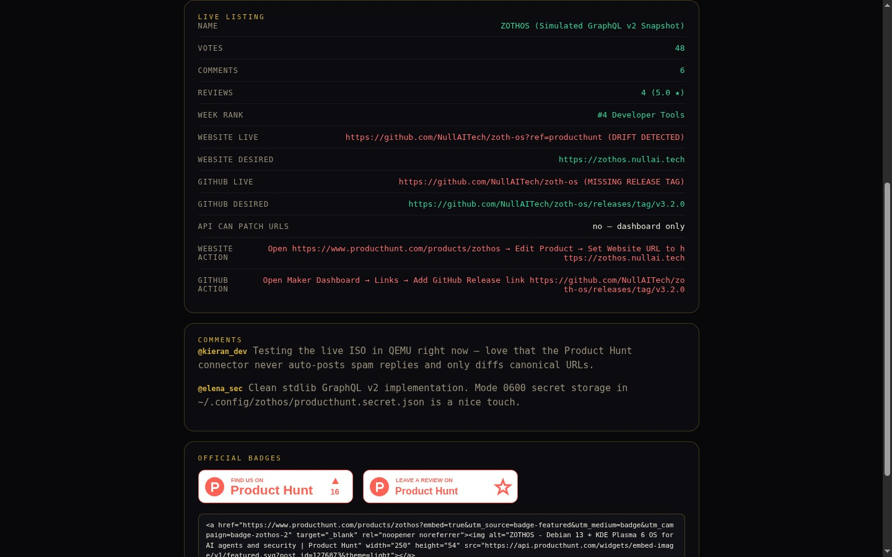

### Step 3.3: Live Rendered Official Product Hunt Badges & Embed Code
Scrolling to the **Official Badges** card displays the live rendered Product Hunt **Featured** and **Leave a Review** SVG badges alongside the copyable `` HTML embed code.

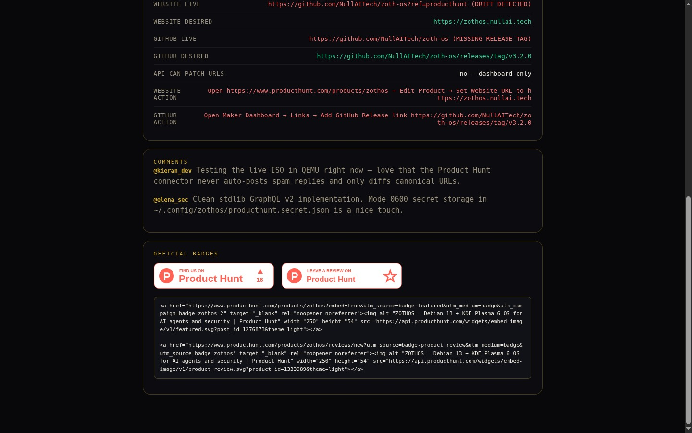

---

## Part 4 — Zoth Studio v2 God-Mode Workstation (`:3000/tools/producthunt-connector`) & Mobile Verification

### Step 4.1: Zoth Studio v2 God-Mode Overview (`:3000/tools/producthunt-connector`)
Navigating to `http://127.0.0.1:3000/tools/producthunt-connector` opens the Zoth Studio v2 God-Mode overview with local `:8139` node telemetry and CLI quick-start commands.

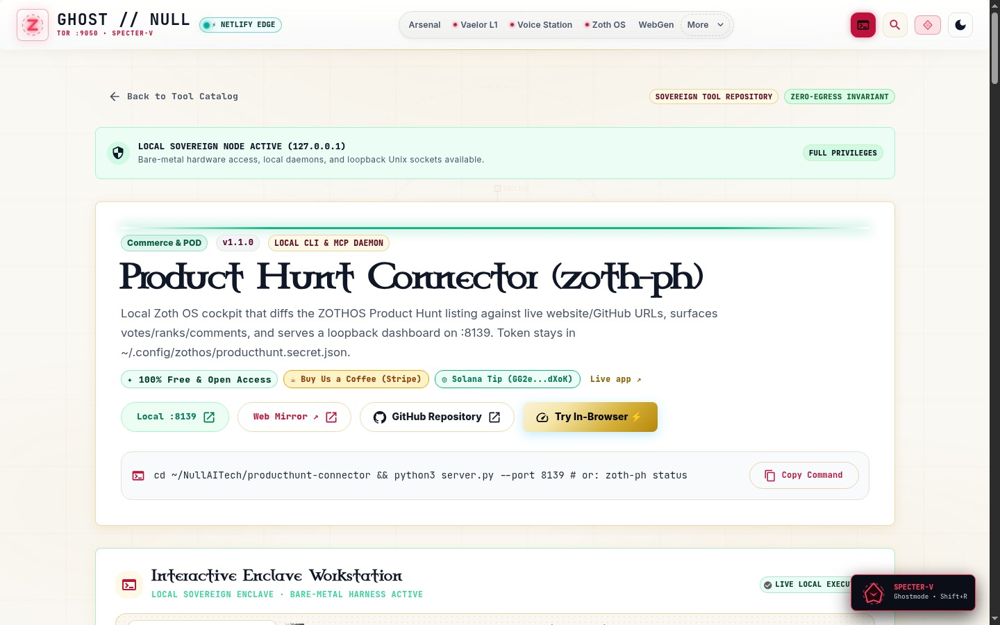

### Step 4.2: Zoth Studio v2 Launch Command, Tagline Scorer & Maker Kit Forge
Scrolling into the interactive enclave reveals the **Product Hunt Launch Command, Tagline Scorer & Maker Kit Forge** with 60fps upvote velocity bars (`First 4H Upvote Surge: 185 upvotes`, `24H Projected Total: 675 (#1 Product of the Day)`, `Tagline Score: 87/100`), interactive launch inputs, and Markdown Launch Kit export.

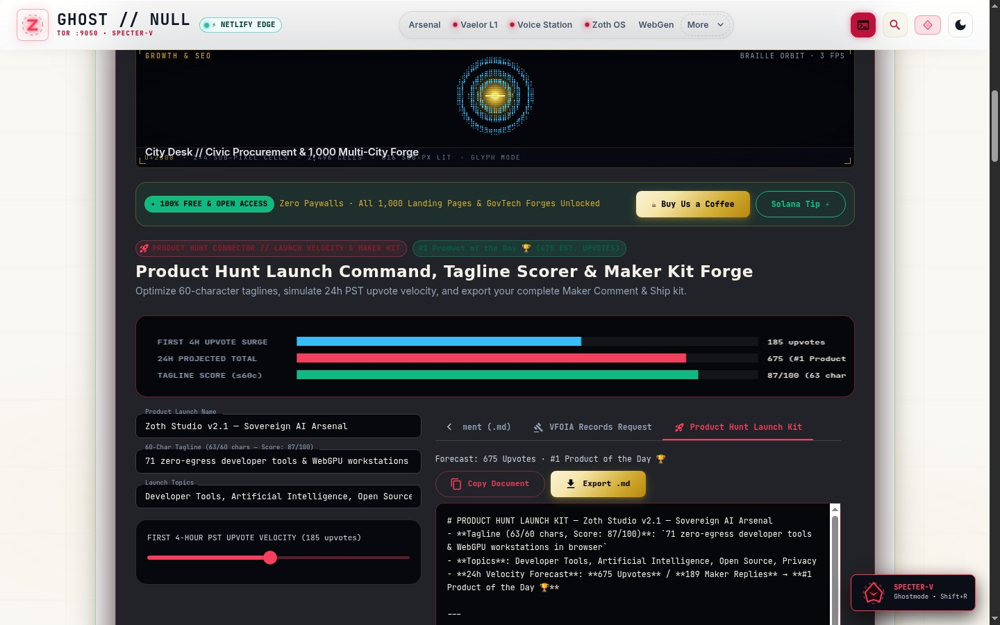

### Step 4.3: Mobile 390×844 Responsive Layout Verification
Verified at `390×844` mobile viewport (`overflowPx === 0`): the Developer Token input, action pills, and Live Listing key-value rows wrap cleanly with zero horizontal scroll overflow.

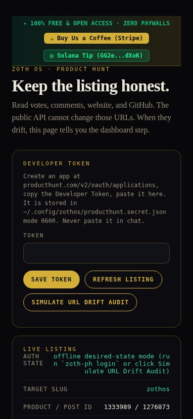
