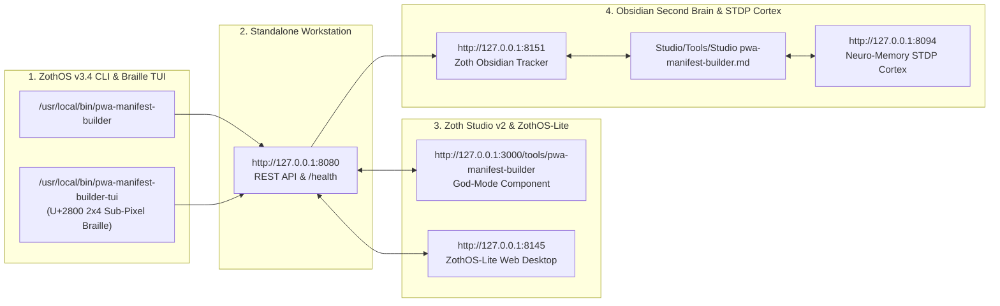

# PWA Manifest Studio (`pwa-manifest-builder`)

> **100% Free & Open-Access W3C Progressive Web App Manifest Architect, ServiceWorker Caching Compiler, Adaptive Maskable SVG Icon Forge, Lighthouse Installability Auditor, Web Share Target / File Handling Generator & PKZIP Bundle Exporter.**
> Engineered by **1nc0gn30 (@1nc0gn30)** • **NullAI Platform**

---

## 1. Executive Summary & Architectural Overview

**PWA Manifest Studio** (`pwa-manifest-builder`) is a zero-dependency Python 3.12+ and browser-native Progressive Web App engineering workstation:

1. **W3C Manifest Architect (`manifest_generator.py`)**: Synthesizes standards-compliant `manifest.webmanifest` payloads across 14 production presets (`ecommerce-store`, `saas-dashboard`, `ai-assistant`, `offline-notes`, `gaming-canvas`, etc.) alongside `<head>` Apple iOS & Microsoft Tile metadata.
2. **ServiceWorker Compiler (`serviceworker_generator.py`)**: Generates `sw.js` caching workers supporting `StaleWhileRevalidate`, `CacheFirst`, `NetworkFirst`, `NetworkOnly`, and `CacheOnly` strategies with Navigation Preload, Background Sync, and Web Push listeners.
3. **Advanced Web Capabilities (`shortcuts_simulator.py`, `share_and_file_handlers.py`)**: Validates and compiles App Shortcuts routers, `web+` URL Protocol Handlers, Web Share Target (`GET`/`POST` multipart) interceptors, and OS File Handling (`window.launchQueue`) scripts.
4. **Lighthouse Installability Auditor & ZIP Bundler (`linter.py`, `icon_forge.py`, `ui_server.py`)**: Scores manifests from `0–100`, generates `192×192`, `512×512`, and adaptive maskable icons, and exports a complete production `.zip` bundle.

---

## 2. Step-by-Step Visual Verification Gallery (12 Real Screenshots)

### Step 01 — Developer Perspective: Repository Architecture & Diagnostics Verification
Inspecting `/home/zoth/NullAITech/pwa-manifest-builder/src/pwa_manifest_builder/` (`catalog.py`, `cli.py`, `icon_forge.py`, `linter.py`, `manifest_generator.py`, `mcp_server.py`, `models.py`, `serviceworker_generator.py`, `share_and_file_handlers.py`, `shortcuts_simulator.py`, `ui_server.py`) and verifying `which -a pwa-manifest-builder` + `pwa-manifest-builder doctor --json`.

---

### Step 02 — Developer Perspective: Automated Pytest Verification Suite (`101 passed`)
Running the full 101-test automated verification suite (`pytest tests/ -v`) covering template catalogs, CLI subcommands, SVG icon forge, Lighthouse linter, manifest generator, MCP JSON-RPC server, ServiceWorker compiler, Share Target/File Handlers, Shortcuts/Protocols, and the HTTP UI server.

---

### Step 03 — Developer Perspective: Live HTTP REST API & Lighthouse Audit Contracts (`:8100`)
Verifying `GET /health`, `POST /api/generate-manifest`, and `POST /api/audit` on `http://127.0.0.1:8100`.

---

### Step 04 — End-User ZothOS CLI: 16-Subcommand Matrix & W3C Manifest Generator
Running `pwa-manifest-builder --help` to inspect all subcommands (`generate`, `sw`, `icons`, `audit`, `meta`, `templates`, `shortcuts`, `protocol`, `share-target`, `file-handlers`, `serve`, `mcp`, `doctor`, `test`) and synthesizing a W3C manifest via `pwa-manifest-builder generate --name "Sovereign Vault" ... --json`.

---

### Step 05 — End-User ZothOS CLI: ServiceWorker Compiler & Lighthouse Compliance Auditor
Generating a `StaleWhileRevalidate` ServiceWorker script via `pwa-manifest-builder sw --cache-name "vault-v1" --strategy stale-while-revalidate --stdout` and piping a template manifest into `pwa-manifest-builder audit - --json`.

---

### Step 06 — End-User ZothOS CLI: App Shortcuts Router & Web Share Target Validator
Running `pwa-manifest-builder shortcuts --template productivity --demo --json` and `pwa-manifest-builder share-target --template social --action "/share-inbox" --method POST --json`.

---

### Step 07 — End-User Standalone Web Workstation (`:8100`): Live Device Preview & 100/100 Lighthouse Gauge
Loading `http://127.0.0.1:8100` to inspect the 3-pane workstation featuring the **Basic Info / Display / Scope / ServiceWorker / Icon Forge / Capabilities** configurator, interactive **Install Bottom Sheet** mobile device simulator, **100 / 100** Lighthouse PWA Score gauge, and **9/9 Passed** PWA Audit Checklist.

---

### Step 08 — End-User Standalone Web Workstation (`:8100`): ServiceWorker Configurator & `sw.js` Code Inspector
Switching to the **ServiceWorker** configuration tab (`pwa-cache-v1`, `Stale-While-Revalidate`, Background Sync, Web Push, Navigation Preload) and inspecting the live compiled `sw.js` script in **Code Inspector** mode.

---

### Step 09 — End-User Standalone Web Workstation (`:8100`): Web Share Target & File Handling (`launchQueue`)
Switching to the **Capabilities** tab (`Web Share Target API` + `File Handling API launchQueue`) and inspecting the generated `share-receiver.js` client handler.

---

### Step 10 — Zoth Studio v2 God-Mode (`:3000/tools/pwa-manifest-builder`): Archetype Selector & Device Simulator
Using the integrated God-Mode workstation at `http://127.0.0.1:3000/tools/pwa-manifest-builder` with 12 application archetypes, `W3C AUDIT: 100% PASSED (9/9)`, live mobile Install Modal simulator, and 1-click PKZIP bundle export.

---

### Step 11 — Zoth Studio v2 God-Mode (`:3000/tools/pwa-manifest-builder`): Offline & SW Strategy + Code Compiler
Switching to `3. Offline & SW` and **Code** view on `:3000/tools/pwa-manifest-builder` to inspect the compiled `manifest.json` / `sw.js` / `<head> tags` / `offline.html` payloads.

---

### Step 12 — Mobile 390×844 Viewport Responsive Verification (`overflowPx: 0`)
Verifying mobile layout responsiveness at `390×844` (`deviceScaleFactor: 2`) on `http://127.0.0.1:8100` with zero horizontal scroll overflow (`overflowPx === 0`) and 100% open-access controls.

---

## 3. Support & Attribution

- **100% Free & Open-Access**: Zero paywalls, zero blur locks, and zero license keys required.
- **☕ Buy Us a Coffee (Stripe)**: [https://buy.stripe.com/3cIfZg27PdKo2D64Ocfw40X](https://buy.stripe.com/3cIfZg27PdKo2D64Ocfw40X)
- **◎ Solana Tip Address**: `GG2eQbVh8ut1BK6j1A2tz7pSySdLpD38BgyEhGcxdXoK`

---

## Sovereign 5-Layer Architecture & Second Brain Topology

### ZothOS v3.4 TUI & Obsidian Second Brain Sync
- **Unicode `U+2800` Braille TUI**: `pwa-manifest-builder-tui --status` / `pwa-manifest-builder-tui --json`
- **Zoth Obsidian Tracker (`:8151`)**: `zoth-obsidian-tracker --verify`
- **Connected Canon Notes**: [[00 Home]] · [[Zoth OS]] · [[Zoth Studio]] · [[ZothOS-Lite Web Desktop]] · [[Zoth Memory]] · [[Public Surfaces]]
