# 🌌 Zoth Reality Shader & Theme Forge (`reality-shader-forge`) — Complete Developer & User Walkthrough

> **100% Free & Open-Access Sovereign Utility**: Zero paywalls, zero blur locks, zero telemetry. Support via [☕ Buy Us a Coffee (Stripe)](https://buy.stripe.com/3cIfZg27PdKo2D64Ocfw40X) or Solana (`GG2eQbVh8ut1BK6j1A2tz7pSySdLpD38BgyEhGcxdXoK`).

---

## 🛠️ Part 1: Developer Perspective (Architecture, Automated Tests & API Verification)

### Step 1: Repository Architecture & Source Tree Inspection
Developers cloning or inspecting `/home/zoth/NullAITech/reality-shader-forge` can verify the standalone HTTP server (`server.py`), the ZothOS CLI binary (`bin/reality-shader-forge`), the interactive 60fps Canvas & theme compiler UI (`public/index.html`), and the 24-test `pytest` verification suite (`tests/test_reality_shader_forge.py`).

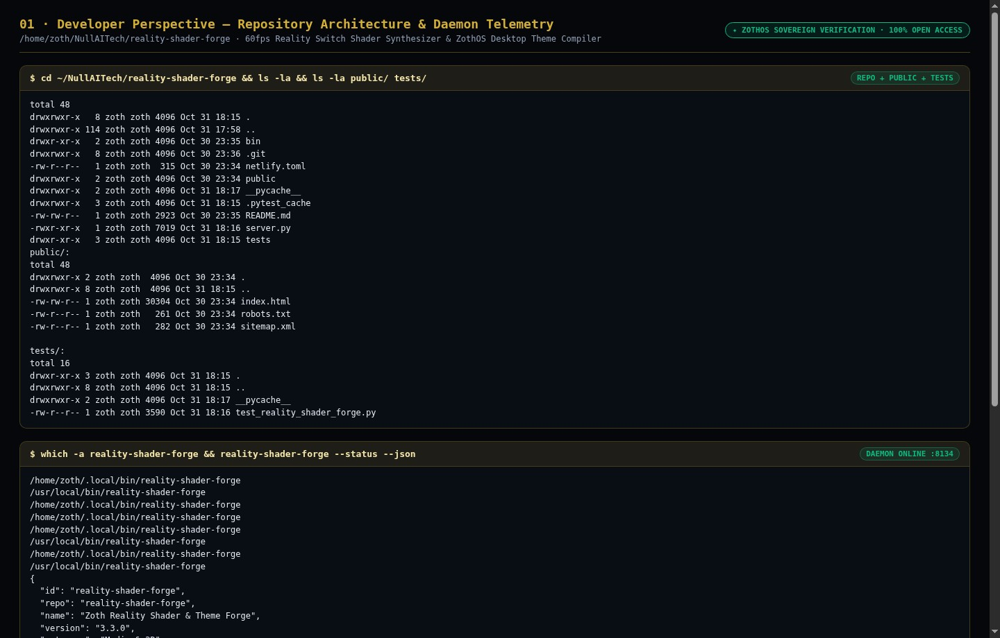

### Step 2: Automated Pytest Verification Suite (`24 passed in 0.76s`)
Running `pytest -v` executes 24 automated unit and integration tests covering all 5 Zoth Realities (`gold`, `cyan`, `crimson`, `emerald`, `purple`) across all 4 export formats (`kde`, `alacritty`, `css`, `json`), CLI flag execution, and live HTTP server endpoints (`/health`, `/api/status`, `/api/realities`, `/api/compile`).

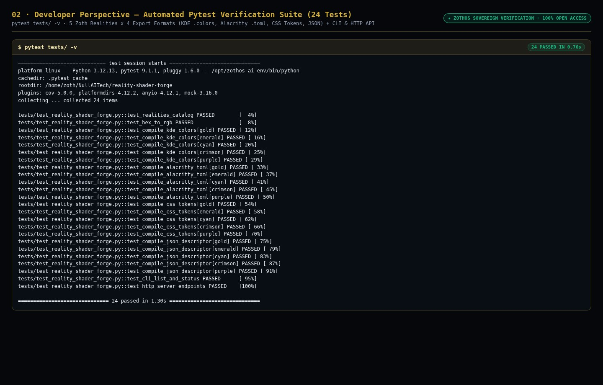

### Step 3: Live REST API & Multi-Reality Compiler Contract Verification
Developers and autonomous agents can query `/health`, `/api/realities`, and `/api/compile?reality=emerald&format=kde` on port `8134` to programmatically list the 5 Zoth Realities and synthesize KDE Plasma `.colors`, Alacritty `.toml`, or CSS custom property payloads.

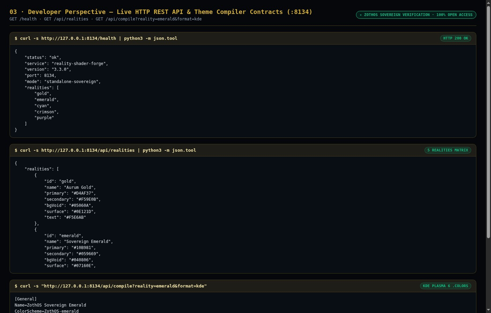

---

## 💻 Part 2: End-User CLI Perspective (ZothOS Global Binary & Multi-Format Export)

### Step 4: Global ZothOS Binary Discovery & CLI Help Matrix
End-users on ZothOS can run `reality-shader-forge --help` and `reality-shader-forge --list` from any terminal directory to view all 5 Zoth Realities (`gold`, `emerald`, `cyan`, `crimson`, `purple`), companion Zoth Bot avatars, and output formats.

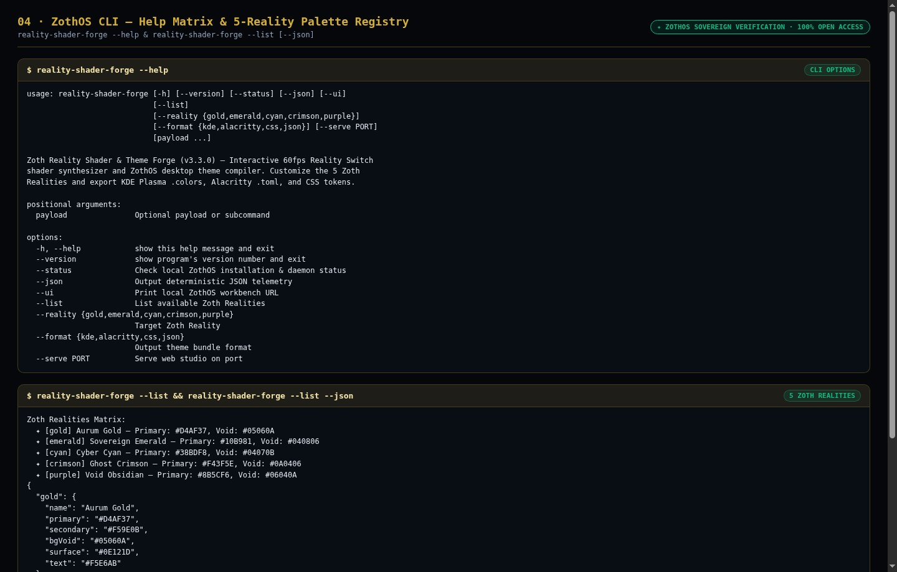

### Step 5: Compiling KDE Plasma 6 `.colors` & Alacritty `.toml` via CLI
Running `reality-shader-forge --reality gold --format kde` and `reality-shader-forge --reality cyan --format alacritty` outputs a complete, spec-compliant KDE Plasma 6 color scheme (`ZothAurumGold.colors`) and Alacritty GPU terminal configuration (`#00F0FF` Cyber Cyan).

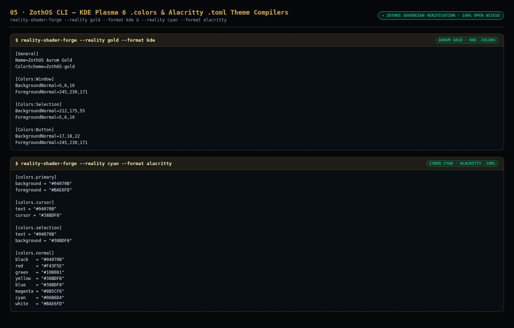

### Step 6: Compiling CSS `:root` Design Tokens & ZothOS v3 JSON Descriptors
Running `reality-shader-forge --reality crimson --format css` and `reality-shader-forge --reality purple --format json` generates `:root[data-zoth-reality="crimson"]` CSS tokens (`#F43F5E` Ghost Crimson) and the full ZothOS v3 JSON reality descriptor (`#A855F7` Void Obsidian).

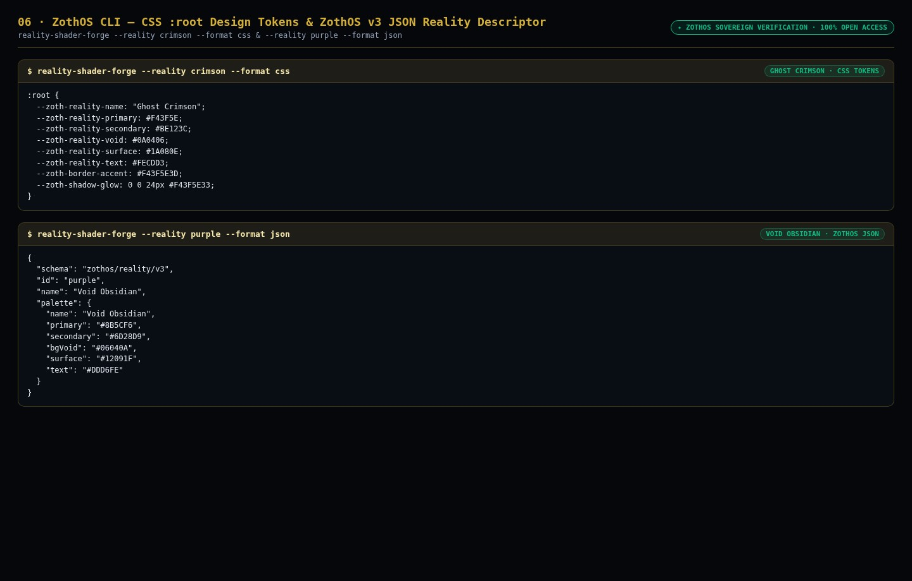

---

## 🖥️ Part 3: End-User GUI Perspective (Standalone Workstation & Zoth Studio v2 God-Mode)

### Step 7: Standalone Workstation (`:8134`) — Aurum Gold (`AURELIUS-9`) & KDE `.colors`
Opening `http://127.0.0.1:8134` launches the standalone workstation featuring the live 60fps sacred geometry constellation canvas, the 5-Reality selector bar, physics sliders (`Particle Velocity`, `Constellation Nodes`, `Chrome Radius`), and the live KDE Plasma `.colors` synthesizer.

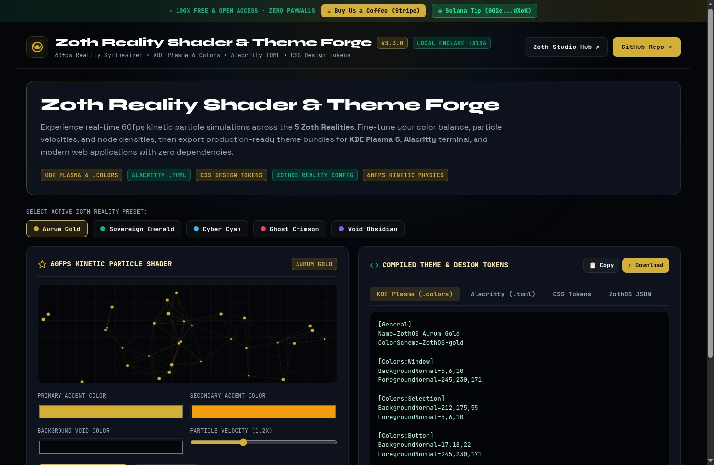

### Step 8: Standalone Workstation (`:8134`) — Sovereign Emerald & Alacritty `.toml`
Selecting **Sovereign Emerald** switches the live 60fps WebGL/Canvas shader to `#10B981` and `#34D399` and compiles the corresponding Alacritty `.toml` terminal configuration.

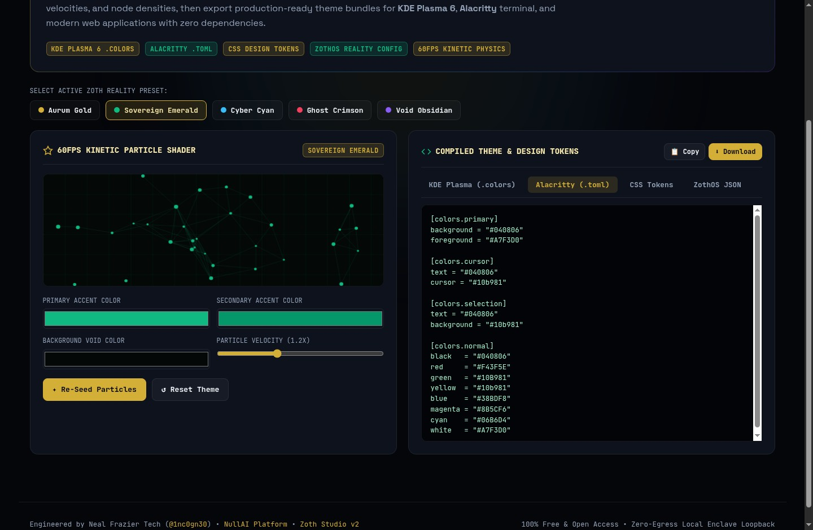

### Step 9: Standalone Workstation (`:8134`) — Cyber Cyan & Studio `.css`
Selecting **Cyber Cyan** (`#00F0FF` / `#38BDF8`) and switching to the **Studio Reality (.css)** tab synthesizes the `:root[data-zoth-reality="cyan"]` CSS custom properties with 1-click copy and `.css` file download.

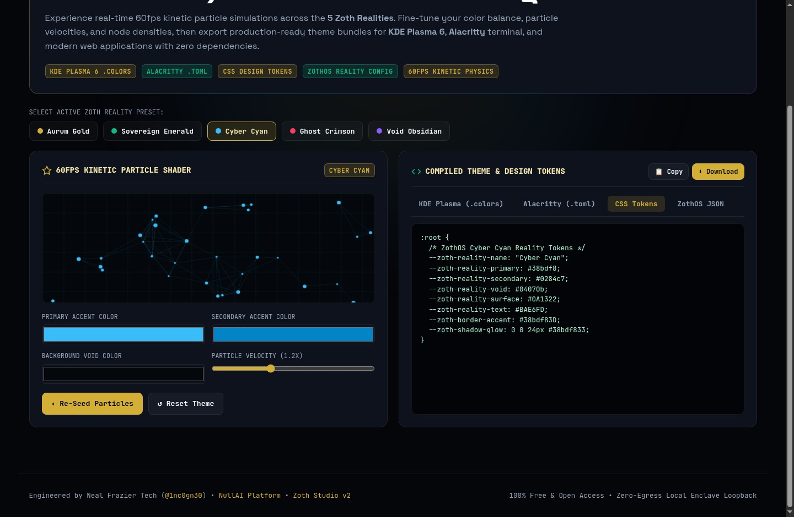

### Step 10: Zoth Studio v2 God-Mode (`:3000/tools/reality-shader-forge`) — Interactive Reality & Zoth Bot Canvas
Inside the Zoth Studio v2 enclave (`http://127.0.0.1:3000/tools/reality-shader-forge`), users can switch between all 5 global studio realities in real time, preview the animated Zoth Bot character HUD overlay, and adjust shader velocity and node density.

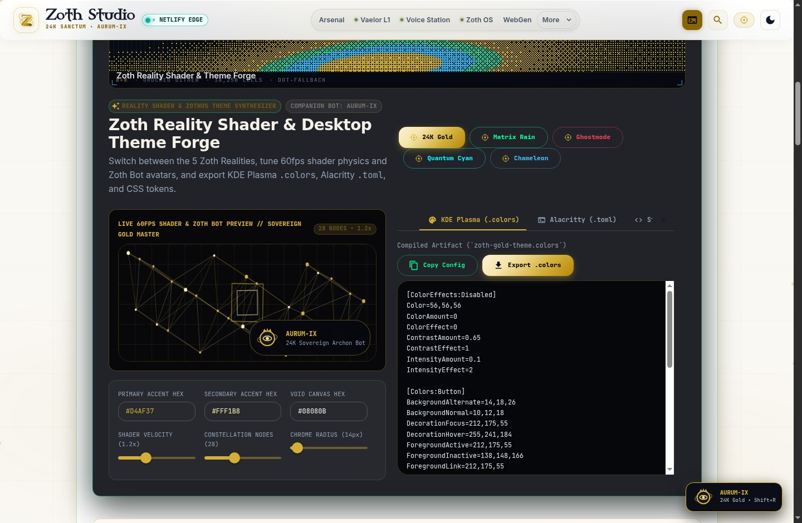

### Step 11: Zoth Studio v2 God-Mode (`:3000/tools/reality-shader-forge`) — Theme Artifact Compiler
Switching tabs in the God-Mode compiler panel exports ready-to-use KDE Plasma `.colors`, Alacritty `.toml`, and Studio `.css` artifacts synchronized with the active Zoth Studio reality.

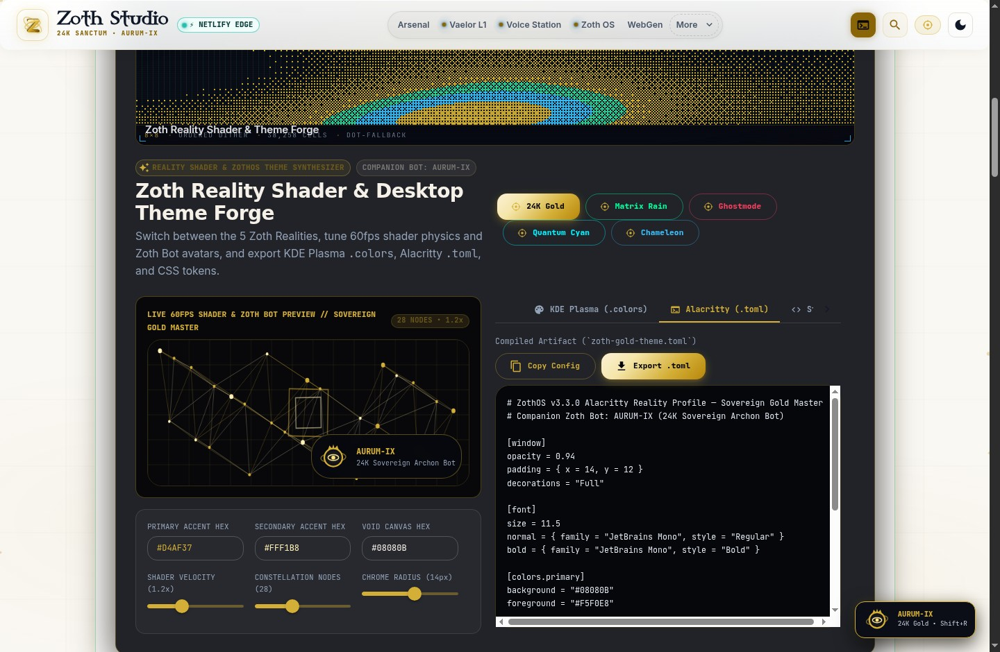

### Step 12: Mobile 390×844 Responsive Verification (`overflowPx === 0`)
Verified at mobile viewport (`390×844`) with zero horizontal scroll overflow (`overflowPx === 0`), stacked reality selector pills, touch-friendly physics sliders, and full mobile code export access.

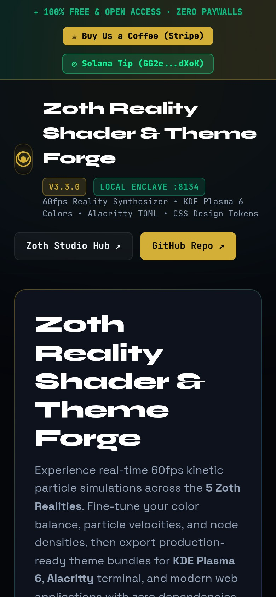
