# 🏛️ Schema Illustrator Studio (`schema-illustrator-studio`)

> **100% in-browser visual database ERD studio, multi-format AST parser, and universal schema transpiler (SQL DDL, JSON Schema, TypeScript, GraphQL SDL, Prisma, Pydantic v2, OpenAPI, Mermaid ERD) with DAG complexity telemetry and relational synthetic mock data generation.**

- **Standalone Workstation**: `http://127.0.0.1:8099`
- **Zoth Studio v2 God-Mode Route**: `http://127.0.0.1:3000/tools/schema-illustrator-studio`
- **Global CLI Binary**: `/usr/local/bin/schema-illustrator-studio` & `/home/zoth/.local/bin/schema-illustrator-studio`
- **100% Free & Open Access**: Zero paywalls, zero license modals, zero frosted-glass blur overlays. Optional support via [☕ Buy Us a Coffee (Stripe)](https://buy.stripe.com/3cIfZg27PdKo2D64Ocfw40X) and Solana (`GG2eQbVh8ut1BK6j1A2tz7pSySdLpD38BgyEhGcxdXoK`).

---

## 🛠️ Part 1 — Developer Walkthrough & Architecture Verification

### Step 1: Repository Structure, AST Modules & Server Entrypoint
Inspecting `/home/zoth/NullAITech/schema-illustrator-studio` confirms the modular pure-Python standard-library architecture inside `src/schema_illustrator_studio/` (`cli.py`, `diagram_engine.py`, `diff_engine.py`, `mcp_server.py`, `metrics.py`, `mock_generator.py`, `models.py`, `parsers/`, `transpilers/`, and `ui_server.py`) and the global ZothOS CLI binaries.

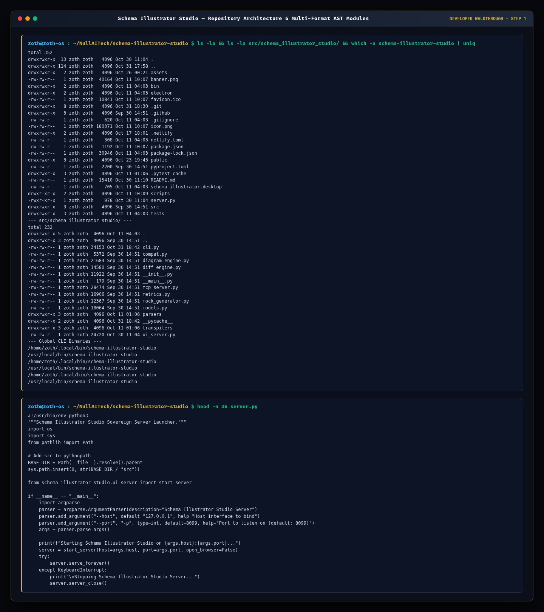

### Step 2: Automated Pytest Verification Suite (`81 passed`)
Executing `pytest -v` runs 81 unit, parser, transpiler, diagram engine, schema diff, mock generator, MCP JSON-RPC, origin guard, and HTTP API tests with 100% pass rate.

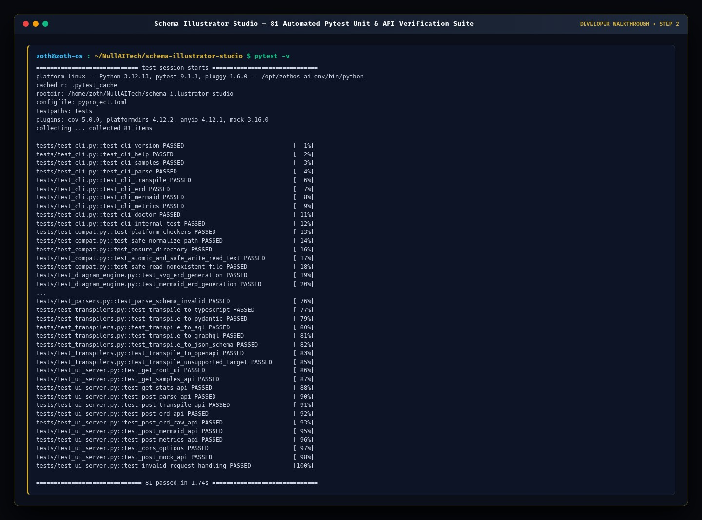

### Step 3: REST API Contract Verification (`/health`, `/api/transpile`, `/api/metrics`)
Querying `http://127.0.0.1:8099/health`, `POST /api/transpile`, and `POST /api/metrics` verifies live multi-format schema transpilation (SQL DDL to TypeScript interfaces) and DAG complexity analysis.

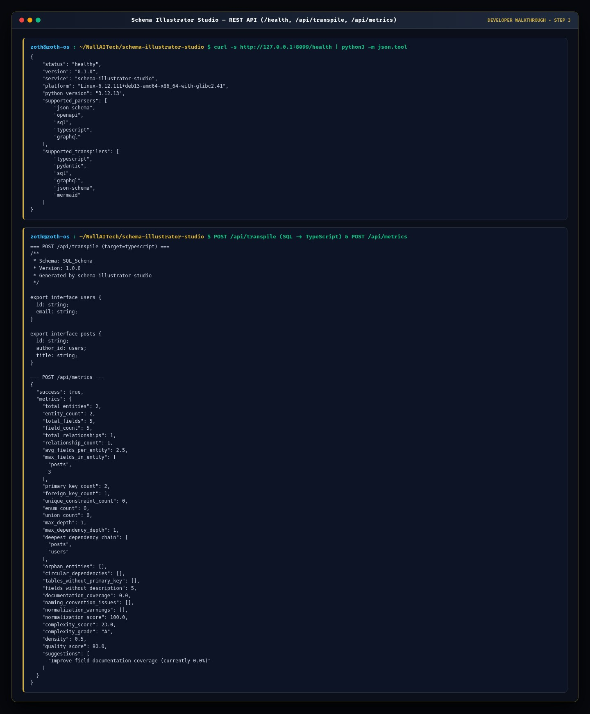

---

## 💻 Part 2 — End-User ZothOS CLI Walkthrough

### Step 4: CLI Diagnostics & Multi-Table AST Parsing
Running `schema-illustrator-studio --help` and `schema-illustrator-studio samples ecommerce | schema-illustrator-studio parse - --no-color` parses the 5-table E-Commerce SQL DDL schema into a structured AST displaying primary keys (`🔑 PK`), foreign keys (`🔗 FK`), column types, nullability constraints, and `N:1` relationships.

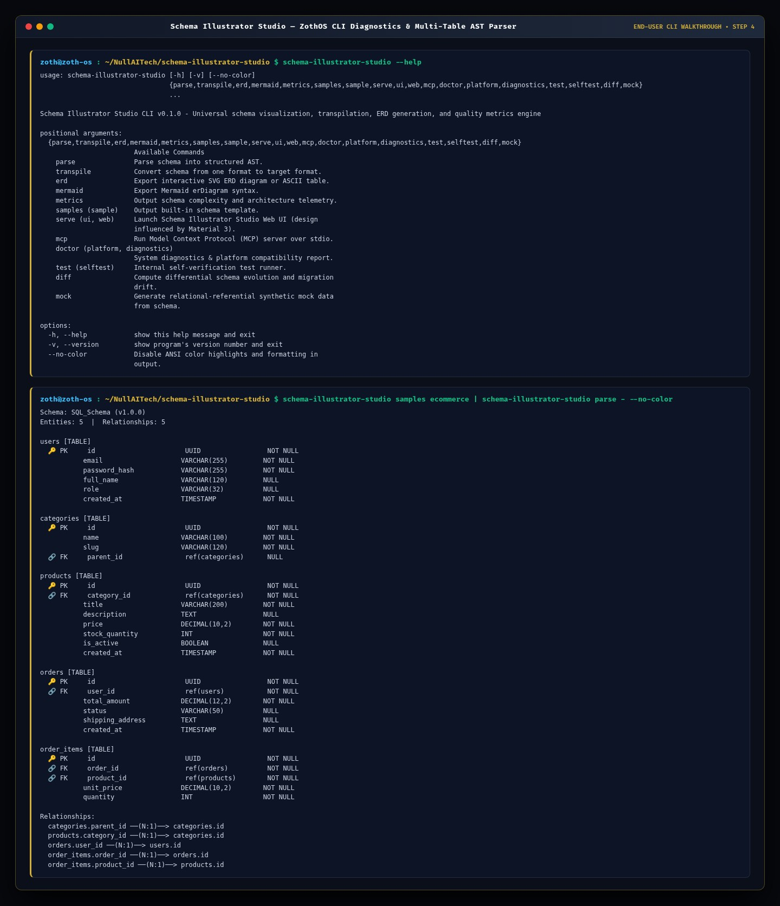

### Step 5: CLI Pydantic v2 Transpiler, DAG Telemetry & Synthetic Mock Data Generator
Piping built-in schemas into `transpile --target pydantic`, `metrics`, and `mock --rows 2 --type json` generates production-ready Pydantic v2 models (`Role`, `User`, `Session`), computes normalization & graph density scores, and synthesizes referentially-valid mock JSON records.

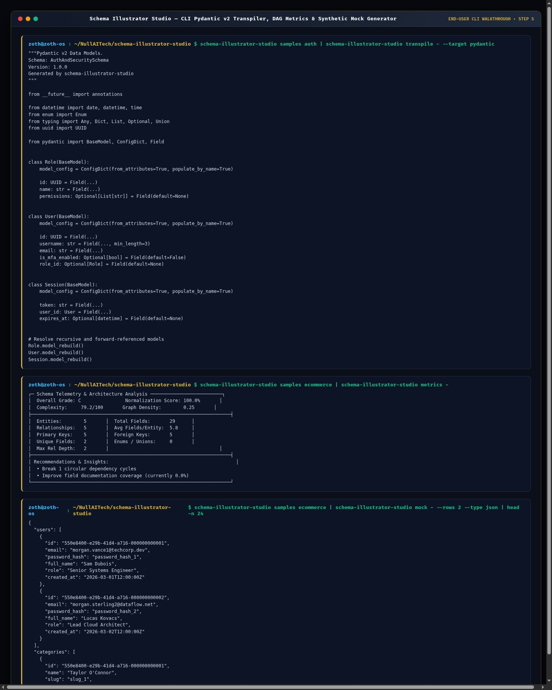

---

## 🖥️ Part 3 — Standalone Workstation & Zoth Studio v2 GUI Walkthrough

### Step 6: Standalone Workstation (`:8099`) — Interactive Vector SVG ERD
Opening `http://127.0.0.1:8099` loads the multi-pane Schema Illustrator Studio workstation with the 5-table E-Commerce SQL DDL schema (`users`, `categories`, `products`, `orders`, `order_items`), smooth cubic-Bezier `N:1` relationship connectors, and live header telemetry pills (`ENTITIES: 5 | FIELDS: 29 | RELATIONS: 5 | GRADE: A+`).

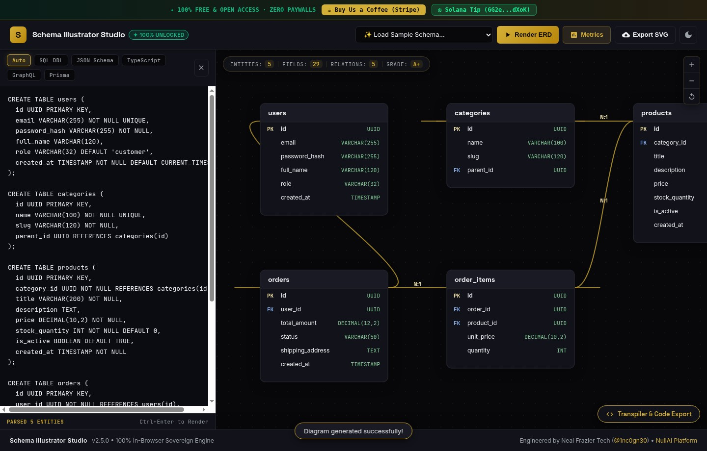

### Step 7: Standalone Workstation (`:8099`) — Multi-Dialect Transpiler Drawer (`Pydantic v2`)
Expanding the bottom **Transpiler & Code Export** drawer and selecting **Pydantic v2** transpiles all 5 SQL tables into typed Python `BaseModel` classes with `Field(..., primary_key=True)` and `foreign_key` metadata—100% unlocked with one-click copy.

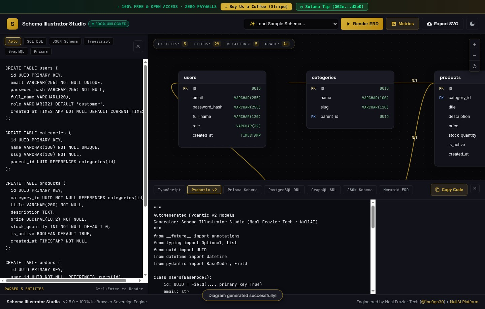

### Step 8: Standalone Workstation (`:8099`) — Schema Quality & Complexity Telemetry Modal
Clicking **Metrics** opens the **Schema Quality & Complexity Telemetry** modal displaying `Entities / Tables: 5`, `Total Fields: 29`, `Relationships: 5`, `Max Hierarchy Depth: 3`, `Complexity Score: 54`, `Normalization Grade: A+`, `100% Primary Key Coverage`, and `Clean Directed Acyclic Graph (DAG)`.

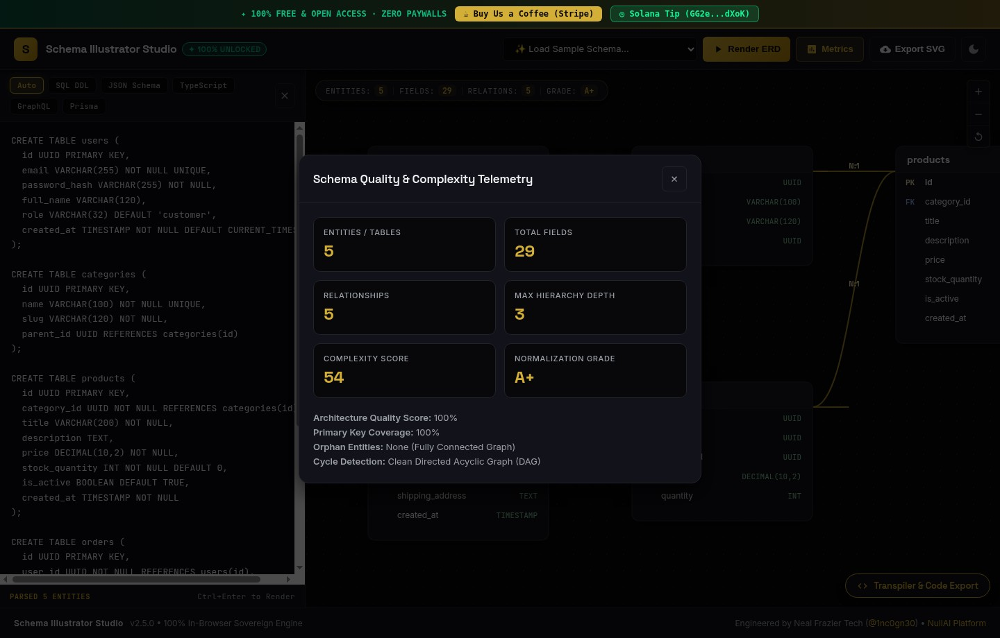

### Step 9: Standalone Workstation (`:8099`) — Editorial Light Mode & Multi-Tenant CRM (Prisma)
Toggling Light Mode and selecting **Multi-Tenant CRM (Prisma)** (`model Tenant`, `model User`, `model Account`, `model Deal`) renders high-contrast ivory entity cards and Prisma `@relation` connectors (`ENTITIES: 4 | FIELDS: 29 | RELATIONS: 8 | GRADE: A+`).

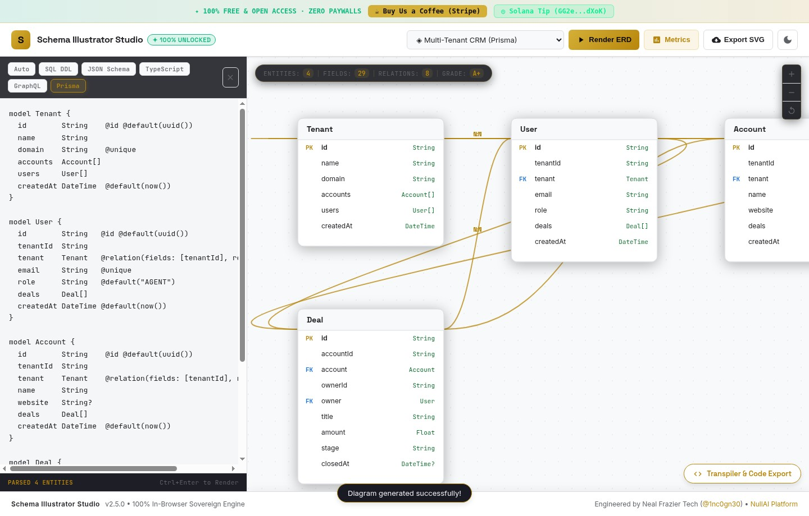

### Step 10: Zoth Studio v2 God-Mode (`:3000/tools/schema-illustrator-studio`) — Dark Mode
Navigating to `http://127.0.0.1:3000/tools/schema-illustrator-studio` renders the integrated God-Mode workstation featuring the Interactive SVG ERD Canvas, Schema Source Editor, Complexity & Normalization Audit, and Live Transpiled Output.

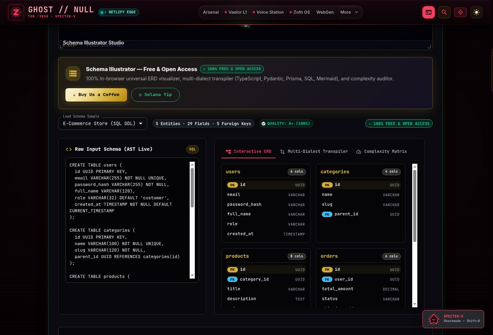

### Step 11: Zoth Studio v2 God-Mode (`:3000/tools/schema-illustrator-studio`) — Light Mode & Pydantic v2
Switching Zoth Studio v2 to Light Mode and selecting the **Pydantic v2** transpiler tab demonstrates clean ink contrast and real-time code synthesis inside the God-Mode workbench.

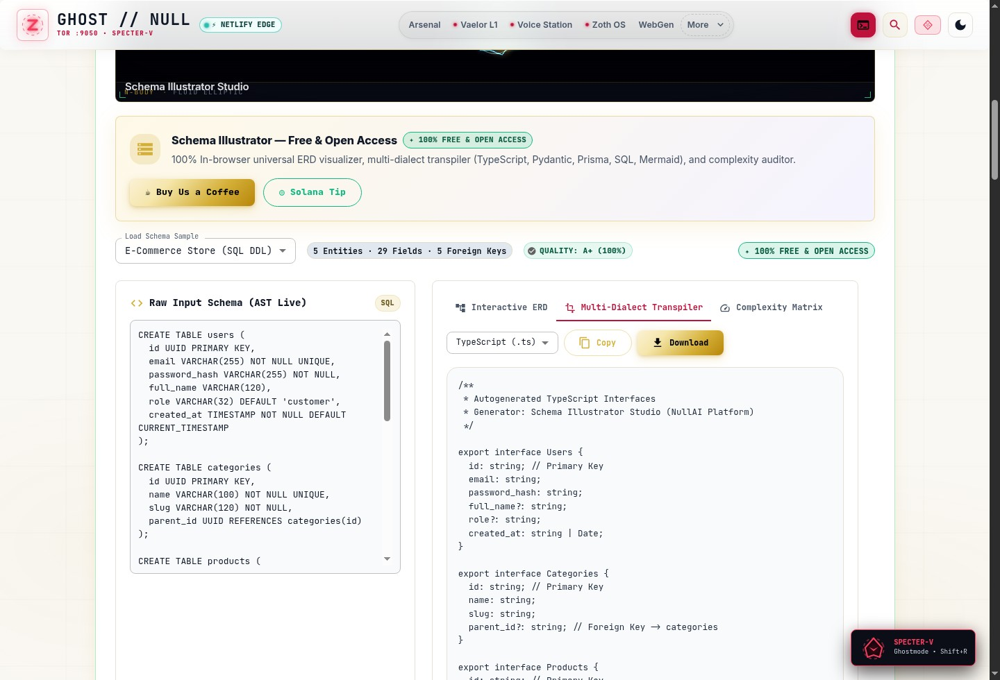

### Step 12: Mobile `390x844` Responsive Viewport Verification (`overflowPx === 0`)
Inspecting `http://127.0.0.1:8099` at `390x844` mobile resolution confirms stacked editor and SVG ERD panes with zero horizontal scroll overflow (`overflowPx: 0`).

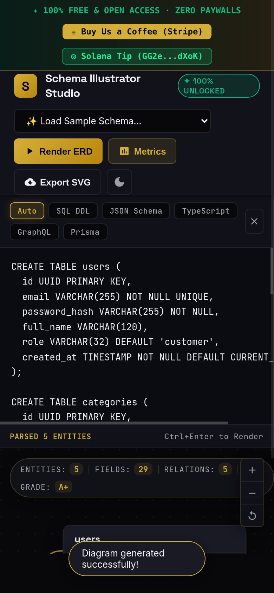
