# ⚡ YourDigitalSpace Master POD Catalog (`storefront-catalog`) — Sovereign Developer & End-User Walkthrough

> **100% Free & Open-Access Sovereign Tool**: Zero paywalls, zero frosted-glass blur locks, and zero license modals. Optional support via [☕ Buy Us a Coffee (Stripe)](https://buy.stripe.com/3cIfZg27PdKo2D64Ocfw40X) or Solana Tip (`GG2eQbVh8ut1BK6j1A2tz7pSySdLpD38BgyEhGcxdXoK`).

---

## 1. Executive Architecture & Capabilities

**YourDigitalSpace Master POD Catalog (`storefront-catalog`)** is a production-ready **10-Listing Etsy Print-on-Demand & Digital Asset Showcase** engineered for Etsy's highest-converting demographic (**55+ Women, Grandmothers, Gardeners, Cottagecore & Crafters**):

- **10 Verified Master Listings**: Apparel (`prod-01`, `prod-02`), Ceramic Mugs (`prod-03`, `prod-04`), Heavyweight Canvas Totes (`prod-05`, `prod-06`), 300 DPI Botanical & Songbird Wall Art (`prod-07`, `prod-08`), and Heirloom Quilt/Embroidery Blueprints (`prod-09`, `prod-10`).
- **62.6% Blended Net Margin**: `$203.41` Combined Basket Retail, `$52.20` Production COGS, `$23.80` Marketplace Fees, and **`$127.41` Net Profit per Full Basket**.
- **Interactive Treasury Projection & Run-Rate Engine**: Simulates daily basket velocity (`1–50 Orders/Day`) to compute Monthly Gross Revenue, Monthly Net Profit, Annual Run Rate, and Days to `$100K` Sovereign Treasury.
- **300 DPI Master Canvases, Photorealistic Mockups & Printify API JSONs**: Every SKU ships with a `300 DPI` transparent canvas, mockup preview, `13/13` A+ SEO tag set, and Printify v1 fulfillment JSON (`/api/payloads/<id>`).

---

## 2. Step-by-Step Verified Screenshot Gallery (12 Real Captures)

### Part A — Developer Perspective: Architecture, Automated Pytest Suite & API Contracts

#### Step 1: Repository Architecture & 10-SKU Asset Manifest
Inspecting `/home/zoth/NullAITech/storefront-catalog` (`server.py`, `catalog_manifest.json`, `payloads/`, `assets/mockups/`, and `tests/`):

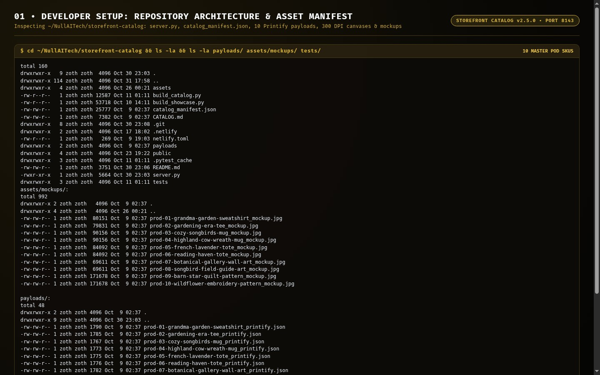

#### Step 2: Automated Pytest Verification (`34 passed in 0.07s`)
Running `pytest -v` in `tests/test_catalog.py` to verify all 10 listings pass Etsy 140-character title bounds, `13/13` 20-character tag limits, financial sum invariants, and physical canvas/mockup/payload file presence:

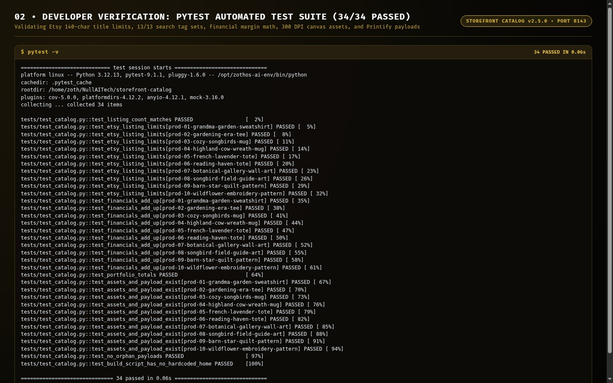

#### Step 3: Live REST API (`/health` & `/api/payloads/<id>`)
Querying `http://127.0.0.1:8143/health` (`62.6%` blended margin) and `/api/payloads/prod-01-grandma-garden-sweatshirt` returning the live Printify v1 JSON payload:

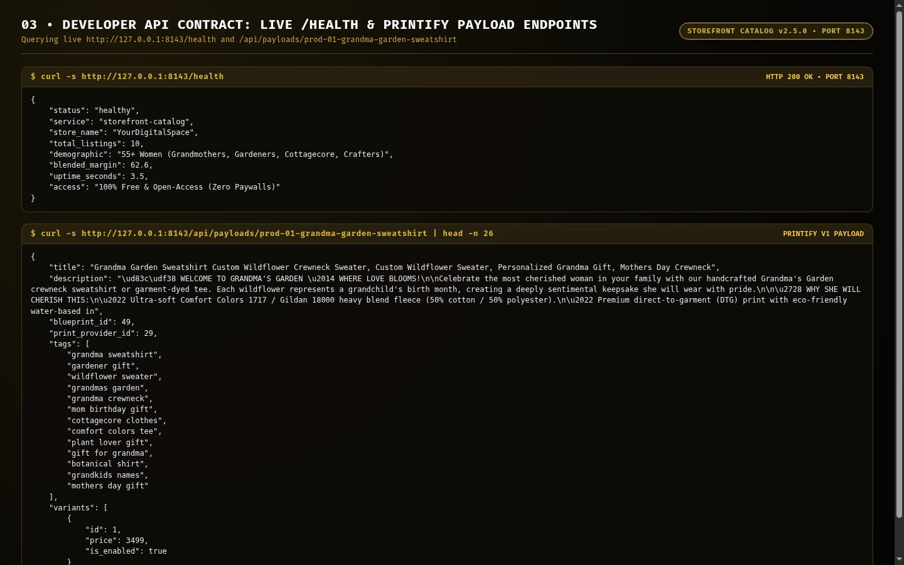

---

### Part B — End-User CLI Perspective: Global ZothOS Binary & Portfolio Subcommands

#### Step 4: Global Binary Discovery (`which -a`), Daemon Status & CLI Reference
Verifying `/usr/local/bin/storefront-catalog` & `~/.local/bin/storefront-catalog`, checking live daemon status via `storefront-catalog --status`, and inspecting `--help`:

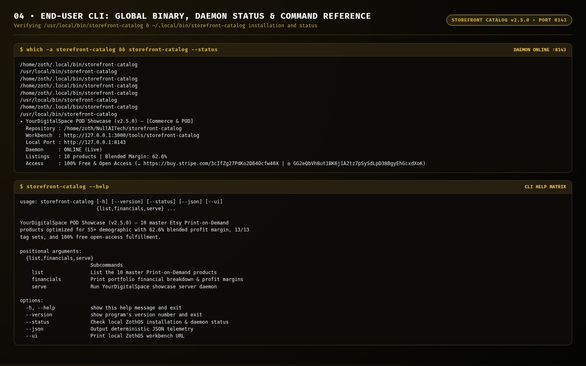

#### Step 5: CLI Execution — 10-Product Listing Matrix & Portfolio Financials
Running `storefront-catalog list` and `storefront-catalog financials` (`Total Retail Value: $203.41`, `Total Net Profit: $127.41`, `Blended Net Margin: 62.6%`):

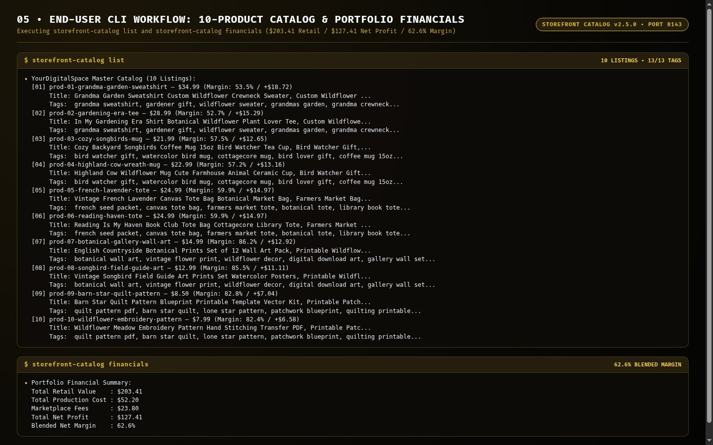

---

### Part C — Standalone Web Workstation GUI (`http://127.0.0.1:8143`)

#### Step 6: Bento Portfolio Metrics & Treasury Projection Engine (Dark Mode)
Inspecting `http://127.0.0.1:8143/` in Dark Mode — viewing the **5-Card Bento Summary** (`10 Items`, `$203.41 Combined Basket`, `$52.2 COGS`, `$127.41 Net Profit`, `62.6% Blended Margin`) and the **Treasury Projection & Run-Rate Engine** (`5 Orders/Day` -> `$30,512/mo Gross`, `$0,112/mo Net Profit`, `157 Days to $100K`):

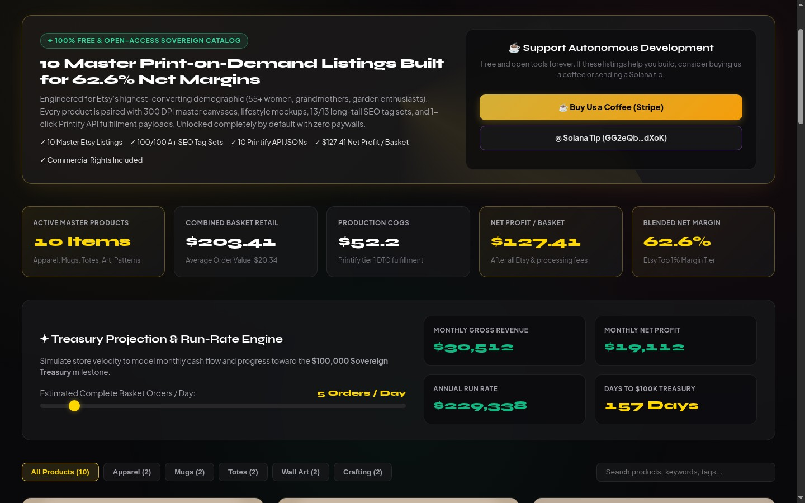

#### Step 7: 10 Master Product Cards Grid, 13/13 SEO Tag Clouds & Printify Payload Exports
Scrolling into the interactive **Product Cards Grid** (`Grandma Garden Sweatshirt +$18.72 / 53.5%`, `In My Gardening Era Shirt +$15.29 / 52.7%`, `Cozy Backyard Songbirds Mug +$12.65 / 57.5%`) with **Canvas & Art**, **Copy & SEO**, and **Download Printify Payload** actions:

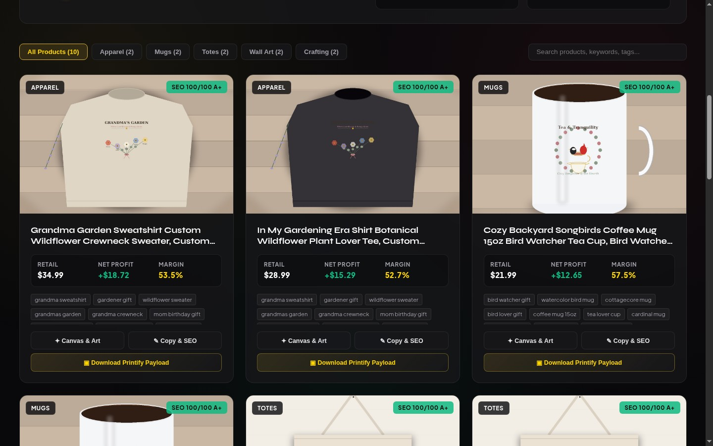

#### Step 8: High-Contrast Alabaster Light Mode (`data-theme="light"`)
Toggling **☀️ Light Mode** on `:8143` and verifying crisp dark ink typography (`#111827`) across `YourDigitalSpace`, banner perks, Bento metrics, and the Treasury Projection Engine:

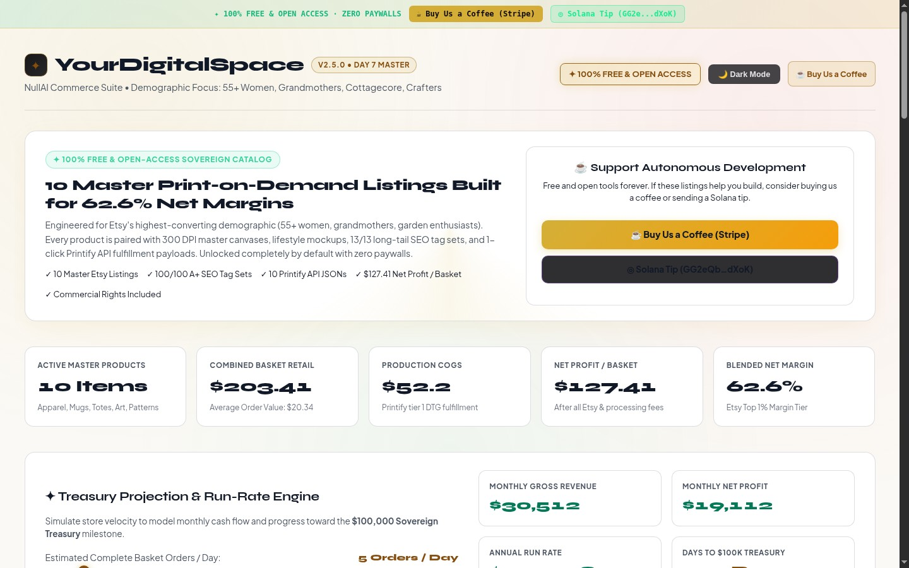

---

### Part D — Zoth Studio v2 God-Mode (`http://127.0.0.1:3000/tools/storefront-catalog`) & Mobile 390px

#### Step 9: Zoth Studio v2 God-Mode Hero & Enclave Header (Dark Mode)
Inspecting `/tools/storefront-catalog` inside Zoth Studio v2 with local node detection (`127.0.0.1:8143`) and 100% open-access badges:

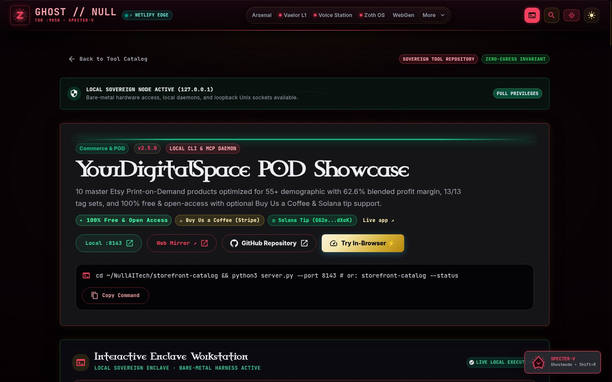

#### Step 10: Zoth Studio v2 Interactive PodCommerce Workstation
Scrolling into the interactive **YourDigitalSpace POD Showcase — Margin, SEO & 300-DPI Asset Forge** workstation inside Zoth Studio v2:

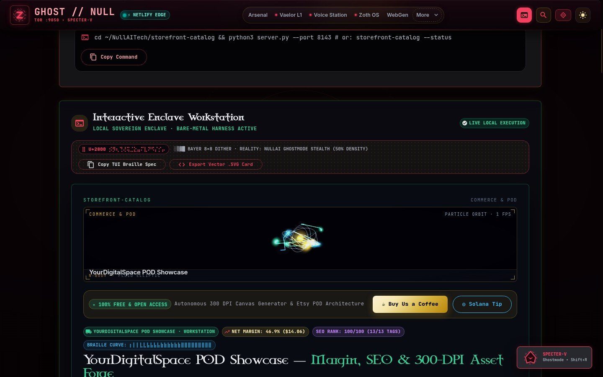

#### Step 11: Zoth Studio v2 Alabaster Light Mode
Switching Zoth Studio v2 to Light Mode (`button[aria-label="Switch to light theme"]`) and verifying clean editorial contrast:

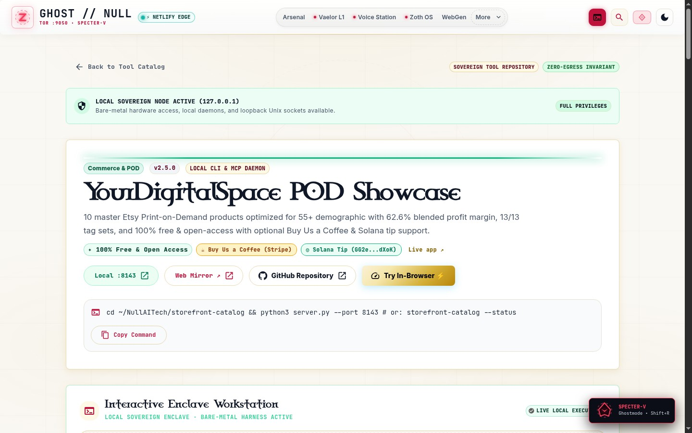

#### Step 12: Mobile `390x844` Responsive Viewport Verification (`overflowPx: 0`)
Verifying zero horizontal scroll overflow (`scrollWidth: 390, clientWidth: 390, overflowPx: 0`) and stacked responsive layout on a `390x844` mobile viewport:

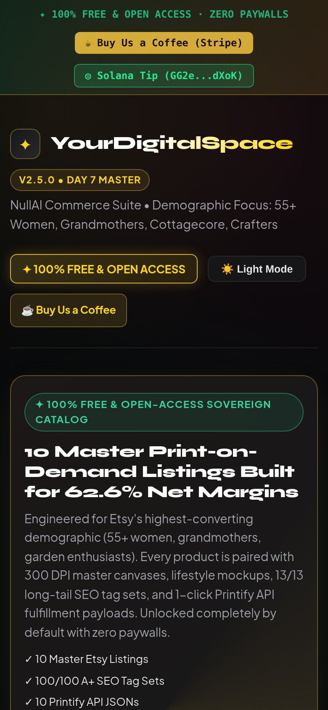
