# UFO Sacred Geometry Studio (`ufo-sacred-geometry`)

> **Sacred Geometry Synthesizer, Crop Circle Agro-Glyph CAD Engine & Multi-Format Vector Exporter** — Pure Python 3 & in-browser geometric AST engine generating 29 classical sacred geometry patterns, Wiltshire crop circle agro-glyphs, Golden Ratio ($\Phi$) harmonics, and direct exports to Scalable Vector SVG, AutoCAD DXF R12/2000, and Wavefront OBJ 3D meshes.

---

## Architecture & Verification Summary

- **Repository**: `/home/zoth/NullAITech/ufo-sacred-geometry`
- **Standalone Workstation**: `http://127.0.0.1:8083` (`ufo-sacred-geometry.nullai.tech`)
- **Zoth Studio v2 God-Mode Route**: `http://127.0.0.1:3000/tools/ufo-sacred-geometry`
- **Global CLI Binaries**: `/usr/local/bin/ufo-sacred-geometry` & `/home/zoth/.local/bin/ufo-sacred-geometry`
- **Automated Test Suite**: `91 passed in 1.11s` (`pytest -v`) + `42 passed` built-in self-verification runner (`ufo-sacred-geometry test`)
- **Open-Access Guarantee**: 100% unlocked in-browser and CLI CAD exports (SVG, DXF, OBJ, PNG, AST JSON) — zero paywall blur filters, zero license modals, zero Solana Tip scripts; includes optional Stripe Coffee (`https://buy.stripe.com/3cIfZg27PdKo2D64Ocfw40X`) and Solana Tip (`GG2eQbVh8ut1BK6j1A2tz7pSySdLpD38BgyEhGcxdXoK`).

---

## Step-by-Step Developer & End-User Walkthrough (12 Verified Screenshots)

### Step 1: Developer Repository Architecture & Entrypoints
Inspecting `/home/zoth/NullAITech/ufo-sacred-geometry` directory structure, `pyproject.toml`, and `src/ufo_sacred_geometry/` (`catalog.py`, `cli.py`, `exporters/`, `generators/`, `mcp_server.py`, `models.py`, `ui_server.py`).

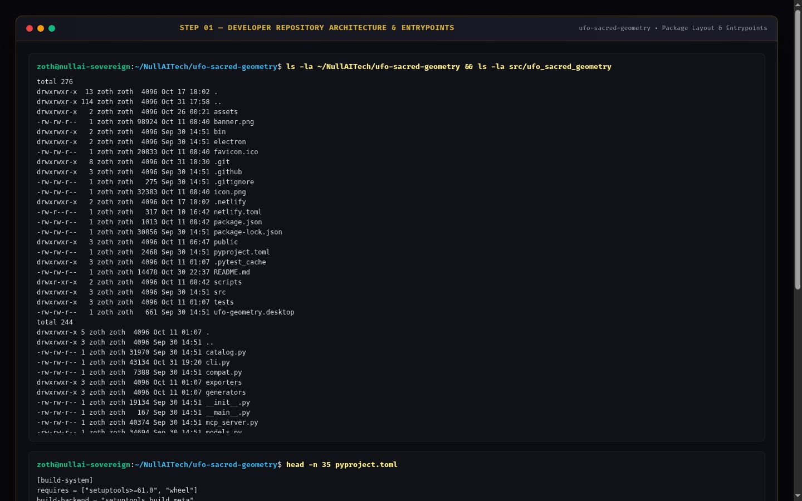

---

### Step 2: Developer Automated Test Suite (`pytest -v`)
Running the 91-test `pytest` suite verifying 2D/3D point projections, Flower of Life family, Metatron's Cube Platonic solids, Sri Yantra 9 interlocking triangles, Wiltshire crop circle Julia sets, Kepler-Poinsot star polyhedra, Solfeggio/Schumann cymatic resonance, SVG/DXF/OBJ exporters, and MCP JSON-RPC protocol handlers.

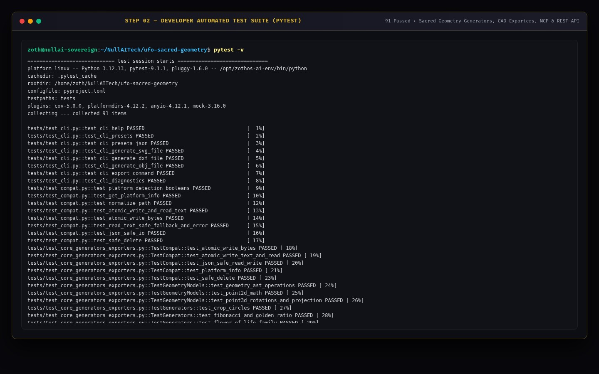

---

### Step 3: Developer REST API & Geometry AST Contract
Querying `GET http://127.0.0.1:8083/api/stats`, `GET http://127.0.0.1:8083/api/diagnostics`, and `POST http://127.0.0.1:8083/api/generate` (`{"pattern": "metatrons_cube", "parameters": {"radius": 45}}`) to verify live AST primitive synthesis and SVG rendering.

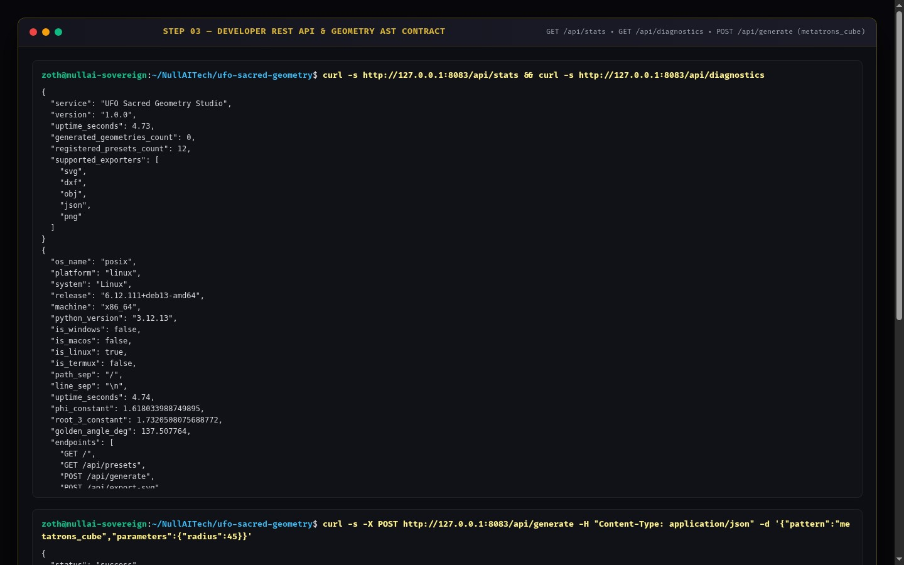

---

### Step 4: End-User CLI Installation & Help Matrix
Verifying global ZothOS binary resolution (`which -a ufo-sacred-geometry`), `ufo-sacred-geometry --status`, and full CLI command documentation (`generate`, `presets`, `export`, `serve`, `mcp`, `doctor`, `test`).

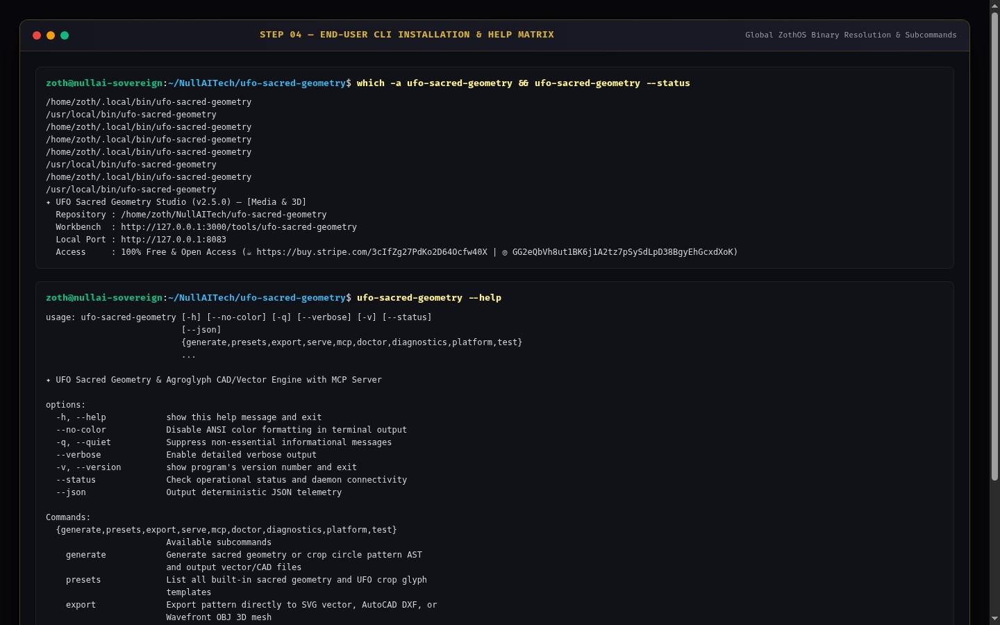

---

### Step 5: End-User CLI Preset Catalog & Diagnostic Doctor
Running `ufo-sacred-geometry presets --no-color` to list all 29 cataloged Sacred Geometry & Crop Circle templates, followed by `ufo-sacred-geometry doctor --no-color` to benchmark Golden Ratio ($\Phi = 1.6180339887$) precision and CAD export throughput.

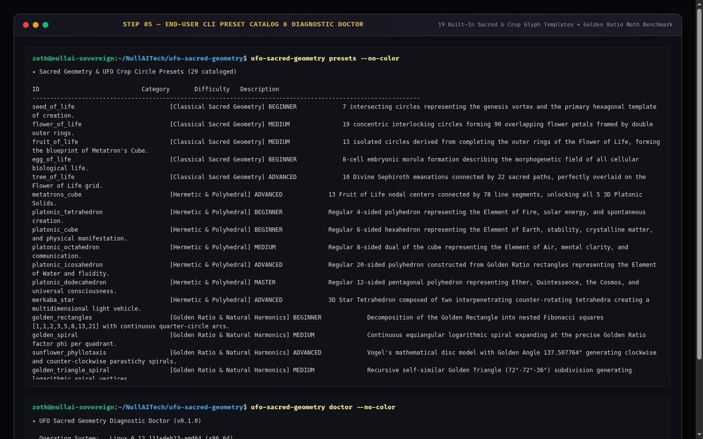

---

### Step 6: End-User CLI Multi-Format CAD Export (`SVG`, `DXF`, `OBJ`) & Self-Test
Exporting `metatrons_cube` to Vector SVG (`/tmp/metatron.svg`), `flower_of_life` to AutoCAD DXF (`/tmp/flower.dxf`), and `merkaba` to 3D Wavefront OBJ (`/tmp/merkaba.obj` — 648 vertices, 387 faces), plus running `ufo-sacred-geometry test`.

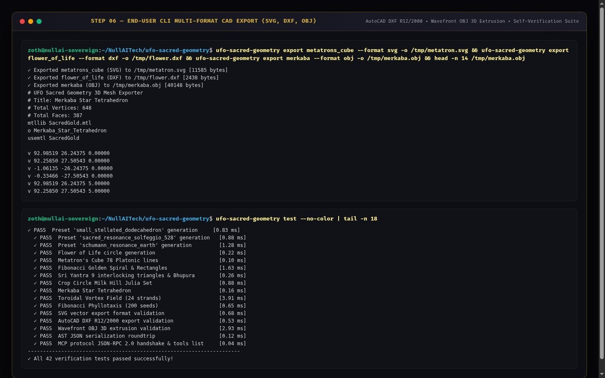

---

### Step 7: Standalone Web Workstation (`:8083`) — Sacred 24K Gold Dark Mode
Loading `http://127.0.0.1:8083` in the 3-pane Sacred Geometry CAD Studio showing the Parametric Generator (`Flower of Life`, `63 Total Elements`, `1008 Vertices`, `D6 Hexagonal Symmetry`), interactive polar SVG viewport, live JSON Abstract Syntax Tree (AST), and 1-Click CAD & 3D Exporters.

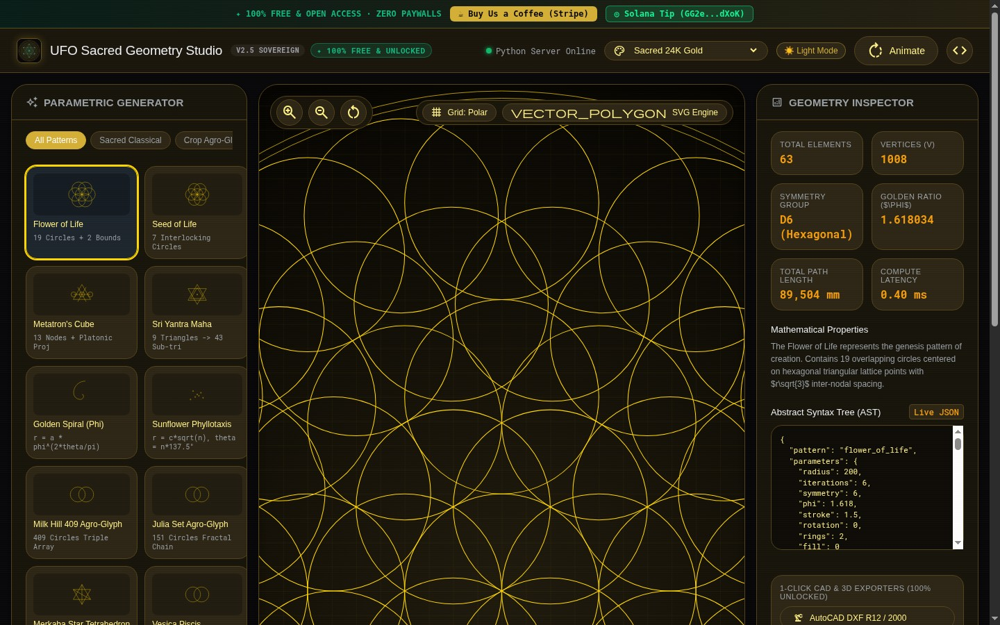

---

### Step 8: Standalone Web Workstation (`:8083`) — Technical Blueprint & Parametric Tuning
Switching to the **Technical Blueprint Blue** theme and tuning parametric radius (`240mm`) with live AST updates and sub-millisecond vector synthesis (`0.10 ms`).

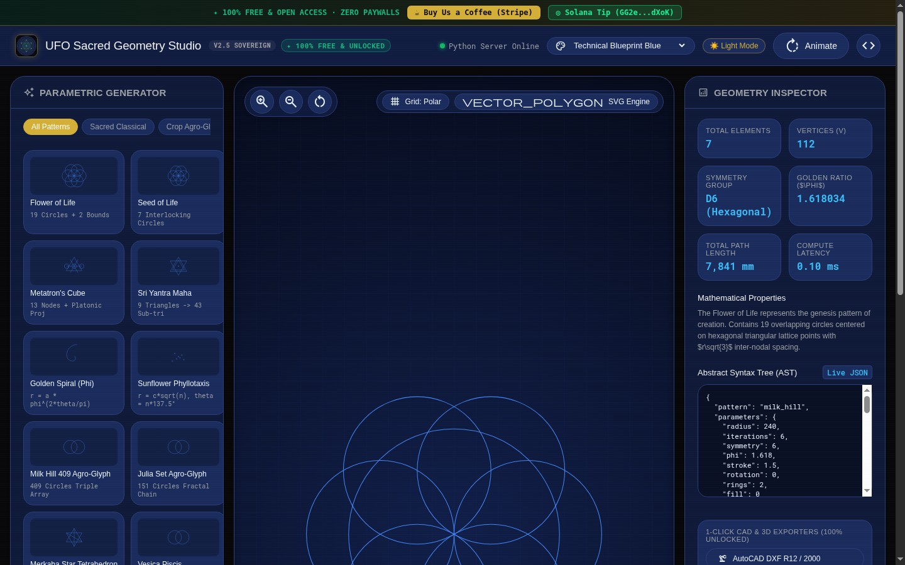

---

### Step 9: Standalone Web Workstation (`:8083`) — Minimalist Editorial Light Mode
Selecting **Metatron's Cube** (`91 Elements`, `364 Vertices`, `35,739 mm Total Path Length`) and toggling **☀️ Light Mode** (`minimalist-light`) to verify crisp dark-ink typography and high-contrast blueprint geometry on warm alabaster surfaces.

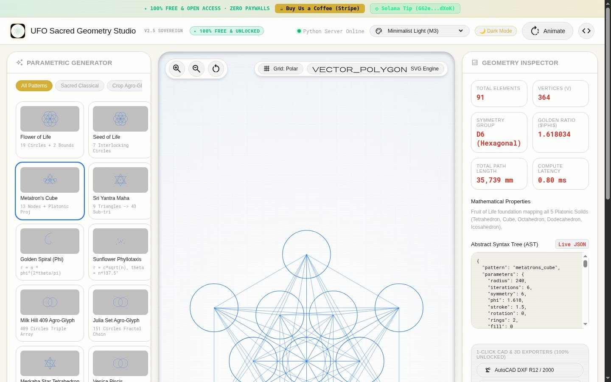

---

### Step 10: Zoth Studio v2 (`:3000`) — God-Mode Overview & Local Enclave Header
Opening `http://127.0.0.1:3000/tools/ufo-sacred-geometry` inside Zoth Studio v2 God-Mode showing local node status (`:8083`), repository clone recipe, and open-access support badges.

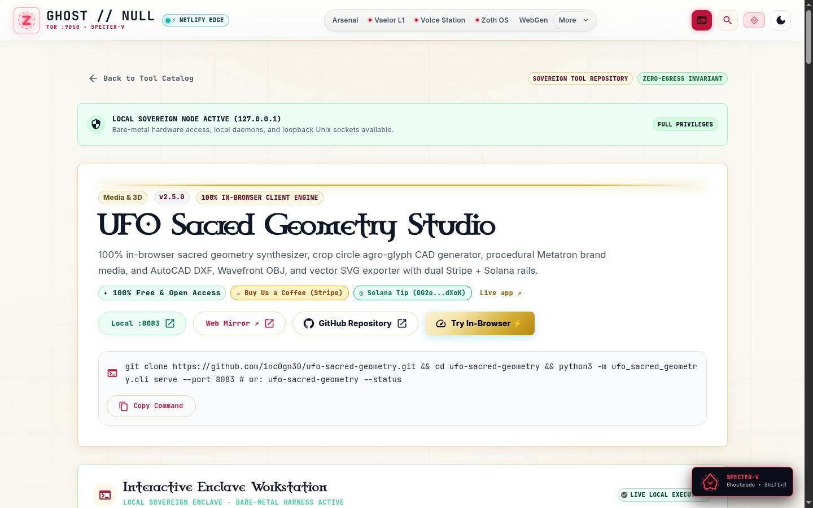

---

### Step 11: Zoth Studio v2 (`:3000`) — Interactive Enclave Workstation & Live CAD Canvas
Scrolling into the embedded **Interactive Enclave Workstation** inside Zoth Studio v2 (`:3000/tools/ufo-sacred-geometry`) with the live Sacred Geometry CAD Studio running directly inside the God-Mode cockpit.

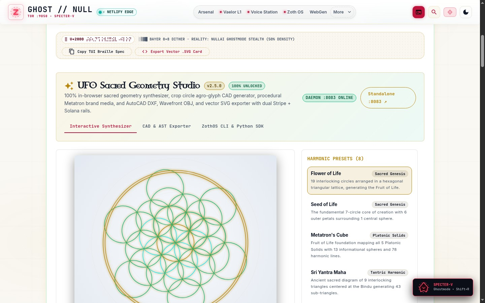

---

### Step 12: Mobile 390px Responsive Workstation Verification (`overflowPx: 0`)
Verifying `http://127.0.0.1:8083` at `390x844` mobile viewport with responsive stacked panels, touch-friendly preset cards, and zero horizontal scroll overflow (`overflowPx === 0`).

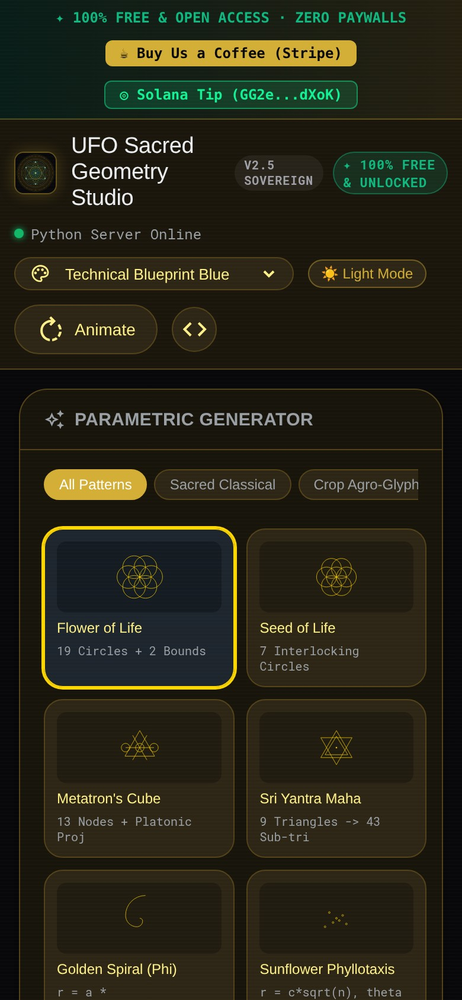

---

## Sovereign 5-Layer Architecture & Second Brain Topology

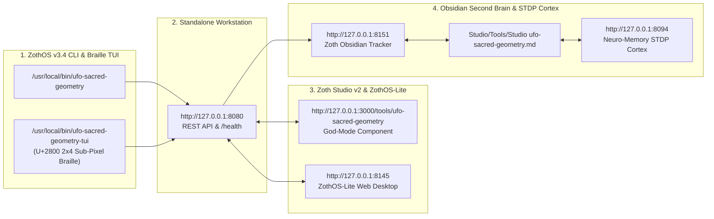

### ZothOS v3.4 TUI & Obsidian Second Brain Sync
- **Unicode `U+2800` Braille TUI**: `ufo-sacred-geometry-tui --status` / `ufo-sacred-geometry-tui --json`
- **Zoth Obsidian Tracker (`:8151`)**: `zoth-obsidian-tracker --verify`
- **Connected Canon Notes**: [[00 Home]] · [[Zoth OS]] · [[Zoth Studio]] · [[ZothOS-Lite Web Desktop]] · [[Zoth Memory]] · [[Public Surfaces]]
