# Vision Gesture Control (`vision-gesture-control`)

> **Touchless 21-Joint 3D Hand Kinematics, Spatial Air Drawing, 13 Real-Time Optical Shaders & MCP Agent Bridge** — Zero-dependency computer vision engine and WebAssembly studio featuring 21-landmark 3D hand classification, OneEuro landmark smoothing, spatial dwell triggers, air-drawing trajectory tracking, 13 live optical shaders, and Model Context Protocol (MCP) JSON-RPC 2.0 agent integration.

---

## Architecture & Verification Summary

- **Repository**: `/home/zoth/NullAITech/vision-gesture-control`
- **Standalone Workstation**: `http://127.0.0.1:8089` (`vision-gesture-control.nullai.tech`)
- **Zoth Studio v2 God-Mode Route**: `http://127.0.0.1:3000/tools/vision-gesture-control`
- **Global CLI Binaries**: `/usr/local/bin/vision-gesture-control` & `/home/zoth/.local/bin/vision-gesture-control`
- **Automated Test Suite**: `216 passed in 1.78s` (`pytest -v` with zero warnings) + `5 passed` built-in self-verification runner (`vision-gesture-control test`)
- **Open-Access Guarantee**: 100% unlocked spatial kinematics dossier export, 3D spatial portal, air-drawing canvas, and MCP tool execution — zero paywall blur filters, zero license modals, zero Solana Tip scripts; includes optional Stripe Coffee (`https://buy.stripe.com/3cIfZg27PdKo2D64Ocfw40X`) and Solana Tip (`GG2eQbVh8ut1BK6j1A2tz7pSySdLpD38BgyEhGcxdXoK`).

---

## Step-by-Step Developer & End-User Walkthrough (12 Verified Screenshots)

### Step 1: Developer Repository Architecture & Entrypoints
Inspecting `/home/zoth/NullAITech/vision-gesture-control` directory structure, `pyproject.toml`, `server.py`, and `src/vision_gesture_control/` (`cli.py`, `compat.py`, `filter_pipeline.py`, `gestures.py`, `mcp_server.py`, `trajectory.py`, `ui_server.py`).

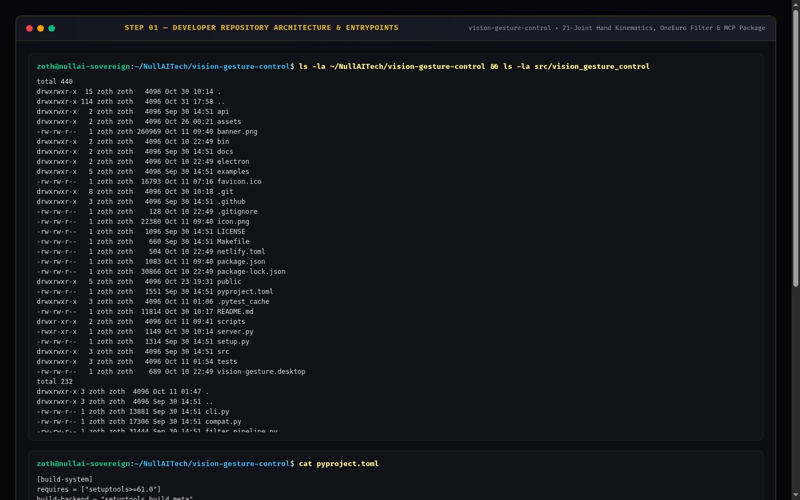

---

### Step 2: Developer Automated Test Suite (`pytest -v`)
Running the full 216-test `pytest` suite verifying 21-joint hand classification, pinch distance math, dwell zone progress, OneEuro 3D smoothing filters, clockwise/counter-clockwise air-drawing trajectory detection, static path-traversal protection, and MCP JSON-RPC 2.0 endpoints.

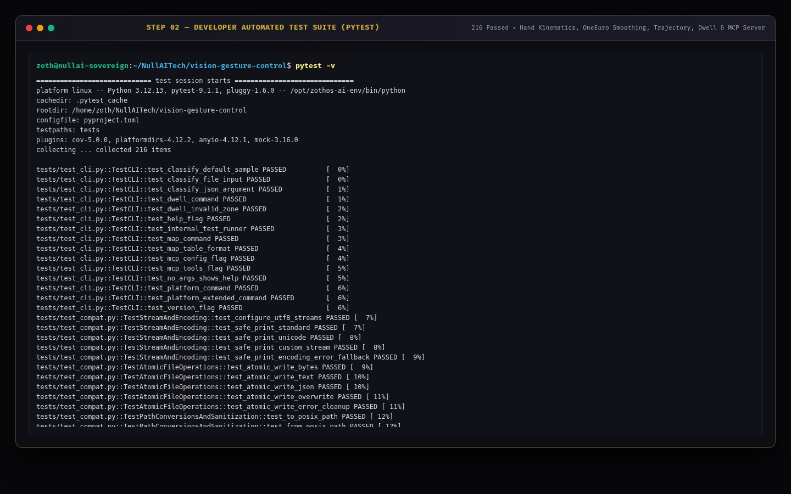

---

### Step 3: Developer REST API & Kinematics Contract
Querying `GET http://127.0.0.1:8089/api/health`, `GET http://127.0.0.1:8089/api/diagnostics` (detecting V4L2 camera devices `/dev/video0` and `/dev/video1`), and `POST http://127.0.0.1:8089/api/dwell` to verify real-time dwell zone evaluation.

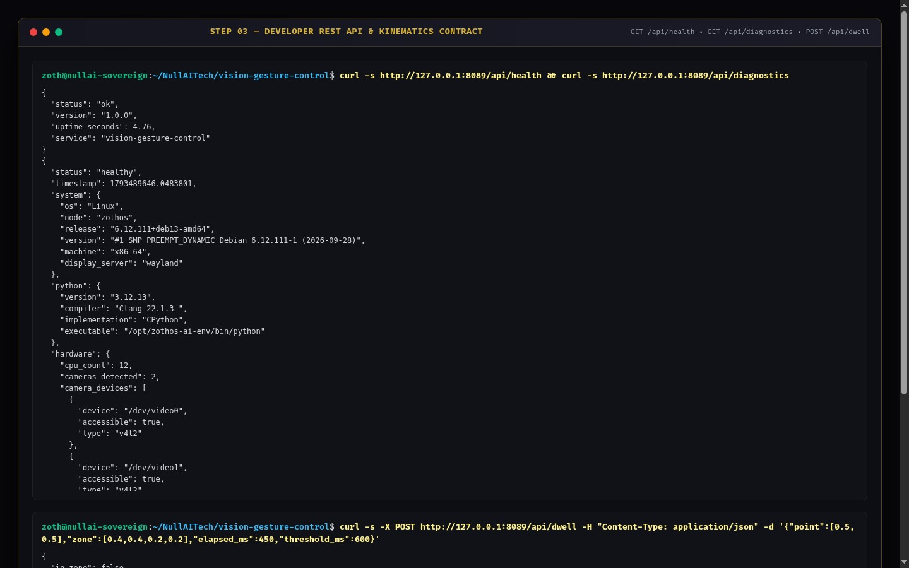

---

### Step 4: End-User CLI Installation & Help Matrix
Verifying global ZothOS binary resolution (`which -a vision-gesture-control`), `--status`, and full CLI subcommand documentation (`serve`, `classify`, `dwell`, `mcp`, `map`, `platform`, `test`).

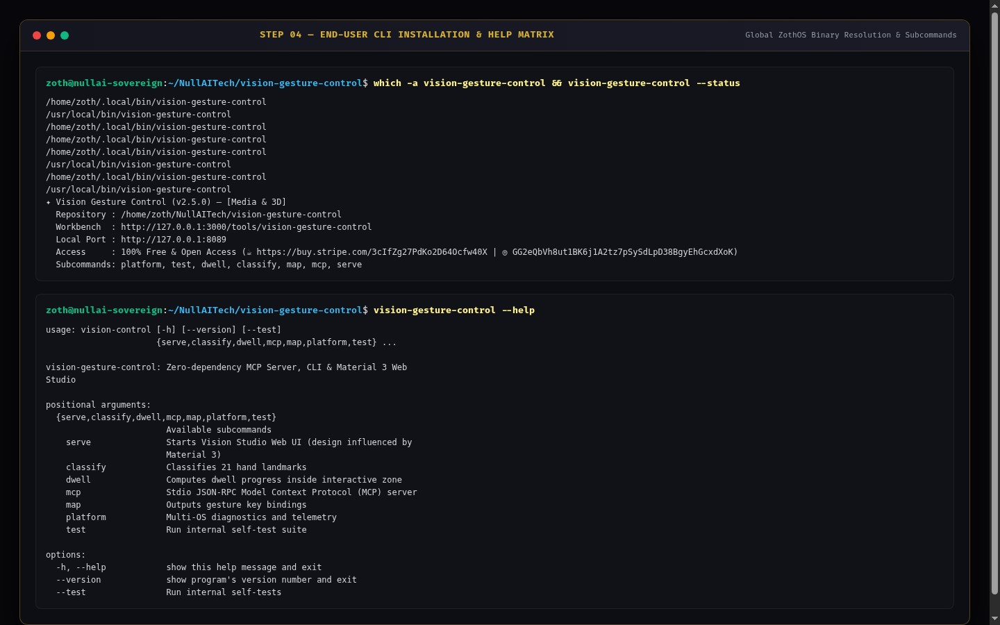

---

### Step 5: End-User CLI 21-Joint Hand Classification & Spatial Dwell
Running `vision-gesture-control classify` to classify 21 3D hand landmarks (`gesture: "open_palm"`, `confidence: 0.98`, finger curl ratios, and pinch distance), followed by `vision-gesture-control dwell --x 0.52 --y 0.48 --zone 0.4,0.4,0.2,0.2 --elapsed 540 --duration 600`.

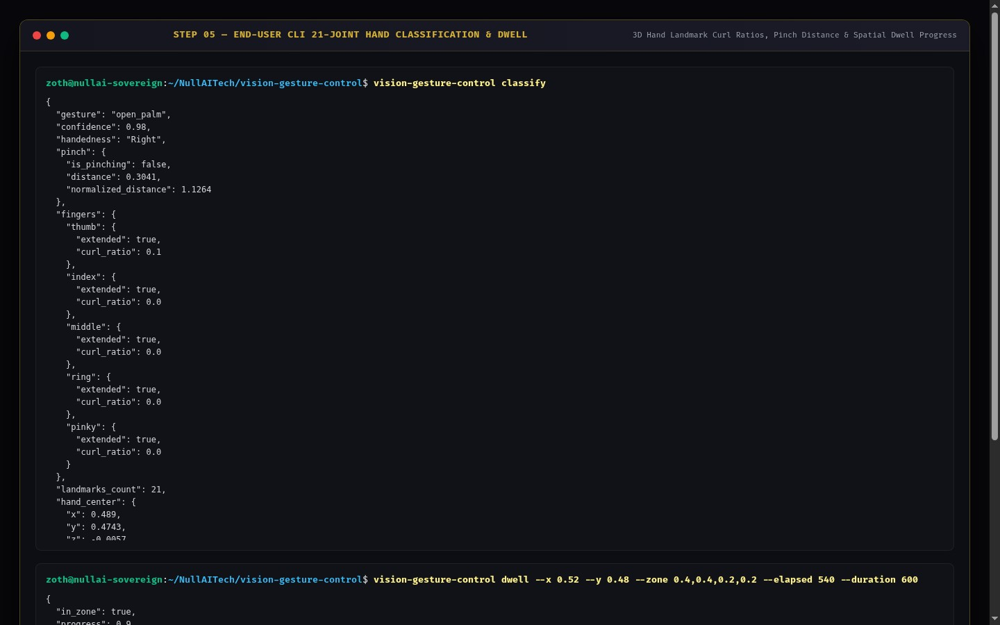

---

### Step 6: End-User CLI Gesture Action Keymap & Self-Test Suite
Running `vision-gesture-control map --preset presentation --format table` to display touchless slide deck key bindings, followed by `vision-gesture-control test` (`Ran 5 tests in 0.001s — OK`).

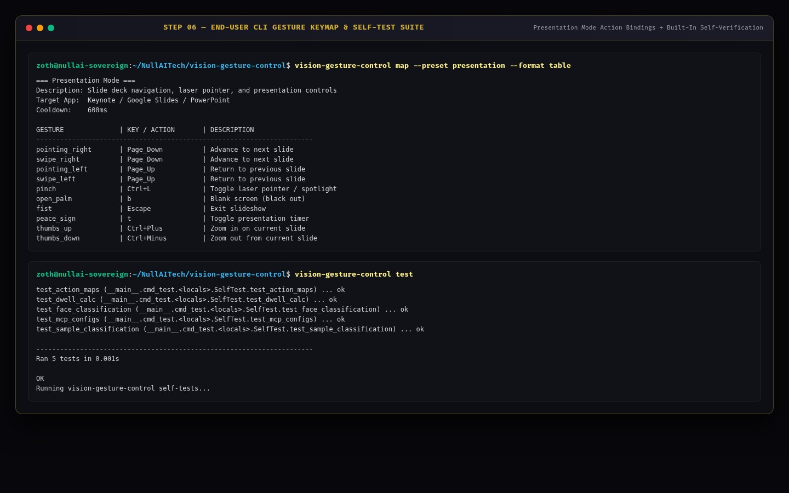

---

### Step 7: Standalone Web Workstation (`:8089`) — Dark Mode Vision Playground & Dual-Hand HUD
Loading `http://127.0.0.1:8089` directly into the Vision Playground showing the 21-joint dual-hand skeleton HUD (`OPEN_PALM`, `60 FPS`, `Conf: 98%`), 13 Live Shaders & Portals, Virtual Hand Simulator, and Dual-Hand Pinch Filter Lens.

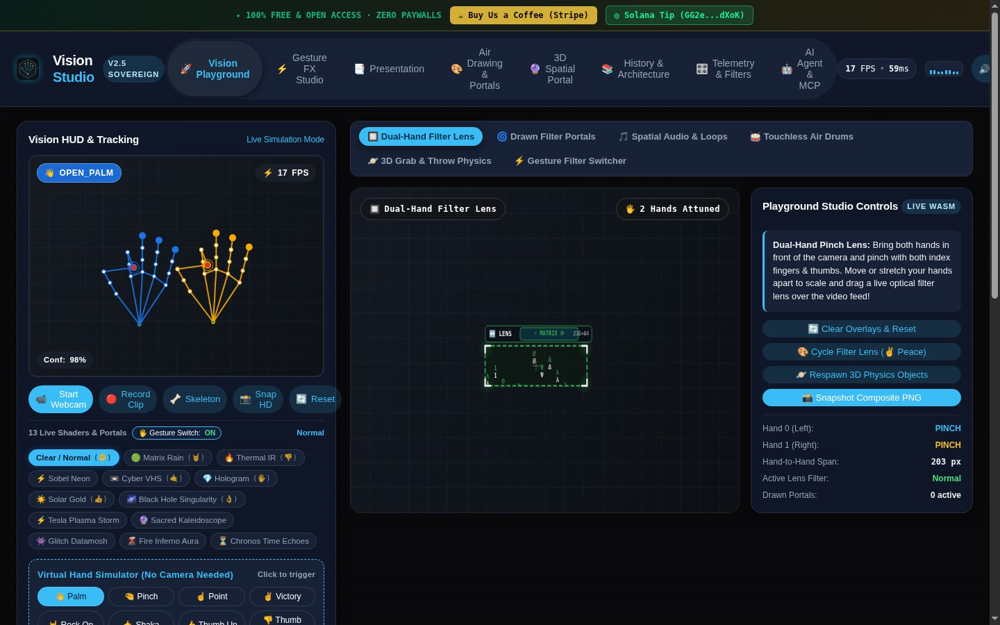

---

### Step 8: Standalone Web Workstation (`:8089`) — Interactive Gesture FX Studio & Particle Spell Casting
Triggering `VICTORY_PEACE` (`✌️ Victory`) in the Virtual Hand Simulator to cycle the optical shader to **Matrix Rain (`🤘`)** and switching to the **⚡ Gesture FX Studio** tab (`Pyrokinesis: Solar Fireball`, Touchless Spatial Hotkeys, and Gesture DJ Filter Sweep).

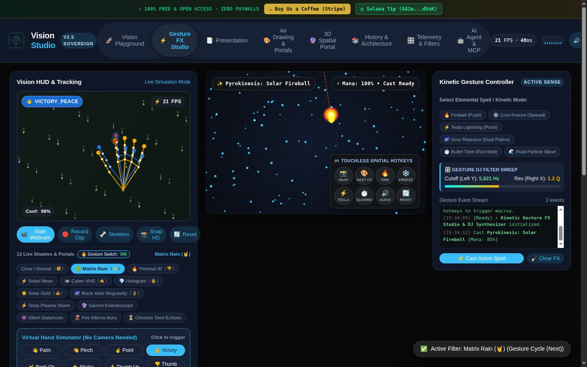

---

### Step 9: Standalone Web Workstation (`:8089`) — Editorial Light Mode & 3D Spatial Portal
Switching to the **🔮 3D Spatial Portal** tab (`Sacred Geometry Matrix` / `Cyber Torus`, Pinch Scale, Hand Tilt 3D Rotation, and `600 Particles`) and toggling **☀️ Light Mode** (`html[data-theme="light"]`).

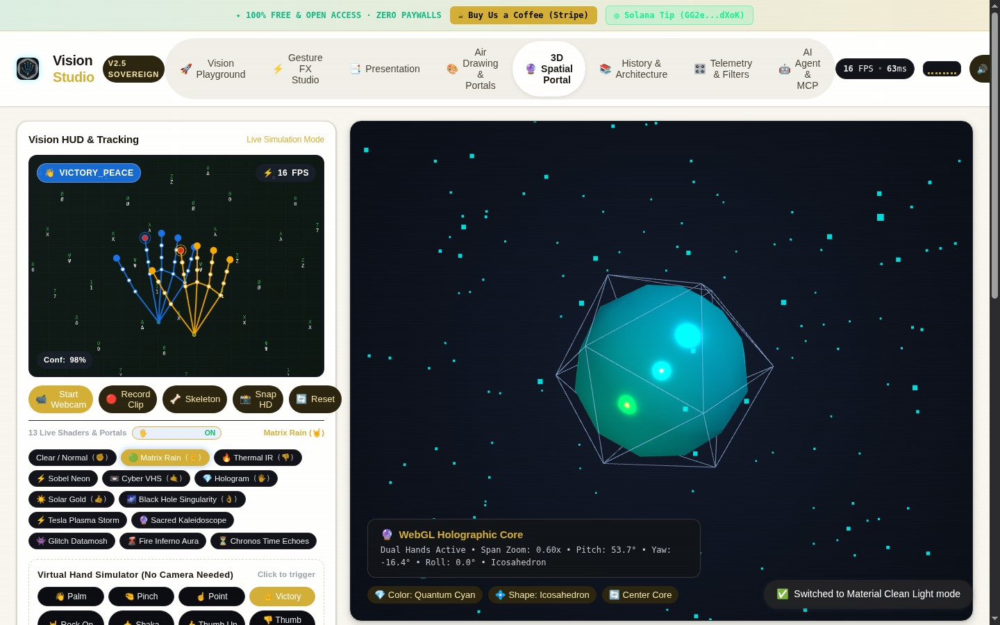

---

### Step 10: Zoth Studio v2 (`:3000`) — God-Mode Overview & Local Enclave Header
Opening `http://127.0.0.1:3000/tools/vision-gesture-control` inside Zoth Studio v2 God-Mode showing local node status (`:8089`), repository clone recipe, and open-access support badges.

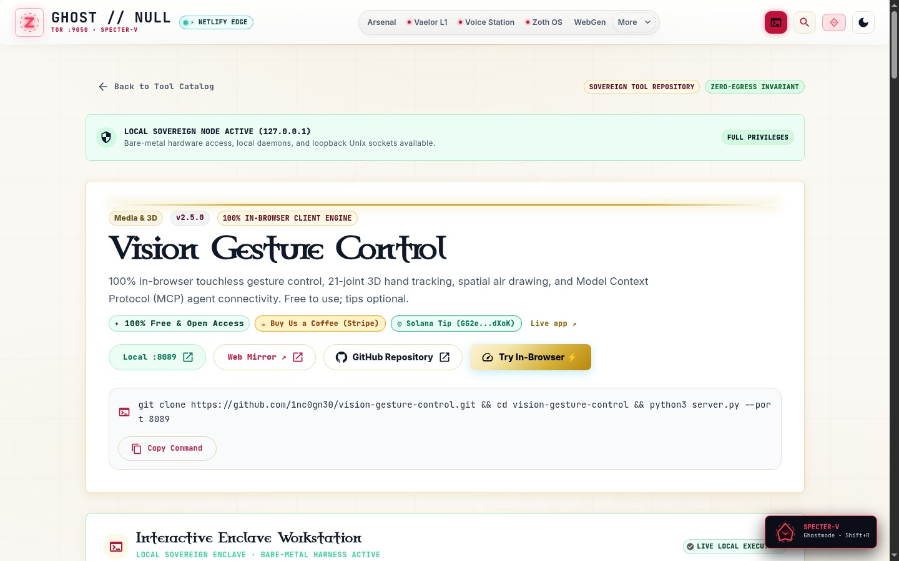

---

### Step 11: Zoth Studio v2 (`:3000`) — Interactive 21-Joint Hand Kinematics Stage
Scrolling into the embedded **Interactive Enclave Workstation** inside Zoth Studio v2 (`:3000/tools/vision-gesture-control`) featuring the 60fps 21-Joint Hand Skeleton stage, 68-Point Facial Mesh & Viseme Lip-Sync toggle, and ZothOS KWin Gesture Bindings.

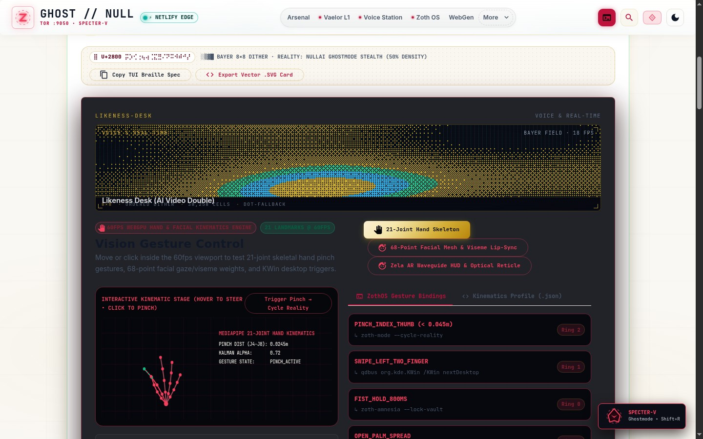

---

### Step 12: Mobile 390px Responsive Workstation Verification (`overflowPx: 0`)
Verifying `http://127.0.0.1:8089` at `390x844` mobile viewport with responsive stacked cards, touch-friendly controls, and zero horizontal scroll overflow (`overflowPx === 0`).

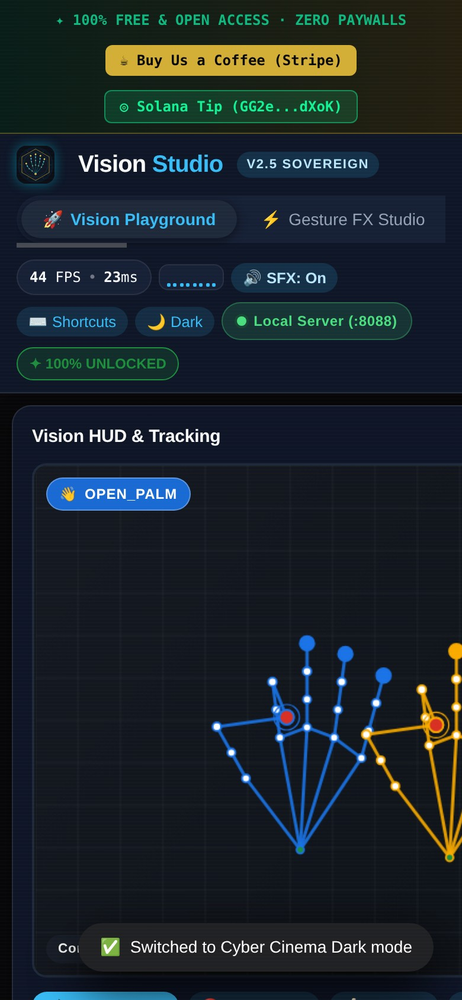

---

## Sovereign 5-Layer Architecture & Second Brain Topology

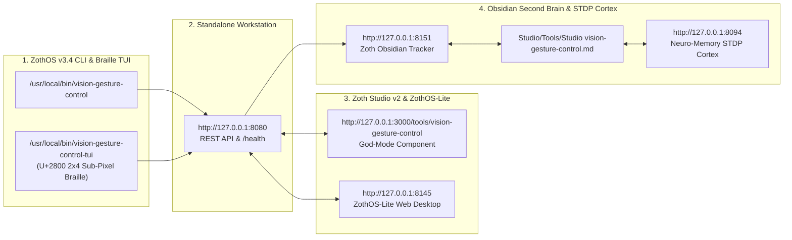

### ZothOS v3.4 TUI & Obsidian Second Brain Sync
- **Unicode `U+2800` Braille TUI**: `vision-gesture-control-tui --status` / `vision-gesture-control-tui --json`
- **Zoth Obsidian Tracker (`:8151`)**: `zoth-obsidian-tracker --verify`
- **Connected Canon Notes**: [[00 Home]] · [[Zoth OS]] · [[Zoth Studio]] · [[ZothOS-Lite Web Desktop]] · [[Zoth Memory]] · [[Public Surfaces]]
