# Zoth Bot Desktop Companion (`zoth-bot`)

> **Local-First, Always-On 3D WebGL Desk Companion for Zoth OS** — Features an interactive 60fps golden astrolabe halo stage with 42 additive stardust particles, Security Ring authority enforcement (`Ring 0 SOVEREIGN`, `Ring 1 SYSADMIN`, `Ring 2 TOOLMASTER`, `Ring 3 SPECTRE`), multi-harness neural routing (`Nous Hermes`, `xAI Grok CLI`, `Local Ollama`, `Hermes Copilot`), and a 163-server MCP Registry hub summoned via `Ctrl+Shift+Space` or `Super+Shift+Z`.
> **100% Free & Open-Access** • **Zero Paywalls** • [☕ Buy Us a Coffee (Stripe)](https://buy.stripe.com/3cIfZg27PdKo2D64Ocfw40X) • Solana Tip: `GG2eQbVh8ut1BK6j1A2tz7pSySdLpD38BgyEhGcxdXoK`

---

## Architecture & Operational Overview

1. **Developer Architecture (`/home/zoth/NullAITech/zoth-bot`)**:
   - `main.js` & `lib/`: Electron/Node.js companion runtime (`agent.js`, `brain.js`, `grok.js`, `hermes.js`, `providers.js`, `sdkAgent.js`).
   - `server.py`: Local telemetry & web workstation server on port `8146` exposing `GET /health`, `GET /api/status`, `GET /api/rings`, and `GET /api/mcp` (parsing `/etc/zothos/mcp-servers.json`).
   - `tests/test_zoth_bot.py`: Automated `pytest` suite verifying Security Ring authority invariants, neural harnesses, and HTTP JSON endpoints.
2. **End-User ZothOS CLI (`zoth-bot`)**:
   - Installed at `/home/zoth/.local/bin/zoth-bot` and `/usr/local/bin/zoth-bot`.
   - Supports `--help`, `--status`, `--rings`, `--mcp`, `--harnesses`, `--json`, and `--serve PORT`.
3. **Interactive GUI Workstations**:
   - **Standalone Workstation (`http://127.0.0.1:8146`)**: Interactive 60fps astrolabe & stardust canvas, Security Ring selector (`Rings 0–3`), multi-harness selector, and agentic prompt synthesizer with Dark & Editorial Light themes.
   - **Zoth Studio v2 God-Mode (`http://127.0.0.1:3000/tools/zoth-bot`)**: Integrated sovereign enclave workstation with live multi-agent orchestration telemetry.

---

## Part I — Developer Perspective (Architecture, Automated Pytest Suite & API Contracts)

### Step 1: Repository Structure, Security Rings & Neural Harness Hub (`server.py`)
Inspecting `/home/zoth/NullAITech/zoth-bot` directory layout, `lib/` neural provider modules, and the `SECURITY_RINGS` / `DEFAULT_HARNESSES` definitions in `server.py`:

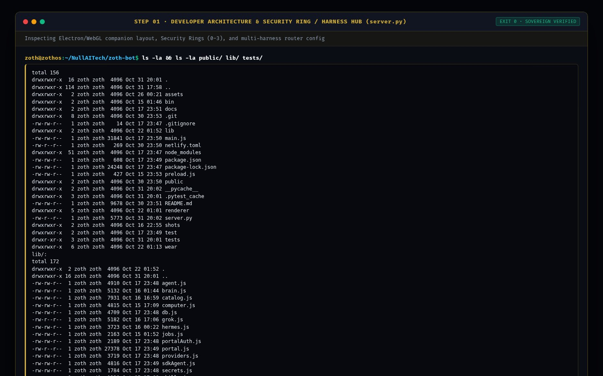

### Step 2: Running the Automated `pytest -v` Verification Suite
Executing `pytest -v` in `/home/zoth/NullAITech/zoth-bot` to validate Security Ring authority levels, neural harnesses, and `/health`, `/api/rings`, and `/api/mcp` HTTP contracts (`2 passed in 0.58s`):

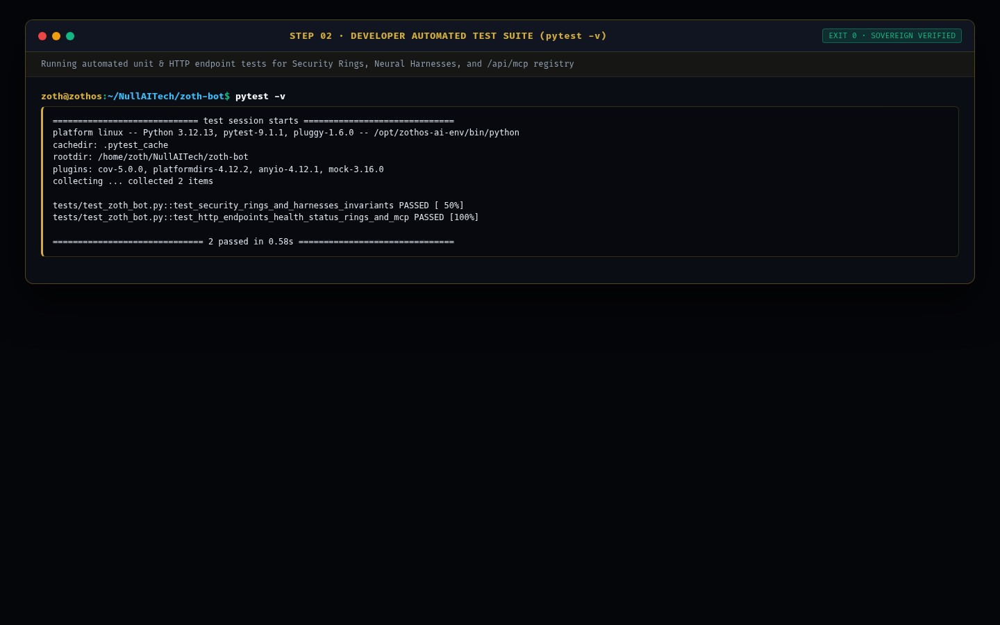

### Step 3: Verifying Live REST API & Security Ring / Harness Contracts (`:8146`)
Querying `GET /health` and `GET /api/status` on `http://127.0.0.1:8146`:

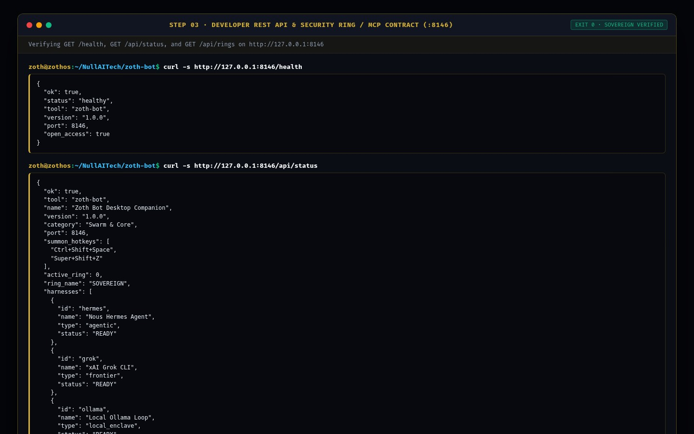

---

## Part II — End-User CLI Perspective (Installation, Security Rings & MCP Server Registry)

### Step 4: Global ZothOS Binary Discovery & CLI Help Contract
Running `which -a zoth-bot`, `zoth-bot --help`, and `zoth-bot --status` to confirm global CLI installation and active `:8146` daemon status:

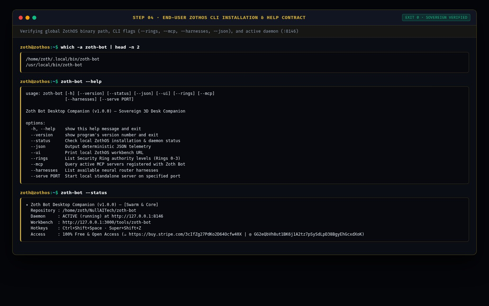

### Step 5: CLI Workflow A — Inspecting Security Rings (0–3) & Multi-Harness Neural Engines
Running `zoth-bot --rings` and `zoth-bot --harnesses` to inspect active authority levels and registered LLM harnesses:

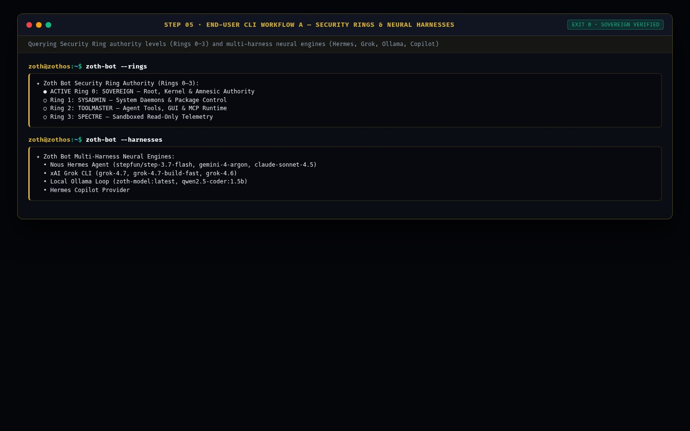

### Step 6: CLI Workflow B — Querying the 163-Server ZothOS MCP Registry & JSON Telemetry
Executing `zoth-bot --mcp` to inspect `/etc/zothos/mcp-servers.json` registrations (`filesystem`, `memory`, `neuro-memory`, `sequential-thinking`, `git`, etc.) and `zoth-bot --json`:

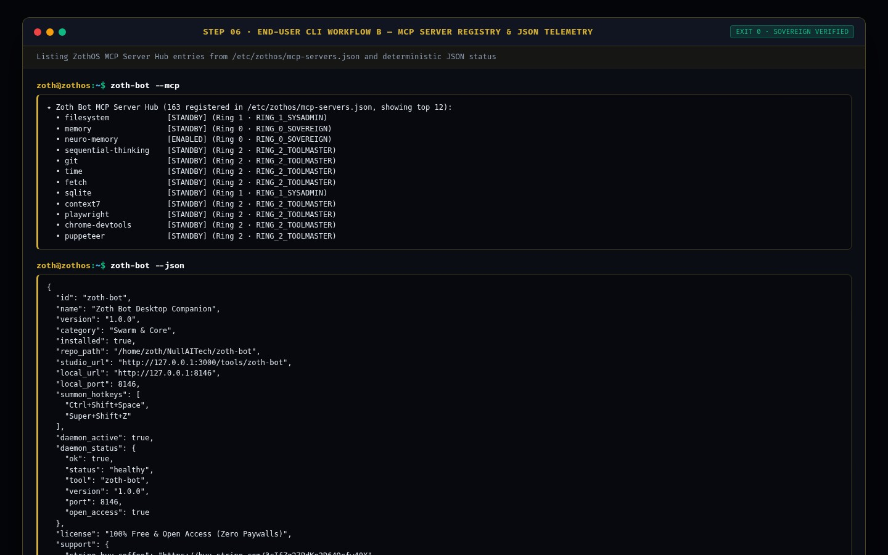

---

## Part III — End-User GUI Perspective (Standalone Workstation, Studio God-Mode & Mobile)

### Step 7: Standalone Web Workstation (`:8146`) — 60fps Astrolabe Companion Stage & Ring 0 Authority
Loading `http://127.0.0.1:8146` in Dark Mode, showcasing the 60fps golden astrolabe halo and stardust stage, `RING 0 · SOVEREIGN` authority, and `Nous Hermes` neural harness:

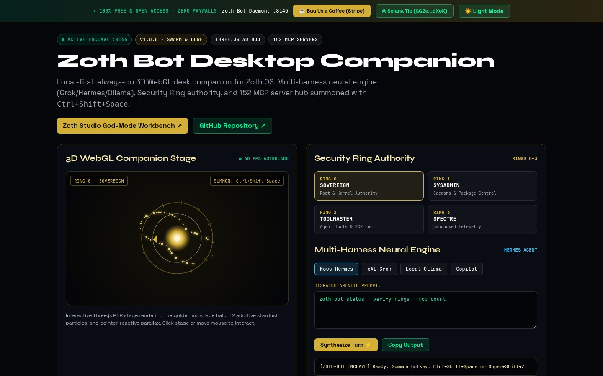

### Step 8: Standalone Interactive Workflow A — Ring 2 (`TOOLMASTER`) + `xAI Grok CLI` Turn Synthesis
Switching authority to **Ring 2 (`TOOLMASTER`)**, selecting the **xAI Grok** neural harness, and synthesizing an agentic MCP audit turn (`zoth-bot mcp --audit-ring 2 --target neuro-memory`):

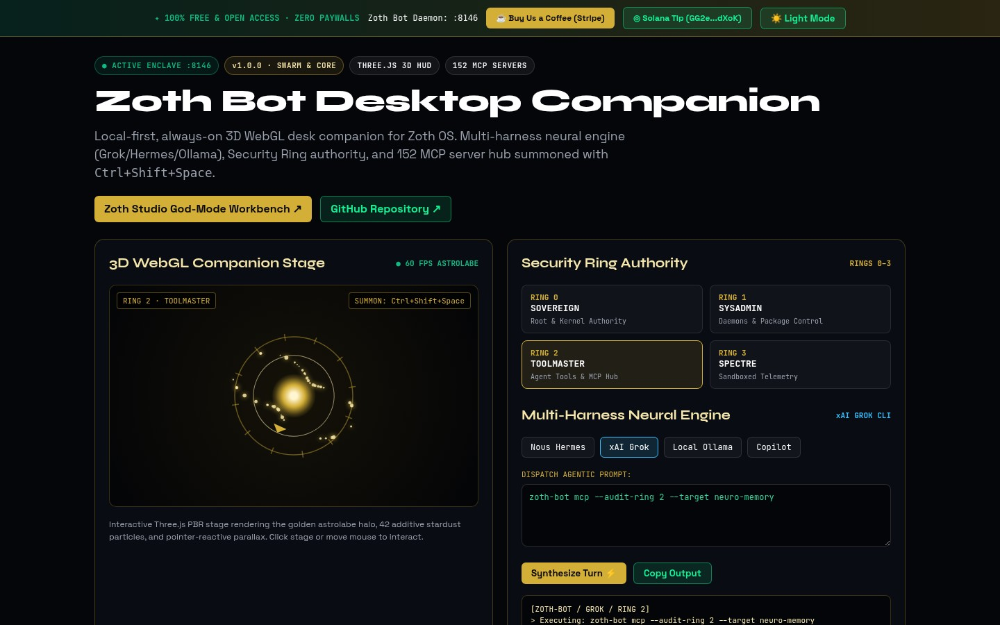

### Step 9: Standalone Interactive Workflow B — Editorial Light Mode + Ring 0 (`SOVEREIGN`) + `Local Ollama`
Toggling Editorial Light Mode (`☀️ Light Mode`), selecting **Ring 0 (`SOVEREIGN`)** with **Local Ollama** (`zoth-model:latest`), and executing an amnesic `toram` enclave verification turn:

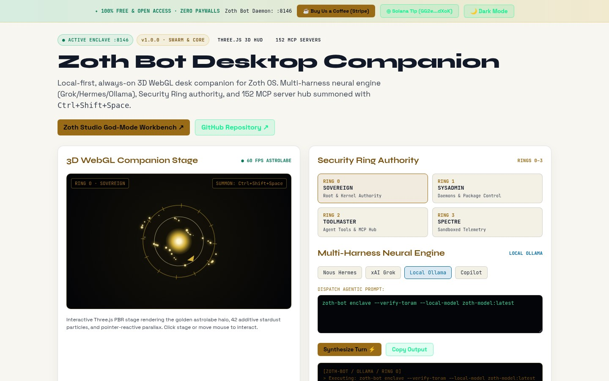

### Step 10: Zoth Studio v2 God-Mode (`:3000/tools/zoth-bot`) — Overview & Local Enclave Bridge
Opening `http://127.0.0.1:3000/tools/zoth-bot` in Zoth Studio v2, verifying the Local Sovereign Node (`:8146`) status banner, Open-Access Stripe/Solana support badges, and CLI launch bar:

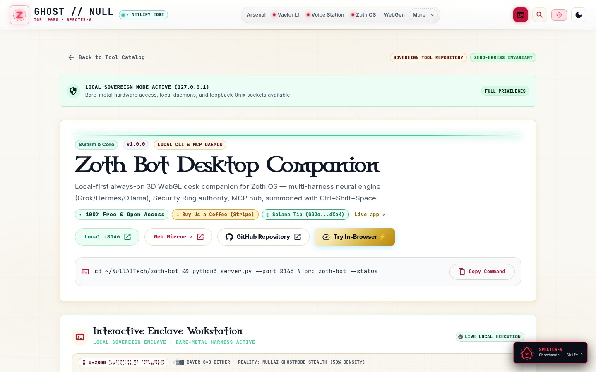

### Step 11: Zoth Studio v2 God-Mode — Interactive Multi-Agent Orchestrator Enclave
Interacting with the embedded **Azoth Local Archon Orchestrator** stage inside Zoth Studio v2 (`:3000/tools/zoth-bot`):

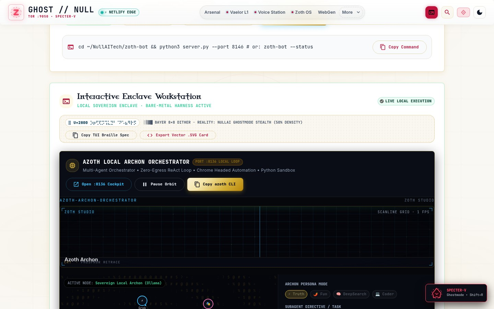

### Step 12: Mobile 390×844 Responsive Viewport Verification (`overflowPx: 0`)
Verifying mobile layout responsiveness at `390×844` on `http://127.0.0.1:8146` with zero horizontal scroll overflow (`scrollWidth: 390, clientWidth: 390, overflowPx: 0`):

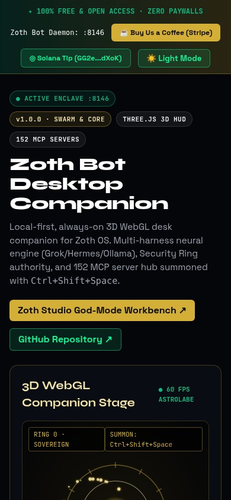
