# Zoth Bounty Research Hub (`zoth-bounty`)

> **Zero-False-Positive Security Research, Responsible Disclosure & Communications Command Center** — Tracks 24 security audits across `Pending (Disclosed)`, `Ongoing`, `Completed / Cleared`, and `Possible (Held Back by Skepticism Filter)` alongside Thunderbird/GHSA disclosure logs and a built-in Thermal Governor (`nice -n 19 ionice -c 3`, CPU `< 68°C`) static sink scanner.
> **100% Free & Open-Access** • **Zero Paywalls** • [☕ Buy Us a Coffee (Stripe)](https://buy.stripe.com/3cIfZg27PdKo2D64Ocfw40X) • Solana Tip: `GG2eQbVh8ut1BK6j1A2tz7pSySdLpD38BgyEhGcxdXoK`

---

## Architecture & Operational Overview

1. **Developer Architecture (`/home/zoth/NullAITech/zoth-bounty`)**:
   - `server.js`: Zero-dependency Node.js HTTP server on port `9494` managing `data/bounties.json`, `data/communications.json`, live CPU thermal polling (`getThermals()`), Thunderbird SQLite inbox sync (`getThunderbirdRecent()`), and `runCoolStaticScan()`.
   - `sync_docs.js`: Synchronizes JSON bounty findings and communications into structured Markdown reports under `docs/`.
   - `tests/test_zoth_bounty.py`: Automated `pytest` suite verifying bounty/communication data invariants and HTTP `/health`, `/api/status`, and `/api/state` endpoints.
2. **End-User ZothOS CLI (`zoth-bounty`)**:
   - Installed at `/home/zoth/.local/bin/zoth-bounty` and `/usr/local/bin/zoth-bounty`.
   - Supports `--help`, `--status`, `--list`, `--category {ongoing,pending,completed,possible}`, `--thermals`, `--json`, and `--serve PORT`.
3. **Interactive GUI Workstations**:
   - **Standalone Workstation (`http://127.0.0.1:9494`)**: Multi-category audit tracker (`Pending`, `Ongoing`, `Completed`, `Possible`, `Communications Log`), Cool-Mode Static Scanner (`nice -n 19`), and Dark/Light themes.
   - **Zoth Studio v2 God-Mode (`http://127.0.0.1:3000/tools/zoth-bounty`)**: Integrated sovereign security enclave with perimeter socket & CVE radar.

---

## Part I — Developer Perspective (Architecture, Automated Pytest Suite & API Contracts)

### Step 1: Repository Structure & Thermal Governor Sink Engine (`server.js`)
Inspecting `/home/zoth/NullAITech/zoth-bounty` directory layout, `data/bounties.json`, `data/communications.json`, and `getThermals()` in `server.js`:

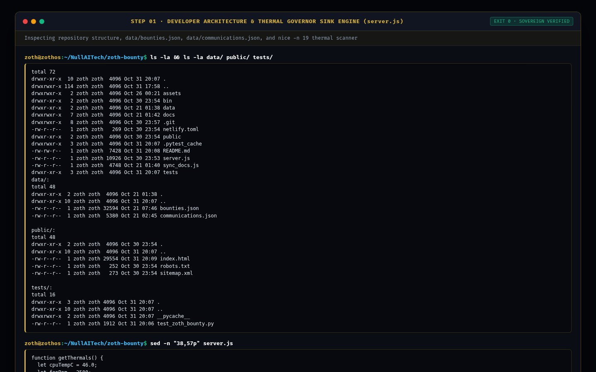

### Step 2: Running the Automated `pytest -v` Verification Suite
Executing `pytest -v` in `/home/zoth/NullAITech/zoth-bounty` to verify bounty dataset invariants and `/health` + `/api/state` HTTP contracts (`2 passed in 0.20s`):

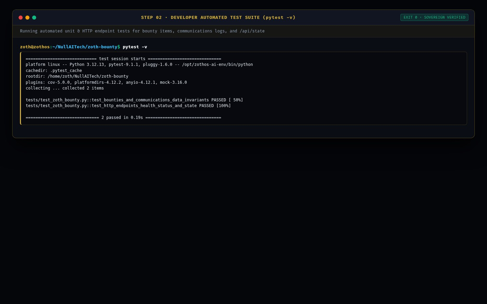

### Step 3: Verifying Live REST API & Bounty Telemetry Contracts (`:9494`)
Querying `GET /health` and `GET /api/status` on `http://127.0.0.1:9494`:

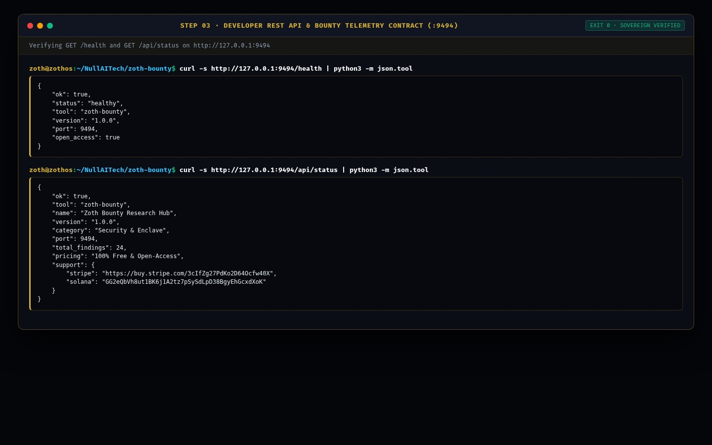

---

## Part II — End-User CLI Perspective (Installation, Category Filtering & Thermal Telemetry)

### Step 4: Global ZothOS Binary Discovery & CLI Help Contract
Running `which -a zoth-bounty`, `zoth-bounty --help`, and `zoth-bounty --status` to confirm global CLI installation and active `:9494` daemon status:

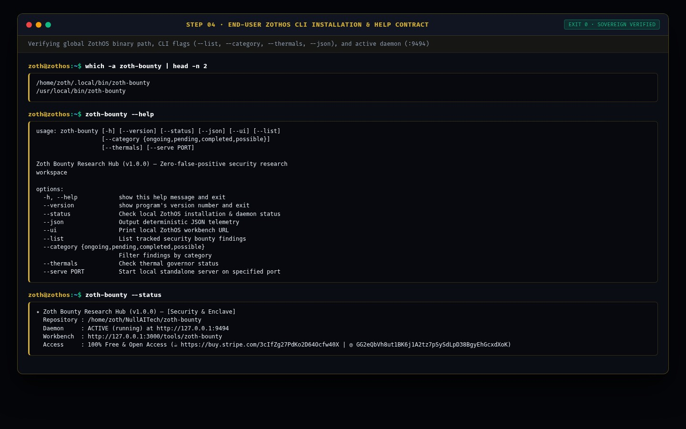

### Step 5: CLI Workflow A — Filtering `Pending (Disclosed)` & `Ongoing` Findings + Thermal Check
Running `zoth-bounty --category pending`, `zoth-bounty --category ongoing`, and `zoth-bounty --thermals`:

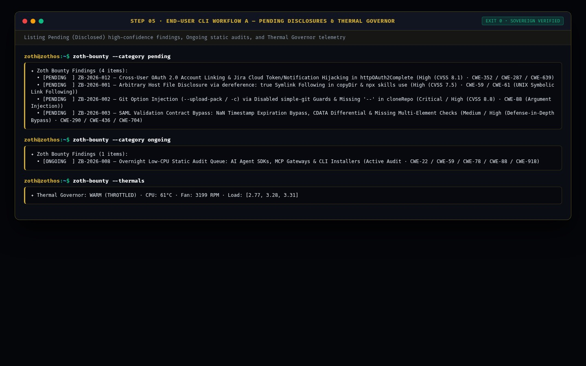

### Step 6: CLI Workflow B — Machine-Readable JSON Telemetry & Pending Findings Export
Executing `zoth-bounty --json` and `zoth-bounty --category pending --json` for automated security pipeline ingestion:

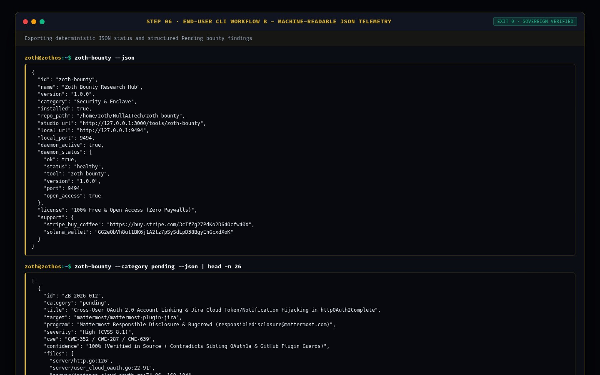

---

## Part III — End-User GUI Perspective (Standalone Workstation, Studio God-Mode & Mobile)

### Step 7: Standalone Web Workstation (`:9494`) — Zero-False-Positive Security Research Dashboard
Loading `http://127.0.0.1:9494` in Dark Mode, displaying live CPU thermal telemetry, category summary cards (`4 Pending`, `1 Ongoing`, `18 Completed`, `1 Possible`, `6 Communications`), and detailed root-cause/triager-skepticism verification cards:

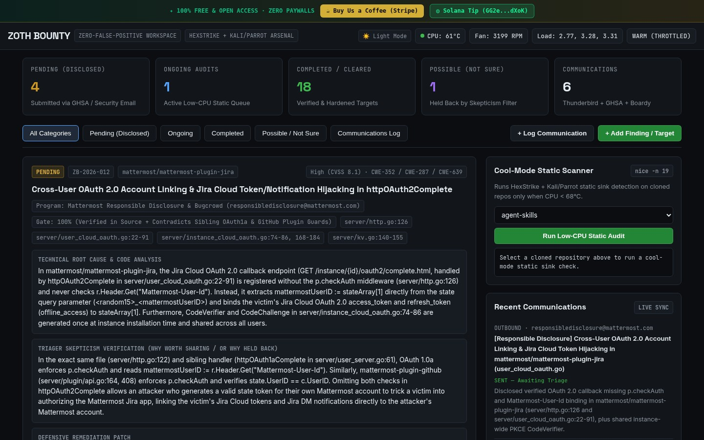

### Step 8: Standalone Interactive Workflow A — Filtering `Pending (Disclosed)` + Cool-Mode Static Audit
Filtering to **Pending (Disclosed)** findings (`ZB-2026-012` Mattermost Jira OAuth 2.0 callback) and executing a `nice -n 19` **Low-CPU Static Audit** on `agent-skills` (`[Repo: agent-skills | Hits: 4]`):

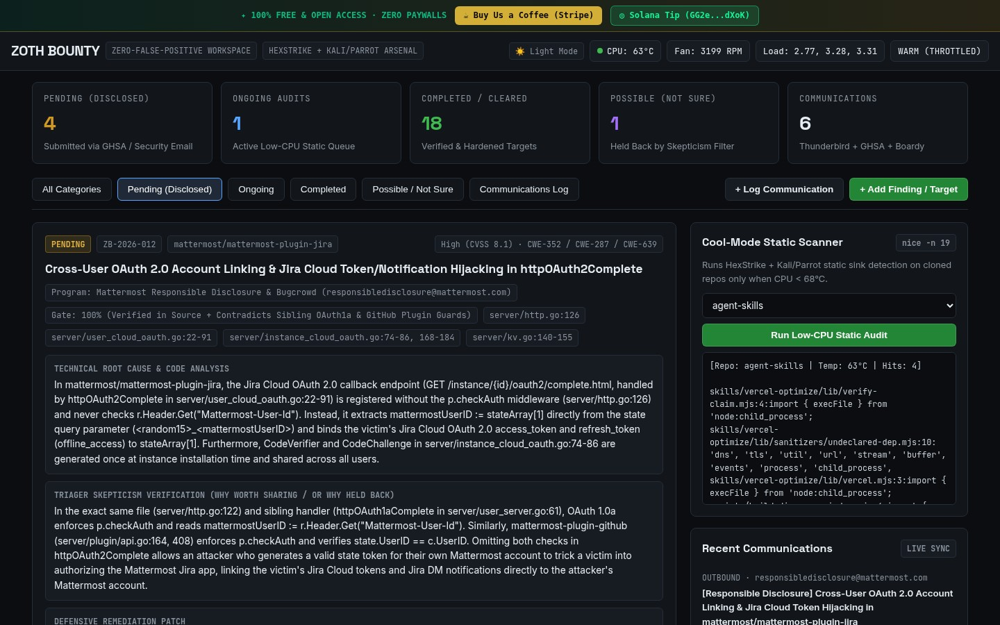

### Step 9: Standalone Interactive Workflow B — Editorial Light Mode & Responsible Disclosure Communications Log
Toggling Editorial Light Mode (`☀️ Light Mode`) and switching to the **Communications Log** tab to inspect outbound responsible disclosure emails (`COMM-2026-006`) and static scanner results:

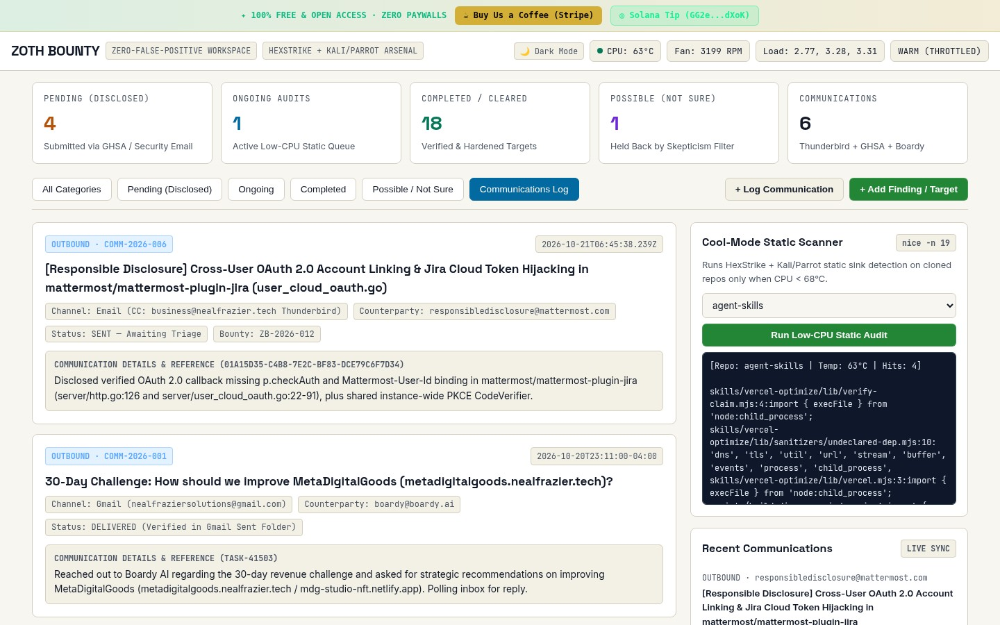

### Step 10: Zoth Studio v2 God-Mode (`:3000/tools/zoth-bounty`) — Overview & Local Enclave Bridge
Opening `http://127.0.0.1:3000/tools/zoth-bounty` in Zoth Studio v2, verifying the Local Sovereign Node (`:9494`) status banner, Open-Access Stripe/Solana support badges, and CLI launch bar:

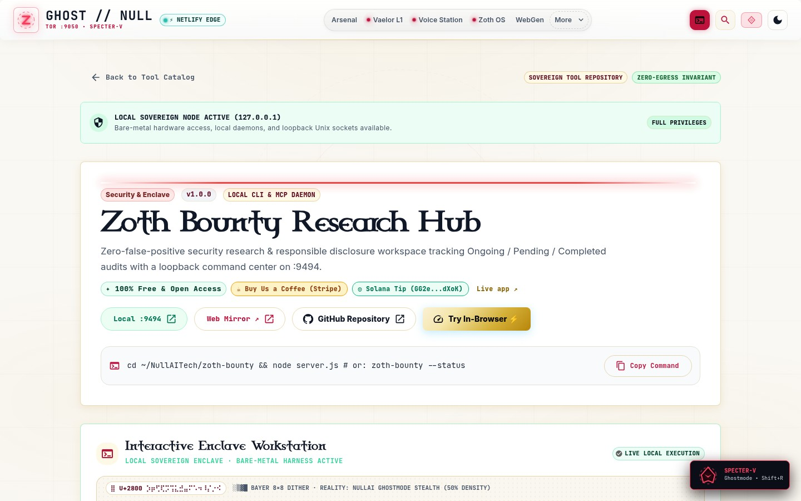

### Step 11: Zoth Studio v2 God-Mode — Interactive Perimeter Socket & CVE Radar Enclave
Interacting with the embedded security enclave workstation inside Zoth Studio v2 (`:3000/tools/zoth-bounty`):

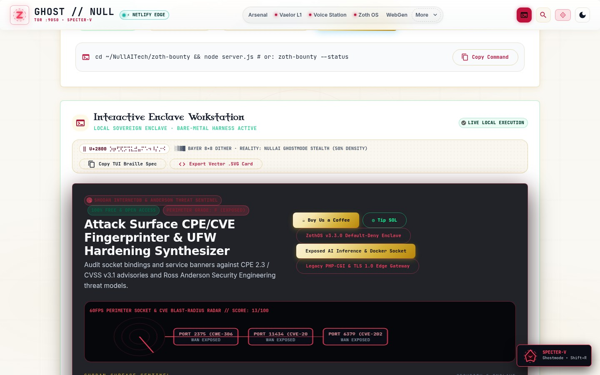

### Step 12: Mobile 390×844 Responsive Viewport Verification (`overflowPx: 0`)
Verifying mobile layout responsiveness at `390×844` on `http://127.0.0.1:9494` with zero horizontal scroll overflow (`scrollWidth: 390, clientWidth: 390, overflowPx: 0`):

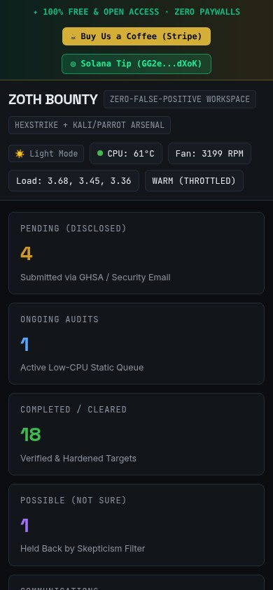

---

## Sovereign 5-Layer Architecture & Second Brain Topology

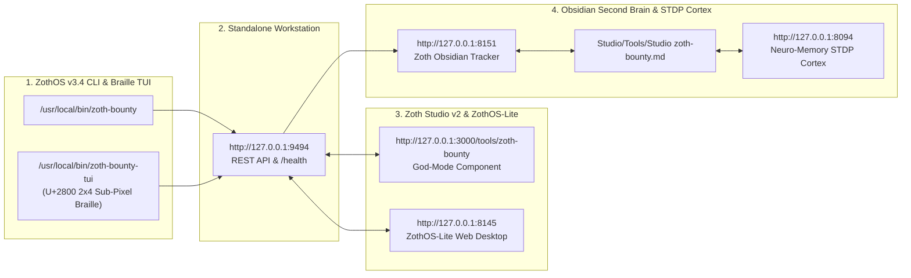

### ZothOS v3.4 TUI & Obsidian Second Brain Sync
- **Unicode `U+2800` Braille TUI**: `zoth-bounty-tui --status` / `zoth-bounty-tui --json`
- **Zoth Obsidian Tracker (`:8151`)**: `zoth-obsidian-tracker --verify`
- **Connected Canon Notes**: [[00 Home]] · [[Zoth OS]] · [[Zoth Studio]] · [[ZothOS-Lite Web Desktop]] · [[Zoth Memory]] · [[Public Surfaces]]
