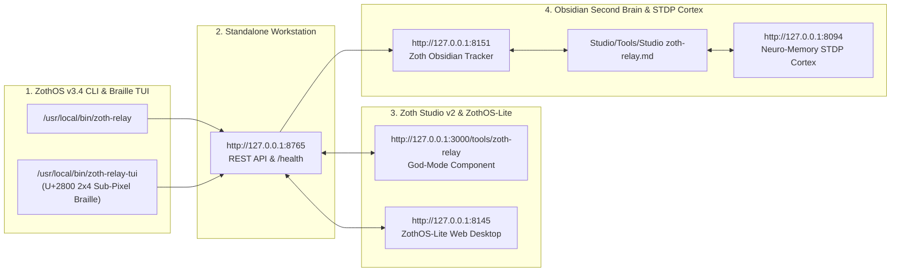

# Zoth Relay (`zoth-relay`) — Complete Developer & End-User Walkthrough

> **100% Free & Open-Access Sovereign Tool** — Zero paywalls, zero blur locks, zero feature gates. Built by **1nc0gn30 • NullAI (`@1nc0gn30`) • NullAI Platform**. Support via [Stripe Buy Us a Coffee](https://buy.stripe.com/3cIfZg27PdKo2D64Ocfw40X) or Solana (`GG2eQbVh8ut1BK6j1A2tz7pSySdLpD38BgyEhGcxdXoK`).

---

## Part 1: Developer Architecture & Verification Walkthrough

### Step 1: Repository Structure, Landlock Sandbox & Systemd Service Hardening
Developers inspecting `/home/zoth/NullAITech/zoth-relay` can review the `zoth_relay/` Python package (`server.py`, `mcp_server.py`, `landlock.py`, `sanitizer.py`, `openapi_actions.py`, `guide_stream.py`) and the hardened `systemd/zoth-relay.service` unit (`NoNewPrivileges=yes`, `ProtectSystem=strict`, `ProtectHome=tmpfs`, `PrivateDevices=yes`).

### Step 2: Automated Pytest Verification Suite (`.venv/bin/pytest -v`)
Running `.venv/bin/pytest -v` in `/home/zoth/NullAITech/zoth-relay` validates distro detection (`zothos`, `parrot`, `debian`), per-agent bearer tokens, directory isolation, rate limits, MCP streamable-HTTP tools, and Landlock `dev` profile bounds.

### Step 3: Live FastAPI Bridge Health & OpenAPI 3.1.0 Actions Schema (`:8765`)
Querying `GET http://127.0.0.1:8765/health` and `GET http://127.0.0.1:8765/openapi-actions.json` verifies the live systemd service and inspects the OpenAPI 3.1.0 schema (`/v1/status`, `/v1/file`, `/v1/dir`, `/v1/exec/run`, `/v1/ask`).

---

## Part 2: End-User ZothOS CLI & TUI Walkthrough

### Step 4: Global Binary Resolution & CLI Help (`zoth-relay --help`)
End users can verify `/usr/local/bin/zoth-relay` and `~/.local/bin/zoth-relay` via `which -a zoth-relay`, check `--version` (`v0.5.0`), and inspect `--help` flags (`--status`, `--sanitize`, `--openapi`, `--profiles`, `--json`).

### Step 5: Live Bridge Telemetry & Landlock Agent Profiles (`--status` & `--profiles`)
Running `zoth-relay --status --json` and `zoth-relay --profiles --json` inspects the live `:8765` bridge endpoints (`/dashboard`, `/mcp`, `/openapi-actions.json`) and the 4 sandbox profiles (`dev`, `read_only`, `ops`, `mobile`).

### Step 6: Auditing Shell Commands with the 5-Stage Command Sanitizer (`--sanitize`)
Running `zoth-relay --sanitize "git status && pytest -v" "sudo rm -rf /" "echo cm0gLXJmIC8= | base64 -d | bash" ":(){ :|:& };:" --json` evaluates commands through the 5-stage shell normaliser, wrapper stripper, and destructive blocklist.

---

## Part 3: Standalone Web Workstation & Zoth Studio v2 God-Mode GUI

### Step 7: Standalone Web Workstation — Multi-Agent MCP/HTTP Bridge & Sanitizer
Opening the Zoth Relay Workstation displays the 5-Stage Shell Normaliser & Command Blocklist analyzer alongside the Landlock Agent Profiles (`agy-dev`, `claude-mcp`, `zela-glasses`) and systemd hardening telemetry.

### Step 8: Standalone Web Workstation — Interactive Forkbomb & Wrapper Evasion Audit
Clicking **Load Forkbomb & Wrapper Evasion Test** audits obfuscated commands (`FOO=1 timeout 5 busybox rm${IFS}-rf${IFS}/etc`, `:(){ :|:& };:`, `/sbin/mkfs.ext4 /dev/sda1`), stripping `FOO=1`, `timeout 5`, and `busybox` wrappers and expanding `${IFS}` to block the underlying destructive payloads.

### Step 9: Standalone Web Workstation — Editorial Light Mode & OpenAPI 3.1 Schema Inspector
Switching to **Light Mode** (`☀ Light / Dark`) and clicking **Inspect OpenAPI 3.1 Actions** renders the warm alabaster editorial interface and displays the OpenAPI 3.1.0 endpoint specifications.

### Step 10: Zoth Studio v2 God-Mode Route (`http://127.0.0.1:3000/tools/zoth-relay`)
Navigating to `/tools/zoth-relay` inside Zoth Studio v2 provides the unified God-Mode header, local `:8765` enclave badge, Web Mirror link, and CLI quick-copy bar.

### Step 11: Zoth Studio v2 God-Mode — Interactive Sovereign Agent Bridge Workstation
Scrolling into the Interactive Enclave Workstation inside Zoth Studio v2 displays the real-time scanline grid and multi-channel agent relay topology.

### Step 12: Mobile Responsive Viewport (`390x844` — Zero Horizontal Overflow)
Verified on a `390x844` mobile viewport with `scrollWidth === 390` (`overflowPx === 0`), stacked header badges, responsive command audit textarea, and touch-friendly action buttons.

---

## Sovereign 5-Layer Architecture & Second Brain Topology

### ZothOS v3.4 TUI & Obsidian Second Brain Sync
- **Unicode `U+2800` Braille TUI**: `zoth-relay-tui --status` / `zoth-relay-tui --json`
- **Zoth Obsidian Tracker (`:8151`)**: `zoth-obsidian-tracker --verify`
- **Connected Canon Notes**: [[00 Home]] · [[Zoth OS]] · [[Zoth Studio]] · [[ZothOS-Lite Web Desktop]] · [[Zoth Memory]] · [[Public Surfaces]]
