# Zoth QuickSite Starter (`zoth-webgen`) — Complete Developer & End-User Walkthrough

> **100% Free & Open-Access Sovereign Tool** · Zero Paywalls · [☕ Buy Us a Coffee (Stripe)](https://buy.stripe.com/3cIfZg27PdKo2D64Ocfw40X) · Solana Tip: `GG2eQbVh8ut1BK6j1A2tz7pSySdLpD38BgyEhGcxdXoK`

## Overview
**Zoth QuickSite Starter (`zoth-webgen`)** is a multi-stack autonomous web compiler (`html`, `astro`, `react`, `react-mui`) and one-shot production template remixer running on `http://127.0.0.1:8092`. It provides a deterministic local-first Foundry compiler, 58+ sovereign production app templates, interactive `@teknium` Uncommon Web canvas shaders (Unicode Braille Wave, Bayer 8x8 Dither, ASCII Matrix), automated craft/SEO auditing, ZIP/HTML export, and one-click Netlify deployment.

---

## Part 1 — Developer Perspective (Architecture, Automated Tests & API Contract)

### Step 1: Repository & Foundry Multi-Stack Compiler Architecture
Developers working on `~/NullAITech/zoth-webgen` can inspect `server.py`, `webgen_engine.py`, `mcp_server.py`, and the `foundry/` multi-stack compiler modules.

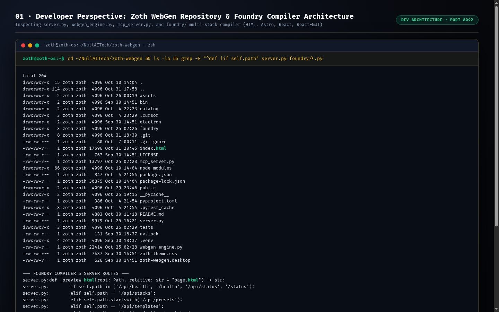

### Step 2: Automated Pytest Verification Suite (`41 passed`)
Running `pytest -v` executes 41 unit and integration tests covering craft voice guardrails, multi-stack compilation (`gold`, `cyberpunk`, `matrix`, `minimal` across `html`, `astro`, `react`, `react-mui`), MCP tools, and one-shot remixing.

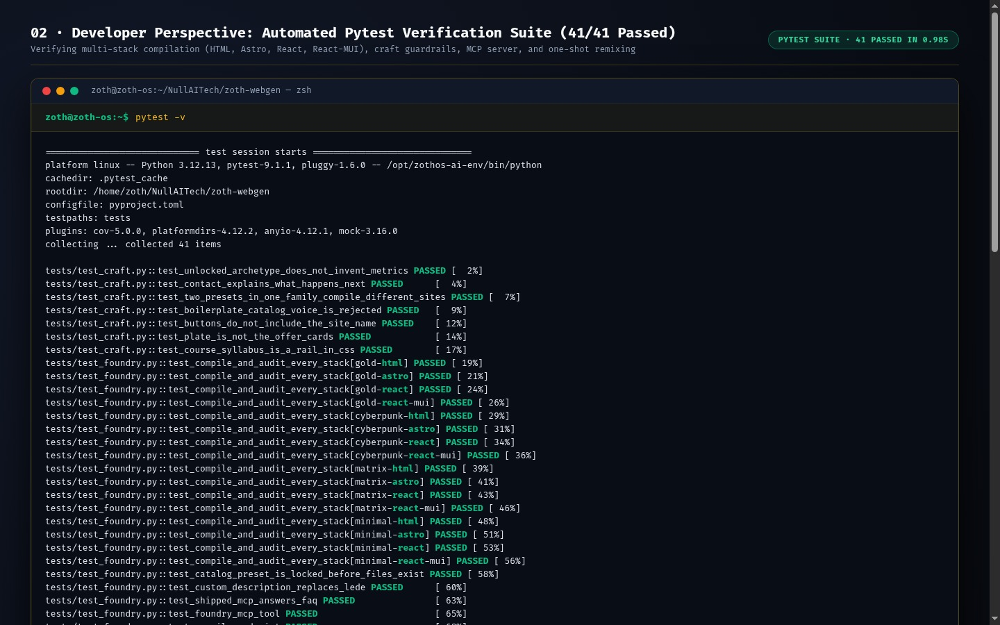

### Step 3: Live REST API Health & Multi-Stack Compiler Contract (`:8092`)
Querying `GET /api/health` and `GET /api/stacks` on `http://127.0.0.1:8092` returns active compiler stacks, themes, and templates.

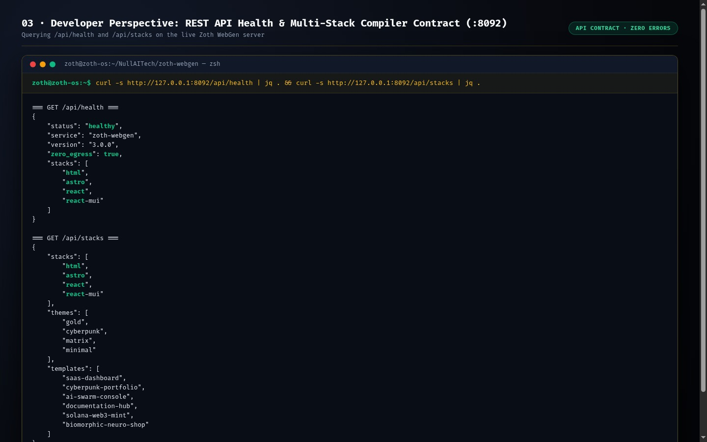

---

## Part 2 — End-User CLI Perspective (ZothOS Global Binary & Subcommands)

### Step 4: Global ZothOS CLI Binary & Help (`zoth-webgen --help`)
End users can invoke `zoth-webgen` directly from `/usr/local/bin/zoth-webgen` or `~/.local/bin/zoth-webgen`.

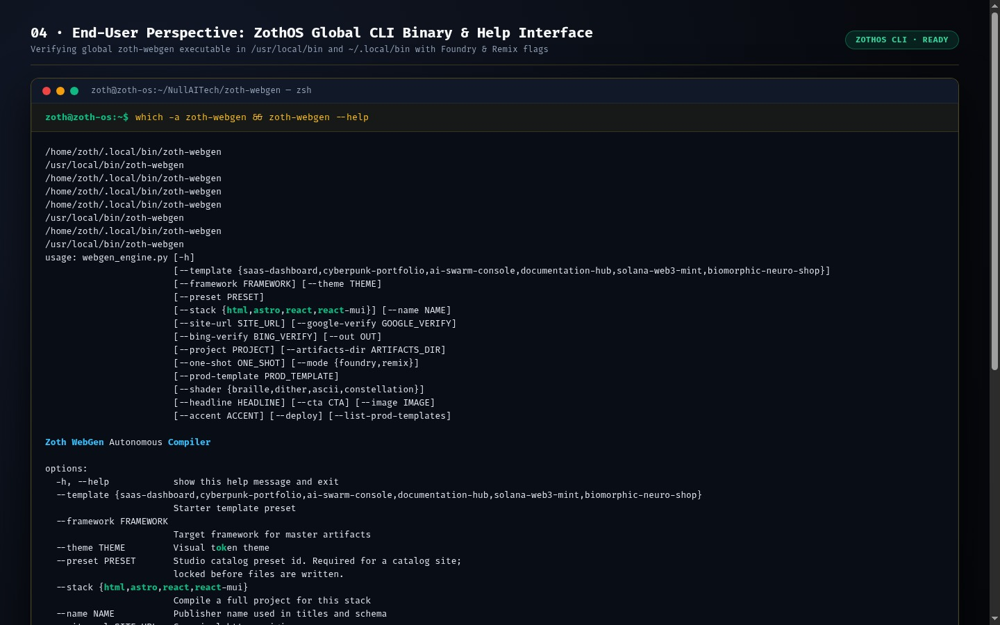

### Step 5: CLI Production App Template Catalog (`zoth-webgen --list-prod-templates`)
Running `zoth-webgen --list-prod-templates` outputs the catalog of 58+ production templates available for instant one-shot remixing.

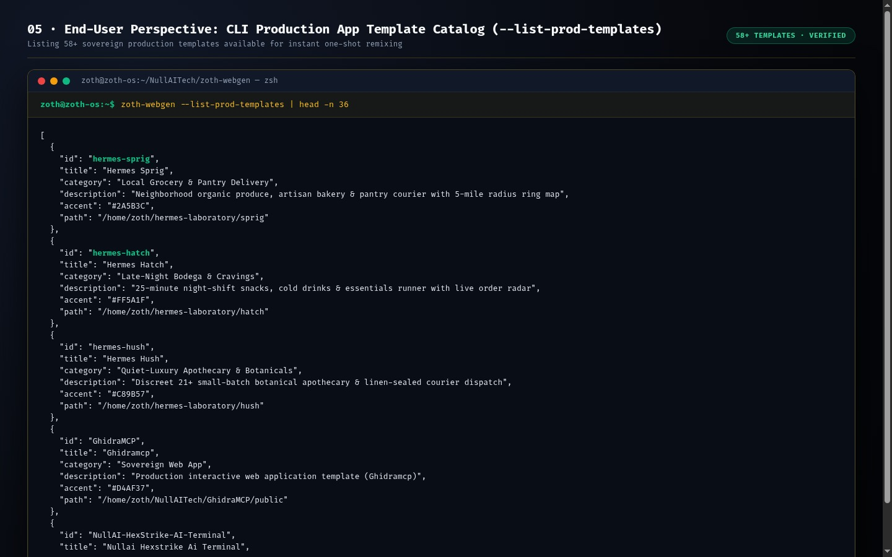

### Step 6: CLI One-Shot Production Template Remix Synthesis
Running `zoth-webgen --one-shot "Sprig Neighborhood Pantry — 15-Minute Organic Drops" --mode remix --prod-template hermes-sprig --shader braille` synthesizes a complete production web app and passes all 35 craft/SEO audit checks (`score: 100`).

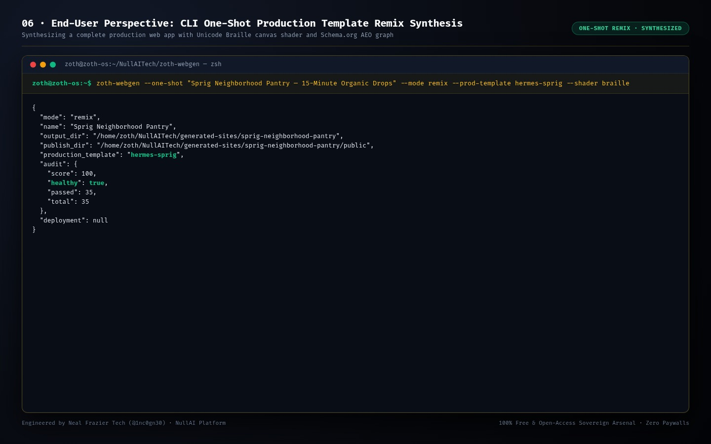

---

## Part 3 — End-User GUI Perspective (Standalone Web Workstation & Zoth Studio v2)

### Step 7: Standalone Web Workstation Home (`http://127.0.0.1:8092`)
Opening `http://127.0.0.1:8092` launches the QuickSite Starter workstation with one-click starter presets, template selector, canvas shader picker, live iframe preview, HTML/ZIP download, and Netlify deployment.

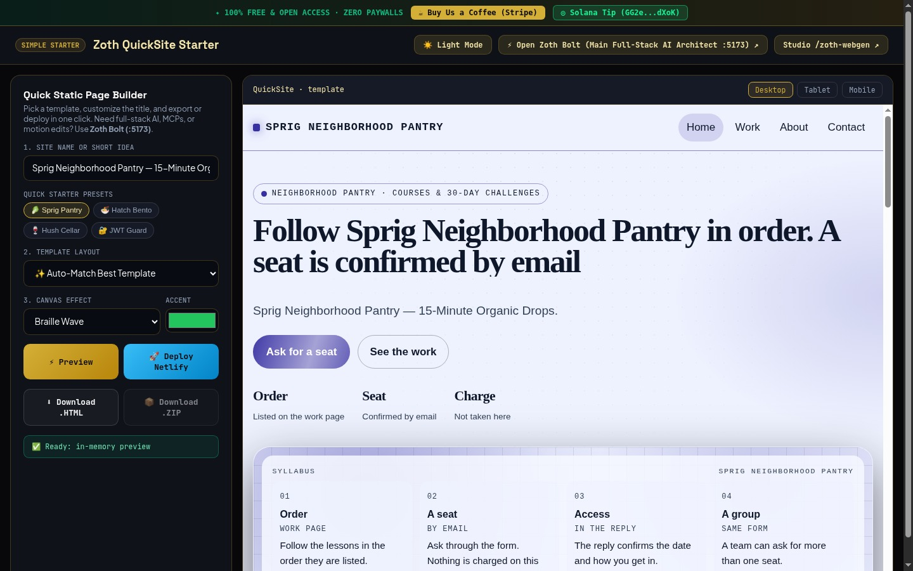

### Step 8: Interactive Preset & Bayer Dither Shader Synthesis
Selecting the **Hatch Bento** preset with the **Bayer Dither** shader and custom `#F97316` accent color immediately synthesizes and renders the dark-mode SaaS application inside the live preview pane.

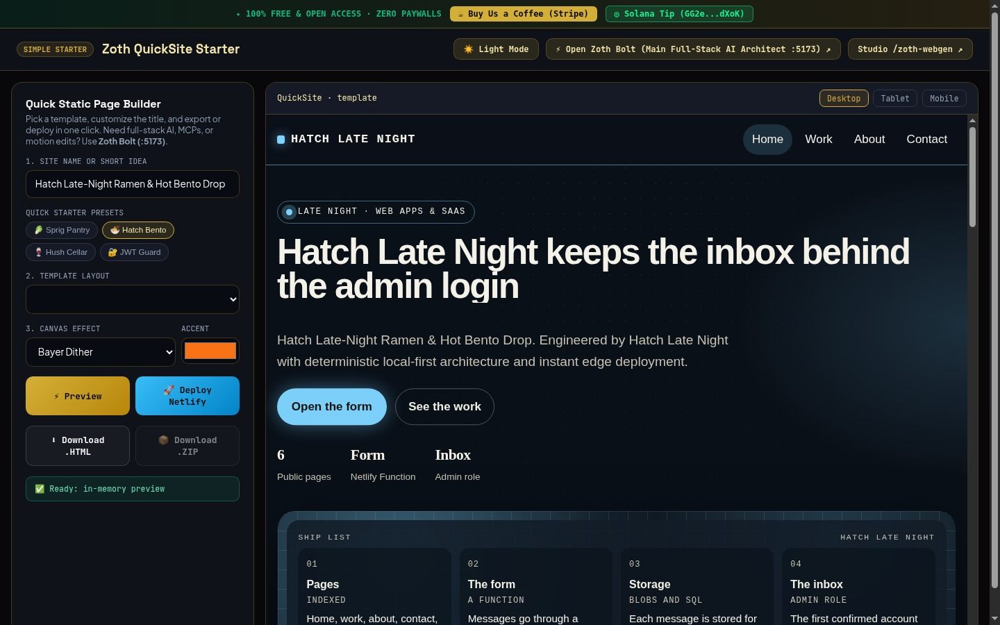

### Step 9: Responsive Viewport Preview Switcher (`Tablet 768px`)
Switching to the **Hush Cellar** preset and clicking the **Tablet** viewport button (`768px`) previews the responsive breakpoint directly inside the workstation.

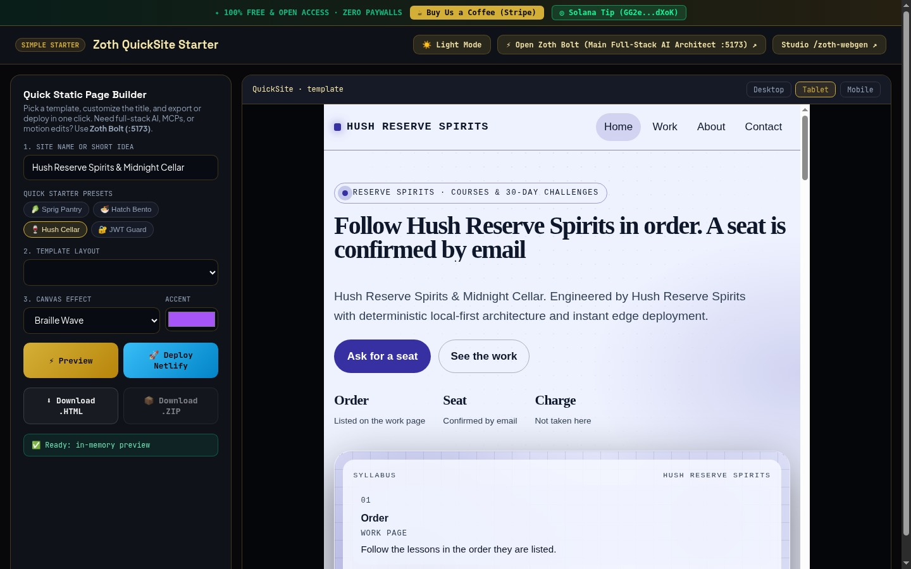

### Step 10: Editorial Ivory Light Mode Theme Toggle
Clicking **☀️ Light Mode** (`#themeToggleBtn`) switches the workstation into high-contrast Editorial Ivory (`#F7F4EC`) with warm bronze borders and crisp ink typography.

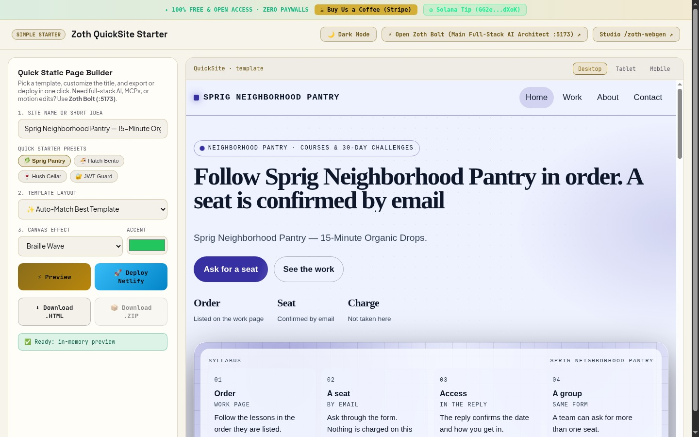

### Step 11: Zoth Studio v2 God-Mode Integration (`http://127.0.0.1:3000/tools/zoth-webgen`)
Visiting `/tools/zoth-webgen` inside Zoth Studio v2 provides the unified God-Mode header, quick-clone command, and interactive enclave workstation.

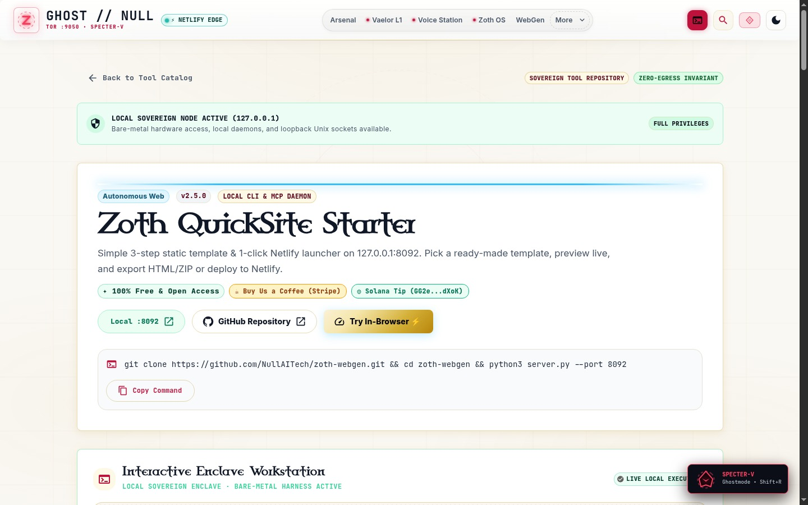

### Step 12: Mobile 390px Responsive Layout (`overflowPx: 0`)
Verified at `390×844` mobile viewport with zero horizontal overflow (`overflowPx: 0`) and stacked touch-friendly controls.

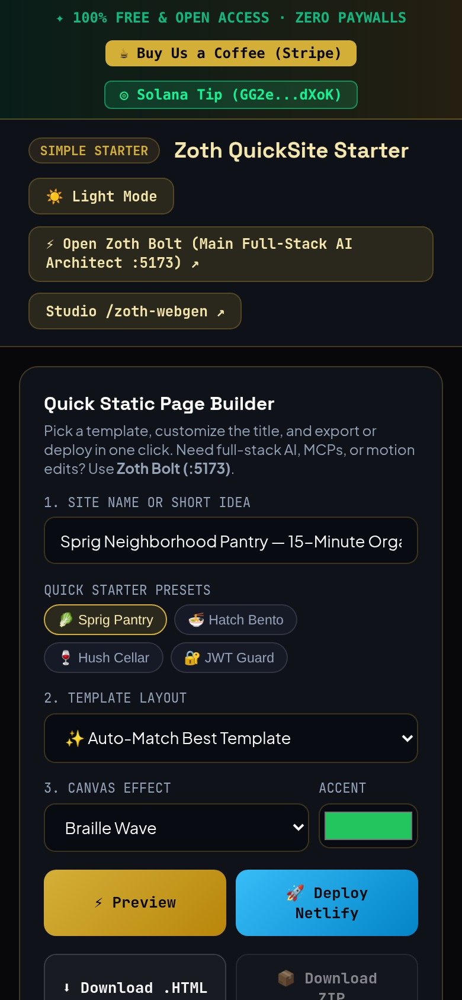
