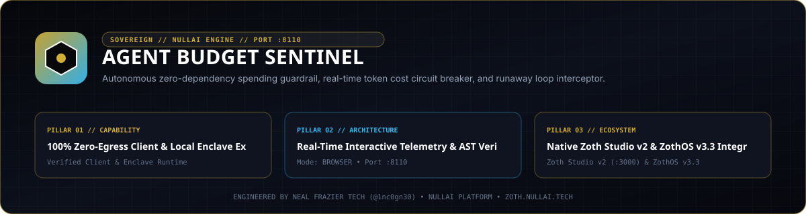

<div align="center">
  
</div>

<br />

# ⚡ Agent Budget Sentinel

> ⚡ **Live Web Application**: [https://agent-budget-sentinel.netlify.app](https://agent-budget-sentinel.netlify.app)  
> 💳 **Unlock Pro Lifetime License ($19 One-Time, $0/mo)**: **[Instant Pro Unlock via Stripe](https://buy.stripe.com/4gMfZg9AheOsdhKbcAfw40L)** *(Use promo code `FOUNDER25` for 25% off)*  
> 🏆 **All-Access Sovereign Pro Bundle (All 44 Tools — $49 Lifetime)**: **[Get All 44 Studios via Stripe](https://buy.stripe.com/eVq14m5k16hW4Le0xWfw40M)**

**Autonomous LLM Token Cost Circuit Breaker & Inline Spending Guardrail for AI Agents**  
*Engineered by Neal Frazier Tech ([@1nc0gn30](https://github.com/1nc0gn30)) • NullAI Platform*

[](https://www.python.org/downloads/)
[](#architecture)
[](#ports)
[](https://nullai.tech)

---

## 🎯 What is Agent Budget Sentinel?

Autonomous AI agents running recursive tool loops, multi-agent debates, and self-refinement chains are notoriously prone to **infinite loop burnouts**—generating runaway cloud bills in minutes.

`agent-budget-sentinel` is an autonomous, **zero-dependency** inline HTTP proxy and spending guardrail. It sits transparently between your AI agents and upstream LLM providers (OpenAI, Anthropic, Gemini, DeepSeek, or local twins). When token consumption breaches your designated spending ceiling or trips an emergency velocity spike, it immediately activates its **Circuit Breaker**, cutting off outbound calls with `HTTP 429 Too Many Requests` and saving your treasury from financial ruin.

---

## 🛡 Sovereign Architectural Highlights

1. **Zero External Pip Dependencies**:
   - 100% Python standard library (`http.server`, `socket`, `sqlite3`, `json`, `urllib.parse`, `threading`, `dataclasses`).
   - Whisper-quiet, event-driven blocking I/O with 0% CPU burn when idle.
2. **Inline Circuit Breaker State Machine**:
   - `CLOSED`: Normal operation (<80% of budget limit).
   - `WARN`: Spending between 80% and 99% of limit (dispatches telemetry warning events).
   - `TRIPPED`: Spending >= 100% or manual kill switch active. Halts requests immediately.
3. **Comprehensive Pricing Matrix**:
   - Built-in real-time rates for GPT-4o, GPT-4o-mini, o1, Claude 3.5 Sonnet, Claude 3.5 Haiku, Gemini 1.5 Pro, DeepSeek V3/R1, and Llama 3.3.
4. **Avant-Garde Web Deck (:8110)**:
   - Real-time Server-Sent Events (SSE) telemetry radar.
   - Interactive Try-Before-You-Buy token cost calculator.
   - Emergency operator kill switch and burst test simulation harness.
5. **Dual Cash Registers & Monetization Funnel**:
   - Above-the-fold high-converting sales banner ($19 founding lifetime vs $79 regular).
   - Stripe & DePay Solana instant activation rails.
   - Frosted glass output paywall over advanced multi-agent quota hierarchy modes.

---

## 🚀 Quickstart & Installation

```bash
# Clone the repository
git clone https://github.com/1nc0gn30/agent-budget-sentinel.git
cd agent-budget-sentinel

# Make CLI executable
chmod +x bin/agent-budget

# Launch the Web Deck (:8110) and Inline Proxy (:8111) with a $5.00 emergency ceiling
./bin/agent-budget serve --budget 5.00
```

### Route Your Agents Through the Circuit Breaker

```bash
# Option 1: Using OpenAI environment variable
export OPENAI_BASE_URL="http://127.0.0.1:8111/v1"
python my_agent.py

# Option 2: Automatic wrapper
./bin/agent-budget run -- python my_agent.py
```

---

## 📡 REST API & Integration

| Method | Endpoint | Description |
| :--- | :--- | :--- |
| `GET` | `/health` | Health check & circuit breaker status |
| `GET` | `/api/stats` | Comprehensive spending telemetry, token counts, and breaker state |
| `GET` | `/api/transactions` | Intercepted API calls ledger |
| `GET` | `/api/stream` | Server-Sent Events (SSE) live push stream |
| `POST` | `/api/budget` | Dynamically update budget ceiling (`{"max_budget_usd": 10.0}`) |
| `POST` | `/api/trip` | Emergency operator kill switch (`{"reason": "Manual trip"}`) |
| `POST` | `/api/reset` | Reset circuit breaker to `CLOSED` (`{"reset_spend": false}`) |
| `POST` | `/api/simulate` | Test token estimation and breaker response safely |

---

## 🧪 Automated Test Suite

```bash
python3 -m pytest -v
```

All tests execute with 100% standard library compliance and sub-second execution.

---

## 📜 License & Sovereign Attribution

Engineered by **Neal Frazier Tech** ([@1nc0gn30](https://github.com/1nc0gn30)) • [NullAI Platform](https://nullai.tech).  
Licensed under the MIT License.

## Network exposure

The server binds to `127.0.0.1` by default. To reach it from other devices,
opt in explicitly with `--host 0.0.0.0` (or set `ZOTH_BIND_HOST=0.0.0.0`; an IP
in `HOST` is also honoured, a plain hostname is ignored) and only on a trusted
network.

Browser requests are only accepted from `localhost` / `127.0.0.1` pages:
cross-site POSTs get `403` and CORS never answers `*`, so a website you visit
can't drive this local server. CLI and agent clients are unaffected.
