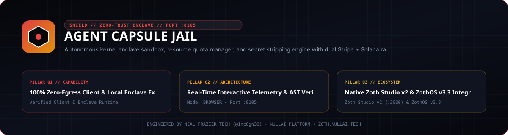

<div align="center">
  
</div>

<br />

# Agent Capsule Jail

[](pyproject.toml)
[](https://www.python.org/)
[](LICENSE)
[](https://nullai.tech)

**Ephemeral Kernel-Enclave Execution Sandbox, Resource Quotas & Filesystem Diff Engine for Sovereign AI Agents.**

Guards the host operating system against untrusted or hallucinated agent code execution by enforcing POSIX resource envelopes, scrubbed environment leases, SHA-256 filesystem delta tracking, and atomic commit/discard workflows.

---

## ⚡ Key Architectural Capabilities

- **100% Python Standard Library (Zero Pip Dependencies)**:
  - Powered exclusively by Python 3.10+ native modules (`http.server`, `socket`, `resource`, `subprocess`, `os`, `signal`, `shutil`, `tempfile`, `json`, `threading`, `dataclasses`, `time`). Zero runtime pip bloat.
- **Kernel-Enforced POSIX Resource Limits (`resource.setrlimit`)**:
  - `RLIMIT_CPU`: Hard execution timeout kills runaway CPU-bound agent scripts (default: 30s).
  - `RLIMIT_AS` & `RLIMIT_DATA`: Restricts maximum virtual address space and data memory to prevent memory exhaustion (default: 512MB).
  - `RLIMIT_NPROC`: Dynamic fork-bomb mitigation that queries host processes to enforce safe concurrency ceilings without impacting host daemons.
  - `RLIMIT_FSIZE`: Caps maximum output file write capacity (default: 50MB) to thwart disk flooding attacks.
- **Strict Environment Sanitization**:
  - Automatically scrubs high-risk host secrets (`OPENAI_API_KEY`, `STRIPE_KEY`, `AWS_SECRET_ACCESS_KEY`, `GITHUB_TOKEN`, `SSH_AUTH_SOCK`, `DATABASE_URL`, and token strings) from the spawned process environment unless granted via an explicit permission lease.
- **Pre/Post Filesystem Delta Fingerprinting**:
  - Captures recursive SHA-256 directory snapshots before command execution and compares against the final state to catalog:
    - **Created Files**: New artifacts, dependencies, or generated scripts.
    - **Modified Files**: Changed configuration or state files with byte-size deltas.
    - **Deleted Files**: Removed or unlinked files.
- **Discard vs. Commit Execution Modes**:
  - **Discard (Default)**: Ephemeral execution. The temporary scratch directory is completely unlinked and wiped upon completion.
  - **Commit**: Atomically merges all modified and created files into a designated destination directory after operator verification.
- **Flight Recorder Telemetry Forwarding**:
  - Emits structured telemetry events (`capsule.start`, `capsule.complete`, `capsule.error`) to `agent-flight-recorder` (`http://127.0.0.1:8104/api/ingest`) if online.
- **Avant-Garde Glassmorphic Web Cockpit (Port 8105)**:
  - Dark obsidian UI (`#08080B`) with gold accents (`#D4AF37`) and emerald safety badges (`#10B981`).
  - Interactive web console with real-time probe presets, live stdout/stderr stream, memory/CPU gauges, and filesystem diff inspector.

---

## 🚀 Quickstart

### 1. Execute a Command Inside an Isolated Capsule
```bash
./bin/agent-capsule exec -- python3 -c "print('Hello from kernel enclave sandbox')"
```

### 2. Run with Custom Resource Limits & Allowed Environment Keys
```bash
./bin/agent-capsule exec \
  --timeout 10 \
  --memory 256 \
  --max-filesize 10 \
  --allow-env OPENAI_API_KEY \
  -- python3 -c "import os; print('Key present:', 'OPENAI_API_KEY' in os.environ)"
```

### 3. Commit Scratch Changes to a Target Directory
```bash
./bin/agent-capsule exec \
  --commit-dir /home/zoth/workspace/output \
  -- python3 -c "with open('output.txt', 'w') as f: f.write('Verified artifact')"
```

### 4. Start the Web Cockpit & REST API Daemon
```bash
./bin/agent-capsule serve --port 8105
```
Open [http://localhost:8105](http://localhost:8105) to access the interactive web console.

### 5. Check System Telemetry Status
```bash
./bin/agent-capsule status
```

---

## 🛡 REST API Endpoints (Port 8105)

| Endpoint | Method | Description |
|:---|:---:|:---|
| `/api/exec` | `POST` | Executes a command in a sandboxed capsule with configurable limits |
| `/api/stats` | `GET` | Aggregated telemetry: total runs, successes, timeouts, RAM saved |
| `/api/capsules` | `GET` | Historical run catalog with exit codes, resource peaks, and filesystem diffs |
| `/api/health` | `GET` | Daemon liveness and health status probe |

### Example Execution Request:
```bash
curl -X POST http://127.0.0.1:8105/api/exec \
  -H "Content-Type: application/json" \
  -d '{
    "command": "python3 -c \"print(2 ** 64)\"",
    "timeout_sec": 5,
    "memory_mb": 256,
    "allowed_env": ["PATH"]
  }'
```

### Example Execution Response:
```json
{
  "capsule_id": "capsule-8a3c9f21",
  "status": "success",
  "exit_code": 0,
  "stdout": "18446744073709551616\n",
  "stderr": "",
  "execution_time_ms": 32.4,
  "cpu_time_ms": 18.2,
  "max_rss_mb": 14.8,
  "filesystem_delta": {
    "created": [],
    "modified": [],
    "deleted": []
  }
}
```

---

## 🧪 Testing Suite

Run the full automated test suite (10/10 tests):
```bash
./bin/agent-capsule test
```
Or via `pytest`:
```bash
pytest -v tests/test_capsule.py
```

---

## 💼 Sovereign SaaS Licensing

- **Founding Member License**: $19 lifetime access (regular $79).
- **Dual Payment Rails**:
  - **Stripe**: [Instant Stripe Checkout](https://buy.stripe.com/7sI7sA8hM2X8eFG8ww) (Credit Cards, Apple Pay, Google Pay)
  - **Solana DePay**: Integration ID `428790dd-7ad1-407c-8ecf-c048c77a4cb8` (Receiver `GG2eQbVh8ut1BK6j1A2tz7pSySdLpD38BgyEhGcxdXoK`)
- **Instant Client-Side Activation**:
  - Pass `?licensed=true` in the URL or enter your receipt email/key into the Pro Modal to permanently unlock all advanced security forensic outputs.

---

## 📜 Attribution

Engineered by **Neal Frazier Tech** ([@1nc0gn30](https://github.com/1nc0gn30)) • [NullAI Platform](https://nullai.tech)

## Network exposure

The server binds to `127.0.0.1` by default. To reach it from other devices,
opt in explicitly with `--host 0.0.0.0` (or set `ZOTH_BIND_HOST=0.0.0.0`; an IP
in `HOST` is also honoured, a plain hostname is ignored) and only on a trusted
network.

Browser requests are only accepted from `localhost` / `127.0.0.1` pages:
cross-site POSTs get `403` and CORS never answers `*`, so a website you visit
can't drive this local server. CLI and agent clients are unaffected.

## Security Model (`/api/exec`)

Capsule Jail runs arbitrary commands, so the API is locked down by default:

- **Real isolation (bubblewrap).** Every capsule runs under `bwrap`: read-only host root, empty private `/home`, `/root`, `/tmp` and `/run` (only the scratch dir is writable), all namespaces unshared, all capabilities dropped, and `no_new_privs` set so `sudo`/setuid binaries cannot escalate. **No network** unless the request sets `"allow_network": true` (CLI: `--allow-network`).
- **No bwrap, no exec.** If bubblewrap is missing, exec is refused. `CAPSULE_ALLOW_UNSANDBOXED=1` opts into rlimits-only mode (not isolation).
- **Exec token.** `POST /api/exec` requires `X-Capsule-Token: <token>` (or `Authorization: Bearer <token>`). The token is generated on first start at `~/.config/agent-capsule-jail/token` (mode 0600); print it with `agent-capsule token`. `CAPSULE_TOKEN` overrides. The web cockpit asks for it once.
- **Local origins only.** Cross-origin browser requests are rejected (403) even with a token; the server binds to 127.0.0.1.
- **Optional allowlist.** `CAPSULE_ALLOWED_COMMANDS=python3,node,echo` restricts the program that may be launched (shell-form commands need `sh` in the list).
- **Safe file I/O.** `initial_files` paths cannot escape the scratch dir; commits only go to `CAPSULE_COMMIT_ROOTS` (default `~/capsule-commits`, `:`-separated) and never follow or copy symlinks. Scratch dirs are always removed.

`GET /api/health` reports the active `sandbox` mode.
