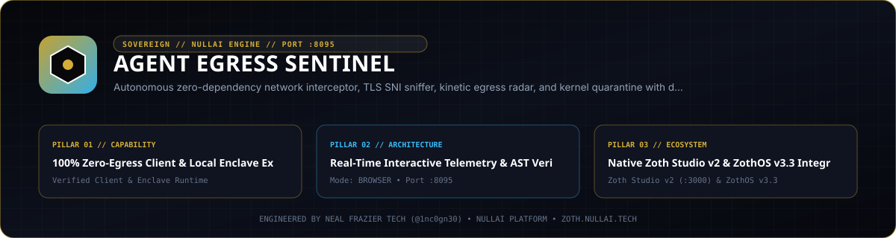
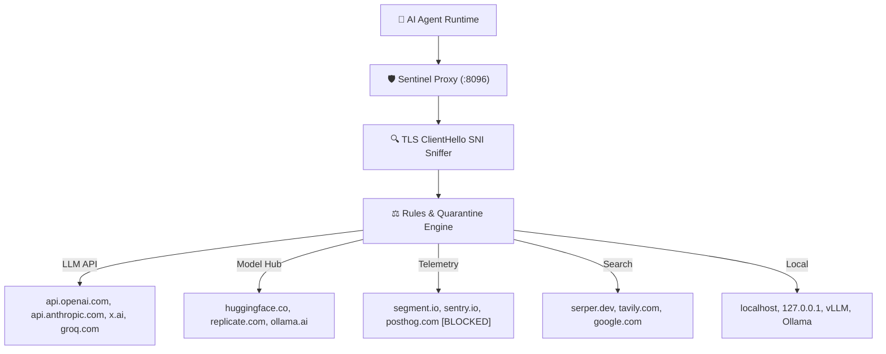

<div align="center">
  
</div>

<br />

# 🛡️ Agent Egress Sentinel

> **Autonomous Zero-Dependency Network Interceptor, Domain Classifier, and Kinetic Egress Radar for AI Agents and LLM Runtimes.**  
> *Engineered by Neal Frazier Tech ([@1nc0gn30](https://github.com/1nc0gn30)) • NullAI Platform*

[](https://python.org)
[](pyproject.toml)
[](tests/)
[](engine/site_guardrail.js)
[](LICENSE)

---

## ⚡ The Problem: Silent Agent Exfiltration & Telemetry Bloat

Modern autonomous AI agents (LangChain, AutoGPT, CrewAI, Grok, Claude, Cursor, Custom LLM scripts) frequently make dozens of hidden network requests per session:
1. **Unannounced Telemetry & Analytics**: Tracking pings to Segment, PostHog, Sentry, Datadog, Mixpanel, and Amplitude.
2. **Hidden Scraping & Search**: Background calls to third-party scrapers, Serper, Tavily, and Google Search.
3. **Model & Weight Hub Calls**: Silent downloads or weight checks against HuggingFace and Civitai.
4. **Data Exfiltration Risk**: Zero visibility into whether an autonomous prompt loop is forwarding sensitive files, database dumps, or API keys to external endpoints.

**Agent Egress Sentinel** solves this with zero external pip dependencies. It wraps any agent process or serves as a global proxy, inspecting TLS ClientHello Server Name Indication (SNI) hostnames without breaking SSL certificates, auditing Linux socket descriptors, classifying destinations into domain taxonomy rings, and enforcing customizable quarantine policies.

---

## 🌟 Key Capabilities

- **100% Python Standard Library**: Runs anywhere Python 3.10+ is installed. Zero `pip` packages required (`socket`, `select`, `sqlite3`, `http.server`, `threading`, `struct`).
- **In-Memory TLS ClientHello SNI Extractor**: Sniffs destination domains directly from the initial TLS handshake bytes. No self-signed root CA installation, no broken certificate chains, zero developer friction.
- **Linux `/proc/<pid>/net/tcp` Socket Auditor**: Background socket monitor scans kernel descriptors to detect raw TCP/UDP outbound sockets that attempt to bypass standard `HTTP_PROXY` environment variables.
- **Autonomous Rules & Quarantine Engine**:
  - `ALLOW_ALL`: Monitor and map all egress in real time.
  - `BLOCK_TELEMETRY`: Deflect known analytics and tracking endpoints (`segment.io`, `posthog.com`, `sentry.io`, etc.) returning `403 Forbidden` while allowing model calls.
  - `ZERO_EGRESS`: Strict local sandbox isolating all outbound traffic except localhost/127.0.0.1.
  - `ALLOWLIST_ONLY`: Restrict egress strictly to user-approved domains.
- **Kinetic Domain Vector Radar**: High-definition browser UI featuring concentric orbital rings for LLM APIs, Model Hubs, Telemetry, Search, and Local services, with real-time packet particle trajectories and SSE live stream.
- **Standard HAR 1.2 Export**: One-click download of compliance and audit records compatible with Chrome DevTools, Charles, and Wireshark.

---

## 🚀 Quickstart

### 1. Installation

Clone and install in editable mode:
```bash
git clone https://github.com/1nc0gn30/agent-egress-sentinel.git
cd agent-egress-sentinel
pip install -e .
```

### 2. Launch the Egress Radar & Proxy Daemon

```bash
agent-egress serve --web-port 8095 --proxy-port 8096
```
- **Web UI & Kinetic Radar**: [http://127.0.0.1:8095](http://127.0.0.1:8095)
- **Egress Proxy Listener**: `http://127.0.0.1:8096`

### 3. Supervise Any Agent or Command

Run your existing AI agent, script, or model under Sentinel supervision:
```bash
# Audit an OpenAI / LangChain agent script
agent-egress run --agent-name my_agent python3 agent.py

# Run with automated telemetry blackhole defense
agent-egress run --quarantine block_telemetry python3 agent.py

# Run with export to standard HTTP Archive (HAR 1.2)
agent-egress run --export-har egress-audit.har python3 agent.py
```

### 4. CLI Inspection & Controls

```bash
# View aggregated domain statistics and throughput
agent-egress stats

# Export all historical traffic to HAR file
agent-egress export -o agent-traffic.har

# Clear egress log database
agent-egress clear
```

---

## 📡 REST & SSE API Reference

| Method | Endpoint | Description |
|---|---|---|
| `GET` | `/api/stats` | High-level metrics (requests, domains, bytes, latency, quarantine count). |
| `GET` | `/api/domains` | Aggregated domain table with byte sent/recv and endpoint counts. |
| `GET` | `/api/traffic` | Paginated raw network event logs (`?domain=`, `?category=`, `?limit=`). |
| `GET` | `/api/stream` | Real-time Server-Sent Events (SSE) feed of captured egress packets. |
| `POST` | `/api/quarantine` | Switch quarantine mode (`allow_all`, `block_telemetry`, `zero_egress`). |
| `POST` | `/api/rules/block` | Add specific domain to real-time blocklist. |
| `POST` | `/api/rules/allow` | Add specific domain to real-time allowlist. |
| `GET` | `/api/export` | Download standard HAR 1.2 compliance trace file. |
| `POST` | `/api/run` | Trigger command execution asynchronously under proxy supervision. |

---

## 🧠 Domain Taxonomy & Classification

Sentinel classifies every outbound connection into one of five primary categories:



---

## 💎 Sovereign Pro Monetization Funnel

Agent Egress Sentinel implements the Sovereign SaaS dual-rail cash register:
- **Founding Member Lifetime License**: $19 USD (Regular $79)
- **Stripe Checkout**: Credit Cards, Apple Pay, Google Pay ([Stripe Payment Link](https://github.com/1nc0gn30/zoth-os))
- **Solana Checkout**: Instant USDC/SOL via DePay integration (`GG2eQbVh8ut1BK6j1A2tz7pSySdLpD38BgyEhGcxdXoK`)
- **1-Click Unlock**: Instant client-side unlock via `?licensed=true` or license key input.

---

## 🧪 Verification & Production Guardrail

Verified using the sovereign automated headless Electron test suite (`site_guardrail.js`):
- ✅ AEO Schema.org JSON-LD Graph (`WebApplication` + `FAQPage`)
- ✅ Zero crawl-delay `robots.txt` + `sitemap.xml`
- ✅ Netlify SPA redirects & security headers (`netlify.toml`)
- ✅ Triple-Viewport Responsive (375px mobile, 768px tablet, 1440px desktop) with 0 overflow
- ✅ Zero runtime console errors
- ✅ 12/12 unit and integration tests passing (`pytest tests/`)

---

## 📜 Attribution & Author

- **Engineered by**: Neal Frazier ([@1nc0gn30](https://github.com/1nc0gn30))
- **Entity**: Neal Frazier Tech • [NullAI Platform](https://nullai.tech)
- **Primary Hub**: [nealfrazier.tech](https://nealfrazier.tech)
- **Repository**: [https://github.com/1nc0gn30/agent-egress-sentinel](https://github.com/1nc0gn30/agent-egress-sentinel)

## Network exposure

The server binds to `127.0.0.1` by default. To reach it from other devices,
opt in explicitly with `--host 0.0.0.0` (or set `ZOTH_BIND_HOST=0.0.0.0`; an IP
in `HOST` is also honoured, a plain hostname is ignored) and only on a trusted
network.

Browser requests are only accepted from `localhost` / `127.0.0.1` pages:
cross-site POSTs get `403` and CORS never answers `*`, so a website you visit
can't drive this local server. CLI and agent clients are unaffected.
