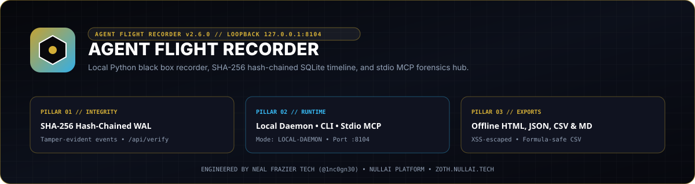

# Agent Flight Recorder (`v2.6.0`)



**Agent Flight Recorder** (`agent-flight-recorder`) is a zero-dependency Python 3.10+ local daemon (`127.0.0.1:8104`), CLI, live terminal TUI, and stdio MCP forensics hub for AI agents. It records command execution streams, network egress, capsule runs, file mutations, prompt scans, and engrams into a **WAL-mode SQLite** database (`flight_recorder.db`) protected by an **append-only SHA-256 hash chain**.

- **Zoth Studio v2 Dossier**: [https://zoth.nullai.tech/tools/agent-flight-recorder](https://zoth.nullai.tech/tools/agent-flight-recorder)
- **Repository**: [https://github.com/1nc0gn30/agent-flight-recorder](https://github.com/1nc0gn30/agent-flight-recorder)
- **Default Loopback Endpoint**: `http://127.0.0.1:8104`

---

## What It Does

- **Process & Stream Recording (`SessionRecorder`)**: Wraps agent commands (`agent-flight-recorder record -- <cmd>`), capturing timestamped `stdout`/`stderr`, real child CPU/RSS telemetry (`os.wait4` + `/proc`), wall duration, and exit status. Proxy env injection is strictly opt-in (`--with-proxy`).
- **SHA-256 Append-Only Hash Chain (`storage.py`)**: Every recorded event computes `event_hash = sha256(canonical_json({session_id, seq, offset_ms, event_type, payload, prev_hash}))` in SQLite WAL mode with `PRAGMA foreign_keys=ON`. Tampering with any row is immediately flagged by `GET /api/verify/<session_id>`, CLI `verify`, or MCP `flight_recorder_verify`.
- **Cross-Daemon Ingestion (`/api/ingest`)**: Receives structured telemetry from sibling daemons (`agent-capsule-jail :8105`, `agent-policy-auditor :8106`, `agent-prompt-firewall :8098`, `agent-egress-sentinel :8095`) and automatically creates parent session rows (e.g., `capsule-jail-audit`) so events never orphan.
- **Live SSE Cockpit & Dual-Theme UI**: Subscribes live to `/api/stream`, scrubs millisecond-by-millisecond, filters all event types in the Raw Event Inspector, and supports Editorial Ivory Light Mode and Obsidian Dark Mode (`?theme=light|dark`, `?embed=1`).
- **Multi-Format Exports**: Exports self-contained XSS-escaped offline HTML replay bundles, JSON, spreadsheet-formula-safe CSV, and Markdown incident reports.

---

## How It Works

```text
Agent Process / Sibling Local Daemons (:8095, :8098, :8105, :8106)
        │
        ├── CLI Wrapper (SessionRecorder, os.wait4 rusage) ──┐
        ├── POST /api/ingest (Origin + Host + 1 MiB guard) ──┼──► FlightStorage (SQLite WAL + SHA-256 Chain)
        └── Stdio MCP Server (agent-flight-recorder mcp) ────┘              │
                                                                            ▼
                                                  FlightDeckServer (127.0.0.1:8104)
                                                  ├── Live SSE (/api/stream, /api/events/stream)
                                                  ├── Scrubber & Verifier (/api/scrub, /api/verify)
                                                  └── Exporters (HTML, JSON, CSV, Markdown)
```

---

## Quickstart

```bash
git clone https://github.com/1nc0gn30/agent-flight-recorder.git
cd agent-flight-recorder

# Start the local loopback daemon on 127.0.0.1:8104
python3 server.py --host 127.0.0.1 --port 8104
```

Open `http://127.0.0.1:8104` in your browser (add `?theme=light` or `?theme=dark` as desired).

---

## ZothOS CLI, Live TUI & Stdio MCP Commands

```bash
# Daemon & storage telemetry
agent-flight-recorder --version
agent-flight-recorder --status
agent-flight-recorder --json

# Record an agent execution session into SQLite
agent-flight-recorder record --title "Repo Audit Run" -- python3 my_agent.py

# Verify a session's SHA-256 hash chain (exit 0 valid, exit 2 tampered)
agent-flight-recorder verify --session <session_id> --json

# Export a standalone XSS-safe HTML incident bundle
agent-flight-recorder export --session <session_id> --output incident-report.html

# Launch the live terminal forensics TUI (queries :8104 with offline SQLite fallback)
agent-flight-recorder-tui --once
agent-flight-recorder-tui --json

# Run the zero-dependency JSON-RPC 2.0 stdio MCP server
agent-flight-recorder mcp --db flight_recorder.db
```

### Stdio MCP Tools (`agent-flight-recorder mcp`)

| Tool | Purpose |
| :--- | :--- |
| `flight_recorder_scrub` | Reconstruct terminal output, egress nodes, engrams, threats, capsule runs, and chain head at `offset_ms` |
| `flight_recorder_sessions` | List recorded sessions and SQLite storage metrics |
| `flight_recorder_ingest` | Append a SHA-256 hash-chained event (auto-creating missing sessions) |
| `flight_recorder_verify` | Verify a session's append-only SHA-256 hash chain for tamper detection |

---

## REST API Reference (`127.0.0.1:8104`)

All API endpoints enforce strict loopback `Host` header validation (defeating DNS rebinding), strict local/Studio `Origin` validation with `Vary: Origin`, `1 MiB` POST body cap (`413`), and JSON schema validation (`400`).

| Method | Endpoint | Description |
| :--- | :--- | :--- |
| `GET` | `/` | Dual-theme time-scrubbing flight deck (`public/index.html`) |
| `GET` | `/health`, `/api/health` | Service health (`status`, actual bound `port`, `version: "2.6.0"`) |
| `GET` | `/api/stats` | Session count, event count, total recorded duration, and DB size |
| `GET` | `/api/sessions?limit=50` | Recent recorded sessions (`limit` 1..500) |
| `GET` | `/api/events?session_id=&event_type=&q=&limit=100` | Filtered raw timeline events |
| `GET` | `/api/session/<id>` | Metadata and SHA-256 chain summary for a single session |
| `GET` | `/api/timeline/<id>` | Ordered hash-chained event list for `<id>` |
| `GET` | `/api/scrub/<id>?offset_ms=1500` | Cumulative forensic state snapshot up to `offset_ms` |
| `GET` | `/api/verify/<id>` | Verify SHA-256 hash chain (`valid`, `event_count`, `head_hash`, `broken_at_event_id`) |
| `GET` | `/api/briefing/<id>` | Executive incident briefing summary for `<id>` |
| `GET` | `/api/stream`, `/api/events/stream` | Real-time Server-Sent Events (SSE) flight telemetry stream |
| `POST` | `/api/ingest` | Ingest a forensic event (`session_id`, `event_type`, `severity`, `payload`) |
| `GET` / `POST` | `/api/export/bundle` | Self-contained, XSS-escaped offline HTML replay bundle |
| `GET` | `/api/export/json` | Structured JSON export with SHA-256 verification metadata |
| `GET` | `/api/export/csv` | Formula-injection-safe CSV event export |
| `GET` | `/api/export/markdown` | Markdown post-mortem incident report |

---

## Testing & Verification

```bash
PYTHONPATH=src python3 -m pytest -q tests
```

---

## Support & License

100% free and open-source software under the MIT License (zero paywalls).

- Optional support (Stripe): [Buy Us a Coffee](https://buy.stripe.com/3cIfZg27PdKo2D64Ocfw40X)
- Optional support (Solana): `GG2eQbVh8ut1BK6j1A2tz7pSySdLpD38BgyEhGcxdXoK` (`solana:GG2eQbVh8ut1BK6j1A2tz7pSySdLpD38BgyEhGcxdXoK`)
- Engineered by **Neal Frazier Tech** (`@1nc0gn30`) • **NullAI Platform** ([https://nullai.tech](https://nullai.tech))
