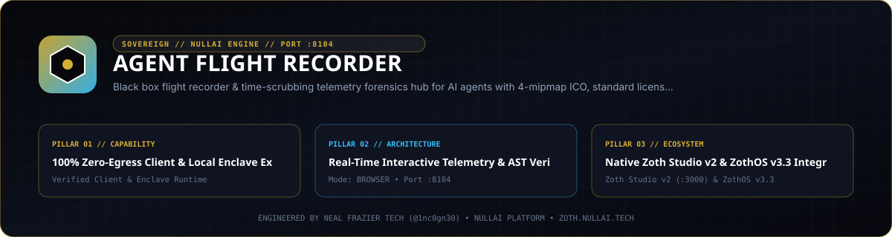

<div align="center">
  
</div>

<br />

# Agent Flight Recorder

[](pyproject.toml)
[](https://www.python.org/)
[](LICENSE)
[](https://nullai.tech)

**Autonomous Black Box Flight Recorder & Time-Scrubbing Telemetry Forensics Hub for AI Agents.**

Captures high-resolution session timelines and provides an interactive in-browser scrubber (like a digital audio workstation or video editor) that allows developers to replay an agent's execution second-by-second.

---

## ⚡ Key Architectural Capabilities

- **Zero External Pip Dependencies**: 100% Python 3.10+ standard library (`http.server`, `socket`, `sqlite3`, `json`, `urllib.parse`, `threading`, `dataclasses`, `time`).
- **Multi-Source Forensic Telemetry Ingestion (Port 8104)**:
  - Ingests events with millisecond timestamps from:
    - **Prompt Firewall (:8098)**: Prompt injection attempts and PII redaction.
    - **Egress Sentinel (:8095/:8096)**: Outbound domain traffic and connection spikes.
    - **Mock Twin (:8097)**: Deterministic mock replays and token savings.
    - **Neuro-Memory Daemon (:8094)**: Synaptic associative memory engrams.
    - **Subprocess Execution**: Standard stdout/stderr stream and system CPU/RAM spikes.
- **Interactive Time-Scrubbing Cockpit (Port 8104 UI)**:
  - Drag the timeline scrubber (0:00 to N:NN) to dynamically inspect:
    - Synchronized terminal output emitted up to that exact timestamp.
    - Active network topological connection graph at that moment in time.
    - Neural memory engrams recalled or synthesized.
    - Peak threat score gauge and system resource utilization.
  - Automated playback controls with 1x, 2x, and 4x speed multipliers.
- **Voice Incident Briefing (Kokoro TTS :9394 Ready)**:
  - Generates natural-language mission debriefs synthesized from timeline telemetry.
- **Single-File Offline Incident Bundle Exporter**:
  - Exports a self-contained, standalone single-file HTML replay viewer with embedded JSON data that runs offline in any browser with zero server required.

---

## 🚀 Quickstart

### 1. Record an Agent Execution
```bash
./bin/agent-flight record --command "python3 -m agent_core"
```
Or record any shell command directly:
```bash
./bin/agent-flight record -- python3 -c "print('Agent initialized'); import urllib.request; print('Done')"
```

### 2. Launch the Time-Scrubbing Flight Deck UI
```bash
./bin/agent-flight serve --port 8104
```
Open [http://localhost:8104](http://localhost:8104) to scrub through recorded flights.

### 3. Export Standalone Offline Incident Bundle
```bash
./bin/agent-flight export --session <session_id> -o incident.html
```

### 4. Check Telemetry Storage Status
```bash
./bin/agent-flight status
```

---

## 🛡 API Endpoints

| Endpoint | Method | Description |
|:---|:---:|:---|
| `/api/sessions` | `GET` | Lists recent recorded flight sessions |
| `/api/session/<id>` | `GET` | Fetches metadata and duration for a session |
| `/api/timeline/<id>` | `GET` | Returns all millisecond-precision forensic events |
| `/api/scrub/<id>?offset_ms=N` | `GET` | Computes state snapshot at offset N ms |
| `/api/briefing/<id>` | `GET` | Generates text briefing for Kokoro TTS |
| `/api/export/bundle?session_id=<id>` | `GET` | Downloads standalone single-file HTML replay bundle |
| `/api/ingest` | `POST` | Ingests forensic telemetry events from external tools |
| `/api/stream` | `GET` | Server-Sent Events (SSE) live telemetry stream |

---

## 🧪 Testing

Run the zero-dependency test suite:
```bash
pytest -v
```

---

## 💼 Sovereign SaaS Licensing

- **Founding Member License**: $19 lifetime access (regular $79).
- **Payment Rails**:
  - Stripe: [Instant Stripe Checkout](https://buy.stripe.com/7sI7sA8hM2X8eFG8ww)
  - Solana DePay: Integration ID `428790dd-7ad1-407c-8ecf-c048c77a4cb8`
- **Instant Activation**: Pass `?licensed=true` in the browser or enter your receipt key in the Pro modal.

---

## 📜 Attribution

Engineered by **Neal Frazier Tech** ([@1nc0gn30](https://github.com/1nc0gn30)) • [NullAI Platform](https://nullai.tech)

## Network exposure

The server binds to `127.0.0.1` by default. To reach it from other devices,
opt in explicitly with `--host 0.0.0.0` (or set `ZOTH_BIND_HOST=0.0.0.0`; an IP
in `HOST` is also honoured, a plain hostname is ignored) and only on a trusted
network.

Browser requests are only accepted from `localhost` / `127.0.0.1` pages:
cross-site POSTs get `403` and CORS never answers `*`, so a website you visit
can't drive this local server. CLI and agent clients are unaffected.
