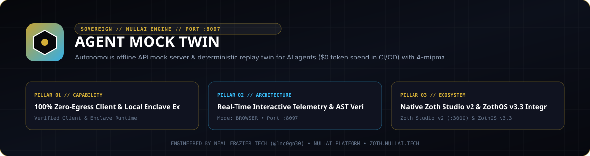

<div align="center">
  
</div>

<br />

# AGENT MOCK TWIN ⚡

> **Autonomous Offline API Mock & Network Twin for AI Agents**  
> *Run autonomous agents in CI/CD and local development loops with **$0 API token cost**, zero latency, and 100% deterministic outputs.*

[](https://github.com/1nc0gn30/agent-mock-twin)
[](https://python.org)
[](https://github.com/1nc0gn30/agent-mock-twin)
[](LICENSE)

---

## 💎 The Problem: The $500 CI/CD Test Run

Autonomous AI agents iterate over complex loops: planning, tool execution, memory retrieval, and self-auditing. In modern development:
1. **Rampant Token Costs**: Every automated CI test run hits live LLM provider APIs (OpenAI, Anthropic, Gemini), burning hundreds of dollars in token billing.
2. **Brittle Flakiness**: Rate limits (HTTP 429), upstream outages, and stochastic model responses cause integration test suites to randomly fail.
3. **Slow Latency**: Waiting 1,500ms–6,000ms per agent turn stalls CI pipelines and local developer velocity.

**AGENT MOCK TWIN** solves this by establishing an autonomous, zero-dependency offline network twin. It ingests real network recordings (standard HAR 1.2 files from `agent-egress-sentinel` or OpenAPI 3.0 specs) and hosts a microsecond-latency local mock server that deterministically answers agent queries at **$0.00 cost**.

---

## 🏛️ Architecture: The Prism Dual-Ring

```text
    ┌─────────────────────────────────────────────────────────┐
    │              ● AGENT MOCK TWIN (PORT 8097)              │
    │                                                         │
    │   ┌───────────────────────┐   ┌─────────────────────┐   │
    │   │  MULTI-TIER MATCHER   │   │   SQLITE STORAGE    │   │
    │   │  1. Exact Hash Match  │   │  • Routes Cache     │   │
    │   │  2. Fuzzy Semantic    │   │  • Hit Telemetry    │   │
    │   │  3. Fallback Synth    │   │  • Microsec Lookups │   │
    │   └───────────────────────┘   └─────────────────────┘   │
    │               ▲                          ▲              │
    │               │                          │              │
    └───────────────┼──────────────────────────┼──────────────┘
                    │                          │
           Intercepted Traffic        Ingested HAR / Specs
                    │                          │
        ┌───────────────────────┐   ┌─────────────────────┐
        │   AUTONOMOUS AGENT    │   │ HAR 1.2 / OpenAPI   │
        │   pytest / CI Runner  │   │ Egress Recordings   │
        └───────────────────────┘   └─────────────────────┘
```

### Multi-Tier Request Matcher
1. **Tier 1 — Exact Match**: Matches HTTP Method + Normalized Path + Request Body SHA256 Hash. Answers with the exact recorded status and response payload with 100% fidelity.
2. **Tier 2 — Fuzzy Semantic Match**: Reconciles subtle prompt drift and variable JSON parameter keys using Jaccard key similarity and model matching.
3. **Tier 3 — Fallback Synthesis**: If an agent hits an unseen endpoint (e.g. `/v1/chat/completions` or `/v1/messages`), the server synthesizes a valid, structured provider response with zero outbound internet access.

---

## 🚀 Quickstart & Zero-Pip Installation

`agent-mock-twin` requires **zero pip packages**. It runs directly on Python 3.10+ standard library.

```bash
# Clone the repository
git clone https://github.com/1nc0gn30/agent-mock-twin.git
cd agent-mock-twin

# Make CLI executable
chmod +x bin/agent-mock

# Check CLI commands
./bin/agent-mock --help
```

---

## 🛠️ Usage Guide

### 1. Ingest Traffic Archive or OpenAPI Specification
Ingest any standard HAR 1.2 file (exported from Chrome, Postman, or `agent-egress-sentinel`):

```bash
./bin/agent-mock import tests/fixtures/sample_traffic.har
```

Or import an OpenAPI 3.0 / 3.1 JSON blueprint:
```bash
./bin/agent-mock import api_spec.json
```

### 2. Start the Standalone Mock Server & Dashboard
```bash
./bin/agent-mock serve --port 8097
```
- **Web Dashboard**: `http://localhost:8097/`
- **OpenAI Mock Base**: `http://localhost:8097/v1`
- **Anthropic Mock Base**: `http://localhost:8097`

### 3. Run Agent Suites with Zero Token Burn
The `agent-mock run` command wraps your agent execution, spins up the mock twin in the background, and injects redirection environment variables:

```bash
./bin/agent-mock run -- pytest tests/test_agent_workflow.py
```

Or run any arbitrary agent script:
```bash
./bin/agent-mock run -- python my_autonomous_agent.py
```

At the end of the run, `agent-mock` outputs a session audit report:
```text
============================================================
  AGENT MOCK TWIN SESSION REPORT
============================================================
  Execution Time:        3.42s
  API Calls Intercepted: 48
  Estimated Tokens Saved:1,680
  API Token Cost:        $0.00 (100% Mock Replay)
  Child Exit Code:       0
============================================================
```

---

## 🌐 Telemetry & REST API

| Endpoint | Method | Description |
| :--- | :--- | :--- |
| `/api/stats` | `GET` | Aggregated counters: total hits, tokens saved, USD saved, active routes. |
| `/api/routes` | `GET` | List all indexed mock routes with method, path, provider, and hit counts. |
| `/api/hits` | `GET` | Retrieve the last N intercepted requests for the replay log. |
| `/api/stream` | `GET` | Server-Sent Events (SSE) live feed broadcasting request hits in real time. |
| `/api/upload` | `POST` | Upload new HAR or OpenAPI blueprints directly via REST. |
| `/api/config` | `POST` | Adjust base latency simulation, jitter, and chaos injection rates. |
| `/api/test` | `POST` | Test playground endpoint to simulate mock requests and view responses. |

---

## 💎 Sovereign SaaS Monetization & Pro Licensing

Agent Mock Twin provides a complete try-before-you-buy experience with client-side utility and a Pro upgrade tier:

- **Founding Member Lifetime**: **$19 one-time** (vs $79 regular).
- **Dual Payment Rails**:
  - **Stripe**: [Direct Checkout Link](https://github.com/1nc0gn30/zoth-os) (Credit Cards, Apple Pay, Google Pay).
  - **Solana Tip**: Integration ID `428790dd-7ad1-407c-8ecf-c048c77a4cb8` (SOL, USDC).
- **Pro Features**:
  1. **Dynamic Chaos Fault Injection**: Simulate upstream HTTP 429 rate limit backoff and 500/503 provider outages to verify agent retry logic.
  2. **Fuzzy Semantic Drift Tolerance**: Configurable Jaccard similarity tolerance for evolving agent prompt payloads.
  3. **Microsecond Latency Jitter**: Test realistic distributed network variance.
  4. **Headless Docker CI Pipeline**: Pre-built Alpine container for GitHub Actions / GitLab CI.

---

## 🧪 Verification & Testing

Run the automated test suite with standard `pytest`:
```bash
pytest -v
```

Run the headless browser guardrail audit:
```bash
npx electron ~/NullAITech/zoth-civilization/engine/site_guardrail.js http://127.0.0.1:8097/
```

---

## 📜 Attribution & License

- **Engineered by**: Neal Frazier Tech ([@1nc0gn30](https://github.com/1nc0gn30))
- **Research Hub**: [NullAI Platform](https://nullai.tech)
- **License**: MIT License

## Network exposure

The server binds to `127.0.0.1` by default. To reach it from other devices,
opt in explicitly with `--host 0.0.0.0` (or set `ZOTH_BIND_HOST=0.0.0.0`; an IP
in `HOST` is also honoured, a plain hostname is ignored) and only on a trusted
network.

Browser requests are only accepted from `localhost` / `127.0.0.1` pages:
cross-site POSTs get `403` and CORS never answers `*`, so a website you visit
can't drive this local server. CLI and agent clients are unaffected.
