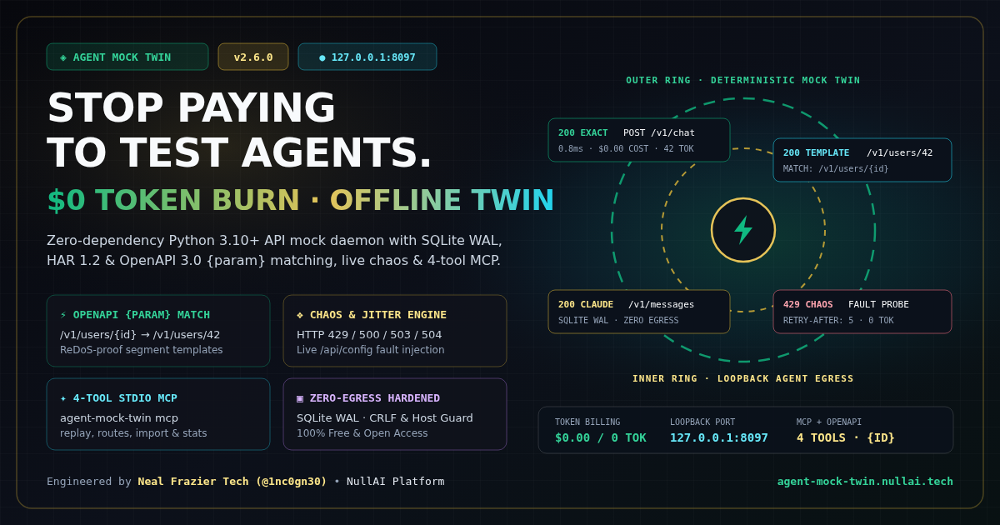

# Agent Mock Twin (`v2.6.0`)



**Agent Mock Twin** (`agent-mock-twin`) is a zero-dependency Python 3.10+ offline API mock server, LLM endpoint simulator (`/v1/chat/completions`, `/v1/messages`, `/v1/embeddings`, `/api/generate`), 4-tool stdio MCP server, and dual-theme telemetry workstation (`127.0.0.1:8097`). It ingests HAR 1.2 archives and OpenAPI 3.0 specifications into SQLite WAL storage (`agent_mock.db`) to replay deterministic responses with configurable latency, jitter, and HTTP `429`/`500`/`503`/`504` chaos fault injection at `$0.00` token cost.

- **Canonical URL**: [https://agent-mock-twin.nullai.tech/](https://agent-mock-twin.nullai.tech/)
- **Zoth Studio v2 Dossier**: [https://zoth.nullai.tech/tools/agent-mock-twin](https://zoth.nullai.tech/tools/agent-mock-twin)
- **Repository**: [https://github.com/1nc0gn30/agent-mock-twin](https://github.com/1nc0gn30/agent-mock-twin)
- **Default Loopback Endpoint**: `http://127.0.0.1:8097`

---

## What It Does

- **HAR 1.2 & OpenAPI 3.0 Ingestion (`HarParser`, `OpenAPIParser`)**: Converts captured network traces or OpenAPI 3.0 specs into indexed SQLite WAL mock routes with RFC 7230 CRLF header validation.
- **4-Tier Deterministic Request Matcher (`RequestMatcher`)**:
  1. **Tier 1 (`exact`)**: Method + Path + SHA-256 request body hash.
  2. **Tier 2 (`fuzzy`)**: Exact Method + Path with JSON key Jaccard & model similarity.
  3. **Tier 2b (`template`)**: Safe literal-segment OpenAPI `{param}` path-template matching (e.g., `/v1/users/{id}` matches `/v1/users/42`, zero arbitrary user regex -> ReDoS-proof).
  4. **Tier 3 (`fallback`)**: Deterministic hash-derived synthetic responses for OpenAI, Anthropic, Ollama, and custom REST paths.
- **Live Latency, Jitter & Chaos Controls**: Configure `base_latency_ms` (`0..10000`), `jitter_ms` (`0..5000`), `chaos_rate` (`0.0..1.0`), and `chaos_type` (`429_rate_limit`, `500_internal_error`, `503_service_unavailable`, `timeout_hang`) via `/api/config` or the web UI.
- **Loopback Security Hardening**: Strict `Origin` regex + port validation (`1..65535`), `Vary: Origin`, DNS rebinding `Host` guard, 2 MiB body cap (`413`), upload + emission CRLF header guards, and `Path.resolve().is_relative_to()` static containment.
- **Zero-Code Process Wrapper (`agent-mock-twin run`)**: Wraps child test commands with `OPENAI_BASE_URL`, `OPENAI_API_BASE`, and `ANTHROPIC_BASE_URL` pointed to `http://127.0.0.1:8097`.

---

## Architecture

```text
HAR 1.2 / OpenAPI 3.0 Spec ──► HarParser / OpenAPIParser ──► MockStorage (SQLite WAL)
                                                                     │
Agent SDK / CLI / MCP ───────► MockServer (127.0.0.1:8097) + RequestMatcher (Exact / Fuzzy / {param} / Fallback)
                                   ├── SSE Stream (/api/stream) + Dual-Theme Web UI (?theme=light|dark&embed=1)
                                   └── Stdio MCP Server (`agent-mock-twin mcp`) + Live TUI (`agent-mock-twin-tui`)
```

---

## Quickstart

```bash
git clone https://github.com/1nc0gn30/agent-mock-twin.git
cd agent-mock-twin

# Start the Offline Mock Twin & Web Dashboard on 127.0.0.1:8097
python3 server.py --host 127.0.0.1 --port 8097
# or via CLI shim:
./bin/agent-mock-twin serve --host 127.0.0.1 --port 8097 --latency 25 --jitter 15
```

Open `http://127.0.0.1:8097` (or `?theme=light` / `?theme=dark`).

---

## ZothOS CLI, Live TUI & MCP Commands

```bash
# Inspect daemon health, version, and cumulative token/USD savings
agent-mock-twin --version
agent-mock-twin --status
agent-mock-twin --json
agent-mock-twin stats --port 8097 --json

# Import a HAR 1.2 archive or OpenAPI 3.0 JSON file into SQLite WAL storage
agent-mock-twin import path/to/agent-traffic.har

# Execute an agent test suite redirected to the local mock twin
agent-mock-twin run --port 8097 -- pytest tests/

# Launch live terminal monitor (queries :8097 with offline SQLite fallback)
agent-mock-twin-tui --once
agent-mock-twin-tui --json

# Launch 4-tool JSON-RPC 2.0 stdio MCP server
agent-mock-twin mcp --port 8097
```

### MCP Tools (`agent-mock-twin mcp`)

| Tool Name | Purpose |
| :--- | :--- |
| `mock_replay_query` | Execute a mock replay query (`method`, `path`, `body`) against `:8097` or local SQLite |
| `mock_list_routes` | List indexed mock routes (optional `provider` filter & `limit`) |
| `mock_import_spec` | Ingest HAR 1.2, OpenAPI 3.0, or route list (`spec` JSON or `file_path`) |
| `mock_get_stats` | Fetch live daemon or SQLite telemetry (`total_hits`, `total_tokens_saved`, `total_usd_saved`, `routes_count`) |

---

## REST API Reference

Control-plane routes enforce loopback `Host` validation and strict local `Origin` CSRF checks (`127.0.0.1`, `localhost`, `[::1]`, `https://zoth.nullai.tech`, or non-browser CLI/SDK clients). Unknown `/api/*` paths return JSON `404` without polluting `mock_hits`.

| Method | Endpoint | Description |
| :--- | :--- | :--- |
| `GET` | `/` | Dual-theme Web Dashboard (`public/index.html`, zero `ACAO`) |
| `GET` | `/health`, `/api/health`, `/status` | Service health, `version: "2.6.0"`, `routes_count`, `total_hits`, `saved_dollars` |
| `GET` | `/api/stats` | Detailed hit counters, saved tokens, USD saved, providers, match-tier breakdown |
| `GET` | `/api/routes` | List active mock routes stored in SQLite WAL |
| `GET` | `/api/hits?limit=50` | Recent intercepted hits (`limit` strictly integer, clamped `1..500`) |
| `GET` | `/api/config` | Current latency, jitter, chaos rate, and chaos type |
| `GET` | `/api/stream` | Real-time Server-Sent Events (SSE) intercept stream |
| `POST` | `/api/upload` | Ingest HAR 1.2, OpenAPI 3.0, or route list (with CRLF header validation, 2 MiB cap) |
| `POST` | `/api/config` | Update `base_latency_ms` (`0..10000`), `jitter_ms` (`0..5000`), `chaos_rate` (`0..1`), `chaos_type` |
| `POST` | `/api/test` | Execute a live playground replay and broadcast hit over SSE |
| `POST` | `/api/clear` | Clear all stored routes and hits |
| `ANY` | `/v1/chat/completions`, `/v1/messages`, `/v1/users/{id}`, `/*` | Deterministic mock replay endpoints |

---

## Testing & Verification

```bash
PYTHONPATH=src python3 -m pytest -q tests
agent-mock-twin --version
agent-mock-twin-tui --once
```

---

## Support & License

100% free, open-access, and unlocked by default under the MIT License (zero paywalls or blur locks).

- ☕ **Buy Us a Coffee (Stripe)**: [https://buy.stripe.com/3cIfZg27PdKo2D64Ocfw40X](https://buy.stripe.com/3cIfZg27PdKo2D64Ocfw40X)
- ◎ **Solana Tip Address**: `GG2eQbVh8ut1BK6j1A2tz7pSySdLpD38BgyEhGcxdXoK` (`solana:GG2eQbVh8ut1BK6j1A2tz7pSySdLpD38BgyEhGcxdXoK`)
- Engineered by **Neal Frazier Tech** (`@1nc0gn30`) • **NullAI Platform** ([https://nullai.tech](https://nullai.tech))
