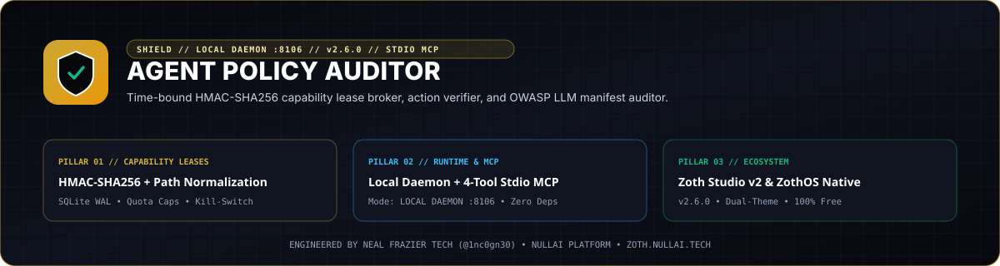

# Agent Policy Auditor & Capability Leaser (`v2.6.0`)



**Agent Policy Auditor** (`agent-policy-auditor`) is a zero-dependency Python 3.10+ local daemon (`127.0.0.1:8106`), time-bound HMAC-SHA256 capability lease broker, live action verifier, static manifest security auditor, live terminal monitor (`agent-policy-auditor-tui`), and 4-tool JSON-RPC 2.0 stdio MCP server for AI agents.

- **Zoth Studio v2 Dossier**: [https://zoth.nullai.tech/tools/agent-policy-auditor](https://zoth.nullai.tech/tools/agent-policy-auditor)
- **Repository**: [https://github.com/1nc0gn30/agent-policy-auditor](https://github.com/1nc0gn30/agent-policy-auditor)
- **Default Loopback Endpoint**: `http://127.0.0.1:8106`

---

## What It Does

- **Cryptographic Capability Broker (`PolicyBroker`)**: Issues HMAC-SHA256 signed, time-bound (`1..86400s`) and budget-bounded (`$0..$100,000`) capability leases across 5 strict primitives (`FS_READ`, `FS_WRITE`, `NET_EGRESS`, `SHELL_EXEC`, `TOKEN_BUDGET`).
- **Path-Traversal & Quota Enforcement**: Normalizes filesystem targets via `posixpath.normpath`, rejects `..` traversal segments and null bytes, enforces segment-aware glob matching (`*` never crosses `/`, `**` matches subdirectories), rejects negative/NaN/infinite costs, and verifies HMAC integrity across `lease_id`, `agent_id`, `capability`, `target`, `granted_at`, `expires_at`, and `max_budget_usd`.
- **SQLite WAL Persistence & Persistent Audit Trail**: Stores leases, violation metrics, and `audit_events` in SQLite with `PRAGMA journal_mode=WAL`, `PRAGMA busy_timeout=5000`, `PRAGMA foreign_keys=ON`, and `0600` file permissions on both `policy_leases.db` and CSPRNG `policy_secret.key`.
- **Static Manifest & Prompt Auditor (`ManifestAuditor`)**: Scans JSON tool schemas, MCP manifests, and system prompts for hardcoded credentials (`SEC-001`), unsandboxed shell execution (`EXEC-002`), unconstrained file writes (`FS-003`), destructive/privileged commands (`DEST-004`), unfiltered network egress (`NET-005`), wildcard FS/network scope grants (`SCOPE-006`), and prompt-injection / guardrail-evasion directives (`INJ-007`).
- **Global & Per-Agent Emergency Kill-Switch**: Revokes individual leases, all leases for a specific agent, or every active lease across all agents (`all_agents: true`), with asynchronous non-blocking event forwarding to Agent Flight Recorder (`127.0.0.1:8104/api/ingest`).
- **Zero-Egress Dual-Theme Web Cockpit**: Local Editorial Ivory Light Mode and Obsidian Gold Dark Mode with zero external font requests, zero `innerHTML` DOM XSS, live Action Verifier panel, persistent Audit Event log, real Attestation JSON / SIEM CEF export, and `?embed=1&theme=light|dark` Studio framing.

---

## How It Works

```text
Agent Runtime / MCP Host / Browser Cockpit
   │
   ├──► PolicyBroker (SQLite WAL 0600 + CSPRNG HMAC-SHA256 Key)
   │       ├── grant_lease()        — strict allowlist, TTL/budget bounds, HMAC sign
   │       ├── verify_action()      — signature check, path normalization, quota debit
   │       ├── revoke_lease()       — immediate single-lease revocation
   │       ├── revoke_all_*()       — per-agent or global emergency kill-switch
   │       └── audit_events table   — persistent forensic log
   │
   ├──► ManifestAuditor (OWASP LLM Top 10 & NIST AI RMF static rule engine)
   │       └── SEC-001, EXEC-002, FS-003, DEST-004, NET-005, SCOPE-006, INJ-007
   │
   ├──► ThreadingHTTPServer (127.0.0.1:8106)
   │       └── Strict Host & Origin/CORS guard, 1 MiB body cap, async Flight Recorder
   │
   └──► Stdio JSON-RPC 2.0 MCP Server (`agent-policy-auditor mcp`)
           └── policy_lease_grant | policy_lease_verify | policy_lease_revoke | policy_audit_manifest
```

---

## Quickstart

```bash
git clone https://github.com/1nc0gn30/agent-policy-auditor.git
cd agent-policy-auditor

# Start the REST API & Web Cockpit on 127.0.0.1:8106
python3 server.py --port 8106
# or:
PYTHONPATH=src python3 -m agent_policy_auditor.cli serve --host 127.0.0.1 --port 8106
```

Open `http://127.0.0.1:8106` in your browser.

---

## ZothOS CLI, Live TUI & Stdio MCP Commands

```bash
# Check live daemon (:8106) or offline SQLite broker status
agent-policy-auditor --status
agent-policy-auditor --json
agent-policy status --port 8106 --json

# Grant a 300-second filesystem write lease with a $1.50 budget ceiling
agent-policy lease grant --agent researcher_01 --cap FS_WRITE --target "/tmp/workspace/*" --duration 300 --budget 1.50 --json

# Verify an action against an active lease (exits 0 if authorized, 1 if denied)
agent-policy lease verify --lease <lease_id> --cap FS_WRITE --target "/tmp/workspace/notes.md" --cost 0.05 --json

# Revoke a single lease or trigger emergency kill-switch
agent-policy lease revoke --lease <lease_id>
agent-policy lease revoke-all --all

# Audit a JSON tool manifest or system prompt
agent-policy audit --file path/to/manifest.json --json

# Launch the real-time terminal monitor (live :8106 polling + SQLite fallback)
agent-policy-auditor-tui --status
agent-policy-auditor-tui --json

# Start the zero-dependency JSON-RPC 2.0 stdio MCP server
agent-policy-auditor mcp
```

### MCP Tools (`agent-policy-auditor mcp`)

| Tool Name | Purpose |
| :--- | :--- |
| `policy_lease_grant` | Issue a time-bound, HMAC-SHA256 signed capability lease |
| `policy_lease_verify` | Verify an agent action against signature, scope, TTL, and USD budget |
| `policy_lease_revoke` | Revoke a specific `lease_id`, one `agent_id`, or `all_agents: true` |
| `policy_audit_manifest` | Statically audit a tool schema, MCP manifest, or prompt |

---

## REST API Reference (`127.0.0.1:8106`)

All routes enforce a strict loopback `Host` header allowlist against DNS rebinding and strict `Origin` validation with `Vary: Origin` (rejecting untrusted origins with `403 JSON`). POST payloads are capped at `1 MiB` (`413 JSON`) and strictly validated (`400 JSON` on malformed or non-object JSON).

| Method | Endpoint | Description |
| :--- | :--- | :--- |
| `GET` | `/` | Dual-theme Web Policy Cockpit (`public/index.html`, supports `?embed=1&theme=light\|dark`) |
| `GET` | `/health`, `/api/health` | Service health check (`status: "ok"`, `version: "2.6.0"`, `port`) |
| `GET` | `/api/status` | Live broker status, uptime, key fingerprint, and aggregate stats |
| `GET` | `/api/stats` | Broker counters (`active_leases_count`, `total_leases_granted`, `violations_blocked`, budget totals) |
| `GET` | `/api/leases` | Active capability leases with remaining TTL |
| `GET` | `/api/audit/events?limit=50` | Persistent SQLite audit events (`LEASE_GRANTED`, `ACTION_ALLOWED`, `ACTION_DENIED`, `LEASE_REVOKED`, `KILLSWITCH_*`, `MANIFEST_AUDIT`) |
| `POST` | `/api/leases/grant` | Grant lease (`{"agent_id", "capability", "target", "duration_sec", "budget_usd"}`) |
| `POST` | `/api/leases/verify` | Verify action (`{"lease_id", "capability", "target", "cost_usd"}`) |
| `POST` | `/api/leases/revoke` | Revoke single lease (`{"lease_id": "..."}`) |
| `POST` | `/api/leases/revoke_all` | Revoke agent leases (`{"agent_id": "..."}`) or global kill-switch (`{"all_agents": true}`) |
| `POST` | `/api/audit` | Audit a manifest/schema (`{"name": "tool.json", "manifest": {...}}`) |

---

## Testing & Verification

```bash
PYTHONPATH=src python3 -m pytest -v tests
agent-policy-auditor --version
agent-policy-auditor --json
agent-policy-auditor-tui --json
```

---

## Support & License

100% free, open-access, and unlocked by default under the MIT License (zero paywalls or blur locks).

- ☕ **Buy Us a Coffee (Stripe)**: [https://buy.stripe.com/3cIfZg27PdKo2D64Ocfw40X](https://buy.stripe.com/3cIfZg27PdKo2D64Ocfw40X)
- ◎ **Solana Tip Address**: `GG2eQbVh8ut1BK6j1A2tz7pSySdLpD38BgyEhGcxdXoK` (`solana:GG2eQbVh8ut1BK6j1A2tz7pSySdLpD38BgyEhGcxdXoK`)
- Engineered by **Neal Frazier Tech** (`@1nc0gn30`) • **NullAI Platform** ([https://nullai.tech](https://nullai.tech))
