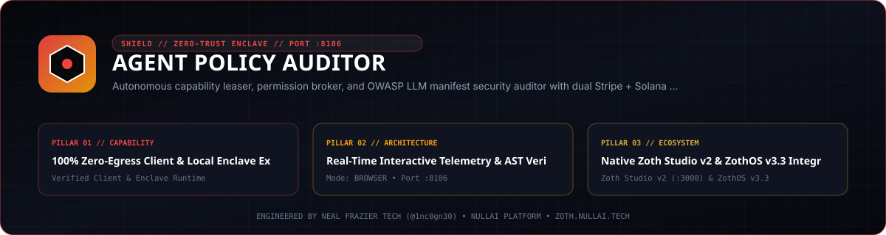

<div align="center">
  
</div>

<br />

# Agent Policy Auditor

[](pyproject.toml)
[](https://www.python.org/)
[](LICENSE)
[](https://nullai.tech)

**Autonomous Capability Leaser, Permission Broker & Manifest Security Auditor for AI Agents.**

Enforces time-bound, cryptographically signed capability leases (HMAC-SHA256) across filesystem scopes, network egress, and token budgets. Audits agent tool schemas and system prompts against OWASP Top 10 for LLMs and NIST AI RMF.

---

## ⚡ Key Architectural Capabilities

- **Zero External Pip Dependencies**: 100% Python 3.10+ standard library (`http.server`, `socket`, `sqlite3`, `hmac`, `hashlib`, `json`, `urllib.parse`, `threading`, `dataclasses`, `time`).
- **Cryptographic Capability Leasing (Port 8106)**:
  - Issues time-bound HMAC-SHA256 tokens granting granular agent scopes:
    - `FS_READ` / `FS_WRITE`: Wildcard glob path bounds (`~/workspace/**`).
    - `NET_EGRESS`: Domain allowlisting (`*.nullai.tech`).
    - `SHELL_EXEC`: Permitted command subsets.
    - `TOKEN_BUDGET`: Cumulative USD session spend caps.
  - Automatic TTL expiration and immediate emergency kill-switches (`revoke_all`).
- **Static Manifest & Prompt Security Auditor**:
  - Scores tool schemas and prompts from 0 to 100 with actionable remediation:
    - Unsandboxed shell execution detection.
    - Arbitrary unconstrained filesystem writes.
    - Hardcoded credentials and API tokens.
    - Destructive irreversible commands (`rm -rf`).
    - Unfiltered network egress.
- **Mesh Telemetry Pipeline**:
  - Forwards violations and lease grants to **Agent Flight Recorder (:8104)** and **Neuro-Memory Daemon (:8094)**.
- **Dual Monetization Rails**:
  - $19 Founding Member lifetime access via Stripe and DePay Solana Web3 payment rails.

---

## 🚀 Quickstart

### 1. Launch the Policy Cockpit & Broker (Port 8106)
```bash
./bin/agent-policy serve --port 8106
```
Open [http://localhost:8106](http://localhost:8106) to manage active capability leases.

### 2. Issue a Capability Lease via CLI
```bash
./bin/agent-policy lease grant --agent pantheon_01 --cap FS_WRITE --target "/tmp/*" --duration 300
```

### 3. Verify an Agent Action Against a Lease
```bash
./bin/agent-policy lease verify --lease lease_xxxxxx --cap FS_WRITE --target "/tmp/output.json"
```

### 4. Audit an Agent Tool Schema or Manifest
```bash
./bin/agent-policy audit --file agent_manifest.json
```

---

## 🧪 Testing

Run the zero-dependency test suite:
```bash
pytest -v
```

---

## 💼 Sovereign SaaS Licensing

- **Founding Member License**: $19 lifetime access (regular $79).
- **Payment Rails**:
  - Stripe: [Instant Stripe Checkout](https://github.com/1nc0gn30/zoth-os)
  - Solana Tip: Receiver `GG2eQbVh8ut1BK6j1A2tz7pSySdLpD38BgyEhGcxdXoK`
- **Instant Activation**: Pass `?licensed=true` in the browser or enter your receipt key in the Pro modal.

---

*Engineered by Neal Frazier Tech ([@1nc0gn30](https://github.com/1nc0gn30)) • NullAI Sovereign Platform*

## Network exposure

The server binds to `127.0.0.1` by default. To reach it from other devices,
opt in explicitly with `--host 0.0.0.0` (or set `ZOTH_BIND_HOST=0.0.0.0`; an IP
in `HOST` is also honoured, a plain hostname is ignored) and only on a trusted
network.

Browser requests are only accepted from `localhost` / `127.0.0.1` pages:
cross-site POSTs get `403` and CORS never answers `*`, so a website you visit
can't drive this local server. CLI and agent clients are unaffected.
