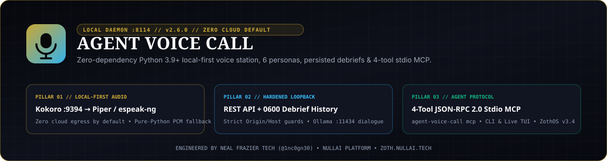

# Agent Voice Call (`v2.6.0`)



**Agent Voice Call** (`agent-voice-call`) is a zero-dependency Python 3.9+ local-first voice calling workstation, REST daemon (`127.0.0.1:8114`), live terminal monitor, and JSON-RPC 2.0 stdio MCP server. It pairs a dual-theme browser voice cockpit (Web Speech API / text input + Web Audio API playback) with a strict local-first TTS pipeline, local Ollama (`127.0.0.1:11434`) dialogue routing, and `0600`-permissioned local debrief persistence.

- **Zoth Studio v2 Route**: [https://zoth.nullai.tech/tools/agent-voice-call](https://zoth.nullai.tech/tools/agent-voice-call)
- **Repository**: [https://github.com/1nc0gn30/agent-voice-call](https://github.com/1nc0gn30/agent-voice-call)
- **Default Loopback Endpoint**: `http://127.0.0.1:8114`

---

## What It Does

- **Strict Local-First Zero-Egress TTS Pipeline (`tts_bridge.py`)**:
  1. **Tier 1 — Local Kokoro (`127.0.0.1:9394/speak`)**: Local neural TTS daemon when online.
  2. **Tier 2 — Local Offline `piper` / `espeak-ng`**: Local CLI synthesis with `--` argument isolation so leading-dash text never breaks parsing.
  3. **Tier 3 — Pure-Python PCM WAV Fallback**: Synthesizes a valid 24 kHz 16-bit mono RIFF/WAVE tone if no local TTS binary is installed.
  4. **Opt-In Cloud (`edge-tts`)**: Disabled by default. Only enabled if you explicitly set `ZOTH_ALLOW_CLOUD_TTS=1`.
- **Six Voice Personas**: `azoth`, `ghostbyte`, `athena`, `mercury`, `kitsune`, and `chronos`.
- **Dual-Theme Browser Cockpit (`/`, `/call`)**: Editorial Ivory Light Mode and Obsidian Dark Mode (`?theme=light|dark`, `?embed=1`, header toggle), zero external font CDN requests, XSS-safe DOM rendering, lazy Web Speech API mic initialization, Web Audio API WAV playback, and live persisted debrief history.
- **Hardened Loopback Security (`server.py`)**: Strict `Origin` and `Host` loopback allowlists (blocking port-suffix CSRF and DNS rebinding), `Vary: Origin`, `1 MiB` body cap (`413`), strict JSON object validation (`400`), `HEAD` 0-byte body compliance, `Path.resolve().is_relative_to()` static file containment, bounded active sessions (`MAX_ACTIVE_SESSIONS = 128` + idle TTL sweep), and read-only `GET /api/call/session`.
- **Local Transcript Persistence (`call_engine.py`)**: Completed call debriefs are appended with `0600` file permissions to `~/.local/share/zoth/voice_calls/debriefs.jsonl` (overridable via `VOICE_CALL_DATA_DIR`).
- **4-Tool JSON-RPC 2.0 Stdio MCP Server (`mcp_server.py`)**: `agent_voice_call_status`, `agent_voice_call_voices`, `agent_voice_call_speak`, and `agent_voice_call_debriefs`.

---

## Architecture

```text
Browser Cockpit (127.0.0.1:8114)
   │  Web Speech API / Text Input + Web Audio API WAV Playback
   ▼
VoiceCallServer (Python 3.9+ stdlib, 127.0.0.1:8114)
   ├── Strict Loopback Host + Origin Guards + 1 MiB Body Cap
   ├── CallManager (bounded sessions, local Ollama :11434 dialogue, 0600 JSONL debriefs)
   ├── tts_bridge (Kokoro :9394 -> Piper / espeak-ng -> Pure-Python PCM WAV)
   └── Optional local hooks: Signal UNIX socket, Neuro-Memory (:8094), Flight Recorder (:8104)

Stdio MCP Server (`agent-voice-call mcp`)
   └── JSON-RPC 2.0 over stdin/stdout (4 tools)
```

### Environment Configuration

| Variable | Default | Purpose |
| :--- | :--- | :--- |
| `ZOTH_BIND_HOST` | `127.0.0.1` | Default bind IP when `--host` is omitted |
| `KOKORO_PORT` | `9394` | Local Kokoro TTS daemon port |
| `PIPER_MODEL` | *(empty)* | Optional path to a local `.onnx` Piper voice model |
| `ZOTH_ALLOW_CLOUD_TTS` | `0` | Set to `1` only to explicitly opt in to Microsoft `edge-tts` |
| `VOICE_CALL_DATA_DIR` | `~/.local/share/zoth/voice_calls` | Directory for `0600` persisted debrief transcripts |
| `SIGNAL_ACCOUNT` | *(empty)* | Optional Signal recipient for `/tmp/signal-cli.sock` debrief delivery |

---

## Quickstart

```bash
git clone https://github.com/1nc0gn30/agent-voice-call.git
cd agent-voice-call

# Start the local loopback workstation on 127.0.0.1:8114
python3 server.py --port 8114
# (or: ./bin/agent-voice-call serve --port 8114)
```

Open `http://127.0.0.1:8114/` in your browser.

---

## ZothOS CLI, Live TUI & MCP Commands

```bash
# Version & daemon health
agent-voice-call --version
agent-voice-call status --port 8114 --json

# Start the loopback daemon
agent-voice-call serve --host 127.0.0.1 --port 8114

# Create a scoped call session URL
agent-voice-call call --channel web --voice azoth --port 8114

# Inspect persisted local call debriefs
agent-voice-call history --limit 10 --json

# Launch desktop browser workstation (used by ZothOS .desktop entry)
agent-voice-call desktop --port 8114

# Live terminal monitor polling real :8114 health & debriefs
agent-voice-call-tui --status
agent-voice-call-tui --json
agent-voice-call-tui --watch

# Run JSON-RPC 2.0 stdio MCP server
agent-voice-call mcp
```

### MCP Tools (`agent-voice-call mcp`)

| Tool | Description |
| :--- | :--- |
| `agent_voice_call_status` | Daemon health (`:8114`), active sessions, and local-first TTS engine status |
| `agent_voice_call_voices` | List all 6 personas (`azoth`, `ghostbyte`, `athena`, `mercury`, `kitsune`, `chronos`) |
| `agent_voice_call_speak` | Local dialogue reply + local-first WAV synthesis (`text`, `voice`, `persist`) |
| `agent_voice_call_debriefs` | Read persisted call debriefs from `~/.local/share/zoth/voice_calls/debriefs.jsonl` |

---

## REST API Reference

All `POST` and `/api/*` endpoints enforce loopback `Host` and `Origin` validation.

| Method | Endpoint | Description |
| :--- | :--- | :--- |
| `GET`, `HEAD` | `/`, `/call` | Dual-theme browser voice cockpit (`?theme=light\|dark&embed=1`) |
| `GET`, `HEAD` | `/health`, `/status`, `/api/stats` | Health, version `2.6.0`, `tts_engine`, `local_first_tts`, `active_sessions`, `debrief_count` |
| `GET` | `/api/voices` | All 6 voice personas and active TTS capabilities |
| `GET` | `/api/call/session?token=<tok>` | Read-only token validation (`401`/`404` if missing/invalid — never mints sessions) |
| `GET` | `/api/call/history?limit=20` | Recent locally persisted call debriefs |
| `GET` | `/api/call/welcome?voice=azoth` | Synthesize local base64 PCM WAV greeting |
| `POST` | `/api/call/create` | Mint scoped session token (`{"channel": "web", "voice": "azoth"}`) |
| `POST` | `/api/call/speak` | Process utterance (`{"token": "...", "text": "...", "voice": "azoth"}`) — requires valid active token (`401` if invalid/ended) |
| `POST` | `/api/call/end` | End session (`{"token": "..."}`), persist `0600` debrief locally, and return summary |

---

## Testing & Verification

```bash
PYTHONPATH=src python3 -m pytest -v tests
./bin/agent-voice-call --version
./bin/agent-voice-call status --json
./bin/agent-voice-call-tui --status
```

---

## Support & License

100% free, open-access, and unlocked by default under the MIT License (zero paywalls, zero cloud egress by default).

- ☕ **Buy Us a Coffee (Stripe)**: [https://buy.stripe.com/3cIfZg27PdKo2D64Ocfw40X](https://buy.stripe.com/3cIfZg27PdKo2D64Ocfw40X)
- ◎ **Solana Tip Address**: `GG2eQbVh8ut1BK6j1A2tz7pSySdLpD38BgyEhGcxdXoK` (`solana:GG2eQbVh8ut1BK6j1A2tz7pSySdLpD38BgyEhGcxdXoK`)
- Engineered by **Neal Frazier Tech** (`@1nc0gn30`) • **NullAI Platform** ([https://nullai.tech](https://nullai.tech))
