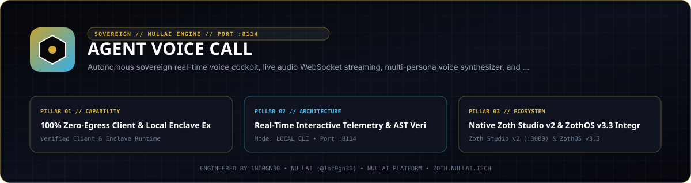
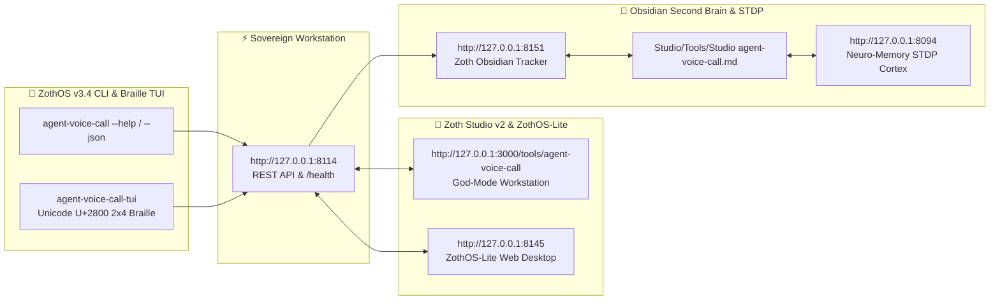

<div align="center">
  
</div>

<br />

<div align="center">
  <a href="https://zoth.nullai.tech/tools/agent-voice-call"></a>
  <a href="https://zothos.nullai.tech"></a>
  <a href="https://nullai.tech"></a>
</div>

# ⚡ Agent Voice Call

> **Autonomous sovereign real-time voice cockpit, live audio WebSocket streaming, multi-persona voice synthesizer, and zero-telemetry call protocol.**

---

## 🏛️ Architectural Overview

**Agent Voice Call** is an official sovereign tool in the **[Zoth Studio v2](https://zoth.nullai.tech)** (72-Tool Matrix) and **[ZothOS Linux 3.3](https://zothos.nullai.tech)** ecosystem, engineered by **1nc0gn30 • NullAI ([@1nc0gn30](https://github.com/1nc0gn30))**.

| Property | Specification |
| :--- | :--- |
| **Tool ID** | `agent-voice-call` |
| **Category** | `Voice & Real-Time` |
| **Loopback Port** | `http://127.0.0.1:8114` |
| **Execution Mode** | `python3 server.py --port 8114` |
| **Zoth Studio Route** | [`https://zoth.nullai.tech/tools/agent-voice-call`](https://zoth.nullai.tech/tools/agent-voice-call) |

---

## 📖 What It Does

- **Real-Time Voice Calling Cockpit**: Low-latency bidirectional voice communication between human users and sovereign AI agents (Azoth, Ghostbyte, Athena, Mercury, Kitsune, Chronos).
- **Kokoro TTS Engine Integration**: Hardware-accelerated local text-to-speech synthesis running on port 9394 with natural speech rhythm and zero cloud telemetry.
- **WebSocket Audio Streaming**: High-fidelity chunked audio streaming with live waveform spectrums and real-time STT transcripts.
- **1-Click Call Link Dispatcher**: Generates instant secure calling links compatible with Signal, SimpleX, or standalone web browsers.
- **100% Free & Open-Access**: Zero paywalls, zero license locks, zero telemetry leaks.

---

## ⚙️ How It Works

1. **Standalone Enclave (`127.0.0.1:8114`)**: Serves an interactive audio cockpit backed by `server.py` with live `/health`, `/api/call/create`, and `/api/call/status` endpoints.
2. **Zoth Studio v2 God-Mode Route**: Deeply integrated into the 72-Tool Sovereign Matrix at `/tools/agent-voice-call`.
3. **ZothOS CLI (`agent-voice-call`)**: Native terminal binary supporting automated call generation, voice audits, and JSON telemetry streaming.

---

## 💻 ZothOS CLI & Server Commands

```bash
# Check status and health
agent-voice-call --status
agent-voice-call status

# Output telemetry in JSON format
agent-voice-call --json

# Generate a 1-click voice call link
agent-voice-call call --channel signal --voice azoth

# Launch the standalone workstation server
python3 server.py --port 8114
```

---

## ☕ Support 1nc0gn30 • NullAI & NullAI

Agent Voice Call is 100% free, open-source, and sovereign software with zero paywalls. If this tool brings you value, consider supporting our ongoing development:

- **☕ Buy Us a Coffee (Stripe)**: [buy.stripe.com/3cIfZg27PdKo2D64Ocfw40X](https://buy.stripe.com/3cIfZg27PdKo2D64Ocfw40X)
- **◎ Solana Tip Address**: `GG2eQbVh8ut1BK6j1A2tz7pSySdLpD38BgyEhGcxdXoK`

---

<div align="center">
  <sub>Engineered by <b>1nc0gn30 • NullAI</b> (<a href="https://github.com/1nc0gn30">@1nc0gn30</a>) &bull; <a href="https://nullai.tech">NullAI Platform</a> &bull; <a href="https://zoth.nullai.tech">Zoth Studio v2</a></sub>
</div>

---

## 🏛️ ZothOS v3.4, Zoth Studio v2 & Obsidian Second Brain Ecosystem



### Cross-Surface Integration Matrix

| Surface | Endpoint / Binary | Capabilities |
| :--- | :--- | :--- |
| **Standalone Workstation** | `http://127.0.0.1:8114` | 100% Free & Open-Access Web Deck, live `/health` & REST telemetry |
| **Zoth Studio v2 Route** | `http://127.0.0.1:3000/tools/agent-voice-call` | Interactive God-Mode component inside Zoth Studio (`https://zoth.nullai.tech`) |
| **ZothOS v3.4 CLI & TUI** | `agent-voice-call` / `agent-voice-call-tui` | Global binary in `/usr/local/bin/` with Unicode `U+2800` Braille TUI & `--json` output |
| **ZothOS-Lite Web Desktop** | `http://127.0.0.1:8145` | Browser-native KDE-style window manager & terminal launcher |
| **Zoth Obsidian Tracker** | `http://127.0.0.1:8151` | Interactive Obsidian Second Brain vault explorer (`~/Documents/Obsidian Vault/Studio/Tools/Studio agent-voice-call.md`) |
| **Neuro-Memory STDP Cortex** | `http://127.0.0.1:8094` | 3-Factor STDP synaptic memory daemon & 21-tool MCP server |

```bash
# Inspect CLI & Unicode U+2800 Braille TUI on ZothOS v3.4
agent-voice-call --help
agent-voice-call-tui --status
agent-voice-call-tui --json

# Verify Second Brain Vault & 12-Step Verification Gallery on :8151
zoth-obsidian-tracker --verify
```

